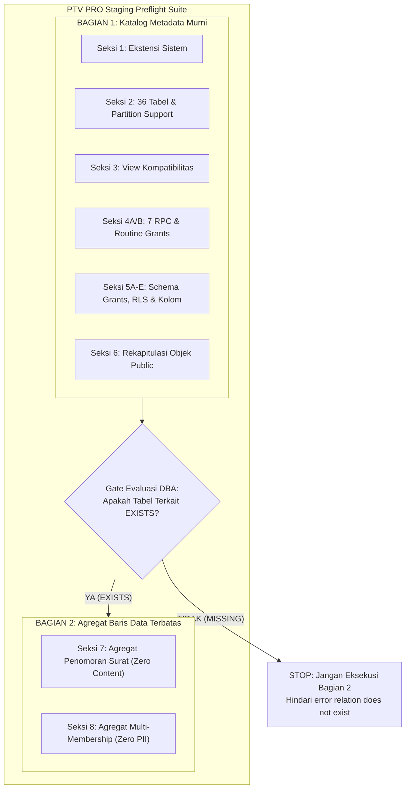

# PTV PRO — SUPABASE STAGING PREFLIGHT REVIEW (STATIC AUDIT REPORT)

**Dokumen:** Tinjauan Statis & Finalisasi Naskah SQL Preflight Supabase Staging  
**Subsystem:** PTV PRO Database & Supabase Security Architecture  
**Target Environment:** Supabase Staging (`swadgljnyelsjstqqxbm`)  
**File Hasil Finalisasi:** [`docs/PTV-PRO-STAGING-PREFLIGHT-FINAL-STATIC.sql`](file:///c:/Users/zidna/ptvpro/docs/PTV-PRO-STAGING-PREFLIGHT-FINAL-STATIC.sql)  
**File Sumber yang Ditinjau:**  
- [`docs/PTV-PRO-STAGING-PARTIAL-STATE-CHECK.sql`](file:///c:/Users/zidna/ptvpro/docs/PTV-PRO-STAGING-PARTIAL-STATE-CHECK.sql)  
- [`docs/PTV-PRO-RPC-IDENTITY-HARDENING-FINAL-SQL-PROPOSAL.md`](file:///c:/Users/zidna/ptvpro/docs/PTV-PRO-RPC-IDENTITY-HARDENING-FINAL-SQL-PROPOSAL.md)  
**Status Evaluasi:** **STATIC REVIEW ONLY — ZERO DATABASE CONNECTION — ZERO SQL EXECUTION — ZERO MUTATION**  
**Tanggal Review:** 09 Oktober 2026  

---

> [!CAUTION]
> ### PERNYATAAN KEPATUHAN MUTLAK (ZERO EXECUTION APPLIED)
> Seluruh analisis dan perbaikan dalam dokumen ini disusun secara murni melalui **penelaahan kode statis (*static code analysis*)**.
> 1. **TIDAK ADA** koneksi database yang dibuka ke instance Supabase staging maupun production.
> 2. **TIDAK ADA** query yang dijalankan melalui Supabase SQL Editor, CLI, MCP, psql, SDK, API, maupun script otomasi.
> 3. **TIDAK ADA** migrasi, DDL, DML, fungsi RPC, trigger, policy, role, grant, atau konfigurasi database yang diubah.
> 4. **TIDAK ADA** kode aplikasi, environment variable, secret, atau file konfigurasi produksi yang dimodifikasi.
> 5. Dokumen ini **TIDAK** menyatakan bahwa staging telah aman atau tervalidasi runtime, melainkan menyajikan naskah SQL preflight yang telah dibersihkan secara statis dan siap dievaluasi oleh Database Administrator (DBA) manusia.

---

## 1. Ringkasan Eksekutif Temuan Audit Statis

Berdasarkan audit silang terhadap [`docs/PTV-PRO-STAGING-PARTIAL-STATE-CHECK.sql`](file:///c:/Users/zidna/ptvpro/docs/PTV-PRO-STAGING-PARTIAL-STATE-CHECK.sql) dan naskah proposal [`docs/PTV-PRO-RPC-IDENTITY-HARDENING-FINAL-SQL-PROPOSAL.md`](file:///c:/Users/zidna/ptvpro/docs/PTV-PRO-RPC-IDENTITY-HARDENING-FINAL-SQL-PROPOSAL.md), diidentifikasi **5 kelemahan struktural utama** pada rancangan query inspeksi sebelumnya:

1. **Flaw Penanganan Pseudo-Role `PUBLIC` pada Audit Schema Privilege (PREFLIGHT 5):**  
   Kueri lama menyaring role dengan `FROM pg_roles r WHERE r.rolname IN ('anon', 'authenticated', 'public')`. Di PostgreSQL, `PUBLIC` adalah pseudo-role / implicit group dan **bukan baris fisik di `pg_roles` (`pg_authid`)**. Akibatnya, filter tersebut mengembalikan 0 baris untuk `public`, sehingga hak `CREATE` dan `USAGE` milik `PUBLIC` pada skema `public` luput dari pemeriksaan.
2. **Potensi Kebocoran PII/UUID pada Kueri Deteksi Anomali Multi-Membership (PREFLIGHT 6):**  
   Kueri lama menggunakan `SELECT identity_id, count(*) ... GROUP BY identity_id HAVING count(*) > 1`. Output ini memaparkan identifier kanonikal (`UUID`) milik santri atau kru ke layar inspeksi/log audit. Padahal untuk kebutuhan preflight gate, cukup dibutuhkan angka skalar jumlah identitas yang mengalami anomali.
3. **Ketiadaan Dukungan untuk Partitioned Tables (`relkind = 'p'`):**  
   Kueri katalog sebelumnya menggunakan `FROM pg_tables` atau `c.relkind = 'r'`. Di PostgreSQL 10+, tabel berpartisi memiliki `relkind = 'p'` dan tidak terdaftar di `pg_tables`. Jika ada tabel yang dipartisi di masa depan atau di staging, tabel tersebut akan salah dilaporkan sebagai `MISSING TABLE`.
4. **Risiko Runtime Crash Akibat Ketiadaan Prasyarat Keberadaan Objek:**  
   Kueri PREFLIGHT 4 (format penomoran surat) dan PREFLIGHT 6 (multi-membership) mengeksekusi `SELECT` langsung terhadap tabel data fisik (`public.ptv_surat_*` dan `public.organization_membership`). Jika staging berada dalam kondisi *fresh database* atau tabel belum dibuat, kueri tersebut akan langsung melempar error fatal `ERROR: relation "public.ptv_surat_..." does not exist`.
5. **Ketiadaan Pemisahan Formal Antara Kueri Katalog vs Kueri Baris Data:**  
   Tidak ada demarkasi yang tegas antara kueri yang murni membaca katalog sistem (`pg_catalog` / `information_schema`) tanpa menyentuh tabel data, dengan kueri yang melakukan *table scan* terhadap baris data aplikasi fisik.

---

## 2. Matriks Komparasi Kueri: Masalah, Perbaikan, dan Alasan Perubahan

Berikut adalah rincian query yang diperbaiki dalam [`docs/PTV-PRO-STAGING-PREFLIGHT-FINAL-STATIC.sql`](file:///c:/Users/zidna/ptvpro/docs/PTV-PRO-STAGING-PREFLIGHT-FINAL-STATIC.sql):

| ID / Seksi | Bagian & Subjek | Masalah pada Kueri Lama | Bentuk Perbaikan pada Naskah Final | Alasan Perubahan & Mitigasi Risiko |
| :--- | :--- | :--- | :--- | :--- |
| **SEC-02** | Verifikasi 36 Tabel & RLS | Kueri lama hanya membaca `pg_tables` dan `pg_class.relkind = 'r'`. Tidak mendeteksi tabel berpartisi (`relkind = 'p'`) dan tidak menampilkan `relforcerowsecurity`. | Menggunakan `pg_class c` dengan `c.relkind IN ('r', 'p')` di-join ke `pg_namespace`, menampilkan `relation_type`, `rls_enabled`, dan `force_rls_enabled`. | Mencegah *false negative* di mana tabel berpartisi salah dilaporkan `MISSING`. Memberikan visibilitas status FORCE RLS. |
| **SEC-04A** | Audit 7 Fungsi & RPC | Kueri fungsi belum mencantumkan parameter volatilitas rutin (`provolatile`) untuk membedakan fungsi `STABLE` vs `VOLATILE`. | Menambahkan kolom `volatility` (`IMMUTABLE`, `STABLE`, `VOLATILE`) dari `p.provolatile`. Mempertahankan `proconfig` lokal dan overload identity arguments. | Volatilitas penting untuk memverifikasi bahwa resolver kapabilitas/JWT bersifat `STABLE` sementara RPC transaksi mutasi berstatus `VOLATILE`. |
| **SEC-05A** | Hak Skema `public` (PREFLIGHT 5) | Kueri lama: `FROM pg_roles WHERE rolname IN ('anon', 'authenticated', 'public')`. Mengabaikan `PUBLIC` karena tidak ada di `pg_roles`. Crash jika role belum ada. | Menggunakan CTE `(VALUES ('anon'), ('authenticated'), ('service_role'), ('public'))` di-LEFT JOIN ke `pg_roles`. Memanggil `has_schema_privilege` secara aman. | Memastikan hak `USAGE` dan `CREATE` pseudo-role `PUBLIC` benar-benar terinspeksi tanpa error dan tanpa melewatkan celah keamanan skema. |
| **SEC-05B** | Status RLS 15 Tabel (PREFLIGHT 7) | `pg_class` di-filter dengan `relkind = 'r'`, mengabaikan tabel berpartisi. Label lama rawan disalahartikan sebagai *deny-all universal*. | Mengubah join ke `c.relkind IN ('r', 'p')`. Mempertegas label `DEFAULT DENY FOR UNPRIVILEGED (OWNER/BYPASSRLS EXEMPT UNLESS FORCED)`. | Mencegah kesalahan interpretasi semantik keamanan RLS pada role superuser, table owner, dan role berkemampuan BYPASSRLS. |
| **SEC-06** | Rekap Objek Skema `public` | Hitungan tabel pada kueri lama menggunakan `pg_tables` standar yang tidak partition-aware. | Menggunakan subquery terhadap `pg_class c` berfilter `relkind IN ('r', 'p')` dengan literal underscore escaping `ptv\_%`. | Menghasilkan rekapitulasi kuantitatif yang presisi dan konsisten dengan Seksi 2. |
| **SEC-07** | Agregat Penomoran Surat (PREFLIGHT 4) | Kueri lama tidak memiliki prasyarat objek, hanya menghitung `count(*)` dan `MAX()`, tidak menghitung rasio NULL atau anomali format nomor. | Menambahkan kolom `jumlah_nomor_terisi`, `jumlah_nomor_null`, dan `count_format_non_standar`. Dipisahkan ke **Bagian 2** dengan prasyarat tegas. | Menghindari kegagalan query saat tabel belum ada. Memberikan deteksi anomali format tanpa membaca atau membocorkan isi surat. |
| **SEC-08** | Agregat Multi-Membership (PREFLIGHT 6) | Kueri lama mengeluarkan daftar `identity_id` yang melanggar batasan perlindungan data pribadi / privasi identitas anggota. | Diubah menjadi skalar agregat murni: `total_identities_with_multiple_current_memberships` dan `max_duplicate_count_per_identity`. Dipisahkan ke **Bagian 2**. | Melindungi identitas pribadi kru/santri dari kebocoran log. Memberikan indikator biner/skalar bersih untuk gerbang preflight. |

---

## 3. Klasifikasi Kueri: Metadata Katalog vs Agregat Baris Data

Naskah final [`docs/PTV-PRO-STAGING-PREFLIGHT-FINAL-STATIC.sql`](file:///c:/Users/zidna/ptvpro/docs/PTV-PRO-STAGING-PREFLIGHT-FINAL-STATIC.sql) memisahkan kueri ke dalam dua bagian besar dengan karakteristik yang sangat berbeda:

### Matriks Perbedaan Karakteristik

| Parameter Evaluasi | Bagian 1: Katalog Metadata Murni | Bagian 2: Agregat Baris Data Terbatas |
| :--- | :--- | :--- |
| **Sumber Data Utama** | `pg_catalog` (`pg_class`, `pg_proc`, `pg_roles`, `pg_policies`) dan `information_schema`. | Tabel fisik data aplikasi (`ptv_surat_*`, `organization_membership`). |
| **Akses Baris Data Aplikasi** | **Nol Mutlak (Zero Data Access)**. Tidak membaca baris tabel aplikasi. | **Membaca Baris Data Fisik (Table Rows Read)** melalui pemindaian agregat. |
| **Risiko Eksekusi (Fail Risk)** | **Sangat Rendah (Fail-Safe)**. Aman dijalankan kapan saja karena katalog sistem selalu ada. | **Tinggi jika Objek Belum Ada**. Akan crash dengan error `relation does not exist` jika tabel belum dibuat. |
| **Implikasi Privasi / PII** | **Nol**. Hanya metadata nama objek, tipe data, dan konfigurasi skema. | **Dilindungi Secara Ketat**. Menggunakan fungsi agregat murni (`count`, `max`) tanpa kolom nama/UUID/isi. |
| **Ketergantungan Eksekusi** | Mandiri (*Independent*). Dapat dieksekusi pertama kali sebagai langkah diagnostik awal. | Bersyarat (*Conditional*). **Wajib** menunggu konfirmasi status `EXISTS` dari Seksi 2 Bagian 1. |

---

## 4. Daftar Objek Database yang Berstatus `NEEDS VERIFICATION`

Sesuai dengan batasan mutlak **Zero Execution**, tidak ada asumsi yang boleh dibuat mengenai kondisi aktual database Supabase Staging (`swadgljnyelsjstqqxbm`). Seluruh objek di bawah ini ditandai sebagai **`NEEDS VERIFICATION`** dan memerlukan eksekusi manual oleh DBA manusia:

| Kategori Objek | Nama Objek / Entitas | Status Verifikasi Statis | Aspek Kritis yang Wajib Diverifikasi oleh DBA |
| :--- | :--- | :--- | :--- |
| **Ekstensi** | `uuid-ossp`, `pgcrypto`, `pgjwt` | `NEEDS VERIFICATION` | Apakah telah terinstal pada skema `extensions` atau `public`, dan apakah versi yang terpasang kompatibel. |
| **Tabel Kanonikal (36 Tabel)** | 36 tabel kanonikal PTV PRO (auth, organisasi, operasional, persuratan, inventaris, keuangan) | `NEEDS VERIFICATION` | Apakah tabel sudah terbuat di staging, apakah ada yang berjenis partitioned table (`relkind = 'p'`), dan apakah RLS aktif. |
| **View Kompatibilitas** | `public.ptv_kru_legacy_compat` | `NEEDS VERIFICATION` | Apakah view masih eksis atau sudah dibersihkan dari DDL sebelumnya. |
| **Fungsi Resolver Auth** | `public.jwt_custom_claims()` | `NEEDS VERIFICATION` | Verifikasi signature, apakah masih ada fungsi peninggalan di skema `auth`, hak `EXECUTE` (wajib ditolak dari `PUBLIC` dan `anon`), dan konfigurasi `proconfig`. |
| **Fungsi Otorisasi** | `public.has_capability(TEXT)` | `NEEDS VERIFICATION` | Verifikasi bahwa fungsi berada di skema `public`, berstatus `SECURITY DEFINER`, dan memiliki guard fail-closed internal. |
| **5 RPC Mutasi Transaksional** | `rpc_checkout_loan`, `rpc_return_loan`, `rpc_return_single_unit`, `rpc_get_next_inv_code`, `rpc_submit_official_doc` | `NEEDS VERIFICATION` | Verifikasi apakah terdapat overload lama tanpa `p_actor_id`, owner fungsi (`postgres`), atribut `SECURITY DEFINER`, dan pencabutan hak dari `anon` & `PUBLIC`. |
| **Hak Skema Public** | Privilege `USAGE` & `CREATE` pada skema `public` | `NEEDS VERIFICATION` | Memastikan pseudo-role `PUBLIC` dan role `anon` **TIDAK** memiliki hak `CREATE` pada skema `public` (mitigasi *schema hijacking*). |
| **Kolom Persuratan Baru** | `diajukan_oleh` pada `ptv_surat_tugas`, `ptv_surat_izin`, `ptv_surat_barang` | `NEEDS VERIFICATION` | Memastikan apakah kolom sudah ada atau belum, serta tipe data dan batasan *nullability*-nya. |
| **Kolom Peminjaman** | `nama_acara` pada `ptv_peminjaman` | `NEEDS VERIFICATION` | Memastikan kolom `nama_acara` belum terbuat (karena implementasi DDL Keputusan 2 masih ditangguhkan/deferred). |
| **Kebijakan RLS (pg_policies)** | Kebijakan pada 15 tabel operasional & sensitif | `NEEDS VERIFICATION` | Memverifikasi apakah tabel surat memiliki policy `SELECT` eksisting, guna mematuhi Keputusan 12 (larangan membuat policy spekulatif tanpa bukti). |
| **Data Format Nomor Surat** | Kolom `nomor_surat` pada 3 tabel surat | `NEEDS VERIFICATION` | Memverifikasi apakah format nomor surat historis staging konsisten dengan regex penomoran RPC baru (`-PTV/YYYY/MM/xxx`). |
| **Data Keanggotaan Studio** | Baris `organization_membership` (`organization_id = 'ptv_studio'`) | `NEEDS VERIFICATION` | Memverifikasi apakah terdapat anomali duplikasi baris keanggotaan aktif (`is_current = TRUE`) sebelum mengaktifkan guard fail-closed. |

---

## 5. Runbook Urutan Pemeriksaan Manual bagi DBA Manusia

Jika di kemudian hari Database Administrator (DBA) berwenang memutuskan untuk menjalankan preflight check secara langsung di Supabase SQL Editor, berikut adalah prosedur operasional standar (SOP) yang direkomendasikan:

### Tahap 1: Persiapan Koneksi & Hak Akses
1. Buka dashboard Supabase Staging (`swadgljnyelsjstqqxbm`).
2. Masuk ke **SQL Editor**.
3. Pastikan eksekusi dilakukan menggunakan role administratif (`postgres` / superuser) agar tidak terkena pembatasan visibilitas baris pada `information_schema.routine_privileges` dan `table_privileges`.

### Tahap 2: Eksekusi Bagian 1 (Katalog Metadata Murni)
1. Salin seluruh isi **BAGIAN 1** dari [`docs/PTV-PRO-STAGING-PREFLIGHT-FINAL-STATIC.sql`](file:///c:/Users/zidna/ptvpro/docs/PTV-PRO-STAGING-PREFLIGHT-FINAL-STATIC.sql) (Seksi 1 sampai dengan Seksi 6).
2. Jalankan kueri-kueri tersebut secara berurutan atau blok per blok.
3. **Evaluasi Gate Hasil Bagian 1:**
   - **Tabel:** Periksa hasil Seksi 2. Catat tabel mana yang berstatus `EXISTS` dan mana yang `MISSING`.
   - **Fungsi & Overload:** Periksa hasil Seksi 4A. Jika ditemukan fungsi target dengan signature lama (misalnya `rpc_checkout_loan` dengan 7 parameter), tandai bahwa DDL `DROP FUNCTION IF EXISTS ...` pada proposal wajib dieksekusi saat migrasi.
   - **Fungsi di Skema `auth`:** Periksa apakah `target_ptv_functions_in_auth_schema_count` di Seksi 6 bernilai `> 0`. Jika ya, catat bahwa terdapat fungsi peninggalan di skema `auth` yang perlu dibersihkan.
   - **Hak Skema `public`:** Periksa hasil Seksi 5A. Pastikan `has_create_on_public` bernilai `FALSE` untuk role `anon`, `authenticated`, dan pseudo-role `public`.

### Tahap 3: Gate Keputusan Eksekusi Bagian 2
- **Kondisi A (Tabel Surat & Membership Terbukti `EXISTS`):**  
  Lanjutkan ke Tahap 4 untuk mengeksekusi Bagian 2.
- **Kondisi B (Tabel Belum Terbuat / `MISSING`):**  
  **STOP EKSEKUSI.** Jangan menjalankan Bagian 2. Database staging berada pada kondisi pra-skema awal. Lewati ke tahap penyusunan baseline migration.

### Tahap 4: Eksekusi Bagian 2 (Agregat Baris Data Terbatas)
1. Jalankan Seksi 7 (Agregat Penomoran Surat):
   - Amati nilai `count_format_non_standar`.
   - Jika terdapat nomor surat historis dengan format non-standar, formulasikan strategi parsing penomoran sebelum patch RPC diterapkan.
2. Jalankan Seksi 8 (Agregat Multi-Membership `ptv_studio`):
   - Amati nilai `total_identities_with_multiple_current_memberships`.
   - Jika nilai `> 0`, lakukan investigasi administratif terhadap data anggota yang duplikat sebelum menerapkan guard fail-closed RPC 1, RPC 2, dan RPC 3.

### Tahap 5: Dokumentasi Temuan
Simpan output tabular dari SQL Editor ke dalam laporan preflight resmi untuk dijadikan bukti evaluasi sebelum persetujuan eksekusi patch SQL proposal.

---

## 6. Pernyataan Penutup

Naskah SQL [`docs/PTV-PRO-STAGING-PREFLIGHT-FINAL-STATIC.sql`](file:///c:/Users/zidna/ptvpro/docs/PTV-PRO-STAGING-PREFLIGHT-FINAL-STATIC.sql) dan dokumen review ini telah diselaraskan secara penuh dengan seluruh kontrak arsitektur PTV PRO. 

Tidak ada script otomatis yang dijalankan, tidak ada sambungan database yang dibuat, dan integritas lingkungan staging tetap terjaga 100% pada kondisi aslinya.
