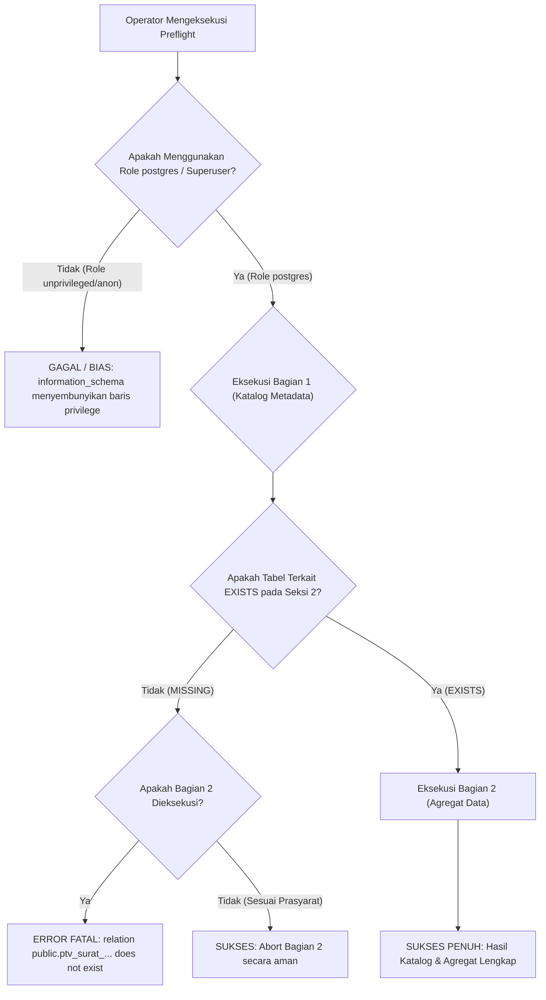

# PTV PRO — SUPABASE STAGING PREFLIGHT VALIDATION REPORT

**Dokumen:** Laporan Validasi Final Preflight Supabase Staging  
**Subsystem:** PTV PRO Database & Supabase Security Architecture  
**Target Environment:** Supabase Staging (`swadgljnyelsjstqqxbm`)  
**Dokumen yang Divalidasi:**  
- [`docs/PTV-PRO-STAGING-PREFLIGHT-FINAL-STATIC.sql`](file:///c:/Users/zidna/ptvpro/docs/PTV-PRO-STAGING-PREFLIGHT-FINAL-STATIC.sql)  
- [`docs/PTV-PRO-STAGING-PREFLIGHT-REVIEW.md`](file:///c:/Users/zidna/ptvpro/docs/PTV-PRO-STAGING-PREFLIGHT-REVIEW.md)  
**Dokumen Acuan & Sumber Pembanding:**  
- [`docs/PTV-PRO-DATABASE-MIGRATION-REVISED.sql`](file:///c:/Users/zidna/ptvpro/docs/PTV-PRO-DATABASE-MIGRATION-REVISED.sql)  
- [`docs/PTV-PRO-RPC-IDENTITY-HARDENING-FINAL-SQL-PROPOSAL.md`](file:///c:/Users/zidna/ptvpro/docs/PTV-PRO-RPC-IDENTITY-HARDENING-FINAL-SQL-PROPOSAL.md)  
- [`docs/PTV-PRO-STAGING-PARTIAL-STATE-CHECK.sql`](file:///c:/Users/zidna/ptvpro/docs/PTV-PRO-STAGING-PARTIAL-STATE-CHECK.sql)  
- [`docs/PTV-PRO-RPC-IDENTITY-HARDENING-DECISIONS.md`](file:///c:/Users/zidna/ptvpro/docs/PTV-PRO-RPC-IDENTITY-HARDENING-DECISIONS.md)  
**Status Evaluasi:** **STATIC VALIDATION ONLY — ZERO DATABASE CONNECTION — ZERO SQL EXECUTION — ZERO MUTATION**  
**Tanggal Validasi:** 09 Oktober 2026  

---

> [!CAUTION]
> ### PERNYATAAN KEPATUHAN MUTLAK (ZERO EXECUTION & ZERO MUTATION)
> 1. Validasi ini dilakukan murni secara statis berbasis berkas lokal di repository `C:\Users\zidna\ptvpro`.
> 2. **TIDAK ADA** koneksi database yang dibuka ke Supabase staging maupun production.
> 3. **TIDAK ADA** query yang dijalankan melalui Supabase SQL Editor, CLI, MCP, psql, SDK, maupun API.
> 4. **TIDAK ADA** modifikasi terhadap skema, data, role, policy, migration, kode aplikasi, maupun konfigurasi environment.
> 5. Laporan ini **TIDAK** menyatakan bahwa staging telah aman atau tervalidasi runtime; status seluruh kondisi live database tetap **`NEEDS VERIFICATION`**.

---

## 1. Ringkasan Pemeriksaan Kelengkapan SQL Final

Evaluasi menyeluruh terhadap [`docs/PTV-PRO-STAGING-PREFLIGHT-FINAL-STATIC.sql`](file:///c:/Users/zidna/ptvpro/docs/PTV-PRO-STAGING-PREFLIGHT-FINAL-STATIC.sql) menunjukkan hasil sebagai berikut:

1. **Struktur & Pemisahan Kueri (Two-Part Suite):**  
   Skrip preflight terbagi secara ketat dan formal menjadi dua bagian:
   - **Bagian 1 (Seksi 1 s.d. 6):** Pemeriksaan Katalog Metadata Murni (*Catalog & Schema Metadata Inspection*). Kueri pada bagian ini **100% bebas akses baris data tabel fisik (*Zero Table Data Access*)**, hanya menargetkan view sistem `pg_catalog` dan `information_schema`.
   - **Bagian 2 (Seksi 7 s.d. 8):** Pemeriksaan Agregat Baris Data Terbatas (*Data Row Aggregate Inspection*). Kueri pada bagian ini membaca data fisik secara agregat skalar dengan prasyarat ketergantungan yang eksplisit dan tegas.
2. **Ketiadaan Perintah Mutasi (Zero Mutation Proof):**  
   Seluruh query berawalan `SELECT` atau `WITH ... SELECT`. Tidak ditemukan satu pun perintah DDL, DML, `INSERT`, `UPDATE`, `DELETE`, `ALTER`, `DROP`, `CREATE`, `GRANT`, `REVOKE`, `TRUNCATE`, maupun blok prosedural `DO` yang dapat mengubah kondisi database.
3. **Perlindungan Privasi Anggota (Zero PII / Zero Content Leakage):**  
   - Kueri anomali keanggotaan studio (Seksi 8) telah diisolasi menjadi subquery agregat skalar murni (`count(*)` dan `MAX()`). Tidak memunculkan kolom `identity_id`, UUID anggota, nama, kontak, atau data pribadi santri/kru.
   - Kueri penomoran surat (Seksi 7) hanya menghitung volume, jumlah nomor terisi/null, nomor tertinggi, dan anomali pola teks format. Tidak memunculkan kolom isi surat, perihal, keperluan, nama pemohon, atau payload JSONB.
4. **Kejelasan Prasyarat Ketergantungan Objek:**  
   Setiap seksi memiliki header komentar yang mendokumentasikan tujuan kueri, prasyarat akses tabel/katalog, dan batasan operasionalnya. Bagian 2 secara tegas memuat peringatan bahwa kueri hanya boleh dijalankan jika tabel terkait dilaporkan `EXISTS` pada Bagian 1.

---

## 2. Matriks Pencocokan & Rekonsiliasi Objek Database

Pencocokan silang antara naskah preflight final ([`docs/PTV-PRO-STAGING-PREFLIGHT-FINAL-STATIC.sql`](file:///c:/Users/zidna/ptvpro/docs/PTV-PRO-STAGING-PREFLIGHT-FINAL-STATIC.sql)) dengan dokumen sumber ([`docs/PTV-PRO-DATABASE-MIGRATION-REVISED.sql`](file:///c:/Users/zidna/ptvpro/docs/PTV-PRO-DATABASE-MIGRATION-REVISED.sql) dan [`docs/PTV-PRO-RPC-IDENTITY-HARDENING-FINAL-SQL-PROPOSAL.md`](file:///c:/Users/zidna/ptvpro/docs/PTV-PRO-RPC-IDENTITY-HARDENING-FINAL-SQL-PROPOSAL.md)) menghasilkan pemetaan detail sebagai berikut:

### A. Tabel Kanonikal & View (36 Tabel + 1 View)

| Nama Objek | Definisi pada Migration Revised | Definisi pada SQL Final Preflight | Status Rekonsiliasi | Analisis & Tindakan yang Disarankan |
| :--- | :--- | :--- | :--- | :--- |
| **36 Tabel Kanonikal** (auth, org, operasional, surat, keuangan, inventaris) | Didefinisikan lengkap pada Baris 37 s.d. 590 di [`docs/PTV-PRO-DATABASE-MIGRATION-REVISED.sql`](file:///c:/Users/zidna/ptvpro/docs/PTV-PRO-DATABASE-MIGRATION-REVISED.sql). | Tercantum lengkap pada array `expected_tables` Seksi 2 dan subquery Seksi 6 di [`docs/PTV-PRO-STAGING-PREFLIGHT-FINAL-STATIC.sql`](file:///c:/Users/zidna/ptvpro/docs/PTV-PRO-STAGING-PREFLIGHT-FINAL-STATIC.sql). | **KONSISTEN (100% MATCH)** | Daftar 36 nama tabel identik. Preflight memeriksa keberadaan, jenis tabel (`r` vs `p`), status RLS, dan status FORCE RLS. |
| **`ptv_kru_legacy_compat`** | `CREATE OR REPLACE VIEW ptv_kru_legacy_compat AS ...` (Baris 596-625 di Migration Revised). | Diperiksa pada Seksi 3 (`information_schema.views`) dan Seksi 6 di Preflight Final. | **KONSISTEN** | Memastikan apakah view backward-compatibility eksis dan dapat di-query. |

### B. Fungsi Keamanan & Resolver Otorisasi (2 Fungsi)

| Nama Objek | Definisi pada File Sumber (Migration / Proposal) | Definisi pada SQL Final Preflight | Status Rekonsiliasi | Analisis & Tindakan yang Disarankan |
| :--- | :--- | :--- | :--- | :--- |
| **`public.jwt_custom_claims()`** | Migration Revised (Baris 633): `public.jwt_custom_claims() RETURNS JSONB STABLE SECURITY DEFINER SET search_path = public, auth`. Hak: `REVOKE FROM PUBLIC, GRANT TO authenticated, service_role`. | Diperiksa pada Seksi 4A & 4B di skema `public` dan `auth`. Memetakan argumen, `prosecdef`, `volatility`, `proconfig`, dan hak eksekusi. | **KONSISTEN** | Preflight memverifikasi bahwa fungsi berada di skema `public` (bukan skema terkelola `auth`) dan hak `EXECUTE` tidak bocor ke `PUBLIC` atau `anon`. |
| **`public.has_capability(TEXT)`** | Migration Revised (Baris 694): `public.has_capability(p_capability TEXT) RETURNS BOOLEAN STABLE SECURITY DEFINER SET search_path = public, auth`. Hak: `REVOKE FROM PUBLIC, GRANT TO authenticated, anon, service_role`. | Diperiksa pada Seksi 4A & 4B di skema `public` dan `auth`. Memetakan identity arguments, `prosecdef`, `volatility`, dan `proconfig`. | **KONSISTEN** | Preflight memvalidasi penempatan di skema `public` serta hak akses untuk evaluasi RLS anonim yang aman (fail-closed internal). |

### C. 5 RPC Transaksional & Overload Signature

| Nama RPC | Definisi pada Migration Revised | Definisi pada Hardening Proposal | Definisi pada SQL Final Preflight | Status Rekonsiliasi | Analisis & Tindakan yang Disarankan |
| :--- | :--- | :--- | :--- | :--- | :--- |
| **`rpc_checkout_loan`** | 8 parameter: `(p_transaction_id TEXT, ..., p_actor_id UUID)` tanpa default (Baris 818). | 8 parameter dengan default: `(..., p_actor_id UUID DEFAULT NULL)`. Proposal juga memuat `DROP FUNCTION IF EXISTS ... (7 params)`. | Seksi 4A mengekstrak seluruh overload via `pg_get_function_identity_arguments(p.oid)` dan Seksi 4B mengekstrak hak akses. | **KONSISTEN (DYNAMIC OVERLOAD DETECTION)** | Preflight tidak mengasumsikan signature tunggal, melainkan mendeteksi apakah overload lama (7 param) dan baru (8 param) eksis bersamaan di database. |
| **`rpc_return_loan`** | 5 parameter: `(p_transaction_id TEXT, ..., p_actor_id UUID)` (Baris 879). | 5 parameter dengan default: `(..., p_actor_id UUID DEFAULT NULL)`. Proposal memuat `DROP FUNCTION IF EXISTS ... (4 params)`. | Seksi 4A & 4B memeriksa seluruh overload dan grant. | **KONSISTEN** | Mendeteksi keberadaan signature warisan 4 parameter tanpa `p_actor_id`. |
| **`rpc_return_single_unit`** | 4 parameter: `(p_loan_row_id UUID, p_unit_id UUID, p_condition_status TEXT, p_actor_id UUID)` (Baris 931). | 4 parameter dengan default: `(..., p_actor_id UUID DEFAULT NULL)`. Proposal memuat `DROP FUNCTION IF EXISTS ... (3 params)`. | Seksi 4A & 4B memeriksa seluruh overload dan grant. | **KONSISTEN** | Mendeteksi keberadaan signature warisan 3 parameter. |
| **`rpc_get_next_inv_code`** | 0 parameter: `()` (Baris 971). | 0 parameter: `()`. Menambahkan guard kapabilitas internal fail-closed (Baris 935 di Proposal). | Seksi 4A & 4B memeriksa signature, `proconfig`, dan grant. | **KONSISTEN** | Memastikan fungsi tidak dapat dieksekusi oleh `anon` atau `PUBLIC`. |
| **`rpc_submit_official_doc`** | 3 parameter: `(p_doc_type TEXT, p_payload JSONB, p_actor_id UUID)` (Baris 994). | 3 parameter dengan default: `(..., p_actor_id UUID DEFAULT NULL)`. Proposal memuat `DROP FUNCTION IF EXISTS ... (2 params)`. | Seksi 4A & 4B memeriksa seluruh overload dan grant. | **KONSISTEN** | Mendeteksi keberadaan signature warisan 2 parameter tanpa `p_actor_id`. |

### D. Kolom Khusus yang Ditambahkan pada Proposal Hardening

| Nama Kolom & Tabel | Definisi pada Migration Revised | Definisi pada Proposal Hardening | Definisi pada SQL Final Preflight | Status Rekonsiliasi | Analisis & Tindakan yang Disarankan |
| :--- | :--- | :--- | :--- | :--- | :--- |
| **`diajukan_oleh`** (`ptv_surat_tugas`, `ptv_surat_izin`, `ptv_surat_barang`) | **Belum Ada** di Migration Revised (hanya ada kolom `disetujui_oleh UUID NULL`, Baris 462, 474, 485). | Diusulkan di Langkah 1.1-1.3 Proposal: `ALTER TABLE ... ADD COLUMN IF NOT EXISTS diajukan_oleh UUID NULL REFERENCES canonical_identity(id)`. | Diperiksa pada Seksi 5E (`information_schema.columns`) bersama `disetujui_oleh`. | **KONSISTEN (PRE-MIGRATION STATE PROBE)** | Preflight bertujuan memastikan apakah kolom `diajukan_oleh` sudah pernah dibuat oleh percobaan DDL sebelumnya atau masih belum ada di staging. |
| **`nama_acara`** (`ptv_peminjaman`) | **Belum Ada** di Migration Revised (hanya ada kolom `keperluan TEXT NOT NULL`, Baris 416). | Keputusan 2 menyetujui penambahan kolom terstruktur (Opsi 2), tetapi DDL ditangguhkan (*deferred*). | Diperiksa pada Seksi 5E (`information_schema.columns`) bersama `keperluan` dan `actor_id`. | **KONSISTEN (DEFERRED DDL SAFEGUARD)** | Preflight memverifikasi bahwa kolom belum dibuat sebelum jadwal resmi DDL migrasi. |

---

## 3. Temuan yang Berpotensi Membuat Kueri Gagal (Potential Failure Modes)

Melalui analisis eksekusi statis, diidentifikasi **5 skenario kegagalan potensial** apabila skrip dijalankan tanpa mematuhi SOP:

1. **Kegagalan Relasi Data pada Bagian 2 (`relation does not exist`):**  
   - **Pemicu:** Jika operator menjalankan seluruh skrip (termasuk Bagian 2) sekaligus dalam kondisi database staging yang masih kosong (*fresh database* tanpa migrasi).
   - **Dampak:** PostgreSQL akan langsung menghentikan eksekusi pada Seksi 7 atau Seksi 8 dengan pesan kesalahan `ERROR: relation "public.ptv_surat_tugas" does not exist`.
   - **Mitigasi pada SQL Final:** Bagian 2 dipisahkan secara fisik dengan header peringatan prasyarat mutlak. Operator wajib mengevaluasi Seksi 2 terlebih dahulu.
2. **Keterbatasan Visibilitas Hak Akses (`CURRENT_USER` Filtering):**  
   - **Pemicu:** Kueri Seksi 4B (`routine_privileges`) dan Seksi 5D (`table_privileges`) dieksekusi menggunakan koneksi dengan role unprivileged (misalnya role anonim atau role aplikasi terbatas).
   - **Dampak:** Berdasarkan standar SQL, view `information_schema` hanya menampilkan baris privilege di mana pengguna aktif bertindak sebagai grantor, grantee, atau owner. Kueri akan mengembalikan hasil kosong atau tidak lengkap, memberikan kesan palsu (*false impression*) bahwa tidak ada grant yang berlaku.
   - **Mitigasi:** Telah ditambahkan catatan peringatan wajib pada header kueri bahwa eksekusi harus menggunakan role administratif (`postgres` / DBA).
3. **Potensi Ambiguitas PostgREST Akibat Overload Ganda (PGRST203):**  
   - **Pemicu:** Jika di staging terdapat signature lama (tanpa parameter `p_actor_id`) DAN signature baru (dengan `p_actor_id UUID DEFAULT NULL`).
   - **Dampak:** Kueri Seksi 4A akan menampilkan 2 baris untuk fungsi yang sama. Di runtime PostgREST, kondisi ini memicu error `PGRST203: Could not choose a best candidate function`.
   - **Mitigasi:** Seksi 4A secara sengaja menggunakan `pg_get_function_identity_arguments` untuk mendeteksi anomali ini sebelum patch migrasi dijalankan, sehingga DBA dapat memastikan eksekusi `DROP FUNCTION IF EXISTS` pada signature lama.
4. **Potensi Role Belum Terdefinisi pada Instance Non-Supabase:**  
   - **Pemicu:** Mengeksekusi pemeriksaan privilege role `anon` atau `authenticated` pada PostgreSQL vanilla di mana role bawaan Supabase belum di-provision.
   - **Dampak:** Pemanggilan langsung `has_schema_privilege('anon', ...)` akan melempar `ERROR: role "anon" does not exist`.
   - **Mitigasi pada SQL Final:** Seksi 5A menggunakan CTE `target_roles` yang di-`LEFT JOIN` ke `pg_roles`, dengan pelindung `CASE WHEN r.rolname IS NOT NULL THEN has_schema_privilege(...) ELSE NULL END`. Jika role belum ada, fungsi mengembalikan `NULL` tanpa melempar error.
5. **Karakter Underscore Wildcard pada Pencarian Nama Objek:**  
   - **Pemicu:** Menggunakan `LIKE 'ptv_%'` tanpa escaping literal underscore.
   - **Dampak:** Karakter `_` di SQL mencocokkan karakter tunggal apa pun (misalnya mencocokkan tabel hipotetis `ptvxacara`), menghasilkan hitungan yang tidak akurat.
   - **Mitigasi pada SQL Final:** Seksi 6 menggunakan literal underscore escaping yang presisi: `c.relname LIKE 'ptv\_%' ESCAPE '\'`.

---

## 4. Temuan Keamanan yang Membutuhkan Konfirmasi Manusia

Berikut adalah temuan keamanan kritis yang diidentifikasi dari penelaahan statis dan wajib dikonfirmasi saat preflight manual dieksekusi:

1. **Hak `CREATE` pada Skema `public` oleh Pseudo-Role `PUBLIC`:**  
   - Secara default pada versi PostgreSQL lama, pseudo-role `PUBLIC` memiliki hak `CREATE` pada skema `public`, memungkinkan pengguna unauthenticated membuat objek tabel/fungsi sembarangan (*schema hijacking*).
   - *Konfirmasi yang Dibutuhkan:* Hasil Seksi 5A wajib mengonfirmasi bahwa `has_create_on_public` bernilai `FALSE` untuk role `anon`, `authenticated`, dan pseudo-role `public`.
2. **Pencabutan Hak Eksekusi Fungsi Sensitif dari `PUBLIC` & `anon`:**  
   - Fungsi `jwt_custom_claims()` dan 5 RPC mutasi memegang hak akses bypass data via `SECURITY DEFINER`. Hak `EXECUTE` pada fungsi-fungsi ini wajib dicabut dari `PUBLIC` dan `anon`.
   - *Konfirmasi yang Dibutuhkan:* Hasil Seksi 4B wajib menunjukkan bahwa grantee yang memiliki hak `EXECUTE` hanyalah `authenticated` dan `service_role` (dengan pengecualian `has_capability` yang membutuhkan hak baca untuk evaluasi RLS).
3. **Penyetelan Parameter Konfigurasi Lokal Fungsi (`proconfig` / `search_path`):**  
   - Fungsi `SECURITY DEFINER` tanpa `SET search_path = ...` rentan terhadap eksploitasi substitusi objek (*search_path hijacking*).
   - *Konfirmasi yang Dibutuhkan:* Hasil Seksi 4A wajib menunjukkan `function_local_config` berisi `search_path=pg_catalog, public, auth` (atau minimal `public, auth`). Jika bernilai `NULL`, fungsi mengeksekusi dengan mewarisi search_path pemanggil yang tidak aman.
4. **Semantik Keamanan Tabel RLS Tanpa Kebijakan (*Default Deny vs Bypass*):**  
   - Tabel dengan `rls_enabled = TRUE` dan `policy_count = 0` mengunci akses baca/tulis bagi role unprivileged (`anon`, `authenticated`).
   - *Konfirmasi yang Dibutuhkan:* Superuser, pemilik tabel, dan role dengan atribut `BYPASSRLS` tetap dapat membaca/menulis ke tabel tersebut KECUALI jika `force_rls_enabled` (`relforcerowsecurity`) bernilai `TRUE`. DBA perlu memastikan apakah tabel audit sensitif (`auth_audit_log`) membutuhkan `FORCE RLS`.
5. **Integritas Format Nomor Surat Eksisting vs Pola Hardening RPC:**  
   - RPC `rpc_submit_official_doc` yang diusulkan menghasilkan nomor surat dengan pola:  
     `ST-PTV/YYYY/MM/xxx`, `SI-PTV/YYYY/MM/xxx`, `SBB-PTV/YYYY/MM/xxx`.
   - *Konfirmasi yang Dibutuhkan:* Jika hasil Seksi 7 menunjukkan `count_format_non_standar > 0`, terdapat arsip surat dengan format di luar konvensi baru. DBA dan tim pengembang wajib menyepakati apakah parser nomor surat perlu mendukung format historis atau membiarkan arsip lama apa adanya.
6. **Integritas Multi-Membership Aktif `ptv_studio`:**  
   - RPC yang diusulkan menerapkan guard deterministik fail-closed: jika satu `identity_id` memiliki lebih dari 1 baris di `organization_membership` dengan `organization_id = 'ptv_studio'` dan `is_current = TRUE`, transaksi checkout dan persuratan akan **langsung melempar eksepsi `23514 (DATA_INTEGRITY_ERROR)`**.
   - *Konfirmasi yang Dibutuhkan:* Jika hasil Seksi 8 menunjukkan `total_identities_with_multiple_current_memberships > 0`, DBA wajib melakukan investigasi data keanggotaan dan membersihkan duplikasi sebelum patch RPC diterapkan.

---

## 5. Daftar Prasyarat Sebelum Preflight Dipertimbangkan untuk Dijalankan

Sebelum Database Administrator (DBA) manusia menjalankan kueri preflight di Supabase Staging (`swadgljnyelsjstqqxbm`), daftar periksa prasyarat (*prerequisite checklist*) berikut wajib dipenuhi:

- [ ] **Persetujuan Manusia Tertulis (Explicit Human Authorization):** Preflight hanya boleh dieksekusi setelah ada arahan tertulis dari penanggung jawab teknis / operator.
- [ ] **Verifikasi Identitas Proyek Staging:** Pastikan project reference di URL dashboard Supabase benar-benar `swadgljnyelsjstqqxbm` (bukan production atau proyek lain).
- [ ] **Koneksi Menggunakan Kredensial Administratif:** SQL Editor harus dibuka menggunakan akun administrator dengan hak peran `postgres` guna memastikan visibilitas penuh terhadap view katalog.
- [ ] **Pemisahan Eksekusi Dua Tahap:**
  - Tahap A: Jalankan hanya **Bagian 1** ([`docs/PTV-PRO-STAGING-PREFLIGHT-FINAL-STATIC.sql`](file:///c:/Users/zidna/ptvpro/docs/PTV-PRO-STAGING-PREFLIGHT-FINAL-STATIC.sql), Seksi 1 s.d. Seksi 6).
  - Tahap B: Evaluasi hasil Seksi 2. Jika dan hanya jika tabel `ptv_surat_tugas`, `ptv_surat_izin`, `ptv_surat_barang`, dan `organization_membership` berstatus `EXISTS`, lanjutkan eksekusi **Bagian 2** (Seksi 7 s.d. Seksi 8).
- [ ] **Prosedur Pencatatan Bukti:** Siapkan sarana penyimpanan tangkapan layar atau ekspor tabular CSV dari hasil kueri untuk dimasukkan ke dalam laporan preflight live.

---

## 6. Rekomendasi Tahap Berikutnya

Berdasarkan hasil validasi statis ini, langkah-langkah yang direkomendasikan adalah:

1. **Pertahankan Kondisi Saat Ini (Zero Execution Stance):**  
   Tidak melakukan perubahan apa pun terhadap skema, aplikasi, atau dokumen proposal yang telah final.
2. **Serahkan Paket Preflight Final kepada Operator DBA Manusia:**  
   Paket preflight yang siap diserahkan terdiri dari:
   - Naskah SQL Preflight: [`docs/PTV-PRO-STAGING-PREFLIGHT-FINAL-STATIC.sql`](file:///c:/Users/zidna/ptvpro/docs/PTV-PRO-STAGING-PREFLIGHT-FINAL-STATIC.sql)
   - Laporan Tinjauan Statis: [`docs/PTV-PRO-STAGING-PREFLIGHT-REVIEW.md`](file:///c:/Users/zidna/ptvpro/docs/PTV-PRO-STAGING-PREFLIGHT-REVIEW.md)
   - Laporan Validasi Final: [`docs/PTV-PRO-STAGING-PREFLIGHT-VALIDATION.md`](file:///c:/Users/zidna/ptvpro/docs/PTV-PRO-STAGING-PREFLIGHT-VALIDATION.md)
3. **Penyusunan Migration Rollout Plan Bersyarat:**  
   Menyiapkan skenario penerapan patch DDL & RPC:
   - *Skenario A (Staging Kosong/Fresh):* Jalankan baseline migration [`docs/PTV-PRO-DATABASE-MIGRATION-REVISED.sql`](file:///c:/Users/zidna/ptvpro/docs/PTV-PRO-DATABASE-MIGRATION-REVISED.sql) terlebih dahulu, diikuti dengan seeding data acuan.
   - *Skenario B (Staging Berisi Data Parsial):* Evaluasi temuan overload dan format nomor surat dari hasil preflight, jalankan cleanup overload, lalu terapkan patch proposal hardening atomik.

---

## 7. Konfirmasi Kepatuhan Penutup

* **Berkas yang Dibuat:** [`docs/PTV-PRO-STAGING-PREFLIGHT-VALIDATION.md`](file:///c:/Users/zidna/ptvpro/docs/PTV-PRO-STAGING-PREFLIGHT-VALIDATION.md)
* **Integritas Berkas Sebelumnya:** [`docs/PTV-PRO-STAGING-PREFLIGHT-FINAL-STATIC.sql`](file:///c:/Users/zidna/ptvpro/docs/PTV-PRO-STAGING-PREFLIGHT-FINAL-STATIC.sql) dan [`docs/PTV-PRO-STAGING-PREFLIGHT-REVIEW.md`](file:///c:/Users/zidna/ptvpro/docs/PTV-PRO-STAGING-PREFLIGHT-REVIEW.md) tidak diubah atau ditimpa karena telah terbukti konsisten dan valid secara statis.
* **Koneksi Database:** **NOL (0)**. Tidak ada koneksi yang dibuka ke instance database Supabase mana pun.
* **Eksekusi SQL:** **NOL (0)**. Tidak ada query yang dijalankan.
* **Mutasi Sistem:** **NOL (0)**. Tidak ada skema, data, kode, maupun konfigurasi yang dimodifikasi.

**Status Akhir: STATIC VALIDATION COMPLETE — WAITING FOR EXPLICIT HUMAN OPERATOR INSTRUCTIONS.**
