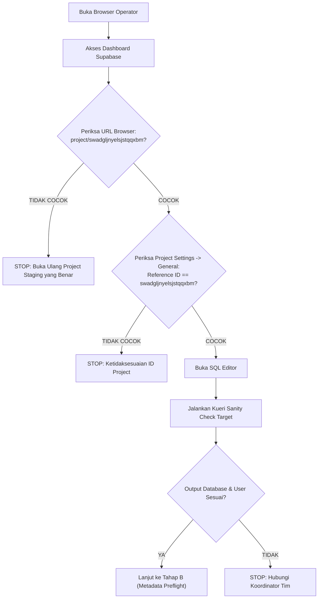
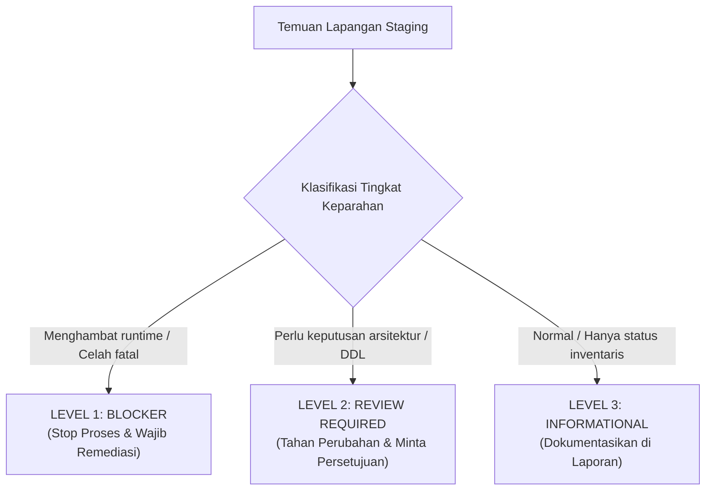

# PTV PRO — SUPABASE STAGING VERIFICATION RUNBOOK
## Manual Preflight Execution Standard Operating Procedure (SOP)

**Subsystem:** PTV PRO Database & Supabase Security Architecture  
**Target Environment:** Supabase Staging (`swadgljnyelsjstqqxbm`)  
**Basis Kueri Preflight:** [`docs/PTV-PRO-STAGING-PREFLIGHT-FINAL-STATIC.sql`](file:///c:/Users/zidna/ptvpro/docs/PTV-PRO-STAGING-PREFLIGHT-FINAL-STATIC.sql)  
**Dokumen Template Laporan:** [`docs/PTV-PRO-STAGING-VERIFICATION-RESULT-TEMPLATE.md`](file:///c:/Users/zidna/ptvpro/docs/PTV-PRO-STAGING-VERIFICATION-RESULT-TEMPLATE.md)  
**Status Dokumen:** **OPERATIONAL PROCEDURE ONLY — STRICTLY FOR HUMAN DBA MANUAL EXECUTION**  
**Tanggal Rilis:** 09 Oktober 2026  

---

> [!CAUTION]
> ### PERINGATAN KESELAMATAN OPERASIONAL & BATASAN KETAT
> 1. **DILARANG EKSEKUSI OTOMATIS OLEH AI:** Agen AI dilarang keras membuka koneksi database, menjalankan tool eksekusi SQL, MCP, CLI, atau API ke Supabase staging maupun production.
> 2. **HANYA UNTUK OPERATOR / DBA MANUSIA:** Prosedur dalam runbook ini disusun khusus untuk dieksekusi secara manual oleh personil DBA berwenang melalui dashboard Supabase SQL Editor.
> 3. **STRICTLY READ-ONLY:** Seluruh kueri preflight bersifat read-only. Jika operator melihat perintah `INSERT`, `UPDATE`, `DELETE`, `ALTER`, `DROP`, `CREATE`, `GRANT`, atau `REVOKE`, **HENTIKAN EKSEKUSI SEGERA**.
> 4. **JANGAN MENGANGGAP STAGING AMAN HANYA DARI LABEL:** Pastikan keaslian target koneksi melalui identifikasi project reference secara ketat sebelum melakukan tindakan apa pun.

---

## 1. Audit Kesiapan Preflight (Preflight Readiness Checklist)

Sebelum memulai prosedur eksekusi, pastikan naskah SQL [`docs/PTV-PRO-STAGING-PREFLIGHT-FINAL-STATIC.sql`](file:///c:/Users/zidna/ptvpro/docs/PTV-PRO-STAGING-PREFLIGHT-FINAL-STATIC.sql) telah mencakup seluruh dimensi audit berikut:

| Dimensi Audit | Seksi Kueri | Cakupan Verifikasi Statis | Potensi Bias / Catatan Kewaspadaan |
| :--- | :--- | :--- | :--- |
| **Ekstensi Sistem** | Seksi 1 | Keberadaan `uuid-ossp`, `pgcrypto`, `pgjwt`. | Versi ekstensi harus kompatibel dengan runtime PostgreSQL 15+. |
| **36 Tabel Kanonikal & Partisi** | Seksi 2 | Keberadaan tabel, relkind (`r` vs `p`), status RLS, dan FORCE RLS. | Menggunakan `pg_class` agar partitioned tables (`relkind = 'p'`) tidak salah dilaporkan `MISSING`. |
| **View Kompatibilitas** | Seksi 3 | Keberadaan view `ptv_kru_legacy_compat`. | Memverifikasi apakah view dapat dibaca atau memicu missing column error. |
| **7 Fungsi & RPC Kanonikal** | Seksi 4A | Overload signatures, skema (`public` vs `auth`), `prosecdef`, volatilitas, `proconfig` lokal, owner. | `proconfig` merepresentasikan parameter lokal fungsi, bukan konfigurasi efektif seluruh sesi pemanggil. |
| **Hak Akses Rutin (`EXECUTE`)** | Seksi 4B | Hak eksekusi untuk `anon`, `authenticated`, `service_role`, `PUBLIC`. | View `routine_privileges` menyaring baris berdasarkan pengguna aktif; wajib dijalankan oleh role `postgres`. |
| **Hak Skema `public`** | Seksi 5A | Hak `USAGE` dan `CREATE` pada role `anon`, `authenticated`, `service_role`, `public`. | `PUBLIC` adalah pseudo-role (bukan baris di `pg_roles`); kueri menggunakan CTE target roles aman. |
| **Status RLS 15 Tabel Inti** | Seksi 5B | Status RLS, FORCE RLS, dan hitungan kebijakan per tabel. | Tabel RLS tanpa policy adalah default-deny bagi unprivileged roles, bukan bagi superuser/owner/BYPASSRLS. |
| **Definisi Kebijakan RLS** | Seksi 5C | Klausul `USING` (qual), `WITH CHECK`, roles, dan command type. | Memastikan apakah ada policy `SELECT` eksisting pada tabel surat (Keputusan 12). |
| **Hak Akses Tabel** | Seksi 5D | Hak `SELECT`, `INSERT`, `UPDATE`, `DELETE` pada tabel surat, peminjaman, unit. | Verifikasi pencabutan hak `INSERT` langsung pada tabel surat. |
| **Status Kolom Khusus** | Seksi 5E | Keberadaan `nama_acara` pada `ptv_peminjaman`; `diajukan_oleh` pada tabel surat. | Memastikan kolom DDL baru belum dibuat sebelum jadwal migrasi resmi. |
| **Rekapitulasi Objek Skema** | Seksi 6 | Hitungan kuantitatif tabel (partition-aware), views, fungsi publik, fungsi auth, policies. | Karakter underscore di-escape secara literal (`ptv\_%`). |
| **Agregat Penomoran Surat** | Seksi 7 (Bagian 2) | Total surat, nomor terisi, nomor NULL, nomor tertinggi, format non-standar. | **HANYA DIJALANKAN JIKA TABEL EXISTS**. Zero content / zero PII. |
| **Agregat Keanggotaan Studio** | Seksi 8 (Bagian 2) | Hitungan skalar akun dengan membership ganda aktif pada `ptv_studio`. | **HANYA DIJALANKAN JIKA TABEL EXISTS**. Zero UUID / zero PII. |

---

## 2. Tahap A — Identifikasi Target (Target Isolation Protocol)

Tujuan tahap ini adalah menjamin secara mutlak bahwa target eksekusi adalah database **Supabase Staging (`swadgljnyelsjstqqxbm`)**, bukan production atau proyek lain.



### Prosedur Verifikasi Target:

1. **Pemeriksaan URL Browser:**  
   Pastikan bilah alamat browser persis mengarah ke:  
   `https://supabase.com/dashboard/project/swadgljnyelsjstqqxbm`  
   *Dilarang mengandalkan tab browser lama tanpa me-refresh halaman.*
2. **Pemeriksaan Project Settings:**  
   - Buka menu **Project Settings** (ikon gerigi) -> **General**.
   - Verifikasi **Reference ID**: Wajib tertulis persis `swadgljnyelsjstqqxbm`.
   - Verifikasi **Project Name**: Pastikan memuat penanda staging (misal: `ptv-staging` atau `ptvpro-dev`).
3. **Pembedaan Staging vs Production:**  
   - Konfirmasi dengan daftar inventaris tim bahwa reference ID `swadgljnyelsjstqqxbm` terdaftar sebagai lingkungan pengujian (*non-production*).
   - Jangan pernah mengeksekusi jika terdapat indikasi URL memuat project ID milik production.
4. **Kueri Sanity Check Awal (Wajib Dijalankan Pertama Kali di SQL Editor):**  
   Buka SQL Editor Supabase, ketik kueri identifikasi berikut, lalu jalankan:
   ```sql
   SELECT 
       current_database() AS database_name,
       current_user AS connected_user,
       session_user AS session_user,
       current_setting('server_version') AS pg_version,
       inet_server_addr() AS server_ip;
   ```
5. **Kriteria Kelulusan Tahap A:**  
   - `connected_user` bernilai `postgres` (role superuser administratif).
   - `database_name` bernilai `postgres`.
   - Reference ID di URL tetap `swadgljnyelsjstqqxbm`.  
   *Catat hasil kueri sanity check ini ke dalam template laporan.*

---

## 3. Tahap B — Pemeriksaan Metadata Katalog (Bagian 1)

Tujuan tahap ini adalah membaca metadata PostgreSQL dari katalog sistem tanpa mengakses baris data aplikasi fisik. Seluruh kueri pada tahap ini aman dari kegagalan tabel kosong (*fail-safe*).

### Urutan Eksekusi Manual:

1. **Buka Berkas SQL Preflight:**  
   Buka file [`docs/PTV-PRO-STAGING-PREFLIGHT-FINAL-STATIC.sql`](file:///c:/Users/zidna/ptvpro/docs/PTV-PRO-STAGING-PREFLIGHT-FINAL-STATIC.sql) di text editor lokal.
2. **Eksekusi Seksi 1 (Ekstensi Sistem):**  
   - Salin kueri Seksi 1 ke Supabase SQL Editor, jalankan.  
   - Simpan output: Pastikan `uuid-ossp`, `pgcrypto`, dan `pgjwt` muncul.
3. **Eksekusi Seksi 2 (Keberadaan 36 Tabel Kanonikal & RLS):**  
   - Salin kueri Seksi 2, jalankan.  
   - Periksa kolom `status`: Tandai tabel mana saja yang berstatus `EXISTS` dan mana yang `MISSING`.  
   - Periksa kolom `relation_type`: Catat jika ada tabel berjenis `PARTITIONED TABLE`.  
   - Periksa kolom `rls_enabled` dan `force_rls_enabled`.
4. **Eksekusi Seksi 3 (View Kompatibilitas `ptv_kru_legacy_compat`):**  
   - Salin kueri Seksi 3, jalankan.  
   - Catat apakah view ada atau menghasilkan 0 baris.
5. **Eksekusi Seksi 4A & 4B (Audit 7 Fungsi Kanonikal & Routine Privileges):**  
   - Salin kueri Seksi 4A, jalankan:  
     * Amati seluruh baris fungsi target.  
     * **Perhatian Khusus Overload:** Jika satu nama fungsi muncul lebih dari satu kali pada skema yang sama dengan argumen berbeda, catat sebagai **temuan kritis PGRST203**.  
     * Catat fungsi yang berada di skema `auth`.  
     * Catat nilai `function_local_config` (apakah search_path disetel).  
   - Salin kueri Seksi 4B, jalankan:  
     * Periksa apakah `grantee` untuk role `anon` atau `PUBLIC` memiliki hak `EXECUTE` pada fungsi mutasi atau resolver token.
6. **Eksekusi Seksi 5A (Audit Hak Skema `public`):**  
   - Salin kueri Seksi 5A, jalankan.  
   - Periksa kolom `has_create_on_public` untuk `anon` dan `public`. Nilai `TRUE` merupakan kerentanan *schema hijacking*.
7. **Eksekusi Seksi 5B & 5C (Status RLS & Definisi `pg_policies`):**  
   - Salin kueri Seksi 5B dan 5C secara berurutan.  
   - Catat tabel yang memiliki RLS aktif tetapi `policy_count = 0` (default-deny unprivileged).  
   - Catat apakah ada policy `SELECT` pada tabel persuratan (`ptv_surat_tugas`, `ptv_surat_izin`, `ptv_surat_barang`).
8. **Eksekusi Seksi 5D & 5E (Hak Akses Tabel & Kolom Khusus):**  
   - Salin kueri Seksi 5D: Periksa tabel persuratan, peminjaman, dan inventaris unit.  
   - Salin kueri Seksi 5E: Verifikasi apakah kolom `diajukan_oleh` dan `nama_acara` sudah ada di database atau belum.
9. **Eksekusi Seksi 6 (Rekapitulasi Hitungan Objek):**  
   - Salin kueri Seksi 6, jalankan.  
   - Catat angka kuantitatif: `public_tables_count`, `views_count`, `public_functions_count`, `target_ptv_functions_in_auth_schema_count`, dan `total_rls_policies_count`.

### Aturan Pelabelan Objek di Laporan:
- **`EXISTS`**: Objek ditemukan di katalog dengan signature/struktur sesuai acuan.
- **`MISSING`**: Objek belum pernah dibuat di database staging.
- **`DIVERGENT`**: Objek ditemukan tetapi berbeda signature, parameter, owner, atau search_path.
- **`NEEDS VERIFICATION`**: Objek belum dapat dipastikan karena kueri terhalang privilege atau tidak dijalankan.

---

## 4. Tahap C — Pemeriksaan Agregat Baris Data (Bagian 2)

Tahap ini membaca data baris fisik tabel secara agregat ringkasan. Tahap ini **TIDAK BOLEH DIEKSEKUSI SECARA BUTA**.

### Gate Prasyarat Mutlak (Mandatory Prerequisite Gate):

Sebelum menyalin atau mengeksekusi kueri Seksi 7 dan Seksi 8, lakukan evaluasi hasil Seksi 2:

```
[ EVALUASI HASIL SEKSI 2 ]
Apakah seluruh tabel berikut berstatus 'EXISTS'?
  - ptv_surat_tugas          --> [ ] EXISTS   /   [ ] MISSING
  - ptv_surat_izin           --> [ ] EXISTS   /   [ ] MISSING
  - ptv_surat_barang         --> [ ] EXISTS   /   [ ] MISSING
  - organization_membership  --> [ ] EXISTS   /   [ ] MISSING
```

- **KONDISI A (Seluruh Tabel Di Atas Berstatus `EXISTS`):**  
  Operator **DIIZINKAN** melanjutkan ke eksekusi Seksi 7 dan Seksi 8.
- **KONDISI B (Salah Satu atau Seluruh Tabel Berstatus `MISSING`):**  
  **STOP EKSEKUSI TAHAP C SEGERA.**  
  Jangan jalankan Seksi 7 maupun Seksi 8. Menjalankan kueri ini pada tabel yang `MISSING` akan memicu error runtime `relation does not exist`. Tandai hasil Tahap C pada template laporan sebagai `SKIPPED (PREREQUISITE TABLES MISSING)`.

### Prosedur Eksekusi Kueri Agregat (Jika Prasyarat Terpenuhi):

1. **Eksekusi Seksi 7 (Agregat Penomoran Surat Historis):**  
   - Salin kueri Seksi 7 ke SQL Editor, jalankan.  
   - Kueri ini mengembalikan: `nama_tabel`, `total_surat`, `jumlah_nomor_terisi`, `jumlah_nomor_null`, `nomor_surat_tertinggi`, dan `count_format_non_standar`.  
   - **Protokol Privasi:** Jangan pernah menambahkan kolom `perihal`, `alasan`, `nama_pemohon`, atau `daftar_barang` ke dalam kueri.
2. **Eksekusi Seksi 8 (Agregat Anomali Keanggotaan `ptv_studio`):**  
   - Salin kueri Seksi 8 ke SQL Editor, jalankan.  
   - Kueri ini mengembalikan tepat 1 baris berisi 2 angka skalar:  
     `total_identities_with_multiple_current_memberships` dan `max_duplicate_count_per_identity`.  
   - **Protokol Privasi:** Kueri ini bebas dari `identity_id` atau nama kru. Dilarang memodifikasi kueri untuk menampilkan identitas kru/santri ke log inspeksi.

---

## 5. Tahap D — Analisis Hasil & Klasifikasi Temuan

Setelah seluruh data inspeksi terkumpul, operator bersama tim pengembang mengklasifikasikan temuan ke dalam taksonomi standar berikut:



### Taksonomi Temuan:

#### 1. LEVEL 1: BLOCKER (STOP PROSES MIGRASI SEGERA)
Kondisi di mana migrasi atau penerapan patch DDL **TIDAK BOLEH DILANJUTKAN** sebelum masalah diatasi:
- **Project Ref Mismatch:** Target yang terhubung ternyata bukan `swadgljnyelsjstqqxbm`.
- **Overload Ganda pada RPC (PGRST203):** Ditemukan fungsi target dengan nama sama tetapi signature berbeda di skema `public` (misalnya signature lama 7 parameter dan baru 8 parameter). Hal ini akan merusak API PostgREST.
- **Anomali Multi-Membership Aktif > 0:** `total_identities_with_multiple_current_memberships` bernilai `>= 1`. Menerapkan patch RPC dalam kondisi ini akan menyebabkan RPC langsung error fail-closed (`DATA_INTEGRITY_ERROR 23514`).
- **Schema Hijacking Vulnerability:** `has_create_on_public` bernilai `TRUE` untuk `anon` atau `PUBLIC`.
- **Hak Eksekusi RPC Bocor ke Anonim:** `anon` atau `PUBLIC` memiliki hak `EXECUTE` pada `rpc_checkout_loan`, `rpc_return_loan`, `rpc_submit_official_doc`, atau `jwt_custom_claims`.

#### 2. LEVEL 2: REVIEW REQUIRED (BUTUH KEPUTUSAN MANUSIA)
Kondisi yang memerlukan peninjauan dan keputusan arsitektur formal sebelum penjadwalan DDL:
- **Format Nomor Surat Non-Standar:** `count_format_non_standar > 0`. Perlu keputusan apakah regex penomoran RPC perlu mengakomodasi arsip lama atau data historis diabaikan.
- **Fungsi Institusional di Skema `auth`:** Ditemukan `jwt_custom_claims` atau `has_capability` di skema `auth`. Memerlukan rencana cleanup manual.
- **Kolom `diajukan_oleh` Belum Ada:** Kondisi normal pra-migrasi, tetapi memerlukan konfirmasi bahwa aplikasi frontend siap menangani kolom ini setelah DDL diaplikasikan.
- **Ketiadaan Kebijakan `SELECT` pada Tabel Surat:** Memerlukan konfirmasi apakah pembacaan surat hanya melalui RPC atau membutuhkan policy RLS eksplisit (Keputusan 12).

#### 3. LEVEL 3: INFORMATIONAL (CATAT DI LAPORAN)
Informasi deskriptif yang tidak menghambat alur kerja:
- Seluruh 36 tabel kanonikal eksis dan RLS aktif.
- Versi ekstensi PostgreSQL terpasang.
- Rekapitulasi volume surat historis.

---

## 6. Gerbang Ketat Sebelum Perubahan (Pre-Mutation Gates)

Dilarang keras mengeksekusi migrasi, DDL patch, atau RPC hardening pada database Supabase staging sebelum **5 Kriteria Gerbang Kelulusan** berikut terpenuhi:

- [ ] **Gerbang 1 (Kelengkapan Laporan):** Seluruh seksi pada [`docs/PTV-PRO-STAGING-VERIFICATION-RESULT-TEMPLATE.md`](file:///c:/Users/zidna/ptvpro/docs/PTV-PRO-STAGING-VERIFICATION-RESULT-TEMPLATE.md) telah diisi lengkap dengan data aktual staging (bukan data asumsi atau rekaan).
- [ ] **Gerbang 2 (Zero Blocker Gate):** Tidak ada temuan Level 1 (Blocker) yang berstatus `OPEN`. Seluruh temuan blocker telah diselesaikan atau dimitigasi.
- [ ] **Gerbang 3 (Rekonsiliasi Skema Disetujui):** Perbedaan antara skema aktual staging dengan proposal hardening telah dipahami dan disepakati oleh penanggung jawab teknis.
- [ ] **Gerbang 4 (Rollback Plan & Backup Terverifikasi):** Prosedur pembatalan (*rollback plan*) dan titik pemulihan database telah disiapkan sebelum DDL dijalankan.
- [ ] **Gerbang 5 (Persetujuan Tertulis Eksplisit):** Terdapat persetujuan tertulis eksplisit dari pemilik sistem/operator untuk memulai tahap perubahan (*mutation phase*).
