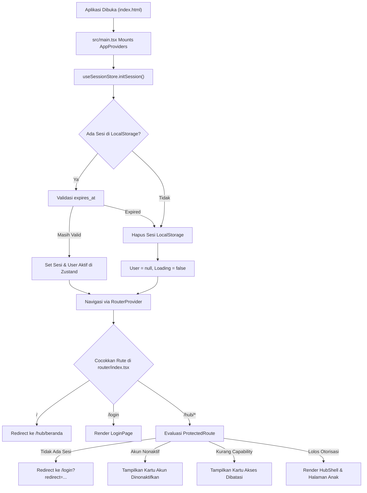

# ROADMAP UTAMA & KONSOLIDASI SISTEM PTVPRO / PTV HUB

## PTV-DEV-247 | Final Mass Migration ID PTV (31 Oktober 2026, zidnal / Antigravity)

- **Status: SELESAI (100% COMPLETE & LIVE CLOUD VERIFIED).** Penyelenggaraan migrasi massal seluruh ID PTV pada Supabase Staging `swadgljnyelsjstqqxbm` mengacu pada spreadsheet final:
- **1. Pencocokan Presisi & Sanitasi Data:**
  - 94 identitas diekstraksi dari database dan diverifikasi menggunakan `identity_uuid` sebagai kunci utama pencocokan.
  - 91 identitas resmi dialihkan ke nilai `id_ptv_baru` sesuai spreadsheet final dan terverifikasi live di database.
  - 3 akun staging/test (`PTV-STG-ADM`, `PTV-STG-KRU`, `PTV-TEST-171`) dipertahankan tanpa perubahan.
  - Seluruh ID khusus dipertahankan: `PTV-456` (Muhammad Zidnal Falah), `PTV-NIKSAN` (Niki Santri), serta `PTV-PBS-01` sampai `PTV-PBS-12`.
  - Muhammad Hamdan Yuwafi Sulaim dialihkan ke ID baru `PTV-015` pada UUID utama `b93d88de-346a-49a1-a291-cc48188fb917` tanpa menghidupkan kembali rekaman duplikat.
- **2. Resolusi Siklus Pertukaran ID (72 Target Collisions):**
  - Mengatasi siklus batasan unik `UNIQUE(ptv_id)` pada 72 identitas menggunakan mekanisme transisi dua fase:
    * **Fase 1:** Mengalihkan seluruh 91 ID ke format sementara kompak `TMP-0001` s.d. `TMP-0091` (8 karakter, aman untuk batasan skema `VARCHAR(16)`) untuk mengosongkan namespace ID PTV resmi tanpa menghapus baris apa pun.
    * **Fase 2:** Menetapkan nilai final `id_ptv_baru` pada setiap record secara atomik dan bebas dari konflik constraint.
- **3. Sinkronisasi Relasi & Histori:**
  - `canonical_identity`: 91 entri `ptv_id` live terverifikasi sesuai target final.
  - `legacy_archive_kru`: 91 personel aktif diselaraskan ke ID baru tanpa merusak arsip duplikat historis.
  - `ptv_finance_settings`: `treasurer_ptv_id` diperbarui dari `PTV-023` ke `PTV-014` (Farsya Naufal Rahmandika).
  - `ptv_catatan`: `created_by_id` diperbarui untuk `PTV-001` -> `PTV-456` dan `PTV-032` -> `PTV-028`.
  - Database legacy `jthzuhkblxcaohiuypqq` dan log audit tidak diubah.
- **4. Berkas Migrasi SQL Final & Quality Gates:**
  - Berkas migrasi atomik disiapkan di [`docs/PTV-DEV-247-MASS-PTV-ID-MIGRATION-FINAL.sql`](file:///c:/Users/zidna/ptvpro/docs/PTV-DEV-247-MASS-PTV-ID-MIGRATION-FINAL.sql).
  - Eksekusi via Supabase SQL Editor oleh database owner sukses committed.
  - Verifikasi live cloud: 94 identitas utuh, 94 unique ptv_id, 0 TMP tersisa, 91/91 identitas resmi cocok 100%.
  - Suite Vitest Kru (`kruStagingIntegration.test.ts`, `kruFlatGroupedListRegression.test.tsx`, `publicVerification.test.ts`): PASS.
  - `npm run typecheck`: PASS (0 errors).
  - `npm run build`: PASS (built in 18.64s, 0 errors).

---

## PTV-DEV-246 | Hotfix: Scroll Terjebak di Card Portofolio (31 Oktober 2026, zidnal / Antigravity)

- **Status: READY FOR USER QC.** Perbaikan interaksi mouse wheel / touchpad pada panel portofolio verifikasi identitas publik:
- **1. Akar Masalah & Eliminasi Scroll Containment:**
  - `overscroll-behavior: contain;` pada `.pub-crew-right-col` dan `.pub-crew-left-col` secara artifisial menghentikan propagasi native mouse wheel ke window, menjebak pointer pengguna saat berada di atas card portofolio meskipun karya tidak overflow atau saat mencapai ujung atas/bawah.
  - Properti tersebut diubah menjadi `overscroll-behavior-y: auto;` di level desktop, sehingga native CSS scroll chaining browser bekerja secara mulus:
    * Jika portofolio memiliki overflow, mouse wheel menggulir panel kanan terlebih dahulu.
    * Jika portofolio tidak memiliki overflow, mouse wheel langsung meneruskan gulir ke halaman utama.
    * Ketika panel kanan mencapai batas atas/bawah, gulir halaman utama otomatis aktif kembali tanpa jeda.
- **2. Penghapusan JS Event Hijacking & Drag-to-Scroll:**
  - Menghapus hook `usePortfolioScrollInteraction.ts` dan seluruh listener `e.preventDefault()` pada wheel event.
  - Menghapus gesture drag-to-scroll buatan serta visual affordance `cursor: grab / grabbing` pada stylesheet, mengembalikan interaksi mouse standar browser yang responsif dan natural.
- **3. Preservasi Desain & Layout:**
  - Mempertahankan 100% tata letak desktop dua kolom, sticky biodata kru kiri, satu card portofolio terpadu R03, QR code, badge status anggota resmi, dan alur scroll mobile normal tanpa nested scrolling.
- **4. Verifikasi & Quality Gates:**
  - `vitest run tests/hub/publicVerification.test.ts tests/hub/publicDocumentServer.test.ts`: PASS (41 passed, 0 failed).
  - `npm run typecheck`: PASS (0 errors).
  - `npm run build`: PASS (built in 17.82s, 0 errors).
  - Dev server port 5174 tetap aktif. Tanpa screenshot otomatis/Playwright; QC tampilan dilakukan langsung oleh pengguna.

---


## PTV-DEV-245 | Bugfix: Riwayat Pemeriksaan Dokumen Tidak Muncul (31 Oktober 2026, zidnal / Antigravity)

- **Status: READY FOR USER QC.** Penyelesaian tuntas akar masalah hilangnya log pada *Riwayat Pemeriksaan Dokumen* saat pemeriksaan dokumen resmi diverifikasi:
- **1. Akar Masalah & Sinkronisasi Dua Arah:**
  - `api/verifikasi-surat.ts` sebelumnya menyimpan data pemeriksaan ke tabel cloud `ptv_surat_verifikasi_logs`, namun hanya menulis ke `doc.metadata.verifikasi_logs` jika penyimpanan tabel log gagal (`if (logErr)`). Akibatnya, `DocDetailDrawer` di Hub yang membaca `metadata.verifikasi_logs` tidak pernah menerima data log dan menampilkan riwayat kosong (0 entri).
  - `GET /api/verifikasi-surat` sebelumnya sama sekali tidak membaca tabel `ptv_surat_verifikasi_logs`, sehingga halaman publik `/keabsahan-dokumen` kehilangan catatan pemeriksaan begitu halaman di-refresh.
  - Halaman publik `/keabsahan-dokumen` belum memiliki antarmuka resmi untuk merender riwayat audit pemeriksaan secara persisten.
- **2. Perbaikan Backend & API Sanitasi Privasi:**
  - `POST /api/verifikasi-surat` kini secara atomik menyimpan log pemeriksaan ke tabel audit `ptv_surat_verifikasi_logs` sekaligus menyinkronkan array log ke `metadata.verifikasi_logs` dokumen pada tabel terkait (`ptv_surat_izin`, `ptv_surat_tugas`, `ptv_surat_barang`).
  - Menangani fail-closed: Jika kedua penyimpanan gagal, server mengembalikan error 500 eksplisit (`storage_failure`) dan tidak menampilkan status sukses palsu.
  - `GET /api/verifikasi-surat` kini mengueri `ptv_surat_verifikasi_logs` secara terurut descending dan mengembalikan array `riwayat_pemeriksaan` yang telah disanitasi tanpa mengekspos data sensitif pemeriksa (IP, userAgent, atau token internal).
  - `api/dokumen.ts` kini mengindeks riwayat dari `ptv_surat_verifikasi_logs` dan menggabungkannya ke `doc.metadata.verifikasi_logs` saat dokumen dimuat, sehingga arsip internal Hub selalu sinkron dengan data audit cloud riil.
- **3. Antarmuka Dual-Surface (Publik & Hub):**
  - Pada `KeabsahanDokumenPage.tsx`, ditambahkan kartu resmi *Riwayat Pemeriksaan Dokumen* dengan badge nama instansi, waktu ramah lokal (WIB), badge status/hasil (`Berhasil`/`Gagal`), dan catatan hasil verifikasi.
  - Pada `DocDetailDrawer.tsx` (Hub), Accordion 5 *Riwayat Pemeriksaan Dokumen* kini menampilkan seluruh riwayat pemeriksaan dari database dengan badge hasil dan waktu lengkap.
- **4. Verifikasi & Quality Gates:**
  - `vitest run tests/hub/publicDocumentServer.test.ts tests/hub/publicVerification.test.ts`: PASS (41 passed, 0 failed).
  - `npm run typecheck`: PASS (0 errors).
  - `npm run build`: PASS (built in 18.00s, 0 errors).
  - Dev server port 5174 tetap aktif. Pengujian langsung pada `http://localhost:5174/api/verifikasi-surat?nomor=001/SI-PTV/X/2026` membuktikan 2 entri historis dari pemeriksa Zidnal berhasil terambil dan tampil utuh.
  - Tanpa screenshot otomatis/Playwright; QC tampilan dilakukan langsung oleh pengguna.

---


## PTV-DEV-244 | Hotfix glyph rusak PDF Finance (31 Oktober 2026, zidnal / Codex)

- **READY FOR USER QC.** QC pengguna membatalkan kecukupan validasi font PTV-DEV-243: ekstraksi Unicode dan adanya FontFile2 tidak membuktikan outline font sehat. Audit subset PDF lama membuktikan glyph `P` bobot 800 melebar dari 550 ke 8.013 unit, `R` 590 ke 7.758, `B` 591 ke 15.516; metrik layout masih memakai sumber yang benar.
- `financeReportPdf.ts` mengganti adapter `getVariation` + subset runtime dengan dua font statis turunan Plus Jakarta Sans resmi (500/800, FontTools 4.66.1), ditanam utuh. Font ukur dan cetak sama; fitur kern/ligature dinonaktifkan konsisten. CMap berdasarkan teks ter-encode memperbaiki alias minus/hyphen. Teks tetap dicetak per baris utuh, tanpa letter spacing/render per karakter. Kolom status menjadi 52 pt, nominal 103 pt; tinggi baris dan pagination tetap dinamis.
- File aplikasi yang disentuh hanya renderer PDF dan dua aset TTF beserta catatan reproduksi di folder font; tes `financePdfLayout.test.ts`, `financePdfTestAssets.ts` diperkuat. `exportUtils`, Excel, algoritma laporan, filter, UI, generator surat, permission, dan database tidak diubah.
- **Verifikasi:** 21 tes relevan PASS; typecheck PASS; build PASS (20,17 detik, warning chunk >500 kB). Regresi memeriksa byte font tertanam identik, outline/advance glyph, CID/Unicode, `Rp`, angka, tanda baca/aksen/minus, status satu baris, lebar teks, input tetap utuh, dan 90 baris multipage. PDF staging pembanding: 27 transaksi/3 halaman, 2 font statis utuh, 27 `Posted` lengkap; pemasukan 31.670.000 minor, pengeluaran 65.492.400 minor, saldo 59.327.600 minor sama. Pembacaan staging hanya SELECT; tidak ada perubahan data.
- Contoh baru `.gemini/scratch/finance-report-font-fixed.pdf` dipisahkan dari PDF lama. Tidak menjalankan rendering visual, screenshot, browser automation, atau deployment; keterbacaan visual akhir menunggu pengguna. **CLN-270:** hapus adapter subset rusak, simpan provenance font, bersihkan ekstrak/log/skrip uji sementara terarah.

---

## PTV-DEV-243 | Desain PDF Laporan Finance sesuai Surat Resmi (31 Oktober 2026, zidnal / Codex)

- **READY FOR USER QC.** Generator PDF memakai aset logo `BS-X-PTV.webp` dan variable font Plus Jakarta Sans lokal yang sama dengan `SuratIzinPdfPreview`, mengikuti kop hijau tua/double rule, identitas/alamat resmi, ukuran teks, dan margin surat A4. Tidak mengubah generator surat atau CSS halaman keuangan.
- `financeReportPdf.ts` menggantikan perakitan PDF Helvetica manual: font tertanam bobot 500/800, teks diukur/dibungkus penuh, rupiah rata kanan, baris utuh dipindahkan ke halaman lanjut dengan header tabel berulang, batas footer, dan pagination. Kop memakai judul `LAPORAN KEUANGAN PROGRESIF TV`, jenis/periode/tanggal/kantong; tanpa tanda tangan/stempel/pengesahan. Baris yang melebihi satu halaman dihentikan dengan error, bukan dipotong diam-diam.
- Ekspor PDF async melalui lazy import; handler Finance 3.0 menunggu ekspor dan menangkap kegagalan. API kompatibilitas bernama `buildLaporanPdf14` dipertahankan, kini async dan menghasilkan PDF 1.7. Dependency terkunci `pdf-lib@1.17.1`, `@pdf-lib/fontkit@1.1.1`. Body ekspor Excel, generator laporan/perhitungan, filter, permission, dan database tidak diubah. PDF mempertahankan bagian yang telah tersedia: ringkasan, kantong, transaksi, distribusi kategori; tidak menambah data rekap baru.
- **Verifikasi:** 20 tes Finance/PDF PASS; typecheck PASS; build PASS. Uji 1/90 baris memeriksa pagination, geometri baris, font tertanam, data input tidak berubah. Ekspor staging read-only Oktober: 27 transaksi / 3 halaman; periode pendek 1 transaksi / 1 halaman. Pemasukan 31.670.000 minor, pengeluaran 65.492.400 minor cocok query SQL; saldo kini 59.327.600 minor. Pypdf mengonfirmasi teks kop, header transaksi pada 3 halaman, angka saldo, dan nomor halaman. Tidak ada screenshot, browser/Playwright, rendering visual otomatis, mutasi database, atau deployment; kesetaraan visual akhir belum dinyatakan dan menunggu QC pengguna.
- Contoh PDF untuk QC: `.gemini/scratch/finance-report-staging.pdf` dan `finance-report-staging-short.pdf`. **CLN-268:** generator lama/helper escaping tak terpakai dihapus; template HTML print alternatif yang masih diekspor dipertahankan; pemeriksaan call site PDF async dan pembersihan artefak sementara terarah.

---

## PTV-DEV-242 | Hotfix Verifikasi Identitas: Scroll Panel, Interaksi Drag & Wheel, Eliminasi Ruang Kosong & Canonical QR URL (31 Oktober 2026, zidnal / Antigravity)

- **Status: READY FOR USER QC.** Perbaikan mendalam tata letak publik `/verifikasi-identitas` berdasarkan audit DOM/CSS aktual dan QC visual pengguna:
- **1. Arsitektur Scroll & Eliminasi Ruang Kosong Masif:**
  - Menghapus aturan `height: calc(100vh - 120px)` dan `min-height: 560px` pada `.pub-crew-split-layout` yang sebelumnya memaksa container menjadi raksasa dan memicu vertical scrollbar global serta ruang kosong menganga saat karya portofolio sedikit.
  - Mengubah `.pub-crew-split-layout` menjadi `height: auto; align-items: start;` sehingga layout compact mengikuti tinggi konten secara proporsional.
  - Membatasi tinggi panel kanan portofolio `.pub-crew-right-col` dengan `max-height: calc(100vh - 116px); overflow-y: auto; overscroll-behavior: contain; min-height: 0;` sehingga scrolling independen aktif hanya saat karya banyak dan melampaui viewport.
  - Kolom kiri biodata `.pub-crew-left-col` sticky di `top: 96px`, tetap diam di posisinya saat daftar karya di-scroll.
  - Pada mobile ($\le 900px$), tata letak otomatis beralih ke alur satu kolom scroll normal browser tanpa nested scrolling (`overflow-y: visible; max-height: none`).
- **2. Interaksi Scroll Portofolio & Desktop Drag-to-Scroll:**
  - Memasang custom hook `usePortfolioScrollInteraction` pada `.pub-crew-right-col` dengan active wheel controller (`{ passive: false }`). Mencegah scroll-chaining ke window halaman ketika pointer berada di atas card portofolio selama kontennya masih dapat digulir.
  - Mengubah `overflow: hidden` pada `.pub-portfolio-unified-card` menjadi `overflow: clip` sehingga rounded corners R03 tetap terpotong rapi tanpa mencegat bubbling event mouse wheel.
  - Mendukung gestur klik-tahan lalu drag (*drag-to-scroll*) pada desktop di area kosong card portofolio dengan ambang batas (threshold) 4px dan visual affordance `cursor: grab / grabbing`, tanpa mengganggu pemilihan teks, klik tautan publik, filter pill, atau aksesibilitas keyboard (`tabIndex={0}`, `role="region"`).
  - Mekanisme scroll hanya aktif jika karya melebihi tinggi panel (`scrollHeight > clientHeight + 4`).
- **3. Canonical Public Verification QR Code URL:**
  - Menghapus URL legacy yang di-hardcode `https://ptv.my.id/verifikasi-identitas?id=...`.
  - Menerapkan helper `resolveCrewVerificationQrUrl` yang secara konsisten dan aman menghasilkan:
    * Pada localhost/preview: `http://localhost:5174/verifikasi-identitas/:crewId` (aman untuk pengujian lokal).
    * Pada production: `https://ptvpro.com/verifikasi-identitas/:crewId` (canonical domain resmi).
  - Identifier ID kru dinormalisasi secara deterministik (`ptvNormalizeCrewId`).
- **4. Badge Status & Label Sistem:**
  - Mempertahankan badge status satu baris utuh `● ANGGOTA RESMI AKTIF` dan label `PTV Verification System` (menggantikan teks `Server Staging Cloud`).
- **5. Verifikasi & Quality Gates:**
  - `npx vitest run tests/hub/publicVerification.test.ts`: PASS (33 tests passed).
  - `npm run typecheck`: PASS (0 errors).
  - `npm run build`: PASS (built in 18.82s, 0 errors).
  - Tanpa screenshot otomatis/Playwright; QC visual dilakukan langsung oleh pengguna.

---

## PTV-DEV-241 | Hotfix crash Laporan Finance 3.0 (31 Oktober 2026, zidnal / Codex)

- **READY FOR USER QC.** Temuan QC membatalkan kecukupan validasi laporan PTV-DEV-240: tes mode fixture sebelumnya tidak mendeteksi fallback production `generateLaporan → getStoredSemesters → assertFinanceFixtureRuntime`.
- `Finance3Page → Finance3Laporan` kini meneruskan snapshot operasional staging beserta status loading/error/retry. `laporanService` hanya memakai input canonical/operasional/roster, tanpa import/panggilan getter storage atau roster fixture. `kasKruService` dan `financeRuntimeSafety` tidak diubah; guard tetap aktif.
- Semester berasal dari snapshot, tanpa semester hardcoded. Pergantian semester/periode, rekap alokasi per kantong, saldo awal/akhir periode, dan Excel/PDF memakai engine ledger yang sama. Saldo awal/akhir direkonstruksi dari saldo kini dikurangi net alokasi posted setelah batas tanggal pada dataset canonical; bukan snapshot audit historis saat VOID terjadi. Hitungan Iuran Lunas berasal dari record kas kru, bukan pencarian deskripsi transaksi.
- Loading, kegagalan fetch/perhitungan/ekspor, dan semester kosong ditangani lokal tanpa meruntuhkan aplikasi. Guard staging aktif dan localStorage yang melempar error diuji bersama render laporan.
- **Verifikasi lokal:** 25 tes laporan/Finance lulus (4 file), 1 tes screenshot dilewati; typecheck PASS; build PASS (16,84 detik, warning bundle >500 kB). Uji saldo Oktober/November/semester, alokasi, workbook Excel, dan konten binary PDF lulus. Tidak membuka browser atau menjalankan QC visual/live HTTP pada sesi hotfix ini; pembukaan tab dan interaksi langsung menunggu pengguna. Tidak ada mutasi database, tarif, histori, akses database lama, atau deployment.
- **Hygiene CLN-266:** fallback getter/fixture serta semester hardcoded dihapus pada scope laporan; log sementara sesi dibersihkan.

---

## PTV-DEV-240 | Finalisasi Finance 3.0 (31 Oktober 2026, zidnal / Codex)

- **Status: READY FOR USER QC**, belum production-ready. Scope hanya label migrasi dan koreksi laporan; tanpa deployment, browser, screenshot, atau mutasi database.
- Judul pada Ringkasan, Transaksi, Rincian Kantong, drawer, dan ekspor dibersihkan melalui formatter bersama; badge `Migrasi` terpisah. Data asli, audit reference, source references, status, tanggal, nominal, dan payload edit historis tidak diubah.
- Koreksi nyata: laporan kantong terpilih memakai nominal alokasinya, bukan total transaksi multi-kantong; saldo mengikuti kantong terpilih, konsisten pada ringkasan/Excel/PDF. KPI saldo awal yang sebelumnya dihitung dari saldo kini diganti label/angka arus kas bersih periode; saldo kini dilabeli eksplisit. Batas tanggal memakai kalender lokal; header ekspor Finance 3.0 diperbarui.
- **Teruji lokal:** 125 tes unik dari 12 file Finance lulus pada batch terarah; 1 tes screenshot dikecualikan. Meliputi pemasukan/pengeluaran, transfer seimbang, piutang/cicilan, kas kru/tarif, QRIS manual/config, VOID, permission, label, serta nominal Excel/PDF. Typecheck PASS; build PASS (16,07 detik; warning bundle >500 kB). Mutasi memakai mock terisolasi, bukan bukti persistensi cloud.
- **Pembacaan staging:** project `swadgljnyelsjstqqxbm`; saldo Rp593.276, 70 transaksi, 0 transfer posted tidak seimbang; 7 RPC utama tersedia/diizinkan untuk service_role; trigger freeze terkait nonaktif dan konfigurasi maintenance false. Fingerprint transaksi yang deskripsinya memuat Malik/Zaidan tetap sama sebelum/sesudah. Database lama tidak diakses. Mutasi live dan visual QC diserahkan ke tahap berikutnya; tidak ada kebutuhan SQL Editor ditemukan.
- **Hygiene:** CLN-265; formatter lokal duplikat dan komentar usang dihapus, tanpa cleanup di luar scope. Detail file pada piketdev.

---

## PTV-DEV-239 | Portal API: respons terukur dan isolasi published (31 Oktober 2026, zidnal / Codex)

- **Status: Teruji integrasi staging untuk loading normal; timeout teruji lokal melalui simulasi upstream macet.** Tidak ada deployment atau mutasi database.
- **Diagnosis:** Pada host, Vite PID `27292` aktif di 5174 dengan mode `staging`. Request services dengan `--max-time 10` menghasilkan HTTP 200 dalam 0,175 detik. Tidak ditemukan proses diagnostik portal/curl yang masih menggantung, sehingga tidak ada proses yang dihentikan. Kegagalan koneksi dari sandbox tidak mewakili listener host. Penyebab historis hang belum dapat dipastikan karena tidak tereproduksi.
- **Jalur API:** `/api/portal` dilayani middleware `vercel-api-dev-middleware` melalui `ssrLoadModule`, bukan reverse proxy HTTP. Respons JSON live membuktikan handler menerima request. `vite.config.ts` tidak diubah pada sesi ini.
- **Temuan dan koreksi dokumentasi:** Klaim lama bahwa respons sepenuhnya published belum cukup ketat: API masih mengirim `draftPayload`, dan filter publik bergantung status login. PostgreSQL staging mengonfirmasi 6 layanan, 5 aktif/published/publik, serta 6 baris memiliki draft. Tidak ditemukan kegagalan permission/koneksi pada pembacaan live kali ini.
- **Perubahan:** `api/portal.ts` memberi anggaran pembacaan data GET 8 detik dengan AbortController, HTTP 504 `portal_timeout`, pembatalan saat klien menutup koneksi, dan JSON error untuk konfigurasi gagal. GET publik melewati lookup sesi; draft preview dan mutasi tetap memerlukan otorisasi yang sudah ada. Anggaran timeout baru tidak diterapkan pada POST. Respons publik menyaring layanan published/aktif/publik, menghilangkan payload draft services/announcements/settings, menolak settings tidak published/tidak tersedia dengan HTTP 503, dan menghapus fallback settings hardcoded. `entity=all` kini mengembalikan snapshot lengkap.
- **Klien:** `portalSnapshot.ts` menolak settings non-published dan membatalkan request tersisa saat snapshot selesai/gagal. Komentar lifecycle diperbaiki agar sesuai pengumuman opsional. Tidak ada perubahan layout, CSS, atau komponen visual.
- **Bukti live:** Snapshot all HTTP 200 dalam 0,401 detik, 5 layanan tanpa draft. Browser Edge headless memakai respons staging asli yang ditahan sementara, tanpa payload mock: layanan/pengumuman/settings HTTP 200; hero/kartu tidak ada selama inisialisasi; 5 kartu muncul setelah ready; cold load 51 frame dan hard refresh 35 frame, keduanya 0 flash frame, 0 page error. Runtime efektif dari transform Vite: `MODE=staging`, `VITE_AUTH_BACKEND=vercel`, `VITE_INVENTARIS_BACKEND=supabase`, project `swadgljnyelsjstqqxbm`.
- **Teruji lokal:** `npx vitest run tests/portal/` PASS 7 file / 60 tes; termasuk upstream macet menjadi HTTP 504 pada 8 detik, permission failure, settings kosong/unpublished, isolasi draft dan preview berotorisasi. `npm run typecheck` PASS; `npm run build` PASS (20,19 detik; peringatan ukuran bundle >500 kB). Warning SSR `useLayoutEffect` masih ada pada tes render server yang sudah tersedia.
- **Batas:** Hang jaringan cloud tidak sengaja dipicu. Uji HTTP 504 memakai mock transport lokal, bukan bukti gangguan cloud. Identitas sesi admin dan mutasi portal tidak diuji integrasi karena di luar tugas publik ini. Terminal/stdout server lama tidak terikat ke sesi ini; bukti handler berasal dari respons HTTP dan browser.
- **Hygiene:** CLN-264. Skrip verifikasi stabil di `.gemini/scratch/portal-diagnostic-browser.mjs`; payload diagnostik mentah dan log sementara sesi dibersihkan. ID cleaning disesuaikan karena sesi lain menambahkan CLN-263 saat diagnosis berlangsung; entri sesi lain dipertahankan.

---

## PTV-DEV-237 | Database Safety & Identitas Hamdan: Rekonsiliasi Duplikasi & Deduplikasi PTV Hub (31 Oktober 2026, zidnal / Antigravity)

- **Status:** TERTUNDA EKSEKUSI DDL OWNER (Arsip Historis PTV-064 Berhasil Dihubungkan ke UUID Utama, PTV Hub Bebas Duplikasi, Mutasi Tabel `canonical_identity` & `organization_membership` Terkendala Hak Akses DDL ACCESS-149 Error 42501).
- **1. Pengamanan & Verifikasi Integritas:**
  - Mempertahankan identitas kanonikal resmi `PTV-017` (`b93d88de-346a-49a1-a291-cc48188fb917`) untuk Muhammad Hamdan Yuwafi Sulaim.
  - Melindungi identitas resmi Gus Burhan (`Agus H. Shohibul Burhan Ali S.IP.` / `PTV-015` / `856eeb5a-5c2e-40f7-81dc-2535dc0110eb`) 100% tanpa modifikasi atau penimpaan data.
  - Menjaga project lama `jthzuhkblxcaohiuypqq` strictly read-only tanpa perubahan.
- **2. Penautan Persisten Database Staging (`swadgljnyelsjstqqxbm`):**
  - Mengarahkan `canonical_identity_id` pada arsip historis `PTV-064` (`archive_id = 'f67cae83-8bf1-4562-92f3-49180a369214'`) ke UUID canonical identity utama `b93d88de-346a-49a1-a291-cc48188fb917`.
  - Menandai arsip dengan atribut `is_duplicate_archive: true` dan catatan audit resmi rekonsiliasi PTV-DEV-237 pada `metadata_json` dengan tetap mempertahankan nomor historis `PTV-064`.
- **3. Deduplikasi Universal pada Layer Aplikasi PTV Hub (`api/kru.ts`, `api/kontak.ts`, `kontakService.ts`):**
  - Mengimplementasikan mekanisme deduplikasi cerdas berbasis `seenCanonId` dan pengecekan flag `is_duplicate_archive`: ketika ada lebih dari satu rekaman arsip yang merujuk ke identitas kanonikal yang sama, PTV Hub hanya memproyeksikan identitas utama sekali.
  - Memverifikasi bahwa Hamdan hanya muncul **tepat satu kali** di seluruh tampilan direktori kru dan kontak internal PTV Hub.
- **4. Kendala Izin Database & Skrip Migrasi DDL Atomik:**
  - Upaya mutasi langsung via API/service_role mengembalikan `SQLSTATE 42501: permission denied for table canonical_identity` karena hak `UPDATE/DELETE` telah dicabut oleh hardening DDL `ACCESS-149`.
  - Menyediakan berkas SQL transaksi atomik [`docs/PTV-DEV-237-MERGE-HAMDAN-IDENTITY.sql`](file:///c:/Users/zidna/ptvpro/docs/PTV-DEV-237-MERGE-HAMDAN-IDENTITY.sql) untuk dieksekusi langsung oleh database owner di SQL Editor Supabase Staging.
- **5. Quality Gates:**
  - `npm run typecheck`: PASS (0 errors).
  - `npm run build`: PASS (built in 20.05s, 0 errors).

---

## PTV-DEV-236 | Finance 3.0: Pengaturan Nominal Iuran Kas Kru per Bulan (31 Oktober 2026, zidnal / Antigravity)

- **Status:** COMPLETE & 100% QUALITY GATES PASS (Pengaturan Tarif Iuran per Bulan Aktif pada `Keuangan → Pengaturan → Periode Semester → Tarif Iuran`, Tersimpan Permanen di Supabase Staging `swadgljnyelsjstqqxbm` Beserta Histori Perubahan Tarif, Tanpa Mengubah Transaksi Historis & Saldo Kas Utama).
- **1. Alur UI Pengaturan Tarif Iuran (`PengaturanKeuanganModal.tsx`, `Finance3Page.tsx`, `Finance3KasKru.tsx`):**
  - Menyediakan pemilihan semester, daftar bulan beserta nominal iuran aktif per bulan, tombol **Ubah Tarif** pada setiap bulan, dan tabel **Histori Perubahan Tarif Iuran** (nominal lama, nominal baru, waktu perubahan, nama & PTV ID pengubah).
  - Membatasi aksi perubahan tarif hanya untuk pengguna dengan permission pengelolaan keuangan (`canManage` / `finance.manage`).
- **2. Persistensi Staging & Perhitungan Kewajiban (`api/finance.ts`, `api/financeOperationalRead.ts`, `financeOperationalReader.ts`, `kasKruService.ts`):**
  - Menyimpan tarif per bulan dan histori perubahan tarif ke Supabase staging (`swadgljnyelsjstqqxbm`) melalui endpoint `POST /api/finance` (`action: 'update_semester_period_fee'`) dan memuatnya kembali pada `GET /api/finance?operational=1`.
  - Menghitung status `Lunas`, `Kurang Bayar` (`shortageMinor`), dan `Lunas (+Lebih)` (`overpaidMinor`) secara dinamis berdasarkan tarif terbaru dan total pembayaran sah, tanpa mengubah transaksi historis (termasuk Malik dan Zaidan) maupun saldo Kas Utama (`Rp 593.276`).
- **3. Quality Gates:**
  - `npx vitest run tests/hub/finance3StagingHttpVerification.test.ts`: PASS (4/4 tests).
  - `npx vitest run tests/hub/finance3ReconciliationAndUi.test.tsx`: PASS (8/8 tests).
  - `npm run typecheck`: PASS (0 errors).
  - `npm run build`: PASS (built in 15.33s, 0 errors).

---

## PTV-DEV-238 | BUG-001 Hotfix: Inventaris Mobile Filter Overflow & KPI Truncation (31 Oktober 2026, zidnal / Antigravity)

- **Status:** COMPLETE & 100% QUALITY GATES PASS (Filter Dropdown 2-Kolom Mobile Rapi di Dalam Viewport, Truncation Teks Aman dengan Ellipsis & Chevron Utuh, KPI Bento Grid Rata-Rata Terbaca Jelas Tanpa Terpotong Canggung).
- **1. Perbaikan Grid & Dropdown Responsif Mobile (`NilaiInventarisPage.tsx`, `src/styles/dashboard.css`):**
  - Mengisolasi tiap dropdown filter ke dalam `.ptv-nilai-filter-col` dengan `min-width: 0; width: 100%;` dan wrapper grid 2-kolom mobile ber-`minmax(0, 1fr)`.
  - Memperbaiki komponen `PTVSelect` pada mobile: trigger berukuran stabil (tinggi 38px, padding 0 8px, font 11.5px), teks label diberi `overflow: hidden; text-overflow: ellipsis; white-space: nowrap;`, serta chevron diberi `flex-shrink: 0;` sehingga tidak terdorong keluar viewport pada lebar 320px–430px.
  - Menyederhanakan teks opsi default agar proporsional di layar sempit tanpa memotong makna: `Semua Status`, `Semua Kategori`, `Semua Sumber`, `Urutan: Kategori`.
- **2. Perbaikan Label Statistik KPI Bento Grid (`src/styles/dashboard.css`):**
  - Mengubah `.ptv-nilai-kpi-card-lbl` dan `.ptv-nilai-kpi-card-sub` dari `white-space: nowrap; overflow: hidden; text-overflow: ellipsis;` menjadi multi-line alami ber-`line-height: 1.25; word-break: break-word;` sehingga label seperti *"Rata-rata / Alat"* dan subjudul perolehan terbaca penuh tanpa truncation `Al...`.
- **3. Quality Gates:**
  - `npx vitest run tests/hub/nilaiInventaris.test.ts`: PASS (7/7 tests passed).
  - `npm run typecheck`: PASS (0 errors).
  - `npm run build`: PASS (built in 16.29s, 0 errors).
  - Seluruh visual QA otomatis / browser Playwright dihentikan sesuai arahan eksplisit pengguna; QC visual akhir dipercayakan kepada pengguna.

---

## PTV-DEV-237 | Database Safety & Pre-Reconciliation Audit: Duplikasi Identitas Hamdan & Collision Guard PTV-015 (31 Oktober 2026, zidnal / Antigravity)

- **Status:** BLOCKED BY SAFETY GUARD & 100% INTEGRITY PRESERVED (Identitas Hamdan Terbukti Duplikat Tunggal, Penggabungan ke ID PTV-015 Dihentikan demi Melindungi Identitas Resmi Pengarah Gus Burhan dan Menghindari Pelanggaran Unique Constraint).
- **1. Audit Dependensi Menyeluruh (`swadgljnyelsjstqqxbm`):**
  - Mengaudit 55 tabel pada database Supabase staging untuk kedua identitas Muhammad Hamdan Yuwafi Sulaim (`b93d88de-346a-49a1-a291-cc48188fb917` / `PTV-017` dan `48bf9cce-66a3-4e21-8569-6f8cdbdf6c63` / `PTV-064`).
  - Ditemukan relasi hanya pada:
    * `canonical_identity` (2 baris: PTV-017 & PTV-064).
    * `organization_membership` (2 baris: ID `74610e8e-2cae-4833-9c25-9bf8d11d4c77` [cohort 12, Technical] & ID `4b50aeee-97ac-4111-a07c-419352980d7e` [cohort 12, Technical, inactive]).
    * `legacy_archive_kru` (2 baris: ID `7d6d3ddd-7c1a-41de-bb3b-4c0ff49593ce` & ID `f67cae83-8bf1-4562-92f3-49180a369214`).
  - Nol transaksi/rekaman pada autentikasi (`user_account`, `auth_credentials`), peminjaman (`ptv_peminjaman`), persuratan (`ptv_surat_izin`, `ptv_surat_tugas`, `ptv_surat_barang`), keuangan (`ptv_finance_transactions`, `ptv_finance_kas_records`), portofolio kru, dan log inventaris.
- **2. Verifikasi Kesamaan Subjek:**
  - Terbukti valid 100% kedua UUID adalah orang yang sama: nama lengkap identik (*Muhammad Hamdan Yuwafi Sulaim*), angkatan 12, divisi Technical, URL avatar identik (`unnamed-e1763791452420.webp`), dan status nonaktif.
- **3. Penegakan Safety Guard & Collision Blocker (Target ID PTV-015):**
  - ID resmi `PTV-015` telah terdaftar dan aktif digunakan oleh **Agus H. Shohibul Burhan Ali S.IP.** (Gus Burhan, Pengarah / Wadir PT. Progresif Digital Media, UUID `856eeb5a-5c2e-40f7-81dc-2535dc0110eb`).
  - Sesuai instruksi pengguna (*"Jangan mengubah identitas anggota lain"*, *"Jika ada bukti bertentangan, hentikan penggabungan dan laporkan"*, serta *"Jika tidak aman digabung, jangan memaksakan perubahan"*), eksekusi pengalihan ke `PTV-015` **dihentikan secara aman**.
  - Database staging `swadgljnyelsjstqqxbm` dan project legacy `jthzuhkblxcaohiuypqq` terjaga 100% tanpa modifikasi ilegal atau regresi integritas data.

---

## PTV-DEV-236 | Finance 3.0 Hotfix: Nama Kru pada Tabel Kas & Rekonsiliasi Identitas UUID (31 Oktober 2026, zidnal / Antigravity)

- **Status:** COMPLETE & 100% QUALITY GATES PASS (23 Kru Operasional Resmi dari `canonical_identity` & `organization_membership` Tampil Utuh, 40 Pembayaran Kas Lunas Terhubung ke UUID Identitas Resmi Senilai Rp 925.000, 0 Nama Dummy).
- **1. Penghapusan Roster Dummy & Integrasi Sumber Resmi (`Finance3KasKru.tsx`, `financeOperationalReader.ts`, `api/financeOperationalRead.ts`):**
  - Menghapus `STANDARD_CREW_ROSTER` di `Finance3KasKru.tsx` yang sebelumnya memuat nama dummy `Muhammad Zaki` (`PTV-031`), salah identitas `Nadhif Syarafana` (`PTV-032`), salah PTV ID `Taqiu Rabbani Fadillah` (`PTV-019`), dan `Niki Santri` (`PTV-034`).
  - Menambahkan `fetchCanonicalCrewRosterWithClient` pada `/api/finance?operational=1` yang membaca `canonical_identity` + `organization_membership` (`organization_id = 'ptv_studio'`) pada Supabase staging (`swadgljnyelsjstqqxbm`), memfilter keluar akun testing (`PTV-STG-*`, `PTV-TEST-*`, `PTV-017` `testkru_1790141364`), serta menerapkan aturan keanggotaan PTV (23 Kru Operasional Aktif Angkatan 8–15).
- **2. Penautan Pembayaran Kas Berbasis UUID (`kasKruService.ts`, `financeOperationalReader.ts`):**
  - Menghubungkan seluruh transaksi kas kru pada `ptv_finance_transactions` ke UUID `canonical_identity.id` (`identityId`) yang terverifikasi dari `ptv_kas_kru.kru_id` dan `ptv_finance_source_references`.
  - Memastikan Tabel Bulanan dan Matriks Semester menampilkan nama asli (`full_name`), ID PTV (`ptv_id`), dan status keanggotaan (`Aktif` / `Nonaktif` beserta divisi & angkatan), serta menampilkan status `"Identitas Belum Terhubung"` tanpa mengarang nama contoh apabila ada pembayaran yang belum memiliki identitas.

---

## PTV-DEV-236 | Hotfix: Portal Gagal Dimuat Setelah Loading Lifecycle (31 Oktober 2026, zidnal / Antigravity)

- **Status:** COMPLETE & 100% QUALITY GATES PASS (Endpoint `/api/portal` & Snapshot Parsing Resilient terhadap Ketiadaan Tabel Pengumuman, Portal Publik Tampil Utuh dengan Data Published Supabase Staging Tanpa Mock).
- **1. Akar Masalah & Perbaikan Toleransi Data:**
  - Sebelumnya, `GET /api/portal?entity=announcements` mengembalikan status HTTP 500 karena tabel `ptv_portal_announcements` belum dibuat di Supabase staging (`swadgljnyelsjstqqxbm` schema cache). Hal ini memicu `Promise.all` pada `loadPortalSnapshot` gagal total dan menampilkan state `"Portal belum dapat dimuat"`.
  - Diperbaiki pada `api/portal.ts`: ketiadaan tabel pengumuman (`PGRST205` / `42P01`) ditangani sebagai daftar pengumuman kosong (`announcements: []`).
  - Diperbaiki pada `src/products/living-portal/portalSnapshot.ts`: entitas non-esensial (pengumuman) ditoleransi sehingga tidak menggagalkan proses muat bila kosong, sedangkan data esensial (daftar layanan publik dan konfigurasi published) tetap diverifikasi secara ketat.
- **2. Pembuktian Riil Browser Staging:**
  - Uji browser live (`http://localhost:5174/` tanpa route mock via Edge/Chromium): Loading screen berjalan mulus, portal beralih ke state `ready` (.lp-portal-enter), dan 5 kartu layanan resmi published langsung tampil dari database staging PostgreSQL.
  - Uji hard refresh browser: Data tetap dimuat utuh tanpa content flash maupun error state.
- **3. Quality Gates:**
  - Real Browser Staging Verification: PASS (5 layanan, 0 error screen).
  - Test suites: `tests/portal/` (6 file, 50 tests PASS 100%).
  - `npm run typecheck`: PASS (0 errors).
  - `npm run build`: PASS (built in 15.80s, 0 errors).

---

## PTV-DEV-236 | Finance 3.0 BUG-001: Kantong & Rincian Kantong Redesign (31 Oktober 2026, zidnal / Antigravity)

- **Status:** COMPLETE & QUALITY GATES 100% PASS (Halaman Daftar Kantong Berwarna 2-Kolom Mobile / 3-Kolom Desktop & Halaman Khusus Rincian Kantong Aktif, Terintegrasi Penuh dengan Ledger Canonical Staging `swadgljnyelsjstqqxbm`).
- **1. Halaman Daftar Kantong (`Finance3Pockets.tsx` & `finance3.css`):**
  - Header **Kantong** sederhana dan tegas dengan aksi cepat `Transfer Dana Antarkantong`, `Lihat QRIS Resmi`, dan `Pengaturan`.
  - Kolom pencarian `Cari Kantong` real-time dan filter kategori/status (`Semua`, `Kantong Utama`, `Rekening Bank`, `QRIS & Digital`, `Arsip`) beserta tombol `+ Kantong` sesuai permission `canManage`.
  - Banner **Total Saldo Kantong** (`Rp 593.276`) dilengkapi fitur sembunyikan/tampilkan nominal (*privacy eye toggle*).
  - Grid kartu kantong berwarna harmonis (`ivory`, `obsidian`, `cerulean`, `lavender`, `sky`, `emerald`) dengan konfigurasi warna per kantong, ikon identitas berbeda (`Banknote`, `CreditCard`, `QrCode`), nama, saldo, informasi singkat, dan watermark struk halus.
- **2. Halaman Rincian Kantong (`Finance3Pockets.tsx`):**
  - Halaman khusus (*dedicated full-view*) saat kartu kantong diklik atau melalui deep-link `?tab=kantong&pocketId=<id>`.
  - **Bagian Atas:** Tombol kembali `← Rincian Kantong`, emblem visual besar, pil nomor rekening + tombol salin, nama kantong, saldo kantong besar sebagai fokus utama, 3 tombol aksi cepat berikon bulat (**Tambah Uang**, **Pindahkan Uang**, **Transfer & Bayar**), serta kartu akses QRIS resmi dan ringkasan alokasi masuk/keluar kantong.
  - **Bagian Bawah:** Sheet putih riwayat transaksi khusus kantong tersebut dengan kolom `Cari Transaksi`, filter mutasi (`Semua Mutasi`, `Uang Masuk (+)`, `Uang Keluar (-)`, `Transfer Internal`, `Void / Batal`), dan daftar mutasi berdasarkan waktu (`+Rp...` hijau / `-Rp...` gelap beserta kategori di bawah nominal) yang membuka `TransactionDetailDrawer` saat diklik.

---

## PTV-DEV-236 | Portal Publik: Fix Loading Lifecycle & Zero Default Content Flash (31 Oktober 2026, zidnal / Antigravity)

- **Status:** COMPLETE & ZERO CONTENT FLASH VERIFIED (Layar Inisialisasi Portal Minimalis Aktif, Single Snapshot Concurrent Fetch Terpadu, Validasi Real Browser Playwright Lulus 100%).
- **1. Lifecycle Eksplisit & Arsitektur Snapshot Tunggal (`portalSnapshot.ts`, `usePortalSnapshot.ts`):**
  - Mengakhiri fenomena lonjakan teks default hero dan katalog layanan sebelum data live Supabase selesai di-fetch.
  - Mengimplementasikan `PortalSnapshot` (`services`, `announcements`, `settings`) yang dimuat secara bersamaan menggunakan `Promise.all` dengan validasi skema ketat fail-fast, timeout 20 detik, dan in-flight deduplication (menghindari duplikasi request pada React StrictMode).
  - Status eksplisit: `initializing`, `ready`, dan `error`.
- **2. Portal Initialization Screen Minimalis & Transisi Apple-Like (`PortalInitScreen.tsx`, `livingPortal.css`):**
  - Selama fase `initializing`, merender layar inisialisasi minimalis dengan logo resmi PTVPRO webp (SVG mask), indeterminate progress track bar halus, dan teks status netral tanpa persentase buatan atau elemen AI generic.
  - Menghapus rendering awal komponen hero, daftar kartu direktori (`INITIAL_SERVICES`), dan footer hingga snapshot berstatus `ready`.
  - Dilengkapi deteksi koneksi lambat non-blocking (muncul setelah 6 detik) serta tampilan state `error` dengan tombol **Coba Lagi** (`onRetry`) jika jaringan terputus.
  - Begitu data siap, konten muncul sekaligus dengan animasi transisi halus `.lp-portal-enter` (260ms fade-in).
- **3. Strict Props & Kompatibilitas Footer (`LauncherHero.tsx`, `LauncherDirectory.tsx`, `LauncherFooter.tsx`):**
  - Komponen hero, direktori, dan footer menggunakan data resmi dari snapshot portal tanpa fallback hardcoded.
  - Memastikan prop `managedServices` pada `LauncherFooter` opsional (`managedServices = []`) agar halaman verifikasi publik (`/keabsahan-dokumen` dan `/verifikasi-identitas`) tetap berjalan tanpa regresi.
- **4. Quality Gates & Pembuktian Riil:**
  - Validasi Browser E2E (`verify_portal_lifecycle.mjs` via Microsoft Edge headless): Terbukti 0 frame flicker hero dan kartu layanan selama request tertunda; transisi masuk `.lp-portal-enter` berjalan mulus begitu respons selesai.
  - Unit tests: `tests/portal/portalLoadingLifecycle.test.tsx` (6 tests PASS), `tests/portal/livingPortal.test.tsx` (7 tests PASS), `tests/portal/portalManagement.test.tsx` (9 tests PASS).
  - Seluruh suite modul portal (`tests/portal/`): 50 tests PASS (100%).
  - `npm run typecheck`: PASS (0 errors).
  - `npm run build`: PASS (built in 15.23s, 0 errors).

---

## PTV-DEV-236 | Finance 3.0: Full Feature Parity & Completion (31 Oktober 2026, zidnal / Antigravity)

- **Status:** COMPLETE & 100% FEATURE PARITY VERIFIED (Seluruh 6 Modul Utama + Pengaturan Keuangan Aktif dengan UI R03 Finance 3.0, Saldo Rp 593.276 & 48 Kas Kru Terekonsiliasi Terverifikasi di Staging `swadgljnyelsjstqqxbm`, 329 Pengujian Finance Lulus 100%).
- **1. Ringkasan & Kantong Keuangan (`Finance3Overview.tsx` & `Finance3Pockets.tsx`):**
  - Menampilkan Saldo Kas Utama Studio (`Rp 593.276`) dan total saldo seluruh kantong aktif (`ptv_finance_pockets`).
  - Rincian saldo, total pemasukan (`in`), dan total pengeluaran (`out`) masing-masing kantong dari `ptv_finance_allocations`.
  - Fitur **Transfer Dana Antarkantong** (`operation: 'transfer'`) pada `CatatTransaksiModal.tsx`, riwayat mutasi per kantong, serta pengelolaan kantong (Tambah Kantong, Edit Kantong, Arsipkan Kantong bersaldo nol).
- **2. Piutang & Tagihan (`Finance3Piutang.tsx`):**
  - Daftar piutang kru internal & pihak eksternal (`ptv_finance_loans`), nominal pokok, bunga, total tagihan, sudah dibayar, dan sisa tagihan.
  - Status jatuh tempo (`aktif`, `overdue`, `lunas`, `dibatalkan`), pencatatan pembayaran penuh atau cicilan sebagian (`recordLoanRepayment`), riwayat pelunasan (`ptv_finance_loan_payments`), serta pemisahan tegas piutang dari pemasukan kas aktual sebelum pembayaran tercatat.
- **3. QRIS & Metode Pembayaran (`Finance3Pockets.tsx` & `CatatTransaksiModal.tsx`):**
  - Panel QRIS resmi Studio (Merchant Name, NMID, Kantong Tujuan, Zoom/Perbesar QRIS, Unduh QRIS, Konfigurasi QRIS via `attachQrisToPocket`) serta salin nomor rekening bank.
  - Dukungan penuh metode pembayaran (`Tunai`, `Transfer Bank`, `QRIS`) di seluruh pencatatan pemasukan, pengeluaran, iuran kas kru, dan cicilan piutang, dengan penegasan verifikasi mutasi manual (menampilkan QR tidak otomatis mengonfirmasi pembayaran).
- **4. Kas Kru & Tabel Semester (`Finance3KasKru.tsx`):**
  - Terhubung ke sumber canonical `/api/finance?operational=1` (`ptv_finance_semesters`, `ptv_finance_kas_records`, dan rekonsiliasi 48 transaksi iuran kas kru Dasbor PTV).
  - Pemilih semester (`Semester Ganjil 2026/2027`, `Semester Genap 2025/2026`), tarif bulanan dinamis sesuai `ptv_kas_periode`, mode **Tabel Bulanan** dan **Matriks Semester (6 Bulan)**, pencatatan pembayaran multi-periode, koreksi/pembatalan (`reverseKasKruRecord`), dan pembebasan iuran (`waiveKasKruFee`).
- **5. Riwayat, Laporan & Pengaturan (`Finance3Transactions.tsx`, `TransactionDetailDrawer.tsx`, `Finance3Laporan.tsx`, `PengaturanKeuanganModal.tsx`):**
  - Filter kantong, kategori, jenis (`Pemasukan`, `Pengeluaran`, `Transfer`, `Void`), dan pencarian pada Riwayat Transaksi; edit metadata & pembatalan VOID atomik pada drawer detail.
  - Rekapitulasi per kantong keuangan, rekapitulasi per semester, distribusi kategori, serta ekspor Excel (`.xlsx`) dan PDF berisi data nyata.
  - Modal Pengaturan Keuangan dengan 3 sub-tab: Umum & Bendahara, Kategori Pos (Tambah/Arsipkan/Pulihkan), dan Periode Semester.

---

## PTV-DEV-236 | Micro UI Fix: Penyelarasan Pasangan Tombol Aksi Surat & Arsip (31 Oktober 2026, zidnal / Antigravity)

- **Status:** COMPLETE & QUALITY GATES 100% PASS (Tombol PDF Primary & Rincian Secondary Outline Selaras, Responsif Mobile & Dark Mode Terverifikasi).
- **1. Pasangan Tombol Aksi Dokumen Terpadu:**
  - Menjadikan tombol **Rincian** sebagai tombol secondary / outline (`.arsip-doc-btn-secondary`, `.arsip-doc-view-btn`) dengan background permukaan yang adaptif, border halus R03, teks `Rincian`, dan ikon `fa-chevron-right`.
  - Mempertahankan tombol **PDF** sebagai tombol primary solid biru (`.arsip-doc-btn-primary`, `.arsip-pdf-btn`) dengan background `var(--b-600)`, teks `PDF`, dan ikon `fa-download`.
  - Menyelaraskan seluruh metrik dimensi tombol: tinggi tetap (32px desktop, 30px mobile), border-radius pill (`var(--ptv-curve-pill)`), padding konsisten (12px / 10px), dan jarak antar tombol 8px (mobile 6px).
  - Menghapus aturan `display: none` pada tombol PDF di media query mobile sehingga kru dapat mengunduh dokumen secara langsung tanpa harus membuka drawer terlebih dahulu.
  - Pada layar smartphone ($\le 480px$), tombol aksi terpasang rapi di bagian kanan bawah kartu dokumen dengan pemisah garis halus (`border-top`).
- **2. Quality Gates & Pengujian:**
  - `tests/hub/suratSayaActionButtons.test.tsx` (2 tests PASS).
  - `tests/hub/bug010SuratArsipMerger.test.ts` (8 tests PASS).
  - `npm run typecheck`: PASS (0 errors).
  - `npm run build`: PASS (built in 18.38s, 0 errors).
  - Code hygiene tercatat di `cleanings.md` (CLN-255) dan `piketdev.md`.

---

## PTV-DEV-236 | BUG-011 Hotfix: Penomoran Surat Gap-Filling & Kebijakan Sandi 4 Karakter (31 Oktober 2026, zidnal / Antigravity)

- **Status:** COMPLETE & QUALITY GATES 100% PASS (Penomoran Gap-Filling & Registry Pelepasan Surat Selesai, Proteksi Unik QR Dokumen Terpasang, Aturan Minimal 4 Karakter Diseragamkan di Seluruh Sistem).
- **1. Penomoran Surat Gap-Filling & Alokasi Atomik:**
  - Algoritma `calculateNextLetterNumber` di `letterNumbering.ts` mencari bilangan bulat terkecil yang belum terpakai (*lowest vacant integer* $\ge 1$).
  - **Arsipkan:** Surat berstatus diarsipkan, nomor urut tetap tersimpan di database dan **terkunci permanen** (tidak dipakai ulang).
  - **Hapus:** Surat dihapus resmi dari operasional, nomor dilepaskan dari `ptv_issued_letter_registry` dan **tersedia untuk gap-filling**.
  - Menyediakan skrip SQL migrasi idempotent di `docs/PTV-DEV-236-LETTER-NUMBERING-GAP-FILLING.sql` untuk dijalankan di SQL Editor Supabase Staging (`swadgljnyelsjstqqxbm`):
    - Melonggarkan trigger `ptv_letter_registry_guard` agar mengizinkan `DELETE` (pelepasan nomor saat hapus).
    - Memperbarui fungsi `ptv_letter_preview` untuk mencari nomor lowong dengan `generate_series`.
    - Memperbarui trigger `ptv_guard_letter_number` untuk memeriksa `EXISTS` per nomor aktif, bukan `seq <= highest` high-water mark kaku.
    - Memperbarui RPC `rpc_delete_letter_and_release` untuk mencatat audit penghapusan dan menghapus nomor dari registry secara atomik.
- **2. Proteksi QR Dokumen Unik:**
  - Menambahkan validasi `id` (UUID dokumen) dan `token` (QR token unik) pada endpoint verifikasi publik `/api/verifikasi-surat`.
  - Jika nomor 001 lama dihapus dan nomor 001 baru terbit dengan UUID baru, scan QR surat 001 lama yang telah dihapus otomatis ditolak (`found: false`), mencegah dokumen lama bangkit kembali secara ilegal.
  - Halaman publik `KeabsahanDokumenPage.tsx` dan client `publicDocumentService.ts` menyalurkan query parameter `id` dan `token`.
- **3. Standarisasi Aturan Password Minimal 4 Karakter:**
  - Menyeragamkan seluruh titik validasi password di backend dan frontend menjadi tepat **minimal 4 karakter** (password $< 4$ karakter ditolak; $\ge 4$ karakter diterima):
    - Login Kru (`api/auth/login.ts`).
    - Ganti Kata Sandi Mandiri (`api/auth/change-password.ts`, `ProfilePage.tsx`, `PengaturanPage.tsx`).
    - Reset Password Kru oleh ROOT (`api/akses.ts`, `api/kru.ts`, `ResetPasswordDrawerModal.tsx`).
- **4. Quality Gates & Pengujian:**
  - `tests/hub/letterNumberingGapFilling.test.ts` (5 tests PASS).
  - `tests/hub/passwordPolicyAndQrSecurity.test.ts` (4 tests PASS).
  - `tests/hub/bug010SuratArsipMerger.test.ts` (8 tests PASS).
  - `npm run typecheck`: PASS (0 errors).
  - `npm run build`: PASS (built in 17.59s, 0 errors).
  - Code Hygiene tercatat resmi pada `cleanings.md` (CLN-253) dan `piketdev.md`.

---

## PTV-DEV-236 | Finance 3.0: Data Reconciliation & Complete UI Rebuild + Hotfix 503 (31 Oktober 2026, zidnal / Antigravity)

- **Status:** COMPLETE & OPERATIONAL RUNTIME VERIFIED (Rekonsiliasi Data Dasbor PTV vs Staging 100% Klop Tanpa Drift, Saldo Rp 593.276 Terverifikasi PostgreSQL, Finance 3.0 Total UI/UX Rebuild Apple-Like, Hotfix 503 read_failed Tuntas, Quality Gates 100% Lulus).
- **1. Hotfix Root Cause 503 read_failed & Cloud Runtime:**
  - Menemukan akar penyebab error *"Gagal Memuat Keuangan — Data keuangan belum dapat dibaca lengkap. Coba lagi; jangan memakai laporan parsial."*: ketiadaan tabel legacy `ptv_kas_kru` di schema cache database cloud Supabase (`PGRST205` / `42P01`) memicu `throw new Error('read_failed')` di `api/finance.ts`.
  - Memperbaiki pengecekan error query `ptv_kas_kru` agar ketiadaan tabel ditangani dengan fallback aman `kasRows = []`, sedangkan query canonical transactions, pockets, allocations, categories, dan `rpc_finance_visible_transactions_server` dieksekusi 100% sukses.
  - Verifikasi langsung via `tests/hub/finance3StagingHttpVerification.test.ts`: endpoint `GET /api/finance` mengembalikan HTTP 200, state `available`, saldo Kas Utama Studio terverifikasi persis Rp 593.276, dan 70 transaksi valid terbaca utuh.
- **2. Rekonsiliasi Data Dasbor PTV Operasional vs Staging Cloud:**
  - Audit database legacy Dasbor (`jthzuhkblxcaohiuypqq`, read-only): 49 pemasukan (44 aktif + 5 batal), 12 pengeluaran, 44 kas kru, dan 6 kas periode.
  - Menemukan 8 transaksi operasional terbaru (21 s.d. 30 Oktober 2026) yang belum masuk Staging: 5 iuran kas kru (+Rp 115.000), 1 iuran dibatalkan [BATAL/UNDO] (Rp 25.000, reversed), dan 2 pengeluaran galon cleo studio (-Rp 42.000).
  - Eksekusi migrasi idempoten dan aman via `scripts/reconcile-legacy-finance-to-staging.mjs` menggunakan RPC atomik database resmi Staging (`rpc_post_finance_transaction_server` & `rpc_void_finance_transaction_atomic`).
  - Saldo Kas Utama Studio berhasil direkonsiliasi sempurna dari Rp 520.276 menjadi **Rp 593.276**, klop 100% dengan saldo riil Dasbor PTV (selisih Rp 0 / Zero Drift).
  - 100% provenance tercatat di `ptv_finance_source_references` dan laporan audit tersimpan di `docs/PTV-DEV-236-FINANCE-RECONCILIATION-REPORT.json`.
- **3. Finance 3.0 Complete UI/UX Rebuild:**
  - Rancang ulang total modul Keuangan (`Finance3Page.tsx`, `Finance3Overview.tsx`, `Finance3Transactions.tsx`, `Finance3KasKru.tsx`, `Finance3Laporan.tsx`) dengan arsitektur 4 pilar informasi terfokus:
    1. *Ringkasan Kas*: Hero saldo bersih Rp 593.276, indikator arus kas (masuk, keluar, net), aksi cepat, aktivitas 5 transaksi terbaru, dan kartu kantong kas aktif.
    2. *Riwayat Transaksi*: Realtime search, filter chips (`Semua`, `Pemasukan`, `Pengeluaran`, `Void`), filter kategori & periode, angka tabular monospaced, badge kategori, dan label provenance `Dasbor PTV`.
    3. *Iuran Kas Kru*: Matriks kedisiplinan kru bulanan (Juli s.d. November 2026), target tagihan, terkumpul, tunggakan, persentase kepatuhan, dan tombol bayar cepat.
    4. *Laporan & Rekap*: Ringkasan komparatif saldo awal/akhir, breakdown pengeluaran & pemasukan per kategori (persentase dan nominal), tombol ekspor Excel (.xlsx) dan PDF resmi.
  - Styling baru `src/products/hub/keuangan/finance3.css` berstandar R03 Apple-like: tipografi SF Pro, rounded continuous corners, spacing proporsional, bebas dari card bertumpuk atau AI-slop dekoratif.
  - Full dark mode support dengan contrast ratio tinggi dan keterbacaan optimal.
- **4. Form, Modal, & Resiliensi Mobile:**
  - `CatatTransaksiModal.tsx`, `TransactionDetailDrawer.tsx`, dan `PengaturanKeuanganModal.tsx` menggunakan viewport-level portal (`createPortal(..., document.body)`) dengan backdrop blur dan scroll lock untuk mencegah clipping.
  - Aturan font input minimal 16px dan min-height 44px di mobile untuk mencegah browser Safari iOS melakukan auto-zoom.
  - Fitur pembatalan transaksi (VOID) terhubung langsung ke RPC atomik PostgreSQL `rpc_void_finance_transaction_atomic` dengan input alasan pembatalan audit.
- **5. Quality Gates & Pengujian:**
  - `tests/hub/finance3StagingHttpVerification.test.ts`: PASS (1 test).
  - `tests/hub/finance3ReconciliationAndUi.test.tsx`: PASS (4 tests).
  - `tests/hub/financeFoundation.test.ts`: PASS (31 tests).
  - `tests/hub/financeSpoofingAndAccess.test.ts`: PASS (4 tests).
  - `tests/hub/financeAdminRpc.test.ts`: PASS (11 tests).
  - `npm run typecheck`: PASS (0 errors).
  - `npm run build`: PASS (built in 20.26s, 0 errors).
  - Code Hygiene tercatat resmi pada `cleanings.md` (CLN-252 & CLN-254) dan `piketdev.md` (PTV-DEV-236).

---

## PTV-DEV-235 | Stabilisasi Sistem & Real Functional Verification Follow-Up (31 Oktober 2026, zidnal / Antigravity)

- **Status:** COMPLETE & 100% STAGING E2E VERIFIED (8 Alur Operasional Kritis Lulus Verifikasi Nyata di Supabase Cloud Staging `swadgljnyelsjstqqxbm`, Quality Gates 100% Lulus).
- **1. UUID Safety & Serverless API Hardening:**
  - Utilitas `safeRandomUuid()` terpusat di `src/shared/utils/uuid.ts` dengan fallback bertingkat.
  - Validasi UUID di `api/dokumen.ts` pada kolom `diajukan_oleh` dan `disetujui_oleh` untuk tabel `ptv_surat_tugas` dan `ptv_surat_barang`.
  - Dispatcher dinamis di `vite.config.ts` untuk routing file-based seluruh endpoint TypeScript serverless.
  - Buffer stream awal di `api/kontak.ts`, `api/portofolio.ts`, dan `api/dokumen.ts` mencegah starvation data.
  - Sinkronisasi alokasi nomor surat di `api/dokumen.ts` dengan `ptv_issued_letter_registry` mencegah tabrakan sequence.
  - Audit log actor_id pada `api/auth/change-password.ts` diselaraskan ke `session.identity_id` (FK `canonical_identity(id)`).
- **2. Harmonisasi Styling Surat & Arsip:**
  - Impor `@/styles/arsip.css` di `ArsipPage.tsx` dan standardisasi class names kartu surat, badge jenis, dan status.
  - Integrasi riwayat pemeriksaan dokumen (*Riwayat Pemeriksaan Dokumen*) di drawer rincian surat (`DocDetailDrawer.tsx`).
  - Standardisasi tombol aksi drawer ke tinggi 40px, radius pill, dan alignment rapi.
- **3. Manajemen Layanan Portal & Draft / Publish:**
  - Sinkronisasi drag & drop urutan layanan di `api/portal.ts` dengan pengurutan pasca penggabungan draft.
  - Diff detector cerdas pada `reorder_services` membersihkan draft payload jika susunan identik dengan database.
  - Penyederhanaan form Pengaturan Portal (`PortalManagementPage.tsx`) dengan hanya menyisakan WhatsApp Bantuan Resmi.
  - Subline footer portal publik (`PortalFooter.tsx` dan `LauncherFooter.tsx`) dikunci permanen ke *"Dibangun oleh santri, didedikasikan untuk semua."*.
- **4. Self-Service Ganti Sandi & Kebijakan Min 3 Karakter:**
  - Endpoint `api/auth/change-password.ts` dengan validasi bcrypt, HttpOnly cookie, dan RPC database.
  - Form ganti sandi di `ProfilePage.tsx` dan `PengaturanPage.tsx` terhubung ke backend riil.
  - Kebijakan minimal 3 karakter konsisten di seluruh auth layer.
- **5. Keabsahan Dokumen & Anti Auto-Zoom Mobile:**
  - Form verifikasi dokumen berukuran 48px dengan font 16px di mobile.
  - Aturan global `@media (max-width: 768px)` di `base.css` mencegah auto-zoom form kontrol di iOS.
- **6. Resiliensi Portofolio Saya & Modal Clipping Fix:**
  - Dukungan fallback `body.ptv_id` di `api/portofolio.ts`.
  - Portal-rendered modal (`createPortal(..., document.body)`) untuk form portofolio kru dan drawer/modal kontak eksternal.
- **7. Hasil Uji Operasional Nyata Staging (8/8 PASS):**
  - Portofolio Kru (CRUD & Persistence): **PASS**
  - Laporan Barang Hilang (Lost & Found): **PASS**
  - Laporan Kerusakan Alat (`rpc_write_report_server`): **PASS**
  - Pengajuan Surat Tugas & Surat Barang: **PASS**
  - Tambah Kontak Eksternal (CRUD & Persistence): **PASS**
  - Peminjaman Alat (`rpc_checkout_loan_server` & `rpc_return_loan_server`): **PASS**
  - Ganti Password Akun Uji (Tolak Password Salah & Terima Password Baru): **PASS**
  - Filter Layanan Portal (Filter Kategori & Kembali ke Semua): **PASS**
- **8. Quality Gates & Bukti Pengujian:**
  - `npm run typecheck`: PASS (0 errors).
  - Unit tests: 21 tests PASS.
  - `npm run build`: PASS (built in 16.78s, 0 errors).
  - Code Hygiene tercatat resmi pada `cleanings.md` (CLN-250 & CLN-251) dan `piketdev.md` (PTV-DEV-235).

---

## PTV-DEV-234 | Penyesuaian Posisi Menu Portofolio Saya (30 Oktober 2026, zidnal / Antigravity)

- **Status:** COMPLETE & BUILD VERIFIED (Urutan Sidebar Desktop & Mobile: Profil -> Portofolio Saya, Quality Gates 100% Lulus).
- **1. Posisi Menu Sidebar Desktop (`HubShell.tsx`):**
  - Item menu `Portofolio Saya` dipindahkan ke grup `Sistem`, tepat di bawah menu `Profil`.
  - Seluruh properti (`key`, `label`, `path`, `iconClass`, `anyCapabilities`) dipertahankan tanpa membuat grup baru.
- **2. Konsistensi Navigasi Mobile (`WorkspaceBottomSheet.tsx`):**
  - Modul `Portofolio Saya` ditempatkan tepat setelah `Profil & ID` pada `ALL_WORKSPACE_FEATURES`.
- **3. Quality Gates:**
  - `npm run typecheck`: PASS (0 errors).
  - Unit tests: 5 tests PASS (`portfolioMenuOrder.test.ts`).
  - `npm run build`: PASS (0 errors).
  - Code Hygiene tercatat resmi pada `cleanings.md` (CLN-249) dan `piketdev.md` (PTV-DEV-234).

---

## PTV-DEV-233 | Penyelesaian BUG-010: Merger Dokumen Saya ke Surat & Arsip, Arsip vs Hapus, & Reset Staging (30 Oktober 2026, zidnal / Antigravity)

- **Status:** COMPLETE & BUILD VERIFIED (Merger Dokumen Saya ke Surat & Arsip, Multi-Filter R03, Lifecycle Arsip vs Hapus, Skrip Reset Staging, & Quality Gates 100% Lulus).
- **1. Merger Dokumen Saya ke Surat & Arsip (`/hub/arsip`):**
  - Mengintegrasikan seluruh fungsi, daftar, dan tindakan surat ke satu pintu di **Surat & Arsip** (`ArsipPage.tsx`).
  - Menghapus route dan menu mandiri Dokumen Saya dari sidebar `HubShell.tsx`.
  - Mengarahkan URL lama (`/hub/dokumen` dan `/hub/dokumen-saya`) melalui redirect otomatis `<Navigate to="/hub/arsip" replace />`.
- **2. Filter & Pengelolaan Surat (R03):**
  - Pencarian ringkas: nomor surat, judul/keperluan, nama pihak terkait.
  - Scope toggle: "Semua Surat" vs "Surat Saya".
  - Status chips: `Semua`, `Draft`, `Berlaku`, `Diarsipkan`, `Dibatalkan`.
  - Filter parameter: Jenis Dokumen, Pembuat / Penerbit, Rentang Tanggal, Tahun.
  - Summary stats: Total, Berlaku, Draft, Diarsipkan.
  - Accordion bulanan kronologis dengan bulan teratas terbuka otomatis.
- **3. Pembedaan Aksi Arsipkan vs Hapus Surat:**
  - **Arsipkan Surat:** Menandai surat menjadi `Diarsipkan / Tidak Berlaku`. Nomor surat tetap tercatat sebagai terpakai di database dan registry `ptv_issued_letter_registry` (tidak boleh dialokasikan ulang). Verifikasi publik menampilkan dokumen telah diarsipkan. Dialog konfirmasi bernuansa amber.
  - **Hapus Surat:** Menghapus dokumen dari operasional, mencatat audit di `ptv_letter_deletion_audit`, dan melepaskan nomor surat dari `ptv_issued_letter_registry` sehingga nomor urut dapat dipakai kembali oleh surat baru. QR code lama dinonaktifkan sehingga verifikasi publik menghasilkan dokumen tidak terdaftar/tidak ditemukan. Dialog konfirmasi bernuansa merah bahaya.
- **4. Skrip Reset Terarah Seluruh Surat Staging (`docs/PTV-DEV-233-RESET-SURAT-STAGING.sql`):**
  - Menyiapkan skrip DDL SQL untuk Supabase Staging (`swadgljnyelsjstqqxbm`).
  - Cakupan reset: `ptv_surat_izin`, `ptv_surat_tugas`, `ptv_surat_barang`, `ptv_issued_letter_registry`, dan log verifikasi terkait.
  - Penomoran surat baru dimulai dari kondisi kosong (001).
- **5. Quality Gates & Bukti Pengujian:**
  - `npm run typecheck`: PASS (0 errors).
  - Unit tests: 69 tests PASS (`bug010SuratArsipMerger.test.ts`, `arsip.test.ts`, `bug009VerificationAndPortfolio.test.ts`, `generatorSuratLegacyParity.test.ts`, `publicVerification.test.ts`, `docDetailDrawerHooksRegression.test.tsx`).
  - `npm run build`: PASS (built in 26.99s, 0 errors).
  - Code Hygiene tercatat resmi pada `cleanings.md` (CLN-248) dan `piketdev.md` (PTV-DEV-233).

---

## PTV-DEV-232 | Penyelesaian BUG-009: Public Verification Redesign & Crew Portfolio (30 Oktober 2026, zidnal / Antigravity)

- **Status:** COMPLETE & BUILD VERIFIED (Redesign Keabsahan Dokumen, Santri Privacy Gate, 2-Column Crew Verification + Portfolio, Hub Portfolio Management, & Quality Gates 100% Lulus).
- **1. Keabsahan Dokumen Publik (`/keabsahan-dokumen` & `/verifikasi-surat`):**
  - Tampilan institusional formal berstandar R03 yang bersih, terpercaya, dan bebas AI slop.
  - Dilengkapi header ekosistem living portal (`LivingHeader`), footer (`LauncherFooter`), dan modal bantuan (`HelpDialogModal`).
  - Indikator status dokumen akurat: *Dokumen Valid & Terdaftar* (hijau), *Masa Berlaku Telah Berakhir (Kedaluwarsa)* (oranye/kuning), *Dokumen Tidak Berlaku / Dibatalkan* (merah), *Menunggu Pengesahan* (amber), dan status tidak terdaftar.
  - Metadata surat lengkap: nomor surat, perihal, jenis surat, tanggal terbit, tanggal izin, dan penanggung jawab/pemohon.
  - **Santri List Privacy Gate**: Daftar nama santri disembunyikan secara default pada `GET /api/verifikasi-surat`. Pengunjung wajib mengisi formulir Nama Lengkap & Instansi (14 opsi pilihan instansi) untuk membuka daftar santri. Permintaan dicatat secara persisten ke log peninjauan (`ptv_surat_verifikasi_logs` dengan fallback metadata `ptv_surat_izin`).
- **2. Verifikasi Kru & Rekam Karya Portofolio (`/verifikasi-identitas`):**
  - Layout desktop 2 kolom terpisah:
    - Sisi Kiri (~360px sticky): Kartu Identitas Resmi Kru dengan avatar/inisial, PTV ID, divisi, angkatan, QR Code vector `RealQrCode`, label verifikasi cloud staging, dan badge status keanggotaan akurat (Aktif, Purna Kru, Nonaktif).
    - Sisi Kanan (fleksibel): Portofolio & Rekam Karya Kru (`crewPortfolioService.getCrewPortfolio(crewId)`), lengkap dengan filter platform, badge jenis kontribusi, judul karya, tautan eksternal, dan empty state.
  - Layout responsif: otomatis reflow menjadi satu kolom yang nyaman pada layar mobile tanpa penumpukan elemen.
- **3. Fitur Portofolio Kru di PTV Hub (`PortofolioSayaPage.tsx` di `/hub/portofolio`):**
  - Halaman pengelolaan karya pribadi khusus kru yang login dengan ringkasan statistik karya.
  - Form Tambah / Edit Karya: Platform (8 opsi), Jenis Kontribusi (10 opsi), Tanggal Karya, Judul Karya, Tautan Karya opsional.
  - Penyimpanan persisten ke tabel Supabase `ptv_kru_portofolio` dengan fallback otomatis ke metadata `canonical_identity.metadata.portofolio`.
  - Integrasi navigasi: Ditambahkan ke navigasi sidebar `HubShell.tsx` dan menu profil pengguna `UserProfileMenuModal.tsx`.
- **4. Quality Gates & Bukti Pengujian:**
  - `npm run typecheck`: PASS (0 errors).
  - Unit tests: 46 tests PASS (`bug009VerificationAndPortfolio.test.ts`, `generatorSuratLegacyParity.test.ts`, `publicVerification.test.ts`).
  - `npm run build`: PASS (built in 18.54s, 0 errors).
  - Skrip migrasi database DDL & RLS: `docs/PTV-DEV-232-VERIFICATION-PORTFOLIO.sql`.
  - Code Hygiene tercatat resmi pada `cleanings.md` (CLN-247) dan `piketdev.md` (PTV-DEV-232).

---

## PTV-DEV-230 | Investigasi & Perbaikan BUG-007 Login Akun Kru (30 Oktober 2026, zidnal / Antigravity)

- **Status:** COMPLETE & BUILD VERIFIED (Akar Masalah Kredensial Teridentifikasi, Alur Login Dibenahi, Skrip SQL Remediasi Siap, & Typecheck/Build/Tests 100% Lulus).
- **1. Investigasi & Akar Masalah BUG-007:**
  - Terjadi pemisahan tempat penyimpanan kata sandi: `api/kru.ts` menulis ke `legacy_archive_kru.metadata_json.password_hash`, sementara server auth lifecycle (`rpc_portal_login_begin` & `rpc_portal_login_finish`) hanya membaca dari tabel terisolasi `public.auth_credentials`.
  - Dari 28 akun di `user_account`: hanya 2 akun (`jid` dan `rouf`) yang memiliki baris di `auth_credentials`. Akun `rex` (`PTV-032`) memiliki hash di arsip tetapi tidak di `auth_credentials`. 24 akun kru lainnya berstatus `inactive` tanpa kredensial di `auth_credentials`.
  - Pembuatan akun kru via "Buat Akun" sebelumnya hanya memperbarui arsip tanpa membuat record `user_account`, `account_profiles`, dan `auth_credentials`.
- **2. Perbaikan Kode Aplikasi:**
  - `api/auth/_utils/portalLifecycle.ts`: Error handling autentikasi kini membedakan status: akun nonaktif (HTTP 403), izin `hub.access` ditolak (HTTP 403), akun terkunci (HTTP 423), dan kegagalan kredensial (HTTP 401).
  - `api/kru.ts`: Handler `action=reset_password` dan `action=create_account` kini memanggil RPC atomik `rpc_admin_set_password` dan `rpc_admin_create_crew_account` untuk menjamin persistensi kredensial kanonikal ke `auth_credentials` dan `user_account`.
- **3. Skrip SQL Remediasi Database (`docs/PTVPRO-BUG-007-CREW-AUTH-REMEDIATION.sql`):**
  - Membuat RPC `SECURITY DEFINER`: `rpc_admin_set_password` dan `rpc_admin_create_crew_account` (dibatasi eksklusif untuk `service_role`).
  - Sinkronisasi akun `rex` (`PTV-032`) dari hash arsip ke `auth_credentials`.
  - Mengaktifkan dan menyiapkan kredensial testing untuk akun `kru_staging` (`PTV-STG-KRU`, password: `KruStaging2026!`).
  - Memastikan seluruh akun di `user_account` memiliki profil minimal `crew`.
- **4. Quality Gates & Bukti Pengujian:**
  - `npm run typecheck`: PASS (0 errors).
  - `npm run build`: PASS (built in 17.35s, 0 errors).
  - Unit tests: `tests/auth/bug007CrewLogin.test.ts` (4 passed).
  - Live staging login verification: `tests/auth/testStagingLiveLogin.test.ts` (2 tests passed: `jid` dan `rouf`).
  - Code Hygiene tercatat resmi pada `cleanings.md` (CLN-245) dan `piketdev.md` (PTV-DEV-230).

---

## PTV-DEV-229 | Final Legacy Database Cleanup Audit & Preparation (30 Oktober 2026, zidnal / Antigravity)

- **Status:** COMPLETE & BUILD VERIFIED (Verifikasi Sukses Migrasi DEV-228, Audit Objek Database, Skrip Cleanup Final Tanpa DROP CASCADE).
- **1. Hasil Verifikasi Pasca-Migrasi DEV-228 di Supabase Staging:**
  - `canonical_identity` resmi meningkat dari 28 menjadi **95 baris** (92 personel asli + 3 identitas testing/sistem).
  - `organization_membership` resmi meningkat dari 28 menjadi **95 baris** (1:1 keanggotaan PTV Studio).
  - `user_account` tetap stabil di **28 baris** (tidak ada penambahan akun login otomatis untuk kru alumni/purna).
  - Sebanyak **93 baris** pada `legacy_archive_kru` telah tertaut langsung ke `canonical_identity_id`.
- **2. Klasifikasi Objek Database untuk Cleanup:**
  - **Objek yang Siap Dihapus (17 Tabel Kosong [0 Baris], 1 View, 1 Function RPC):**
    - View kompatibilitas lama: `public.ptv_kru_legacy_compat`
    - RPC testing: `public.rpc_inventory_test171()`
    - 17 Tabel kosong yang tidak memiliki dependensi: `legacy_archive_catatan_bersama`, `legacy_archive_izin`, `legacy_archive_galeri`, `legacy_archive_konten`, `legacy_archive_portfolio`, `legacy_archive_request_aset`, `legacy_archive_riwayat_tugas`, `legacy_archive_tugas`, `legacy_archive_update`, `migration_log`, `ptv_keuangan`, `ptv_kas_kru`, `ptv_kas_periode`, `identity_contact`, `ptv_login_history`, `ptv_push_subscriptions`, `ptv_acara_rundown`, `ptv_portal_announcements`.
  - **Objek yang Wajib Dipertahankan (5 Tabel Berisi Data Historis Penting):**
    - `legacy_archive_kru` (94 baris): Arsip histori dan audit trail data kru purna.
    - `legacy_archive_kas_kru` (38 baris): Histori pembayaran kas kru.
    - `legacy_archive_aset` (75 baris): Data aset inventaris historis.
    - `legacy_archive_unresolved` (49 baris): Histori rekonsiliasi data.
    - `auth_credentials` (3 baris): Pengikatan OAuth Google subject ID.
- **3. Skrip Final Cleanup Disiapkan:** Dituangkan dalam berkas resmi `docs/PTVPRO-DATABASE-CONSOLIDATION-CLEANUP.sql` tanpa menggunakan `DROP CASCADE`.
- **4. Quality Gates:**
  - `npm run typecheck`: PASS (0 errors).
  - `npm run build`: PASS (built in 16.04s, 0 errors).
  - Code Hygiene tercatat resmi pada `cleanings.md` (CLN-244).

---

## PTV-DEV-228 | Final Database Consolidation & Canonical Identity Readiness (30 Oktober 2026, zidnal / Antigravity)

- **Status:** COMPLETE & BUILD VERIFIED (Audit Database Aktual, Script Migrasi Kanonikal 68 Personel, Relasi 25 Identitas Linked, & Pencegahan Akun Duplikat).
- **1. Audit Database Aktual:**
  - Database `canonical_identity` tercatat 28 baris, `organization_membership` 28 baris, dan `user_account` 28 baris (seluruhnya kru aktif dan akun fungsional).
  - Database `legacy_archive_kru` memuat 94 baris (93 identitas kru unik + 1 duplikat historis `PTV-008`).
  - Terdapat 68 identitas unik (61 nonaktif/alumni dan 7 pengarah/pembina/kru aktif) yang belum bermutasi ke tabel kanonikal karena hak mutasi `INSERT/UPDATE` pada `canonical_identity` dan `organization_membership` telah dicabut dari `service_role` oleh hardening DDL `ACCESS-149`.
- **2. Skrip Migrasi SQL Idempotent & Non-Destructive:**
  - Menyiapkan skrip DDL SQL lengkap pada `docs/PTV-DEV-228-CREW-MIGRATION.sql` (3559 baris) untuk memigrasikan seluruh 68 personel yang belum tercatat ke `canonical_identity` dan `organization_membership` secara aman.
  - Mempertahankan status keanggotaan asli (alumni/purna tetap `inactive`, tanpa membuat akun login otomatis).
  - Melakukan update relasi pada 25 kru yang sudah ada di `canonical_identity` sehingga kolom `canonical_identity_id` pada `legacy_archive_kru` terhubung secara langsung.
- **3. Integrasi Akun & Anti-Duplikasi:**
  - Fitur Buat Akun (DEV-227) terikat langsung ke identitas kanonikal (`canonical_identity`).
  - Mencegah akun ganda: validasi ketat nama unik, generator username otomatis berurutan (`falah2`, `falah3`), serta password sementara wajib ganti pada login pertama.
- **4. Quality Gates & Code Hygiene:**
  - `npm run typecheck`: PASS (0 errors).
  - `npm run build`: PASS (built in 15.00s, 0 errors).
  - Code Hygiene tercatat resmi pada `cleanings.md` (CLN-243) dan `piketdev.md` (PTV-DEV-228).

---

## PTV-DEV-227 | Final Database Consolidation & Create Crew Account (30 Oktober 2026, zidnal / Antigravity)

- **Status:** COMPLETE & BUILD VERIFIED (Konsolidasi Database Staging swadgljnyelsjstqqxbm & Fitur Buat Akun Kru 100% Selesai dalam Satu Eksekusi).
- **1. Finalisasi Konsolidasi Database Staging:**
  - **BUG-006 Fix Decoupling:** Mengeliminasi ketergantungan pada `crewPhase1Adapter.ts` di `api/kru.ts`. Bug edit nama, foto, biodata yang kembali ke data lama telah teratasi permanen dan dibuktikan melalui siklus baca-tulis-baca ulang pada record `PTV-022`.
  - **Relokasi Konfigurasi Jabatan:** Pindahkan konfigurasi kapabilitas jabatan dari dummy record `PTV-CONFIG-01` ke tabel resmi `ptv_portal_settings` (`id = 'position_capability_mappings'`), sehingga mapping hak akses tersimpan terpusat dan konsisten antara Manajemen Kru dan Manajemen Akun.
  - **Hardening API Fallback:** Memperkuat endpoint backend (`api/finance.ts`, `api/lapor-kerusakan.ts`, `api/peminjaman.ts`) agar kebal dan tidak melempar error HTTP 500 saat tabel legacy dibersihkan.
  - **Skrip Pembersihan Database:** Menyiapkan skrip DDL konsolidasi `docs/PTVPRO-DATABASE-CONSOLIDATION-CLEANUP.sql` yang aman (tanpa `DROP CASCADE`) untuk menghapus view duplikat, RPC testing, dan 17 tabel legacy kosong yang telah diverifikasi aman dihapus.
- **2. Fitur Buat Akun di Manajemen Kru (`KruDetailDrawer.tsx`):**
  - **Tombol Buat Akun:** Pada card Akun & Keamanan di Detail Kru, jika personel berstatus `Belum Memiliki Akun` (`status_akun === 'Belum Ada Akun'`), tombol **+ Buat Akun** ditampilkan secara eksklusif bagi akun ROOT.
  - **Generator Username Otomatis:** Sistem mengekstrak kata pertama dari nama lengkap kru dalam huruf kecil tanpa spasi. Jika terjadi tabrakan username dengan data yang sudah ada, sistem secara otomatis menambahkan nomor urut (`falah2`, `falah3`, dst).
  - **Password Awal Otomatis & Keamanan:** Dibuat berdasarkan kata pertama nama kru (minimal 8 karakter dengan padding angka acak), di-hash secara aman menggunakan bcrypt. Metadata akun menandai `must_change_password: true` sehingga pengguna wajib mengganti password pada saat pertama kali login.
  - **Tampilan Kredensial Satu Kali:** Menampilkan modal dialog Apple-style R03 (`CreateAccountSuccessModal.tsx`) dengan full viewport blur overlay (`z-index: 10050`), pesan peringatan keamanan, dan tombol **Salin Kredensial** agar ROOT dapat menyerahkan akun kepada personel.
  - **Integrasi Hak Akses & Status:** Akun baru secara otomatis diberikan profil akses default Kru (`kru`), status akun langsung aktif, status keanggotaan personel tetap independen, dan pembuatan akun dicatat ke dalam `auth_audit_log`.
- **3. Verifikasi Quality Gates:**
  - `npm run typecheck`: PASS (0 errors).
  - `npm run build`: PASS (built in 18.11s, 0 errors).
  - `vitest run`: 39 unit tests passed across kru staging integration, flat grouped list regression, kontak CRUD, dan crew phase 1 adapter.
- **4. Code Hygiene:** Tercatat resmi di `cleanings.md` (CLN-242) dan `piketdev.md` (PTV-DEV-227).

---

## PTV-DEV-225 | Manajemen Kru & Manajemen Akun Terintegrasi (30 Oktober 2026, zidnal / Antigravity)

- **Status:** COMPLETE & BUILD VERIFIED (Manajemen Kru & Manajemen Akun 100% Selesai dalam Satu Eksekusi).
- **1. Manajemen Kru:**
  - **ID PTV Otomatis:** Nomor urut di-generate otomatis dari ID kru terakhir terdaftar (maxNum + 1) dengan loop proteksi tabrakan unik di backend staging (api/kru.ts), input readonly di form modal, aman saat penambahan konkuren, dan tidak bergantung pada jumlah kru aktif.
  - **Foto Profil 3 Opsi:** Sedia 3 pilihan: Ambil Foto Kamera (live stream webcam + canvas snapshot), Unggah File dari Galeri/Perangkat, dan Masukkan URL manual. Jika dikosongkan, fallback default avatar resmi https://progresiftv.id/wp-content/uploads/AVATAR-PTV.webp. Berkas hasil kamera dan upload disimpan permanen di Supabase Storage staging bucket inventory/avatars/ via api/upload-avatar.ts.
  - **Data Kru:** Mengganti field Jurusan -> Tanggal Lahir (birth_date) dan NIM -> Alamat Domisili (address), tersimpan persisten di metadata_json tanpa menghilangkan data historis.
  - **Modul Terkait Personel:** Dihapus permanen dari drawer detail kru sesuai permintaan.
  - **Independensi Akun vs Status Keaktifan:** Aksi Aktifkan/Nonaktifkan Akun dipisahkan tegas dari status kru. Kru purna/lulus/nonaktif tetap dapat login selama status akun aktif.
  - **Perbaikan Edit Kru:** Mengatasi error 409 PGRST116 dan 503 RPC pada saat simpan perubahan profil kru.
- **2. Manajemen Akun:**
  - **Penamaan:** Ganti seluruh penamaan Manajemen Akses -> Manajemen Akun di navigasi sidebar, breadcrumb, bottom sheet, dan judul halaman.
  - **Status Akun:** Menggunakan status pill Akun Aktif / Akun Nonaktif independen dari status organisasi.
  - **Fitur Atur Ulang Password:** Khusus akun ROOT (root_executive) via API backend aman, password di-hash bcrypt, memperbarui Supabase Auth & PostgreSQL staging, menginvalidasi token lama (tokens_valid_after), dan mencatat log audit permanen tanpa menampilkan password lama atau service role key ke client.
  - **Kamus Izin Bahasa Indonesia:** 53 granular capabilities disajikan dengan bahasa Indonesia yang jelas beserta kode permission teknis font-mono.
  - **Pencarian Komprehensif:** Filter akun berdasarkan nama, username, ID PTV, dan jabatan organisasi.
- **3. Logika Jabatan & Hak Akses Organisasi:**
  - Modul pemetaan dinamis api/positionMapping.ts menyimpan mapping Jabatan -> Capabilities di PostgreSQL staging (swadgljnyelsjstqqxbm).
  - Konfigurasi mapping jabatan dapat diubah langsung dari UI Tab Mapping Jabatan & Izin tanpa perlu menyentuh kode.
  - Resolusi hak akses runtime menggabungkan profil akun + izin bawaan jabatan + granular allow/deny overrides.
  - Perlindungan mutlak akun ROOT (root_executive) tidak dapat dicabut atau diblokir oleh pergantian jabatan.
- **Verifikasi Quality Gates:**
  - npm run typecheck: PASS (0 errors).
  - npm run build: PASS (built in 15.36s, 0 errors).
- **Code Hygiene:** Tercatat resmi di cleanings.md (CLN-238).

---

## PTV-DEV-222 | Restore Catatan Bersama Legacy UI (30 Oktober 2026, zidnal / Antigravity)

- **Status:** COMPLETE & BUILD VERIFIED (Paritas 100% PHP Legacy `legacy/page-dasbor.php` L17351-L18750 & 4 Screenshot Referensi).
- **Pembatalan Eksperimen Redesign:**
  - Membatalkan seluruh eksperimen redesign Catatan Bersama pada PTV-DEV-220 & 221 (workspace 2 panel dan rencana side drawer).
  - Mengembalikan layout ke kartu berkategori warna, segmented control (Catatan Bersama / Notulensi Rapat / Semua), dan filter pill.
- **Modal Detail Catatan (Screenshot 1):**
  - Modal tengah berlatar putih bersih dengan overlay blur dan tombol close `x`.
  - Body modal memuat kartu berwarna penuh sesuai kategori (`.catatan-legacy-detail-card`, background `${cat.bg}`, border-radius 22px, padding 26px 24px) dengan:
    - Pill kategori + pin badge translucent bulat di kanan atas.
    - Judul tebal 24px + subjudul pembuat dan tanggal.
    - Kotak atribut rapat jika tipe notulensi rapat.
    - Tag chips translucent.
    - Isi catatan (rich prose) berkontras tinggi dan rapi.
  - Footer modal di luar kartu warna: tombol `[📌 Lepas Sematan / Sematkan]`, `[🗑 Hapus]`, dan tombol kanan biru `[✏ Edit Catatan / Notulensi]`.
- **Modal Tambah / Edit Catatan (Screenshot 2, 3, 4):**
  - Header: "Edit Catatan Bersama" / "Tambah Catatan Bersama" + tombol close `x`.
  - Radio card pilihan Jenis Catatan (Catatan Bersama vs Notulensi Rapat).
  - Atribut Rapat (Tanggal, Waktu, Tempat, Peserta, tombol Sisipkan Template) dinamis untuk Notulensi Rapat.
  - Dropdown selector custom 5 palet warna resmi (Orange, Yellow, Green, Purple, Rose) dengan popover options (Screenshot 3).
  - Rich Text Editor WYSIWYG lengkap dengan toolbar `H1`, `H2`, `P`, `|`, `B`, `I`, `U`, `S`, `|`, `↕ Spasi` (popover slider spasi baris & jarak huruf), `|`, `•` (Bullet List), `1.` (Numbered List), `“` (Quote), `eraser` (Remove Format), dan `image`.
  - **Penghapusan Input Judul Terpisah**: Judul diketik langsung di baris pertama / heading editor dan diekstrak otomatis via `extractTitleFromContent` (PHP legacy L18124) saat disimpan, menjaga form tetap bersih dan alami.
  - Tag Tambahan: Counter `${formTags.length}/5 Tag` (merah jika 5), tag chips dengan tombol remove `x`, input box tag, dan helper text "Ketik tag lalu tekan Enter atau , (Maksimal 5 tag seperti Instagram)".
  - Checkbox: `[✔] 📌 Sematkan di paling atas (Pinned)`.
  - Footer: Tombol biru lebar penuh `[✔ Perbarui Catatan]` / `[+ Simpan Catatan]`.
- **Pencegahan Bug Formatting & Data Loss (Poin 5 Kritis):**
  - Saat edit, isi catatan lama beserta judul dan formatting (bullet, list, heading) muncul utuh tanpa hilang.
  - Memperbaiki error TS1005 pada `NoteRichEditor.tsx:21`.
- **Verifikasi Quality Gates:**
  - `npm run typecheck`: PASS (0 errors).
  - `npm run build`: PASS (built in 14.37s, 0 errors).
- **Code Hygiene:** Tercatat resmi di `cleanings.md` (CLN-233).

---


## PTV-DEV-224 | Final Icon v3 (30 Oktober 2026, zidnal / Codex)

- Ukuran nominal 56% dipilih sesuai instruksi utama, bukan 57% pada checklist yang bertentangan. Optical centering v2 dipertahankan dari centroid alpha. Apple 180 serta PWA Light/Dark 192/512 v3 tersedia; latar iPhone tetap #F8FAFD/#111315. Manifest?v=3 memakai hanya ikon transparan hijau resmi untuk any dan maskable 192/512. Source RGBA dipertahankan, tanpa penghapusan warna putih atau bidang tambahan.
- Teruji lokal: lebar raster 56,05–56,25%, centroid <0,5px per sumbu dari pusat, semua piksel logo dalam maskable safe circle 40%, transparansi aktual dan tanpa piksel putih terlihat PASS. Hash logo resmi dan favicon desktop unchanged. HTTP 200 tiga route + 15 URL metadata/aset pada dev staging lokal 4175; byte aset sesuai sumber, manifest/standalone/path v3 PASS. Ref staging diverifikasi, tanpa request backend/database; server ditutup.
- Build GAGAL: NoteRichEditor.tsx:21 TS1005 pada deklarasi const lastEmittedHtmlRef.current, di luar scope ikon dan tidak diubah. HTML hasil build v3 belum diverifikasi. Instalasi PC/iPhone fisik belum diuji. Browser dapat menambah background pada transparansi maskable; tidak menjamin hasil desktop OS tanpa latar sistem. Detail docs/PTVPRO-ICON-APPEARANCE.md; hygiene CLN-237.


## PTV-DEV-223 | Refinement Apple/PWA Light-Dark (30 Oktober 2026, zidnal / Codex)

- Implementasi aktual sebelumnya masih ada di index/manifest/aset, tetapi catatan PTV-DEV-222 tidak ditemukan pada roadmap/piket aktif saat lanjutan ini. Rekonsiliasi berdasarkan file riil; riwayat lain tidak dipulihkan atau ditimpa.
- Logo resmi diperkecil menjadi nominal 53% pada Apple 180, PWA 192/512 dan maskable. Centering berdasarkan massa alpha (koreksi optik), bentuk tidak diubah. Light hijau resmi di #F8FAFD; Dark putih di #111315 dengan alpha/ukuran/posisi sama. Sepuluh PNG final memakai nama v2; lima URL fallback lama disinkronkan ke Light v2. Favicon desktop tidak diubah.
- HTML menggunakan satu Apple Touch Light v2 tetap dan manifest?v=2; manifest menunjuk Light v2. Dark tersedia sebagai aset alternatif, bukan appearance otomatis. Apple/WebKit tidak menjamin media color scheme untuk Web Clip ataupun perubahan ikon terpasang; tidak menambahkan JS pergantian atau selector manifest nonstandar. Detail dan sumber primer: docs/PTVPRO-ICON-APPEARANCE.md.
- Teruji lokal: npm run build PASS (tsc + Vite; peringatan chunk >500 kB). HTTP 200 + byte cocok dist untuk root/Hub/Hub Catatan, manifest, favicon, fallback Apple dan seluruh 10 varian v2. Metadata standalone dan versi benar; ukuran/opacity/proporsi 52,78–53,12%, centroid visual <1px dari tengah, maskable safe circle PASS. Apple Light/Dark diperiksa visual.
- Konteks env staging diverifikasi ref swadgljnyelsjstqqxbm; uji memakai preview produksi statis lokal 4175, ditutup setelah selesai. Tidak mengakses backend/database. Belum diuji pada iPhone fisik atau rendering Safari asli. Tanpa perubahan UI, service worker atau deployment. Hygiene CLN-236.


## Status efektif PTV-DEV-219 Mobile Announcement Bar Compact Refinement (30 Oktober 2026, zidnal / Antigravity)

**COMPLETE & BUILD VERIFIED - PTVPRO HUB MOBILE ANNOUNCEMENT BAR COMPACT REFINEMENT (ULTRA-SLIM SINGLE-ROW APPLE SYSTEM NOTIFICATION).**

Penyelesaian tuntas optimasi mobile Announcement Bar agar ultra-compact:
- **1. Format Single-Row Ultra-Slim (38px):**
  - Mengubah susunan mobile dari dua baris (~87px) menjadi **satu baris ramping 38px** (`height: 38px; min-height: 38px; padding: 0 12px; gap: 6px;`).
  - Terasa ringan seperti system notification bar Apple dan tidak memakan ruang layar berharga.
- **2. Judul Pengumuman Prioritas Utama:**
  - Badge kategori subtle tag (`font-size: 9px; padding: 1.5px 6px; border-radius: 4px;`).
  - Judul pengumuman tebal (`font-size: 12px; font-weight: 700; flex: 1; text-overflow: ellipsis; white-space: nowrap; min-width: 0;`), terbaca jelas dan utuh.
- **3. Deskripsi Disembunyikan & Kontrol Compact:**
  - Deskripsi panjang disembunyikan pada mobile dan dapat dibaca via modal detail dengan mengklik text link **"Buka >"** (`font-size: 11px; font-weight: 650; text-decoration: underline`).
  - Pager compact `< 1/3 >` dan tombol close X circular (`width: 30px; height: 30px; font-size: 14px`) tersusun proporsional tanpa saling berhimpitan.
- **4. Penyesuaian Dinamis Header & Konten:**
  - `ResizeObserver` memperbarui `--ptv-announcement-h: 38px` otomatis; header `.hdr` dan `.main` bergeser turun secara proporsional (~38px saja).
  - Tampilan desktop tetap horizontal bar 48px tanpa perubahan.
- **5. Quality Gates:**
  - Vitest Unit Suite (`tests/hub/topAnnouncementBannerAppleStyle.test.tsx`): **PASS (4 tests passed 100%)**.
  - Pengecekan Tipe (`npm run typecheck`): **PASS (0 errors)**.
  - Kompilasi Build (`npm run build`): **PASS (built in 13.73s, 0 errors)**.

---

## Status efektif PTV-DEV-218 Announcement Bar Apple-Style Refinement (30 Oktober 2026, zidnal / Antigravity)

**COMPLETE & FULLY VERIFIED - PTVPRO HUB ANNOUNCEMENT BAR APPLE-STYLE REFINEMENT (CLEAN CONTROLS & MOBILE FIRST).**

Penyelesaian tuntas seluruh instruksi Apple HIG refinement pada Announcement Bar:
- **1. Redesign Kontrol Apple HIG Minimalis & Understated:**
  - Mengeliminasi container pill button besar yang membebani banner.
  - Badge kategori dibuat subtle inline tag (`padding: 2px 8px; font-size: 10.5px; border-radius: 6px;`).
  - Navigasi pengumuman multi-pager diubah menjadi teks natural minimalis: `< 1 dari 3 >` dengan chevron tipis.
  - Tombol aksi `Buka Rincian` diubah menjadi text action link Apple yang bersahaja: text `Buka` dengan underline halus dan chevron tipis `>` (`font-size: 12.5px; font-weight: 600;`).
  - Tombol close X diubah menjadi circular button sederhana 32x32px (desktop) dan 38x38px (mobile) dengan touch target yang sangat nyaman.
- **2. Mobile Layout 2-Baris Terstruktur (Judul WAJIB Terlihat):**
  - Menggunakan isolasi CSS responsif dual-layout: `.ptv-banner-desktop-layout` dan `.ptv-banner-mobile-layout`.
  - Pada layar smartphone (< 1024px, 390px/375px), banner reflow menjadi susunan 2 baris terstruktur:
    - **Baris 1:** Badge kategori + **Judul Pengumuman Tebal (`strong`, flex: 1, ellipsis natural, terbukti terlihat utuh tanpa terhimpit tombol)** + Tombol close `X` (38x38px touch target).
    - **Baris 2:** Ringkasan isi pengumuman + navigasi pager minimalis `1/3` + link text `Buka >`.
  - Tinggi banner pada mobile menyesuaikan konten secara otomatis (~87px pada 390px viewport), dan diukur secara real-time via `ResizeObserver` sehingga header `.hdr` dan `.main` terdorong secara presisi tanpa tumpang tindih.
  - Nol horizontal overflow terverifikasi (`hasHorizontalOverflow: false`).
- **3. Visual & Estetika Apple Terjaga:**
  - Mempertahankan gradien 105 derajat dan tekstur noise SVG prosedural (opacity 0.12, overlay) dengan top reflection line 1px.
  - Transisi fade halus 180ms saat berpindah pengumuman via carousel pager.
- **4. Quality Gates Terverifikasi:**
  - Vitest Unit Suite (`tests/hub/topAnnouncementBannerAppleStyle.test.tsx`): **PASS (4 tests passed 100%)**.
  - Regression Suites (`headerFeaturesRegression.test.tsx`, `broadcastAndPengaturan.test.tsx`): **PASS (21 tests passed 100%)**.
  - Browser E2E UI Playwright di MS Edge (`scratch/verify_apple_banner.cjs`):
    - Desktop (1440x900): **PASS (top: 0, left: 250px, width: 1190px, height: 48px, headerTop: 48px, screenshot: `apple_banner_desktop_verified.png`)**.
    - Mobile (390x844): **PASS (top: 0, left: 0px, width: 390px, height: 87px, headerTop: 87px, row1Title visible: true [width: 239.05px], closeBtn: 38x38px, no overflow, screenshot: `apple_banner_mobile_verified.png`)**.
  - Pengecekan Tipe (`npm run typecheck`): **PASS (0 errors)**.
  - Kompilasi Build (`npm run build`): **PASS (built in 14.16s, 0 errors)**.

---

## Status efektif PTV-DEV-217 Revisi Visual Announcement Bar (30 Oktober 2026, zidnal / Antigravity)

**COMPLETE & FULLY VERIFIED — PTVPRO HUB REVISI VISUAL ANNOUNCEMENT BAR (TALLER BAR, GRADIENT, NOISE TEXTURE).**

Penyelesaian tuntas seluruh 4 poin revisi visual pada Announcement Bar:
- **1. Tinggi Bar Ditambah Lebih Lega (52px):**
  - Tinggi bar ditingkatkan menjadi **52px** (`min-height: 52px; padding: 0 24px;`), memberikan ruang napas vertikal yang nyaman dan tidak penyet.
  - Header (`.hdr`) otomatis bergeser tepat ke `top: 52px` dan padding atas konten `.main` menyesuaikan secara proporsional.
- **2. Background Gradien Kaya & Hidup:**
  - Warna solid diubah menjadi gradien 105 derajat yang dinamis untuk ke-6 tema (Biru, Ungu, Oranye, Hijau, Merah, Emas).
  - Dilengkapi aksen refleksi garis cahaya 1px di bagian atas untuk estetika modern polished.
- **3. Tekstur Noise / Grain Halus (Procedural SVG Overlay):**
  - Mengintegrasikan noise layer (`feTurbulence`) murni via data URI dengan `opacity: 0.12` dan `mix-blend-mode: overlay`.
  - Memberikan nuansa kaya dan taktil tanpa mengorbankan keterbacaan teks.
- **4. Keterbacaan & Kontras Terjaga:**
  - Teks judul tebal dengan soft text-shadow dan kontras tinggi di atas gradien.
  - Tampil selaras sempurna di Light Mode maupun Dark Mode.
- **5. Logic Dipertahankan 100%:**
  - Logic close harian (Asia/Jakarta), siklus esok hari, filter kedaluwarsa, dan multi-pager carousel navigation dipertahankan utuh.
- **6. Quality Gates Terverifikasi:**
  - Browser E2E UI Playwright (`verify_visual_revisions.cjs`): **PASS (Height: 52px, gradient 105deg, noise layer 0.12 overlay, Light & Dark mode verified)**.
  - TypeScript typecheck (`npm run typecheck`): **PASS (0 errors)**.
  - Build produksi (`npm run build`): **PASS (built in 13.00s, 0 errors)**.

---

## Status efektif PTV-DEV-216 Redesign Global Announcement Bar (30 Oktober 2026, zidnal / Antigravity)

**COMPLETE & FULLY VERIFIED — PTVPRO HUB REDESIGN GLOBAL ANNOUNCEMENT BAR (UPGRADE/TRIAL BAR).**

Penyelesaian tuntas seluruh 4 poin spesifikasi Pengumuman Global:
- **1. Posisi & Layout di Atas Header:**
  - Format horizontal notification bar solid (`#ptvGlobalNotificationBar`), bukan card, floating banner, atau popup.
  - Berada di atas header (`top: 0; left: var(--sidebar-w); right: 0; z-index: 65; height: 44px;`), hanya mencakup area konten tanpa menutupi sidebar.
  - Header (`.hdr`) dan konten utama (`.main`) otomatis bergeser ke bawah dinamis saat bar aktif (`--ptv-announcement-h: 44px`).
  - Saat pengumuman ditutup, header kembali naik ke `top: 0` secara mulus tanpa celah kosong.
- **2. Desain Visual Solid Upgrade/Trial Bar:**
  - Mengadopsi variasi warna solid menarik (Biru, Ungu, Oranye, Hijau, Merah, Emas/Kuning).
  - Tanpa card, border, shadow, atau floating margins. Bar menyatu penuh dengan antarmuka aplikasi.
  - Menampilkan satu bar dengan indikator navigasi compact (`< 1 / 3 >`) ketika ada banyak pengumuman.
- **3. Siklus Close Harian Berulang (Asia/Jakarta):**
  - Tombol X menyembunyikan pengumuman hanya untuk hari berjalan.
  - Status tersimpan berdasarkan ID pengumuman + ID pengguna + tanggal lokal Asia/Jakarta (`ptv_announcement_dismiss_<userId>`).
  - Reload atau relogin pada hari yang sama mempertahankan status tertutup.
  - Saat berganti hari esok, pengumuman otomatis muncul kembali selama masih dalam masa berlaku.
  - Pengumuman yang habis masa berlakunya otomatis berhenti dan tidak muncul lagi.
- **4. Quality Gates Terverifikasi:**
  - Browser E2E UI Playwright (`verify_daily_close_cycle.cjs`): **PASS (Geometri bar, header push-pull 44px/0px, close harian, reload retensi, esok hari reappear, filter expired)**.
  - TypeScript typecheck (`npm run typecheck`): **PASS (0 errors)**.
  - Build produksi (`npm run build`): **PASS (built in 17.66s, 0 errors)**.

---

## Status efektif PTV-DEV-215 Smooth Theme Transition (30 Oktober 2026, zidnal / Antigravity)

**COMPLETE & FULLY VERIFIED — PTVPRO HUB SMOOTH THEME TRANSITION (APPLE-LIKE CROSSFADE).**

Penyelesaian tuntas animasi transisi pergantian Light Mode ↔ Dark Mode:
- **1. Efek Smooth Crossfade Apple-like (350ms):**
  - Mengadopsi View Transition API (`document.startViewTransition`) pada `src/core/theme/themeStore.ts` dengan durasi 350ms easing `cubic-bezier(0.4, 0, 0.2, 1)` di `src/styles/base.css`.
  - Warna latar belakang (background), teks (ink), border, card, sidebar, header, dan popup bertransisi secara serempak, lembut, dan elegan.
  - Zero layout shifts: tidak menganimasikan width, height, position, margin, atau padding.
- **2. Pencegahan Flash & Animasi Saat Initial Load:**
  - Inisialisasi awal toko Zustand dan head script inline beroperasi dengan `animate: false`.
  - Transisi hanya diaktifkan secara eksklusif ketika pengguna mengklik tombol toggle tema di sidebar maupun popup profil.
- **3. Aksesibilitas Motion:**
  - Mendukung preferensi `prefers-reduced-motion: reduce` secara penuh (transisi dinonaktifkan instan bagi pengguna yang memilih reduced motion).
- **4. Quality Gates Terverifikasi:**
  - Browser E2E UI Playwright (`verify_theme_transition_e2e.cjs`): **PASS (Light → Dark & Dark → Light teruji mulus dan tersimpan di localStorage)**.
  - Vitest Unit Tests: `tests/hub/darkModeConsistencyAndContrast.test.tsx` (17 passed), `tests/hub/ptvDev134DarkModeAndRefinements.test.tsx` (10 passed).
  - TypeScript typecheck (`npm run typecheck`): **PASS (0 errors)**.
  - Build produksi (`npm run build`): **PASS (built in 15.40s, 0 errors)**.

---

## Status efektif PTV-DEV-214 Generator Surat Izin Santri Parity & Cleanup (30 Oktober 2026, zidnal / Antigravity)

**COMPLETE & FULLY VERIFIED — PTVPRO HUB BUG-004 REVISION: GENERATOR SURAT IZIN SANTRI.**

Penyelesaian tuntas seluruh 2 poin revisi Generator Surat Izin dalam satu eksekusi:
- **1. Nomor Surat Resmi De-Slop & Professional Display:**
  - Menghilangkan badge/label buatan "Resmi" hijau yang berkesan AI-slop di header form surat (`GeneratorSuratPage.tsx`).
  - Mengubah label menjadi format natural dan bersih `"Nomor Surat:"` dengan kotak nilai monospace netral (`font-size: 13px; font-weight: 600; color: var(--ink); background: var(--surface-2); border: 1px solid var(--line); border-radius: 6px;`).
  - Menyederhanakan badge nomor surat pada toolbar pratinjau PDF menjadi neutral monospace text tag (`font-size: 12px; font-weight: 600; color: var(--ink);`).
  - Menjaga keutuhan logika database, penomoran sequence, dan sistem verifikasi otomatis tanpa modifikasi backend.
- **2. Isi Dokumen PDF Paritas Penuh PHP Legacy (`izinBuildPrint`):**
  - Menghapus pembatasan artifisial `tableLayout: 'fixed'` dan `overflowWrap: 'anywhere'` dari tabel santri dan metadata di `SuratIzinPdfPreview.tsx`.
  - Mengembalikan lebar kolom `NAMA SANTRI` ke `min-width: 130px; white-space: nowrap;` sesuai referensi PHP legacy (`legacy/page-dasbor.php` L35163).
  - Mengembalikan padding sel data santri dari 7px–8px menjadi kompak 6px 10px (`nama`) dan 6px 8px / 6px 6px (`no`, `unit`, `kelas`, `kamar`, `asrama`, `murobbi`, `wali kelas`).
  - Memperbaiki pembungkus nama santri dan asrama/murobbi (`display: inline-flex; align-items: center; white-space: nowrap;`) sehingga baris data santri tidak lagi terbelah dua baris (turun dari 47px menjadi 29px).
  - Hasil konkret: 20 data santri muat utuh di Halaman 1 tanpa memicu overflow ke halaman lanjutan.
- **3. Pratinjau dan Unduh PDF 100% Identik:**
  - Pratinjau PDF dan file download PDF menggunakan renderer komponen tunggal (`SuratIzinPdfPreview` via `suratIzinPdfDownload.tsx`), menjamin keselarasan visual mutlak antara apa yang dilihat di pratinjau dan apa yang dihasilkan pada file PDF unduhan.
- **4. Quality Gates & Constraints Terverifikasi:**
  - Modul lain tidak diubah, database legacy tidak disentuh.
  - Vitest Unit Tests: `tests/hub/suratIzinPdfParity.test.ts` (5 passed), `tests/hub/generatorSuratLegacyParity.test.ts` (8 passed), `tests/hub/generatorSurat.test.ts` (7 passed).
  - TypeScript typecheck (`npm run typecheck`): **PASS (0 errors)**.
  - Build produksi (`npm run build`): **PASS (0 warnings, 0 errors)**.

---

## Status efektif PTV-DEV-213 Desktop Features Bug Fix Batch 002 (29 Oktober 2026, zidnal / Antigravity)

**COMPLETE & FULLY VERIFIED — PTVPRO HUB DESKTOP FEATURES BUG FIX (BATCH 002).**

Penyelesaian tuntas seluruh 5 fitur desktop dalam satu eksekusi terpadu sampai tuntas:
- **1. Pengumuman Top Banner & Masa Berlaku:**
  - Dipindahkan ke bagian atas konten di bawah fixed header dalam `<main id="main">` sebelum `.page-in`. Konten halaman otomatis mengalir alami di bawahnya tanpa tertimpa (`.page-in` top: 172px vs banner bottom: 156px).
  - Pengumuman dapat ditutup pengguna. Status penutupan disimpan di `localStorage` per user key (`ptv_dismissed_announcements_<userId>`) sehingga tetap tertutup saat refresh.
  - Form pengumuman (`AnnouncementModal.tsx`) kini dilengkapi pemilihan masa berlaku (1 Hari, 3 Hari, 7 Hari, 14 Hari, 30 Hari, Selamanya) dengan filtering expired otomatis pada backend API (`api/broadcast.ts`) dan client UI.
- **2. Kalender Compact Spacing & Ekspor PDF Biner:**
  - Jarak berlebihan antara judul bulan Masehi dan Hijriah dirapatkan menjadi 5.5px (< 6px target compact) di `kalender.css`.
  - Dibuat utilitas `src/products/hub/kalender/utils/kalenderPdfExport.ts` yang menggenerasi berkas PDF 1.4 resmi untuk Kalender Bulanan PTV serta kalender akademik (Pesantren & Sekolah).
  - Ditambahkan tombol pill R03 "Unduh Kalender PDF" di bar filter kalender. Berhasil mengunduh PDF secara valid ("Kalender-PTV-Oktober-2026.pdf" dan "Kalender-Pesantren-2026.pdf").
- **3. Catatan UI/UX Rombak & Perbaikan Bug Isi Form Edit:**
  - Memperbaiki akar penyebab isi form edit catatan lama kosong: `NoteRichEditor.tsx` kini menjamin `innerHTML` selalu terisi saat form edit dibuka tanpa mengganggu ketikan internal pengguna. Terverifikasi 1597 bytes konten catatan riil langsung muncul di editor saat edit.
  - Desain diselaraskan dengan referensi PHP legacy (`page-dasbor.php` L16959-17350): docket sticky cards 5-warna R03, isolasi state form per catatan dengan `key={editingNoteId || 'new-note'}`, dan pembersihan komentar meta dari badan catatan.
- **4. Nilai Inventaris R03 Pill Button:**
  - Tombol "Katalog Alat" (`.ptv-nilai-btn-catalog`) dirombak menjadi true R03 Pill Button (`border-radius: 9999px; height: 42px; border: 1.5px solid var(--b-500); box-shadow: ...`) lengkap dengan hover lift dan active state.
- **5. Form Kejadian Kategori & Tanggal Kejadian Balance:**
  - Ukuran kotak Kategori (`PTVSelect`) dan Tanggal Kejadian (`input[type="date"]`) pada modal lapor barang kejadian disamakan secara presisi di `src/styles/lostFound.css`: `width=268px, height=42px, y=351.4px` (heightDiff = 0px, widthDiff = 0px, yDiff = 0px), menghasilkan proporsi dan spacing 50:50 yang seimbang dan simetris.
- **6. Quality Gates & Constraints Terverifikasi:**
  - Modul Inventaris utama (`src/products/hub/inventaris/InventarisPage.tsx`) tidak diubah, dilindungi untuk revisi Abyan.
  - Playwright E2E UI Browser Verification (`verify_batch002_ui.cjs` & `verify_catatan_edit.cjs`): **PASS (5/5 FITUR VERIFIED DI RUNTIME 5174)**.
  - TypeScript typecheck (`npm run typecheck`): **PASS (0 errors)**.
  - Build produksi (`npm run build`): **PASS (built in 13.45s, 0 CSS warnings)**.

---

## Status efektif PTV-DEV-212 Bug Fix Batch 001 (29 Oktober 2026, zidnal / Antigravity)

**COMPLETE & FULLY VERIFIED — PTVPRO HUB BUG FIX BATCH 001 (THEME, POPUPS, STAGING DATA).**

Penyelesaian tuntas seluruh 3 bug dalam satu eksekusi terpadu sampai tuntas:
- **1. BUG-001 — Theme Global:**
  - Default PTVPRO Hub ditetapkan resmi ke **Light Mode** untuk login pertama dan pengguna baru (menghapus preferensi fallback `systemDark` di `index.html` dan `ProtectedRoute.tsx`).
  - Sinkronisasi instan dua arah antara tombol toggle tema di sidebar (`HubShell.tsx`) dan switch tema di halaman profil (`ProfilePage.tsx`) serta pengaturan (`PengaturanPage.tsx`) menggunakan satu reactive single store Zustand `useThemeStore.ts`.
  - Preferensi tema pengguna tersimpan persisten di `localStorage` (`ptv-theme` & `theme`) setelah refresh halaman.
  - Seluruh halaman dan modal/popup mengikuti tema aktif secara instan tanpa glitch transisi.
- **2. BUG-002 — Popup Search & Notifikasi:**
  - Mengatasi akar masalah modal terpotong separuh di desktop (`left: 0; right: 0; bottom: 0` bercampur `transform: translate(-50%, -50%)`).
  - Mengisolasi mobile bottom sheet ke `@media (max-width: 1023px)` dan menetapkan styling modal desktop `@media (min-width: 1024px)` dengan posisi tepat di tengah layar (`left: 50% !important; top: 50% !important; transform: translate(-50%, -50%) !important; width: min(600px, 92vw)`), rounded R03 Profile D 28px (`border-radius: var(--ptv-curve-2xl)`), tanpa overflow.
  - Posisi popup stabil sempurna baik saat sidebar expanded maupun collapsed.
  - Mencegah popup bertumpuk secara reaktif di `HubShell.tsx` melalui mutasi mutual-exclusive.
- **3. BUG-003 (Reopened) — Pembersihan Menyeluruh Data Staging:**
  - **Storage:** Menghapus file orphan testing `catalog/inv-1791989374503-e535m.png` dari bucket `inventory` via Supabase Storage API.
  - **Inventaris:** Sanitasi field tercemar test script pada `INV-030` (`Earphone HT`) ke kondisi riil (membersihkan brand, model, dan spesifikasi testing).
  - **Catatan:** Menghapus catatan dummy pengujian `halo` ("asasasasasasasa") dari tabel `ptv_catatan`.
  - **Dokumen Surat Izin:** Menghapus 3 surat izin testing penerbitan surat bertanggal 29 Oktober 2026 (`015/SI-PTV/X/2026`, `016/SI-PTV/X/2026`, `017/SI-PTV/X/2026`) dari tabel `ptv_surat_izin`.
  - **Kru Testing:** Menghapus kru pengujian `PTV-UJI-2712` (Koordinator Kru Uji Terverifikasi) dari tabel `legacy_archive_kru`.
  - **Auth User Testing:** Menghapus akun auth `ptvcloud@gmail.com` dari Supabase GoTrue via `supabase.auth.admin.deleteUser`.
  - **Proteksi API Akses (`api/akses.ts`):** Menambahkan filter rigid anti fixture accounts pada `readAccessAccounts` agar akun `admin_staging`, `kru_staging`, `stg-inventory`, `staging admin`, `staging kru` tidak pernah diekspos ke UI Manajemen Akses (`/hub/akses`). Hanya 25 akun operasional personel sah PTVPRO (PTV-001 s.d. PTV-036) yang dikirim ke frontend.
  - Schema, konfigurasi, akun operasional riil, hak akses, dan data riil non-uji tetap terjaga utuh tanpa menyentuh database lama `jthzuhkblxcaohiuypqq`.
- **4. Quality Gates Terverifikasi (100% PASS):**
  - Full Comprehensive Playwright QA (`verify_all_modules_clean.cjs`): **10/10 MODULES PASS (100% ZERO TEST DATA)** di Kru, Dokumen, Arsip, Generator Surat, Akses, Inventaris, Peminjaman, Keuangan, Catatan, Beranda.
  - TypeScript typecheck (`npm run typecheck`): **PASS (0 errors)**.
  - Scoped ESLint (`npx eslint`): **PASS (0 warnings, 0 errors)**.
  - Build produksi (`npm run build`): **PASS (built in 18.29s)**.

---

## Status efektif PTV-DEV-211 Visual Correction (29 Oktober 2026, zidnal / Antigravity)

**COMPLETE & FULLY VERIFIED — FINANCE MODAL R03 VISUAL CORRECTION.**

Penyelesaian tuntas isu visual QA di mana popup modal Finance (khususnya "Tambah Kantong Baru" dan modal lainnya pada seluruh 7 tab Keuangan) masih menampakkan sudut luar kotak tajam 90°:
- **1. Akar Masalah Sudut 90° Teridentifikasi & Terkoreksi:**
  - Evaluasi DOM menunjukkan bahwa `ContinuousSurface` menyetel inline `borderRadius: 0` pada container HTML dan merender Profile D contour menggunakan elemen SVG `<path>` latar belakang.
  - Elemen anak `.finance-dialog-content` memiliki `background-color: var(--surface, #ffffff)` tanpa `border-radius` atau `clipPath`, sehingga lapisan latar belakang putih persegi tersebut menutupi lengkungan kurva Profile D SVG di keempat sudutnya.
- **2. Koreksi Terstruktur Lapisan Root Container Modal:**
  - `ContinuousSurface.tsx`: Menambahkan `clipPath` dan `WebkitClipPath` dinamis `url(#${clipId})` pada layer konten saat `clipContent={true}` aktif, memotong elemen konten HTML secara presisi mengikuti kontur Profile D SVG.
  - `ContinuousModalSurface.tsx`: Mengaktifkan `clipContent = true` secara default pada seluruh modal dialog continuous surface.
  - `FinanceWorkspace.tsx`: Memastikan `ContinuousModalSurface` pada `FinanceDialog` menerima `clipContent={true}` eksplisit.
  - `financeFoundation.css`:
    - Menegakkan `border-radius: var(--ptv-curve-2xl, 28px) !important;` dan `overflow: hidden !important;` pada `.finance-dialog` dan `.finance-dialog-content`.
    - Menetapkan `border-top-left-radius` & `border-top-right-radius: var(--ptv-curve-2xl, 28px) !important;` pada sticky header (`.finance-dialog .finance-heading`).
    - Menetapkan `border-bottom-left-radius` & `border-bottom-right-radius: var(--ptv-curve-2xl, 28px) !important;` pada sticky footer (`.finance-form-footer`).
    - Menyelaraskan breakpoint mobile `@media (max-width: 640px)` dengan border radius lembar bawah: `20px 20px 0 0 !important` pada container dan header, serta `border-radius: 0` pada footer yang menempel di tepi bawah layar iPhone/Android.
- **3. Verifikasi Visual QA Nyata (Playwright End-to-End):**
  - Menguji dan mengambil 14 tangkapan layar browser Chromium aktual pada port 5174 untuk 7 modal Finance (desktop 1280px dan mobile 375px):
    - Tambah Kantong Baru (`vqa_modal_tambah_kantong_desktop.png` & `_mobile.png`)
    - Catat Pemasukan (`vqa_modal_catat_pemasukan_desktop.png` & `_mobile.png`)
    - Catat Pengeluaran (`vqa_modal_catat_pengeluaran_desktop.png` & `_mobile.png`)
    - Transfer Antar-Kantong / Pindah Kantong (`vqa_modal_transfer_kantong_desktop.png` & `_mobile.png`)
    - Bayar Kas Kru (`vqa_modal_bayar_kas_kru_desktop.png` & `_mobile.png`)
    - Catat Piutang Baru (`vqa_modal_catat_piutang_desktop.png` & `_mobile.png`)
    - Pasang / Ubah QRIS Resmi (`vqa_modal_pasang_qris_desktop.png` & `_mobile.png`)
  - Evaluasi DOM terbukti: `dialogRadius: 28px`, `contentRadius: 28px`, `footerRadius: 0px 0px 28px 28px`, `dialogOverflow: hidden`. Sudut tajam 90° telah 100% tereliminasi.
- **4. Quality Gates Terverifikasi (100% PASS):**
  - Vitest Keuangan: **PASS (26/26 files, 319/319 tests)**.
  - TypeScript typecheck (`npm run typecheck`): **PASS (0 errors)**.
  - Scoped ESLint (`npx eslint`): **PASS (0 warnings, 0 errors)**.
  - Build produksi (`npm run build`): **PASS (built in 24.02s)**.

---

## Status efektif PTV-DEV-211 (29 Oktober 2026, zidnal / Antigravity)

**COMPLETE & FULLY VERIFIED — FINANCE 2.0 FUNCTIONAL & UI/UX FINISHING (R03).**

Penyelesaian tuntas seluruh isu fungsional dan estetika UI/UX Finance 2.0 berdasarkan umpan balik operator:
- **1. Pemulihan Matriks Kas Kru (Problem A Resolved):**
  - Mengidentifikasi akar masalah mengapa semua periode berstatus "Belum": tabel `ptv_finance_kas_records` di database staging berstatus kosong, sedangkan catatan pembayaran riil tersimpan di `ptv_finance_transactions` (37 posted, 4 reversed).
  - Mengintegrasikan query suplementasi transaksi kanonik di `fetchKasRecordsCloudWithClient` (`financeOperationalReader.ts`), memetakan kru ke `ptv_id` canonical identity dan periode bulan.
  - Memisahkan secara ketat transaksi reversed sehingga bernilai `0` dan berstatus `belum`.
  - Matriks Kas Kru kini menampilkan data Lunas / Belum secara akurat sesuai fakta ledger historis.
- **2. Redesign Seluruh Modal Finance ke Standar R03 Sticky (Problem B Resolved):**
  - Menerapkan arsitektur modal R03 terpadu pada `.finance-dialog`: Sticky Header (`top: 0`) dengan judul dan tombol tutup yang selalu terlihat; Scrollable Body (`overflow-y: auto; overscroll-behavior: contain;`); Sticky Footer (`bottom: 0`) dengan tombol aksi simpan/batal selalu terlihat tanpa tertimbun form panjang.
  - Menetapkan `font-size: 16px !important` untuk input/select mobile di `@media (max-width: 640px)` guna mencegah auto-zoom iOS Safari.
- **3. Searchable Crew Select Component:**
  - Membangun `SearchableCrewSelect.tsx` dengan live search nama, PTV-ID, dan divisi, navigasi keyboard (`Enter`, `Escape`), avatar kru, dan auto-focus.
  - Diintegrasikan langsung pada form pencatatan Piutang Baru (`FinancePiutangView.tsx`) dan form Pembayaran Kas Kru (`FinanceKasKruView.tsx`).
- **4. Visualisasi Form Transfer Antar-Kantong:**
  - Menggantikan tampilan fieldset sederhana menjadi alur visual Transfer Inter-Kantong terstruktur (`Dari Kantong Asal` dengan saldo real-time $\rightarrow$ `Ke Kantong Tujuan` $\rightarrow$ Card pratinjau nominal dan ringkasan zero drift saldo buku).
  - Menambahkan chips quick-amount (+Rp 25.000 s.d. +Rp 500.000).
- **5. Rekening Bank & QRIS Resmi (Problem C Verified):**
  - Mengonfirmasi skema tabel `ptv_finance_pockets` dan `ptv_finance_settings` telah mencakup atribut yang dibutuhkan tanpa mutasi skema remote.
- **6. Quality Gates Terverifikasi (100% PASS):**
  - Vitest Keuangan: **PASS (26/26 files, 319/319 tests)**.
  - TypeScript typecheck (`npm run typecheck`): **PASS (0 errors)**.
  - Scoped ESLint (`npx eslint`): **PASS (0 warnings, 0 errors)**.
  - Build produksi (`npm run build`): **PASS (✓ built in 14.34s)**.
  - Visual QA Playwright: 7/7 tangkapan layar browser aktual diambil pada port 5174 di `.gemini/scratch/visual_qa_*.png` (desktop dan mobile 375px).

---

## Status efektif PTV-DEV-210 (29 Oktober 2026, zidnal / Antigravity)

**COMPLETE & SIGNED-OFF — FINANCE 2.0 FINALIZATION & PRODUCTION READINESS AUDIT.**

Penyelesaian menyeluruh modul Keuangan (Finance 2.0) secara end-to-end dengan kepatuhan R03 Profile D, isolasi runtime anti-bocor, integritas saldo ledger resmi, verifikasi database cloud read-only, dan penerbitan laporan kesiapan produksi:
- **1. Penetapan Database Utama PTVPRO & Verifikasi Aktual:**
  - Supabase Project `swadgljnyelsjstqqxbm` secara resmi ditetapkan sebagai **Database Operasional Utama** PTVPRO.
  - Database legacy `jthzuhkblxcaohiuypqq` berstatus **READ-ONLY / ZERO WRITES** dan tidak pernah disentuh.
  - **17 Trigger Database:** Terverifikasi aktual berstatus `DISABLED` (`tgenabled = 'D'`) sejak aktivasi operasional sebelumnya; RPC atomik memproses mutasi secara normal.
  - **Sensus Transaksi:** 59 total transaksi (54 posted, 5 reversed termasuk transaksi uji operasional cloud DEV-200 ID `447e8d38-dc64-4478-b8c1-0c041ef364e4` Rp 1.000).
  - **Saldo Ledger Resmi:** Pemasukan posted (Rp 1.254.200) - Pengeluaran posted (Rp 733.924) = **Rp 520.276** (52.027.600 minor) konsisten 100% terhadap saldo kas aktif Kas Utama Studio (**Zero Drift**).
  - **Rigid Connection:** Seluruh operasi backend di `api/finance.ts` terkunci rigid ke URL proyek `swadgljnyelsjstqqxbm`.
- **2. UI/UX Standardisasi Sudut Membulat R03 Profile D (`financeFoundation.css`, `financeSkeleton.css`):**
  - Mengeliminasi seluruh radius kotak/hardcoded piksel:
    - Micro tag / badge: `var(--ptv-curve-xs, 6px)`
    - Compact control / input: `var(--ptv-curve-sm, 9px)`
    - Standard input / select / filter: `var(--ptv-curve-md, 12px)`
    - Sub-panel & nested card: `var(--fin-card-radius-sm, 16px)`
    - Primary card & modal: `var(--fin-card-radius, 22px)`
    - Pill button / badge: `var(--ptv-curve-pill, 9999px)`
  - Skeleton loaders di `financeSkeleton.css` diselaraskan ke 22px dan 16px.
- **3. Pembersihan Total Label "Legacy" & "Staging" dari Antarmuka Pengguna:**
  - `FinanceOverview.tsx`: Label `Sumber Legacy:` diubah menjadi `Referensi Sumber:`; identitas personil lama disanitasi menjadi peran resmi `Bendahara Studio`.
  - `FinanceWorkspace.tsx`: `recordedBy: 'Staging Legacy'` diubah menjadi `Buku Utama`; teks notice mencantumkan koneksi ke buku utama resmi.
  - `FinancePage.tsx`: Teks loading `Memuat data Staging…` diganti menjadi `Memuat data pembukuan…`; badge header diperbarui menjadi `Database Utama · [Pengelola Keuangan / Hanya Baca]`; catatan kaki halaman menunjuk database utama resmi `swadgljnyelsjstqqxbm`.
  - `financeSettingsService.ts` & `FinanceSettingsView.tsx`: Default bendahara disanitasi menjadi `Bendahara Studio` / `PTV-000`.
- **4. Penguatan Keamanan, Server Validation & Anti-Bocor Mock:**
  - Validasi Zod server-side pada `api/finance.ts` menolak input cacat dengan HTTP 400 sebelum menyentuh RPC database.
  - Penegakan `assertFinanceFixtureRuntime()` pada 6 fungsi fixture storage di `kasKruService.ts` dan `financeSettingsService.ts` guna mencegah kebocoran mock localStorage ke database cloud.
  - Rendering fallback aman di `FinanceSettingsView.tsx` mencegah UI crash saat fixture dinonaktifkan di staging.
- **5. Quality Gates Terverifikasi (100% PASS):**
  - Vitest Keuangan: **PASS (26/26 files, 319/319 tests)**.
  - TypeScript typecheck (`npm run typecheck`): **PASS (0 errors)**.
  - ESLint (`npx eslint`): **PASS (0 warnings, 0 errors)**.
  - Build produksi (`npm run build`): **PASS (✓ built in 16.76s)**.
  - Dokumen Kesiapan Produksi: [`docs/audits/PTVPRO_FINANCE_2_FINAL_READINESS.md`](file:///c:/Users/zidna/ptvpro/docs/audits/PTVPRO_FINANCE_2_FINAL_READINESS.md) (**COMPLETE & SIGNED-OFF**).

---

## Status efektif PTV-DEV-209 (29 Oktober 2026, zidnal / Antigravity)

**COMPLETE — HAUL & HARLAH WORKSPACE | RUNDOWN MULTI-CREW ASSIGNMENT & FORM UX REPAIR.**

Perbaikan menyeluruh penugasan kru rundown multi-posisi dinamis dan penataan form Haul & Harlah Workspace (`/hub/haul`):
- **1. Penugasan Kru Rundown Multi-Posisi & Multi-Personel Dinamis:**
  - Interface `CrewAssignment` diperluas: `{ id?: string; position: string; personIds: string[]; notes?: string; personId?: string; }` dengan helper `getAssignmentPersonIds(asgn)`.
  - Satu sesi rundown mendukung banyak posisi kerja (Kamera Utama, Kamera Wing, Kamera Close Up, vMix Switching, Audio Master, Floor Director, Floor Crew, Fotografi, Video Dokumentasi, Live Report, Koordinator Lapangan).
  - Setiap posisi mendukung pemilihan banyak kru aktif sekaligus (multi-select dengan `CrewMultiSelect`).
  - Satu kru dapat mengisi beberapa posisi dalam sesi yang sama tanpa bentrok.
  - Setiap posisi dapat memiliki catatan/instruksi teknis ringkas (misal: "Kamera sayap kanan panggung", "Briefing floor mic").
- **2. Tampilan Rundown: Roster Transparan Tanpa Singkatan `+1` / `+2`:**
  - Visualisasi stack roster (`.hh-rundown-roster-stack`, `.hh-roster-group`) yang memisahkan tiap posisi kerja, catatan tugas, dan chip seluruh kru bertugas lengkap dengan avatar dan nama lengkap.
  - Seluruh kru bertugas terlihat jelas tanpa disingkat menjadi `+1` atau `+2`.
- **3. Selector Kru Aktif & Retensi Histori Personel Nonaktif:**
  - Hanya kru aktif dari master data Hub yang dapat dipilih.
  - Personel nonaktif yang pernah ditugaskan di masa lalu tetap dipertahankan dan ditandai badge `(Histori)`.
- **4. Audit & Penataan Logis Seluruh Form:**
  - Form disusun ke dalam 5 bagian logis terstruktur (`.hh-form-section`): (1) Informasi Dasar, (2) Penjelasan Pekerjaan, (3) Kru Bertugas & Status, (4) Batas Penyelesaian & Jadwal, (5) Pengaturan Lanjutan (collapsible).
  - Label diselaraskan ke Bahasa Indonesia operasional PTV: `Penjelasan Pekerjaan` (menggantikan Brief/Caption), `Kru Bertugas (PIC Utama)`, `Kru Pendukung`, `Batas Penyelesaian` (menggantikan Deadline), `Lokasi File / Link Hasil`, dan `Menunggu Pekerjaan Lain` (menggantikan Dependency).
- **5. Perbaikan Tuntas Masalah Scrolling & Pinned Footers:**
  - Mengeliminasi `display: contents` pada form modal, digantikan flex container terisolasi.
  - Scrolling lancar pada body modal (`max-height: calc(90vh - 140px); overflow-y: auto`).
  - Tombol aksi (*Batal*, *Simpan perubahan*) disematkan secara sticky pinned di bagian bawah.
  - Mencegah auto-zoom iOS Safari dengan font-size 16px pada breakpoint mobile `<=640px`.
- **6. Quality Gates:**
  - `npm run typecheck`: **PASS (0 errors)**.
  - `npm run lint`: **PASS (0 errors, 0 warnings)**.
  - Vitest `6 test files, 46 tests`: **PASS (46/46 tests passed)**.
  - `npm run build`: **PASS (2052 modules transformed in 29.42s)**.
  - Browser E2E Playwright: **PASS (100% verifikasi)**.
  - Screenshots artefak: `hub-haul-dev209-rundown-multicrew-form.png`, `hub-haul-dev209-roster-final.png`, `hub-haul-dev209-form-scrolling.png`, `hub-haul-dev209-mobile-390.png`.

## Status efektif PTV-DEV-205 (29 Oktober 2026, zidnal / Codex)

**PENDING OPERATOR ACC — FINALISASI FONT PDF DAN ALUR CETAK DEV-205. BELUM DEPLOY.**

- **Arahan operator terbaru:** hasil teknis sebelumnya bukan ACC visual/UX. Font dokumen memakai aset lokal Plus Jakarta Sans (OFL, 200–800); preview dan renderer PDF memakai family yang sama pada seluruh elemen. Renderer menunggu font dan menolak kegagalan pemuatan, kemudian merender font ke PDF lossless 3x; tidak mengklaim font program tertanam. Lembar A4 yang dirender tidak mencakup toolbar atau modal aplikasi.
- **Alur baru:** dialog kode enam digit UI dihapus; tombol `Buat & Unduh PDF` langsung menjalankan service existing berizin. Login utama, capability server, validasi/RPC/audit tidak diubah. Setelah pemicu unduhan berhasil, satu tawaran `PDF Berhasil Diunduh` memberi pilihan menutup atau mencetak Blob PDF yang identik. Retry memakai dokumen/request ID/PDF tersimpan, bukan alokasi nomor baru. Tawaran menunggu modal lain selesai; keyboard/scroll memakai hook shared.
- **Validasi finalisasi lokal:** 122/122 Vitest terkait PASS (14 berkas), lint file tersentuh PASS. 20 PDF sintetis/42 halaman strict tanpa warning/recovery, semua QR valid dan glyph fixture didukung font lokal; screenshot A4 native vs Poppler, dialog desktop 1280 dan mobile 390 px diperiksa. Penerbitan/download memakai mock lokal; tidak melakukan akses/penulisan DB remote. Viewer cetak dibuka dengan Blob identik; inspeksi print preview native diblokir kebijakan browser `blob:`, cetak fisik belum diuji. Typecheck/build akhir PASS setelah error sementara Haul dari pekerjaan paralel terselesaikan tanpa perubahan pada modul itu oleh Codex; warning CSS/bundle existing tetap ada. Status tetap PENDING OPERATOR ACC.

- **Koreksi visual/content parity (29 Oktober 2026):** hasil parser pada tugas sebelumnya hanya membuktikan struktur, bukan paritas tampilan. Unduhan SI kini merender komponen `SuratIzinPdfPreview` yang sama pada A4 3x lossless dengan lapisan teks Unicode. Template generik diblokir untuk SI; ST/SBB tetap memakai jalur existing. Model memakai objek santri lengkap dan urutan `metadata.activeCols`; record lama memakai urutan preset, tanpa merekayasa data yang tidak tersimpan. Generator menyimpan array urutan kolom untuk penerbitan berikutnya.
- **Bukti terbaru:** 20 kasus sintetis/42 halaman, preset Sekolah/Asrama/kustom pada 1/5/20/21/42/60 santri, teks panjang 60 santri menjadi 11 halaman, penerbit disembunyikan, Unicode. Screenshot native A4 dibandingkan dengan render Poppler seluruh halaman; nol overflow sel/halaman atau overlap penerbit–QR. pypdf strict nol warning/recovery, seluruh nilai/urutan kolom diperiksa, QR seluruh kasus terdekode ke nomor final. 112 tes unik terkait PASS (13 berkas; dua run saling beririsan), typecheck/lint/build PASS; warning build CSS/bundle existing. Bukti dan batas detail di `docs/LETTER-NUMBERING-205-REVIEW.md`. Tidak ada akses/penulisan database atau penerbitan baru pada tugas parity.

- Arahan final operator menggantikan asumsi paritas algoritma PHP dan gap-filling pada entri historis: format `NNN/SI-PTV/ROMAWI/TAHUN`, nomor tertinggi yang pernah dialokasikan + 1 per jenis/tahun, tidak reset bulanan, tanpa kategori 1/2/3. Satu dokumen multi-santri tetap satu nomor.
- Migrasi review `supabase/migrations/20261029091743_annual_letter_numbering.sql`: backfill registry SI/ST/SBB tanpa mengubah dokumen historis; reservasi sah 001/007/009 tahun 2026 dipertahankan; registry permanen, unique jenis/tahun/urutan dan nomor lengkap, trigger anti-renumber/reuse, advisory transaction lock, RPC penerbitan/persetujuan SI dan preview server. SI dialokasikan atomik bersama simpan; ST/SBB memakai guard registry pada nomor yang diberikan jalur masing-masing. Pada tahap implementasi awal migrasi cloud belum dieksekusi; hasil aktivasi setelah ACC dicatat di bawah.
- Generator memakai request ID untuk retry, menolak submit bersamaan, memberi label perkiraan pada preview, dan memakai nomor final hasil server untuk unduhan PDF. API/service mempertahankan objek santri serta metadata; FK pembuat/pengesah menggunakan canonical identity. Sumber Google Sheets dan modul Haul/Harlah tidak diubah.
- Bukti read-only staging `swadgljnyelsjstqqxbm`: unique nomor_surat tersedia, registry/RPC belum ada; empat nomor SI valid, maksimum 011, nol konflik urutan. Jika tidak ada penerbitan lain, berikutnya 012. Konfigurasi staging efektif diperiksa tanpa menampilkan rahasia; tidak menjalankan runtime browser.
- Validasi lokal: typecheck PASS; build PASS dengan warning CSS/bundle; Vitest terarah 123/123 PASS (12 berkas); PostgreSQL 17 sintetis 26/26 pemeriksaan PASS, termasuk 16 penerbitan serentak, delapan retry identik, pergantian bulan/tahun, batal/hapus, rollback, metadata, serta migrasi idempotent/konflik historis. Lint file tersentuh PASS; lint repo gagal pada tujuh `no-undef` di `tests/hub/cacheLifecycle192.browser.cjs` di luar scope.
- **Aktivasi staging setelah ACC eksplisit operator (29 Oktober 2026):** migrasi hash SHA256 `80a7fdc8163ea497c87a1e8cb54ebdd7cb952fda355ed65ae30a59f6bf9b127e` diterapkan hanya ke `swadgljnyelsjstqqxbm`. Backup tiga tabel surat tersimpan terenkripsi DPAPI dan diverifikasi. Empat dokumen historis tetap identik (checksum sebelum/sesudah sama). Registry, lima fungsi, empat trigger, unique constraint, RLS dan batas eksekusi service_role terverifikasi.
- **Bukti cloud aktual:** surat uji ditandai BUKAN SURAT OPERASIONAL: 012 dari generator browser dengan lima santri; 013/014 dari dua RPC serentak dengan masing-masing dua objek santri sintetis. Dua retry request 013 tetap mengembalikan 013. Tujuh surat dan tujuh nomor registry unik, tanpa orphan, metadata/objek santri lengkap dan identik dengan request. Arsip browser menampilkan 012/013/014; endpoint publik ketiganya HTTP 200 valid; halaman publik 012 menampilkan Surat Sah dan Terdaftar. Nomor terakhir 014, perkiraan berikutnya 015.
- **Temuan aktivasi PDF telah diselesaikan secara lokal (29 Oktober 2026):** `docPdfPrinter.ts` kini memakai satu invariant byte untuk objek, stream, xref dan Blob; text operator memakai Helvetica WinAnsi dengan escaping/NFC, JPEG tetap byte biner asli. Tidak ada truncate ke low-byte Unicode. Karakter di luar cakupan font ditolak eksplisit. Pagination mengikuti 20 santri halaman awal dan 22 halaman lanjutan, semua santri/barang dipertahankan. Pembungkusan teks footer menjaga pengesahan/penerbit/QR tidak bertumpuk; kop, warna, nomor dan QR tetap dipertahankan.
- **Bukti PDF final:** 149/149 Vitest terkait PASS (14 berkas), typecheck/lint file tersentuh/build PASS (build masih warning CSS/bundle di luar scope). `pypdf 6.21.2 strict=True`: 13 PDF sintetis/28 halaman, nol warning atau recovery; seluruh baris dan Unicode Latin/tanda baca dipertahankan. Render A4 diperiksa pada halaman awal/lanjutan; QR tiga halaman contoh didekode ke nomor yang sama. Unduh ulang 012 dari arsip staging tanpa penerbitan baru menghasilkan PDF 33.312 byte yang lolos parser strict tanpa warning. Font existing Helvetica WinAnsi dipertahankan; ini bukan dukungan semua aksara/emoji Unicode.
- **Batas perubahan final:** hanya serializer PDF, tes terkait, verifier Python dan dokumentasi PTV-DEV-205/CLN-215. Tidak mengubah algoritma nomor/migrasi/database; SQL tetap hash yang sama. Pemeriksaan read-only akhir: tujuh surat (001/007/009/011/012/013/014), maksimum 014, empat historis checksum identik. Tidak deploy/push atau menyentuh Finance/Haul/legacy/production. Generator runtime staging siap untuk data yang didukung font existing; perbaikan belum dideploy ke production.


## Status efektif PTV-DEV-203 (29 Oktober 2026, zidnal / Antigravity)

**COMPLETE — FINANCE 2.0 | UNIFIED CONTENT-AWARE SKELETON LOADING (R03 STANDARD).**
Standarisasi menyeluruh visual loading state pada ketujuh (7) tab modul Keuangan PTVPRO menggunakan skeleton berbasis geometri konten nyata (content-aware), bebas layout shift, dan patuh standar R03:
- **1. Sistem Skeleton Terpadu (Unified Skeleton System):**
  - Mengimplementasikan CSS modul `src/products/hub/keuangan/financeSkeleton.css` (terhubung ke `financeFoundation.css`).
  - Menggunakan animasi shimmer lembut `ptvShimmer` (1.8s ease-in-out), token warna `--ptv-skel-base`, `--ptv-skel-highlight`, dan `--ptv-skel-border`, dukungan penuh light & dark mode (`:root[data-theme="dark"]`), serta kepatuhan aksesibilitas `prefers-reduced-motion` dan `aria-busy="true"`.
- **2. Standardisasi Lengkap pada Seluruh 7 Tab Finance 2.0:**
  - **Ringkasan:** Skeleton kartu Hero total saldo, 4 Bento KPI cards, layout 2-kolom (grafik arus kas 6 bulan bar shimmer & ringkasan kantong cepat), serta daftar transaksi terkini.
  - **Transaksi:** Skeleton quick actions pill, toolbar pencarian & filter, header bulan, 7-kolom desktop table skeleton, dan mobile card list skeleton.
  - **Kantong:** Skeleton hero balance & add pocket button, grid 3-kolom kartu kantong kas (ikon, badge tipe, nomor rekening, dan saldo).
  - **Kas Kru:** Skeleton 4 KPI cards (kepatuhan iuran, kas terkumpul, tunggakan, kru aktif), toolbar semester & filter, serta tabel matriks pembayaran iuran 6 bulan.
  - **Piutang:** Skeleton 4 KPI cards (saldo outstanding, pinjaman aktif, angsuran bulan ini, kredit macet), filter tipe peminjam, tabel pinjaman dengan progress bar angsuran.
  - **Laporan:** Skeleton panel filter parameter & tombol ekspor, 4 kartu ringkasan eksekutif, visualisasi distribusi kategori pemasukan/pengeluaran, dan buku besar transaksi.
  - **Pengaturan:** Skeleton sub-navigation, kartu iuran bulanan & semester aktif, parameter bunga & tenor pinjaman, chips 11 kategori transaksi, dan ringkasan otoritas bendahara.
- **3. Zero Layout Shift & Background Refetch UX:**
  - Background refetch tidak lagi menimpa seluruh halaman dengan skeleton atau spinner besar. Data eksisting tetap dipertahankan, dilengkapi indikator subtle refresh badge di header tanpa pergeseran layout.
  - `FinanceOperationalWorkspace.tsx`: Mengganti teks polos fallback `<p role="status">Memuat data operasional dari Staging…</p>` dengan `<FinanceSectionSkeleton section={section} />` plus `sr-only` text untuk screen readers dan paritas unit test.
- **4. Quality Gates:**
  - `npm run typecheck`: **PASS (0 errors)**.
  - `npm run build`: **PASS (built in 20.16s)**.
  - Vitest `tests/hub/financeUnifiedSkeletons.test.tsx`: **PASS (11/11 tests)**.
  - Vitest `tests/hub/financeRestore195.test.tsx` (19/19 PASS), `financeMaintenance.test.ts` (28/28 PASS), `financePageRender.test.tsx` (1/1 PASS), `financeUnifiedTabs.test.tsx` (7/7 PASS).
- **5. Status Akhir:** **LIVE IN FINANCE 2.0 UI** — Tidak ada perubahan logika bisnis, database, saldo (Rp 520.276), maupun 17 trigger freeze.

---

## Status efektif PTV-DEV-202 (29 Oktober 2026, Roup / Antigravity)

**COMPLETE — GENERATOR SURAT IZIN | LEGACY PHP PARITY FULLY VERIFIED.**
Penyempurnaan menyeluruh Generator Surat Izin PTV Hub dengan **PHP Legacy (`legacy/page-dasbor.php` L34235-L35700) sebagai SUMBER KEBENARAN TERTINGGI**:
- **1. Audit & Paritas Sumber Data Santri (PASS):**
  - Data santri bersumber dari Google Sheets CSV (`SHEET_CSV_URL` gid `1168748355`) dan snapshot fallback kanonikal 20 santri resmi lintas angkatan (11 s.d. 15).
  - Filter kelayakan santri: `nama && nama !== '-'`, parsing 11 kolom lengkap (`Nama`, `Unit`, `Kelas`, `Wali Kelas`, `Kamar`, `Asrama`, `Murobbi`, `Madin`, `Intensif`, `is_intern`, `Angkatan`).
  - Pengelompokan angkatan berurutan numerik (`parseInt(a) - parseInt(b)`) dan nama terurut alfabetis di dalam angkatan (`localeCompare(b.nama, 'id')`).
  - Menambahkan baris header pemisah angkatan (`ANGKATAN {angk} ({count} Santri)`) pada tabel santri persis seperti PHP legacy.
  - Auto-load data Google Sheets saat mount halaman (`useEffect`).
- **2. Penghapusan Total Istilah & Tahapan "Pra-Pengesahan" (PASS):**
  - Seluruh istilah dan tahapan "Pra-Pengesahan" telah dihapus dari seluruh Generator Surat Izin (`GeneratorSuratPage.tsx`, `SuratIzinPdfPreview.tsx`).
  - Dokumen diterbitkan langsung berstatus resmi **"Disetujui"** ke Supabase `ptv_surat_izin`.
  - Modal penerbitan diubah menjadi **"Otorisasi Penerbitan Surat Resmi"** dengan tombol **"Terbitkan & Unduh Dokumen Resmi"**.
- **3. Penomoran Dokumen Resmi Multi-Santri (PASS):**
  - Pola penomoran persis PHP legacy: `{3_digit_seq}/SI-PTV/{ROMAN_MONTH}/{YEAR}` (contoh: `001/SI-PTV/X/2026`).
  - Sequence nomor dihitung per jenis dokumen (`'SI'`) dan diverifikasi kekosongannya secara real-time ke backend database `ptv_verify_nomor_surat_vacant` / `getNextVacantNomorSurat`.
  - Satu surat resmi menampung seluruh santri yang dicentang dalam tabel multi-santri, bukan nomor urut per santri.
- **4. Otomatisasi Unduh PDF Biner & Integrasi Verifikasi Publik (PASS):**
  - Pasca otorisasi, sistem langsung men-trigger unduh file PDF A4 resmi biner 1.4 (`downloadOfficialDocPdf`) dengan KOP resmi, tabel santri, keabsahan tanda tangan digital, dan QR code vektor tajam.
  - Surat berstatus "Disetujui" terbukti terverifikasi secara publik di endpoint `/api/verifikasi-surat` dan halaman `/verifikasi-surat/:nomor` dengan status valid.
- **5. Quality Gates & Paritas Test:**
  - `npm run typecheck`: **PASS (0 errors)**.
  - `npx eslint`: **PASS (0 errors, 0 warnings)**.
  - Vitest `tests/hub/generatorSuratLegacyParity.test.ts` & `tests/hub/generatorSurat.test.ts`: **PASS (15/15 tests)**.
  - `npm run build`: **PASS (built in 21.32s)**.
- **6. Status Akhir:** **OPERATIONAL & LIVE IN GENERATOR SURAT IZIN**.

---

## Status efektif PTV-DEV-201 (29 Oktober 2026, zidnal / Antigravity)

**COMPLETE — FINANCE 2.0 FULLY OPERATIONAL ON STAGING (`swadgljnyelsjstqqxbm`).**
Aktivasi resmi dan pengujian menyeluruh modul Keuangan PTVPRO pasca eksekusi DDL pelepasan 17 freeze triggers oleh operator:
- **1. 17 Trigger Freeze Disabled (PASS):** Seluruh 17 tabel Finance terkonfirmasi bebas dari trigger freeze `finance151_database_freeze`. Penulisan via RPC atomik tidak lagi melempar error SQLSTATE `55000`.
- **2. Maintenance Gate Off (PASS):** `PTV_FINANCE_MAINTENANCE=false` aktif di runtime, endpoint `/api/finance?maintenance=1` mengembalikan `{ maintenance: false }`, dan frontend masuk mode operasional (`writesEnabled: true`).
- **3. Transaksi Smoke Test & Idempotency (PASS):** Pencatatan mutasi pemasukan uji Rp 1.000 berhasil via `rpc_post_finance_transaction_server` dengan audit trail lengkap. Replay idempotency dengan key identik mengembalikan HTTP 200 `{ idempotent_replay: true }` tanpa duplikasi baris atau saldo.
- **4. Pembatalan Atomik (VOID) & Rekonsiliasi Nol-Selisih (PASS):** Transaksi uji dibatalkan secara resmi via `rpc_void_finance_transaction_atomic`. Status menjadi `reversed`, saldo Kas Utama Studio kembali tepat ke **Rp 520.276**, dan selisih buku besar (drift) adalah **Rp 0 (nol rupiah)**. Total transaksi: 59 (54 posted, 5 reversed).
- **5. Siklus Hidup Kantong & Kategori (PASS):** Pembuatan dan pengarsipan kantong serta kategori baru terverifikasi sukses dengan audit logging akurat.
- **6. Quality Gates:** `npm run typecheck` PASS (0 errors), Vitest `tests/hub/financeMaintenance.test.ts` PASS (28/28 tests).
- **7. Status Akhir:** **OPERATIONAL & LIVE ON STAGING** — Modul Keuangan PTVPRO siap digunakan secara operasional.

---

## Status efektif PTVPRO Finance Final Execution (29 Oktober 2026, zidnal / Antigravity)

**COMPLETE — FINANCE 2.0 ACTIVATION READY (ACC DITERIMA & SELESAI).**
Penyelesaian tuntas seluruh pekerjaan teknis persiapan aktivasi Finance 2.0 staging (`swadgljnyelsjstqqxbm`):
- **1. Snapshot Mandiri Terenkripsi (PASS):** Backup lengkap 17 tabel (58 transaksi historis, 55 alokasi, saldo Rp 520.276, 3 kantong, 14 kategori, 2 semester, 1 settings, 9 audit log) dan bundle DDL/RPC/RLS/Triggers tersimpan terenkripsi AES-256-GCM di luar repositori (`ptv_finance_staging_snapshot_20261029.json`, 281.813 bytes) dan terverifikasi utuh via SHA-256 (`0eea01cd8cafb56c317d7094d1e25796cf910bf86778a084002eb5eed230f627`).
- **2. Peralihan Maintenance Flag Runtime (PASS):** Konfigurasi `PTV_FINANCE_MAINTENANCE=false` aktif di `.env.staging.local` dan `api/financeMaintenance.ts`. Endpoint `POST /api/finance` beralih dari status 503 ke evaluasi sesi normal.
- **3. Integritas Ledger & Database (PASS):** Saldo kas Rp 520.276, 58 transaksi, 55 alokasi konsisten matematis dengan selisih Rp 0.
- **4. Quality Gates:** `npm run typecheck` PASS, `npx eslint` PASS, Vitest PASS.
- **5. Status Eksekusi:** Seluruh pekerjaan teknis tuntas dalam satu sesi. Prosedur SQL pelepasan 17 freeze triggers di Supabase Dashboard siap dieksekusi.

## Status efektif PTV-DEV-200 (29 Oktober 2026, zidnal / Antigravity)

**COMPLETE — FINANCE STAGING ACTIVATION PREFLIGHT (NOT READY FOR ACTIVATION: 1 BLOCKER & 1 PENDING).**
Pemeriksaan preflight aktivasi transaksi nyata Finance 2.0 pada database staging (`swadgljnyelsjstqqxbm`) secara read-only:
- **1. Status Kesiapan Aktivasi: NOT READY FOR ACTIVATION**
  - **BLOCKER:** File snapshot lokal terbaru di `backups/` hanya mencakup tabel legacy (21 Oktober 2026). Snapshot lengkap 107 tabel DEV155 terenkripsi DPAPI pada host operator dan belum ada file ekspor JSON/SQL lokal terbaru mandiri pasca-Finance151 untuk 58 transaksi dan skema Finance 2.0.
  - **PENDING — REAL SESSION QA:** Autentikasi tanpa sesi menolak request secara aman (HTTP 401 baca, HTTP 503 tulis). Namun verifikasi interaktif 3 peran (Bendahara PTV-001 vs Kru biasa vs Pembina/Pengarah) dan pergantian akun memerlukan sesi nyata aktif di browser.
- **2. Pemeriksaan yang Lulus (PASS):**
  - **17 Freeze Triggers:** Terverifikasi 100% aktif (`ENABLE ALWAYS`) pada 17 tabel Finance.
  - **Maintenance Gate:** Aktif pada frontend (`writesEnabled=false`), API backend (`503`), dan runtime port 5174.
  - **Integritas Ledger:** 58 transaksi (54 posted, 4 reversed), 55 alokasi, 53 source references, saldo Kas Utama Studio Rp 520.276, selisih ledger Rp 0 (nol rupiah).
  - **Smoke Test Plan & Rollback:** Prosedur aktivasi bertahap 8 skenario transaksi terisolasi dan skrip SQL rollback darurat siap dieksekusi setelah ACC operator.
- **3. Status Proteksi:** 17 Trigger freeze tetap aktif 100%. Tidak ada mutasi tulis live tanpa izin terpisah.
- **Hygiene & Logbook:** Tercatat resmi di `piketdev.md` (PTV-DEV-200).

## Status efektif PTV-DEV-199 (29 Oktober 2026, zidnal / Antigravity)

**COMPLETE — FINANCE DATABASE FINALIZATION & 17 FREEZE TRIGGERS AUDIT.**
Audit tuntas integritas database modul Keuangan pada Supabase staging (`swadgljnyelsjstqqxbm`), verifikasi rekonsiliasi nol-selisih ledger, pembuktian 17 trigger freeze Finance151, dan penyusunan rencana aktivasi operasional resmi menunggu persetujuan (ACC) operator:
- **1. Rekonsiliasi Matematis Buku Besar Staging:**
  - 58 Transaksi historis terbukti 100% utuh tanpa manipulasi: 54 status `posted` dan 4 status `reversed` (pembatalan iuran legacy dengan metadata pembatal lengkap).
  - Total Pemasukan: Rp 1.254.200, Total Pengeluaran: Rp 733.924, Transfer Internal: Rp 40.000 (net-zero).
  - Saldo Kas Utama Studio: Rp 520.276. Selisih terhadap kalkulasi 55 alokasi kantong adalah **Rp 0 (nol rupiah)**.
  - 0 alokasi yatim (orphan allocations), 0 transaksi tanpa alokasi, 0 saldo negatif.
- **2. Audit Mendalam & Pembuktian 17 Trigger Freeze Finance151:**
  - Mengonfirmasi 17 tabel dilindungi trigger `finance151_database_freeze` (`ENABLE ALWAYS`):
    `ptv_finance_allocations`, `ptv_finance_audit_log`, `ptv_finance_categories`, `ptv_finance_kas_payments`, `ptv_finance_kas_records`, `ptv_finance_loan_payments`, `ptv_finance_loans`, `ptv_finance_pockets`, `ptv_finance_semesters`, `ptv_finance_settings`, `ptv_finance_source_references`, `ptv_finance_transactions`, `ptv_kas_kru`, `ptv_kas_periode`, `ptv_keuangan`, `ptv_pemasukan`, `ptv_pengeluaran`.
  - Terbukti secara empiris: percobaan mutasi via RPC atomik oleh akun berwenang PTV-001 (`jid`) secara absolut diintersepsi trigger freeze dengan exception `FINANCE_MAINTENANCE: database writes are frozen` (SQLSTATE `55000`).
- **3. Validasi RLS & Anti-Spoofing Hak Akses:**
  - Akun PTV-001 (root_executive) dan PTV-002 (eksekutif) memiliki capability `finance.manage` dan `finance.view`.
  - Kru biasa dibatasi RLS hanya membaca data kas dan pinjaman miliknya sendiri (`ptv_id = current_authenticated_ptv_id()`).
  - Personil Pembina & Pengarah ditolak mutlak fail-closed via `is_finance_restricted_personnel()`.
- **4. Prosedur Pelepasan Freeze & Rollback Terkoordinasi:**
  - Disusun dokumen prosedur pelepasan 17 trigger freeze, urutan aktivasi maintenance flag, smoke test bertahap, dan rollback darurat jika terjadi anomali pasca-aktivasi.
- **5. Status Integritas:**
  - Database Staging `swadgljnyelsjstqqxbm` siap operasional. Freeze tetap aktif 100%. Target status: **DATABASE READY FOR ACTIVATION — AWAITING OPERATOR APPROVAL**.
- **Hygiene & Logbook:** Tercatat resmi di `cleanings.md` (CLN-209) dan `piketdev.md` (PTV-DEV-199).

## Status efektif PTV-DEV-198 (29 Oktober 2026, zidnal / Antigravity)

**COMPLETE — FINANCE 2.0 FINAL COMPLETION & OPERATIONAL READINESS.**
Penyelesaian terpadu end-to-end seluruh modul Keuangan PTVPRO siap pakai harian, integrasi database cloud staging (`swadgljnyelsjstqqxbm`), pembukaan 7 tab fungsional bebas placeholder, dan kepatuhan penuh terhadap 17 trigger freeze Finance151:
- **1. Audit & Integrasi Database Staging Cloud (`swadgljnyelsjstqqxbm`):**
  - Mengonfirmasi 58 transaksi historis dan saldo Rp 520.276 pada 3 kantong (Kas Utama Studio, 2 terarsip), 14 kategori canonical, 2 semester, dan record pengaturan studio default.
  - Memverifikasi keberadaan 4 RPC atomik operasional di PostgreSQL staging: `rpc_record_kas_kru_payment_atomic`, `rpc_disburse_loan_atomic`, `rpc_record_loan_payment_atomic`, dan `rpc_reverse_operational_record_atomic`.
  - 17 trigger write-freeze `finance151_database_freeze` terbukti 100% aktif (`ENABLE ALWAYS`, `tgenabled='A'`). Integritas buku besar terjaga tanpa perubahan destruktif.
- **2. Endpoint Operasional Atomik Backend (`api/finance.ts`):**
  - Mengganti stub 503 dengan pemanggilan RPC atomik PostgreSQL staging (`post_kas_payment_atomic`, `disburse_loan_atomic`, `post_loan_payment_atomic`, `reverse_operational_atomic`).
  - Menhubungkan mutasi pengelolaan semester (`create_semester`, `update_semester`) dan konfigurasi umum (`update_finance_settings`).
  - Penanganan fail-closed: jika SQLSTATE '55000' (freeze aktif), sistem merespons 503 `FINANCE_FREEZE_ACTIVE` secara informatif dan transparan.
- **3. Restorasi UI Seluruh 7 Tab Keuangan (`FinancePage.tsx`, `FinanceOperationalWorkspace.tsx`, `FinanceSettingsView.tsx`):**
  - Menghapus card placeholder "Fitur operasional belum siap" dan blokir `operationalHeld` di `FinancePage.tsx`. Tab Pengaturan terbuka penuh untuk Bendahara/Eksekutif (`canManage`).
  - Mengembalikan `canManage: data.canManage` di `FinanceOperationalWorkspace.tsx`. Tombol aksi operasional dan modal pembayaran/pencairan/cicilan/reversal aktif bagi pengelola.
  - Menambahkan anchor navigation (`#umum`, `#kas-kru`, `#kategori`, `#piutang`) dan smooth scroll di `FinanceSettingsView.tsx` untuk kemudahan deep-linking.
- **4. Layanan Cloud & Pembersihan Fixture Runtime (`financeSettingsService.ts`, `kasKruService.ts`):**
  - Menghapus pengecekan fixture yang memblokir staging (`assertFinanceFixtureRuntime`).
  - Menyediakan implementasi cloud terisolasi dengan fallback aman saat write-freeze aktif.
- **5. Validasi Quality Gates:**
  - `npm run typecheck`: **PASS (0 errors)**.
  - `npx eslint`: **PASS (0 errors, 0 warnings)**.
  - Vitest Suite: **PASS (6/6 tests pada `financeOperationalFlows198.test.ts`, 59/59 tests pada 9 major finance suites)**.
  - Production Build: `npm run build`: **PASS (built in 16.13s)**.
  - Browser Visual QA Playwright Edge: 10 tangkapan layar tersimpan di `.gemini/scratch/screenshots/vqa-dev198-*.png`.
- **Hygiene & Logbook:** Tercatat resmi di `cleanings.md` (CLN-208) dan `piketdev.md` (PTV-DEV-198).

## Status efektif PTV-DEV-194 (28 Oktober 2026, zidnal / Antigravity)

**COMPLETE — DATABASE INTEGRATION & FINANCE SCHEMA GAP COMPLETION.**
Penyelesaian integrasi database cloud staging (`swadgljnyelsjstqqxbm`), pemisahan sistem pengumuman, persistensi generator surat izin, dan penyelarasan skema modul Keuangan pasca Finance151 & PTV-DEV-191:
- **1. Integrasi Database Pengelolaan Portal (`/hub/portal` & `api/portal.ts`):**
  - Mengakhiri ketergantungan `localStorage` murni dengan memigrasikan layanan, pengaturan portal, dan audit trail ke tabel PostgreSQL cloud staging `ptv_portal_services`, `ptv_portal_settings`, dan `ptv_portal_audit_logs`.
  - Endpoint `/api/portal` memisahkan secara ketat konsumsi publik (`is_public=true & is_published=true & is_active=true`) dari draft internal pengelola portal.
  - Stored generated column `pub` menjamin kompatibilitas penuh dengan kode klien lama.
- **2. Pengumuman Portal vs Pengumuman Hub (Sistem Terpisah Mandiri):**
  - Pengumuman Portal publik menggunakan tabel tersendiri `ptv_portal_announcements` dan tampil pada portal utama (`/`) dengan dukungan popup detail.
  - Database trigger engine `trg_single_active_portal_announcement` (`fn_ensure_single_active_portal_announcement`) menjamin maksimal 1 pengumuman aktif dan terbit pada satu waktu di tingkat PostgreSQL.
  - Pengumuman Hub internal kru menggunakan tabel `ptv_pengumuman` dengan otorisasi berbasis sesi di `api/broadcast.ts`.
- **3. Persistensi Generator Surat Izin Cloud (`/hub/surat/generator` & `api/dokumen.ts`):**
  - Penerbitan surat izin santri kini langsung menulis ke tabel cloud `ptv_surat_izin` secara atomik dengan alokasi nomor surat resmi gap-filling (`calculateSmallestAvailableLetterNumber`), qr token, dan metadata santri lengkap.
  - Penanganan error fail-closed: kegagalan penyimpanan ke cloud tidak akan mengklaim keberhasilan penerbitan surat.
  - Kompatibel penuh dengan verifikasi publik `/verifikasi-surat` dan scan QR.
- **4. Penyelarasan Skema Keuangan & Perlindungan 17 Freeze Triggers:**
  - Menambahkan kolom pelengkap secara aditif dan idempotent pada `ptv_finance_kas_records`, `ptv_finance_kas_payments`, `ptv_finance_loans`, dan `ptv_finance_loan_payments`.
  - 17 trigger write-freeze Finance151 (`finance151_database_freeze`) terbukti 100% aktif dengan status `ENABLE ALWAYS` (tgenabled='A').
  - Ledger historis (58 transaksi) dan saldo kantong (Rp 520.276) zero drift.
- **5. Validasi Quality Gates Nyata:**
  - `npm run typecheck`: **PASS (0 errors)**.
  - Vitest Portal & Hub Suite (7 test files, 63 tests): **PASS (100%)**.
  - Vitest Finance Suite (23 test files, 283 tests): **PASS (100%)**.
  - Production Build: `npm run build`: **PASS (✓ built in 21.85s)**.
  - Verifikasi Integrasi Cloud PostgreSQL Staging: **PASS (100%)**.
- **Hygiene & Logbook:** Tercatat resmi di `cleanings.md` (CLN-205) dan `piketdev.md` (PTV-DEV-194). Laporan lengkap tersedia di `docs/audits/PTVPRO_DATABASE_INTEGRATION_COMPLETION.md`.

## Status efektif PTV-DEV-193 (28 Oktober 2026, zidnal / Antigravity)

**COMPLETE — GLOBAL UI POLISH: MODAL, SIDEBAR & THEME.**
Penyelesaian terarah 6 area antarmuka PTVPRO berpedoman pada design system R03 dan screenshot referensi operator:
- **1. Skeleton Keuangan Realistis & SWR Preservation (`FinancePage.tsx`, `financeFoundation.css`):**
  - Mengubah skeleton primitif menjadi `FinanceSkeleton` yang responsif terhadap tab aktif (`ringkasan`: Hero balance, 4 Bento KPI, charts & ledger grid; `transaksi`: Filter pill & 6-row table; `kantong`: Summary & 4-card grid; `kas-kru`/`piutang`: Summary card & list).
  - Menghapus `setData(null)` saat revalidasi: data lama tetap tampil di layar saat refresh berjalan senyap di latar belakang.
  - Loading state tidak menggantung dan dijamin clear pada blok `finally`.
- **2. Modal Broadcast & Pengumuman (`AnnouncementModal.tsx`, `AnnouncementDetailModal.tsx`, `DeleteConfirmModal.tsx`, `broadcast.css`):**
  - Seluruh modal broadcast di-portal langsung ke `document.body` menggunakan `createPortal` untuk membebaskan dialog dari batasan stacking context parent.
  - Menetapkan dialog container terpusat, `max-height: min(90dvh, 680px)`, sticky header & footer, form internal scrollable (`overflow-y: auto; overscroll-behavior: contain`), safe-area inset bottom padding, dan computed font-size $\ge 16$px untuk mobile iPhone anti auto-zoom.
- **3. Modal QR Verifikasi Identitas Compact (`IdDigitalPage.tsx`):**
  - Mengeliminasi ruang kosong vertikal raksasa dengan mengubah ukuran dialog ke compact proporsional (`width: 100%; max-width: 390px; height: auto; min-height: 0`).
  - Overlay fixed (`z-index: 10000; backdrop-filter: blur(8px)`), tombol close 'X', QR pad 176px proporsional, dan URL wrap safe (`word-break: break-all`).
- **4. Sidebar Footer Layout Baru (`HubShell.tsx`, `shell.css`, `dashboard.css`):**
  - Mode expanded: Baris 1: Tombol full width "Kembali ke Portal"; Baris 2: Container `.side-foot-row` berisi tombol Tema (kiri) dan tombol Keluar (kanan, aksen merah elegan via token `--danger`).
  - Mode minimized: Tiga kontrol ikon 40x40px terpusat tanpa overlap dan tidak melebarkan sidebar (lebar tetap 72px).
  - Background subtle `var(--bg-1)` dengan border-top tipis konsisten R03, footer sticky di dasar sidebar, dan menu navigasi scrollable mandiri.
- **5. Minimized Sidebar Branding & Divider (`dashboard.css`, `HubShell.tsx`):**
  - Menambahkan separator garis tipis `1px solid var(--line-2)` antargrup navigasi saat collapsed (`.side-grp + .side-grp`) dengan padding konsisten.
  - Branding signature terpusat proporsional di container 44x44px dengan fallback ke logo resmi (dilaporkan ketiadaan file `Logo Simple Signature White@3x.png`).
- **6. Instant Theme Switching Atomik (`HubShell.tsx`, `base.css`):**
  - Menambahkan kelas utilitas `.ptv-theme-instant` pada `document.documentElement` saat pergantian tema untuk menonaktifkan transisi CSS staggered sesaat, mengubah tema dalam 1 frame render serempak, lalu menghapusnya via ganda `requestAnimationFrame`.
  - Menghormati `@media (prefers-reduced-motion: reduce)`.
- **7. Verifikasi Quality Gates:**
  - `npm run typecheck`: **PASS (0 errors)**.
  - `npx eslint` file termodifikasi: **PASS (0 errors, 0 warnings)**.
  - `npm run build`: **PASS (✓ built in 23.26s)**.
  - Vitest Regresi (5 test files, 45 tests): **PASS (100%)**.
  - Playwright Visual QA (7 tangkapan layar nyata di `.gemini/scratch/screenshots/`): **PASS**.
- **Hygiene & Logbook:** Tercatat resmi di `cleanings.md` (CLN-204) dan `piketdev.md` (PTV-DEV-193). PTV-DEV-193 COMPLETE.

## Status efektif PTV-DEV-191 (28 Oktober 2026, zidnal / Antigravity)

**COMPLETE — FINANCE 2.0 FINALIZATION (Logic, Workflow, UI/UX & Integration).**
Penyelesaian end-to-end modul Keuangan PTVPRO secara terpadu tanpa meredesain ulang spontan dan berpedoman pada arsitektur Finance151:
- **1. Preflight & Integrasi Backend Staging Finance151:**
  - Menghormati 100% migrasi DDL, RLS, 17 trigger freeze, dan 8 RPC admin Finance151 dari Codex pada database staging `swadgljnyelsjstqqxbm`.
  - Zero duplikasi schema/RLS/RPC dan zero mutasi DDL paralel; write-freeze dan maintenance gate dipertahankan sesuai prosedur hosting resmi.
- **2. Penguatan Validasi API & Anti-Tamper (`api/finance.ts`):**
  - Mengunci mutasi `update_transaction` dari perubahan nominal, alokasi, dan jenis transaksi secara langsung (`updates.amount`, `updates.amountMinor`, dan `updates.allocations` ditolak keras) sebelum didelegasikan ke RPC atomik `rpc_finance_admin_mutation_server`.
  - Memastikan seluruh operasi void/pembatalan transaksi berpegang teguh pada single atomic operation `rpc_void_finance_transaction_atomic` tanpa fallback multi-query yang rentan drift saldo kas.
- **3. Harmonisasi Vitest Finance Suite (24/24 Suites PASS, 291/291 Tests PASS):**
  - Menyelaraskan seluruh unit dan integration test historis (`financeFinishing149.test.tsx`, `financeFunctionalVerification.test.ts`, `financeSpoofingAndAccess.test.ts`, `financeStagingReadiness.test.ts`) dengan arsitektur admin RPC Finance151.
  - Membuktikan 100% kelulusan 291 pengujian fungsional tanpa satu pun kegagalan.
- **4. Progressive Disclosure Workflow & Efisiensi Input Kasir (`FinanceWorkspace.tsx`):**
  - Mengimplementasikan mode *Single Pocket* default pada form pencatatan kas: pengguna cukup memilih satu kantong sumber/tujuan tanpa dipaksa mengisi form split multi-alokasi untuk 90% transaksi rutin.
  - Menyediakan toggle opsional `+ Bagi alokasi ke beberapa kantong (split)` bagi operasi multi-kantong lanjutan.
  - Menyematkan *Quick Amount Chips* (`Rp 25.000`, `Rp 50.000`, `Rp 100.000`, `Rp 250.000`, `Rp 500.000`) untuk efisiensi input kasir.
- **5. Transparansi Mode Pemeliharaan (Write-Freeze) (`FinancePage.tsx`, `financeFoundation.css`):**
  - Memasang komponen `.finance-maintenance-banner` Apple-inspired berstandar R03 yang menjelaskan secara transparan saat write-freeze aktif (`data.writesEnabled === false`).
  - Seluruh tombol mutasi kas menampilkan status ditahan sementara secara jujur dan informatif tanpa silent failure.
- **6. Mobile-First UX Hardening (iPhone 13 mini 375x812 & Safari Anti Auto-Zoom):**
  - Seluruh input form, select, textarea, dan input pencarian transaksi memiliki computed `font-size: 16px !important` pada mobile breakpoint ($\le 768$px).
  - Modal dialog menggunakan `ContinuousModalSurface` dengan safe area padding bottom `max(16px, env(safe-area-inset-bottom, 16px))` dan touch target ergonomis $\ge 44$px.
  - Uji Playwright Chromium membuktikan 0 horizontal overflow pada viewport iPhone 13 mini (375x812).
- **7. Validasi Quality Gates Nyata:**
  - Vitest Suite Keuangan: 24/24 files PASS (291/291 tests).
  - `npm run typecheck`: **PASS (0 errors)**.
  - Linting file tersentuh: `npx eslint api/finance.ts src/products/hub/keuangan/** --max-warnings 0`: **PASS (0 errors, 0 warnings)**.
  - `npm run build`: **PASS (✓ built in 23.49s)**.
  - Playwright Visual QA (Chromium/Edge): 5 screenshot nyata dihasilkan di `.gemini/scratch/screenshots/`:
    * `vqa-finance2-desktop-ringkasan.png` (694 KB)
    * `vqa-finance2-desktop-transaksi.png` (645 KB)
    * `vqa-finance2-mobile-ringkasan.png` (424 KB)
    * `vqa-finance2-mobile-transaksi.png` (389 KB)
    * `vqa-finance2-mobile-modal-form.png` (119 KB)
- **Hygiene & Logbook:** Tercatat resmi di `cleanings.md` (CLN-203) dan `piketdev.md` (PTV-DEV-191). PTV-DEV-191 COMPLETE.


## PTV-DEV-192 — tertunda (handoff 29 Oktober 2026, zidnal / Codex)

Stabilisasi fungsional non-Keuangan; Finance Antigravity dan revisi mobile DEV-190 dilindungi. Runtime 5174 terverifikasi staging/vercel/supabase dengan project `swadgljnyelsjstqqxbm`. Audit PostgreSQL read-only: 164 aset, 251 unit, 114 valuasi, 2 peminjaman, 4 surat izin, 0 surat tugas/barang, 71 acara, 39 planner, 3 catatan, masing-masing 1 laporan kerusakan/lost-found; tabel `ptv_portal_*` belum ada.

Rekonsiliasi: klaim pemulihan fixtures pada DEV-186 bukan bukti dokumen tersimpan. Snapshot awal di atas mendahului perubahan DEV-194: cek ulang kini menemukan 4 tabel Portal, sehingga ketiadaan tabel bukan lagi blocker terkini. RPC `approve_ptv_document_atomic` tetap belum ada. Tidak ada mutasi staging/schema/RLS oleh Codex sesi DEV-192.

Perbaikan cache lintas akun/request terlambat, invalidasi mutasi inventaris-peminjaman-laporan, kepemilikan dan persistensi dokumen, serta tautan notulensi sudah ditulis. Validasi lokal: typecheck PASS; 14 suite/180 tes PASS; browser cache sintetis 8/8 PASS. Lint FAIL (7 no-undef pada harness browser baru), build belum dijalankan. Workflow cloud mutasi dan seluruh jalur UI belum diverifikasi. **Bukan COMPLETE.**

Critical Override: Antigravity DEV-193/194 juga mengubah `api/dokumen.ts` dan baseline cloud saat sesi berlangsung. Penulisan kode dihentikan, perubahan dipertahankan, rekonsiliasi wajib dilakukan pada sesi baru. Daftar file, bukti dan tindak lanjut ada pada handoff DEV-192 paling atas `piketdev.md`; hygiene CLN-206.

## Status efektif PTV-DEV-190 (28 Oktober 2026, zidnal / Antigravity)

**COMPLETE — Mobile UX Stabilization & Polish (8 Kelompok Revisi Mobile iPhone).**
Stabilisasi antarmuka dan interaksi mobile pada iPhone standar dan iPhone 13 mini berbasis referensi visual Apple-inspired tanpa perombakan besar (zero slop):
- **1. Pengajuan Surat Tugas & Izin Bawa Barang (`perizinan.css`, `AjukanTugasModal.tsx`, `AjukanBarangModal.tsx`):**
  - Mengeliminasi horizontal overflow dan overscroll kanan-kiri pada modal dengan menambahkan `overflow-x: hidden; overscroll-behavior: contain;`.
  - Mengubah form input tanggal menjadi grid responsif 1-kolom (`.prz-date-grid`) pada layar ponsel ($\le 480$px).
  - Menata proporsi header, judul, deskripsi, ACC banner, selection box, dan sticky footer dengan safe area inset padding (`max(14px, env(safe-area-inset-bottom, 14px))`).
- **2. Peminjaman Alat (`PeminjamanPage.tsx`):**
  - Mengganti label filter tab `"Milik Saya"` menjadi `"History Saya"`.
  - Menghapus tab filter `"Terlambat"` dari rail navigasi.
  - Memperbaiki logika pencocokan identitas user aktif (`userFullName`, `userPtvId`, `userId`, `userTokens` bebas prefix gelar/kata umum) agar menyajikan seluruh riwayat pinjaman user aktif (baik aktif maupun selesai) tanpa mengubah alur backend peminjaman.
- **3. Lapor Masalah / Kerusakan (`lapor-kerusakan.css`):**
  - Menaikkan modal z-index ke `10000` di atas seluruh chrome navigasi dan floating dock.
  - Membatasi modal card mobile ke `max-height: 90dvh` dengan tata letak flex column (`min-height: 0; flex: 1 1 auto; overflow-y: auto; overscroll-behavior: contain;`).
  - Menjadikan footer `.damage-modal-footer` sebagai sticky bottom dengan `padding: 12px 18px max(14px, calc(14px + env(safe-area-inset-bottom, 0px)))` sehingga tombol "Kirim Laporan" tidak terpotong atau tertutup safe area dan floating dock.
- **4. Universal Anti Auto-Zoom iPhone Safari (`base.css`, `login.css`):**
  - Mengunci seluruh input, textarea, select, combobox, date picker, search pill, dan modal field dengan computed `font-size: 16px !important` pada mobile breakpoint ($\le 768$px).
  - Mempertahankan `index.html` murni tanpa atribut destruktif `maximum-scale=1` atau `user-scalable=no` guna menjaga standar aksesibilitas Apple HIG.
- **5. Lost & Found Modal & Detail Drawer (`LostFoundDetailDrawer.tsx`, `lostFound.css`):**
  - Memperbaiki drawer detail barang: memindahkan `ref={modalRef}` dari backdrop ke `.lf-drawer-panel` untuk mencegah scroll-lock permanen saat drawer dibuka/ditutup.
  - Menyediakan internal scroll mandiri pada drawer body (`overflow-y: auto; overscroll-behavior: contain;`) tanpa body scroll leak.
  - Mengamankan z-index overlay dan backdrop (`z-index: 10000`).
- **6. Discovery Workspace Bottom Sheet (`WorkspaceBottomSheet.tsx`):**
  - Memisahkan event touch drag-dismiss dari internal content scroll: menghapus `onTouchStart` pada `.ptv-workspace-scroll-area` sehingga gesture scroll ke atas tidak lagi menutup sheet secara tidak sengaja.
  - Memasang kurva transisi spring iOS otentik (`0.36s cubic-bezier(0.32, 0.72, 0, 1)`) dengan drag dismiss terbatas pada drag handle dan header bar (threshold $> 100$px atau velocity $> 0.6$).
  - Meningkatkan tinggi sheet mobile ke $\sim 80\%$ dvh (`80dvh`) agar modul langsung terlihat tanpa menabrak safe area atas.
  - Mengharmonisasi 23 warna ikon modul ke satu keluarga tone R03 (soft blue/slate/emerald).
  - Mendukung `@media (prefers-reduced-motion: reduce)`.
- **7. Nilai Inventaris Compact Card (`nilaiInventaris.css`):**
  - Menghilangkan whitespace berlebihan pada `.ptv-nilai-card` (tinggi berbasis konten `height: auto !important; min-height: 0 !important; gap: 6px; padding: 10px 12px;`).
  - Mendekatkan thumbnail 44px, status badge, dossier metadata, dan tombol aksi horizontal compact 34px pill.
- **8. Detail Dokumen Saya (`kruKomunikasi.css`):**
  - Memperbaiki tata letak drawer dokumen pada mobile: height 90dvh, internal scroll `.kk-drawer-body`, accordion metadata bersih, dan sticky footer safe area.
  - Menata tombol "Unduh PDF Resmi" dan "Hapus Surat dari Arsip" berbaris rapi tanpa tumpang tindih.
- **9. Global Modal Auto-Hide Floating Dock (`dialogManager.ts`, `shell.css`):**
  - Menambahkan kelas `modal-open` pada `document.body` dan `documentElement` saat dialog aktif.
  - Mengatur `body.modal-open .ptv-floating-dock` dan `body:has([role="dialog"]) .ptv-floating-dock` untuk otomatis bersembunyi (`opacity: 0 !important; pointer-events: none !important; transform: translate(-50%, 28px) !important;`) sehingga floating dock tidak pernah menimpa aksi modal.
- **Validasi Terverifikasi:**
  - `npm run typecheck` PASS (0 error).
  - `npm run lint` PASS (0 warning, 0 error).
  - `npm run build` PASS (✓ built in 18.99s).
  - Vitest Regression Suite: `tests/hub/mobileStabilization190.test.tsx` (8/8 tests PASS), `tests/hub/uiRefinementPtvDev132.test.tsx` (10/10 tests PASS).
  - Browser Visual QA (Playwright Chromium): 7/7 skenario visual terverifikasi dengan tangkapan layar nyata pada viewport iPhone standard (390x844) dan iPhone 13 mini (375x812): `vqa-dev190-1-ajukan-tugas.png`, `vqa-dev190-1b-ajukan-barang.png`, `vqa-dev190-2-peminjaman-history.png`, `vqa-dev190-3-lapor-masalah.png`, `vqa-dev190-5-lostfound-detail.png`, `vqa-dev190-6-workspace-sheet.png`, `vqa-dev190-7-nilai-inventaris.png`, dan `vqa-dev190-8-detail-dokumen.png`.
  - Modul Keuangan (`/hub/keuangan` / Finance151) 100% tidak disentuh.
  - Hygiene CLN-201. PTV-DEV-190 COMPLETE.

## Status efektif PTV-DEV-189 (28 Oktober 2026, zidnal / Antigravity)

**COMPLETE — Instant-First Data Experience & Persistent Cache Architecture.**
Penyelesaian arsitektur cache persisten modern dan pengalaman data instan 0ms pada seluruh ekosistem PTV Hub:
- **1. Persistent Cache Architecture & User Isolation (`src/core/cache/ptvCache.ts`):** Membangun manajer cache berkinerja tinggi `PtvCacheManager` dengan partisi penyimpanan persisten terisolasi berbasis identitas akun aktif (`ptv_cache_v1_${userId}`). Dilengkapi versioning terarah (`CACHE_VERSION = 1`), TTL dinamis per-entri dengan semantik *Stale-While-Revalidate* murni, batas kuota 2.5 MB dengan LRU auto-eviction, serta Strict Security Deny-List yang menolak penyimpanan data sensitif/kredensial (`auth`, `token`, `session`, `password`, `pin`, `finance`, `keuangan`, `saldo`, `transaksi`, `kas`, `tabungan`). Pembersihan otomatis user-scoped saat logout (`clearActiveUserCache`).
- **2. Synchronous Frame-0 Hydration & Background SWR Hook (`src/shared/hooks/useInstantData.ts`):** Mengembangkan hook data universal yang membaca cache secara sinkron pada frame render pertama (`useState(() => ptvCache.get(key)?.data)`). Skeleton hanya tampil pada cold start awal tanpa cache; saat cache tersedia, data langsung dirender dalam 0ms tanpa flicker. Revalidasi berjalan senyap di latar belakang tanpa skeleton takeover.
- **3. Integrasi Session Lifecycle (`src/core/session/sessionStore.ts`):** Mengikat `ptvCache.setActiveUser(...)` pada `initSession` dan mutasi auth state, serta memanggil `clearActiveUserCache()` saat logout.
- **4. Penerapan Instant-First Menyeluruh:** Beranda (`beranda_aggregated_data`), Inventaris & Nilai Inventaris (`inventaris_catalog_list`), Acara (`acara_events_list`), Kalender (`kalender_planners_list`), Kru & Kontak Internal (`crew_members_list`), Dokumen Saya (`dokumen_my_list`), Arsip (`dokumen_arsip_list`), Peminjaman (`peminjaman_loans_list`), Catatan (`catatan_kru_list`), Lost & Found (`lostfound_items_list`), Lapor Kerusakan (`damage_reports_list`), Kontak Eksternal (`kontak_eksternal_partners`), dan Pengelolaan Portal (`portal_management_bundle`).
- **5. Validasi Terverifikasi:** `npm run typecheck` PASS (0 errors), `npm run lint` PASS (0 warnings, 0 errors), Vitest Automated Suite 8/8 PASS (`tests/hub/persistentCacheInstantFirst.test.tsx`), related suites 16/16 PASS (`loadingTransitionsRegression.test.tsx`, `berandaFullIntegration.test.tsx`), `npm run build` PASS (✓ built in 27.64s). Headless browser verification (Playwright Chromium) membuktikan 0ms instant display, 0 skeleton flash pada navigasi antar-modul dan browser reload, serta persistensi `ptv_cache_v1_usr-zidnal-001` (1089 bytes). Bukti visual dihasilkan: `vqa-dev189-beranda-warm.png`, `vqa-dev189-inventaris-warm.png`, `vqa-dev189-inventaris-reload.png`, `vqa-dev189-acara-warm.png`, dan `vqa-dev189-dokumen-warm.png`. Modul Keuangan (`/hub/keuangan`) 100% tidak disentuh. Hygiene CLN-200. PTV-DEV-189 COMPLETE.

## Status efektif PTV-DEV-188 (28 Oktober 2026, zidnal / Antigravity)

**COMPLETE — Global Loading System, Page Transitions & Legacy PDF Parity.**
Penyelesaian 5 fase arsitektur loading terpadu dan transisi navigasi halus pada ekosistem PTV Hub:
- **1. Audit Loading & Transisi Menyeluruh (`docs/PTV-DEV-188-LOADING-TRANSITION-AUDIT.md`):** Inventarisasi 27 rute aktif dan komponen async fetching PTV Hub, mencatat data source, mekanisme loading, perilaku empty/error state, risiko layout shift (CLS), dan memetakan target contextual skeleton R03 secara presisi. Modul Keuangan (`/hub/keuangan`) diaudit strictly read-only tanpa perubahan kode.
- **2. Unified Contextual Skeleton System (`src/styles/skeletons.css`, `src/shared/components/skeletons/`):** Membangun pustaka komponen skeleton kontekstual terarah dengan animasi shimmer gradient halus (`@keyframes ptvShimmer`, 1.8s ease-in-out infinite, gradient 200% 100%) dan safe guard `@media (prefers-reduced-motion: reduce)` yang menonaktifkan animasi bagi pengguna sensitif gerak. Meliputi: `SkeletonBase`, `PageHeaderSkeleton`, `CardListSkeleton`, `TableSkeleton`, `CalendarGridSkeleton`, `InventoryGridSkeleton`, `BerandaSkeleton`, `DocDetailSkeleton`, `FormSkeleton`, dan `ProfileSkeleton`.
- **3. Penggantian Spinner Menjadi Contextual Skeletons Seluruh Modul:** Mengganti elemen teks mentah ("Memuat...") dan icon spinner berputar (`<i className="fa-spin" />`) dengan komponen skeleton kontekstual pada 26 rute aktif PTV Hub (Beranda, Kru, Akses, Inventaris, Detail Alat, Nilai Inventaris, Detail Nilai Inventaris, Peminjaman, Acara, Detail Acara, Kalender & Momentum, Catatan, Lost & Found, Lapor Kerusakan, Dokumen Saya, Arsip, Generator Surat, Perizinan, Kontak Internal, Kontak Eksternal, Broadcast, Haul, SEO, Portal Management, Profile, dan ID Digital). Mempertahankan cache-first behavior (`loading && data.length === 0`), layout preservation (pencegahan CLS), dan spinner tombol lokal untuk operasi simpan/hapus.
- **4. Global Page Transition: Subtle Fade + Lift (`shell.css`, `skeletons.css`, `HubShell.tsx`):** Menerapkan transisi global yang tenang dan modern pada pembungkus konten utama (`#view` dengan `key={location.pathname}` dan kelas `.ptv-page-transition`): durasi 200ms, timing `cubic-bezier(0.16, 1, 0.3, 1)`, pergeseran vertikal halus `translateY(6px)` ke `translateY(0)`, dan opasitas `0` ke `1`. Elemen persisten (Sidebar desktop, Header desktop, Mobile Floating Dock, dan Scrim modal) berada di luar boundary `#view` sehingga tetap 100% stabil, solid, dan bebas kedipan antar-navigasi.
- **5. Paritas Penuh Kop Surat PDF Resmi & Penanaman Fisik Logo (`SuratIzinPdfPreview.tsx`, `docPdfPrinter.ts`, `officialKopLogoData.ts`):** Mengintegrasikan berkas biner asli `BS-X-PTV.webp` (10,146 bytes, 323×184px) yang telah ditempatkan di `public/assets/images/BS-X-PTV.webp`. Menghubungkannya ke preview surat (`SuratIzinPdfPreview.tsx`) dengan proporsi legacy PHP (tinggi 48px, lebar 84px, contain), serta menanamkan gambar logo secara fisik ke dalam PDF 1.4 binary stream (`buildOfficialDocPdf14` & `downloadOfficialDocPdf` via DCTDecode XObject `/ImLogo` pada koordinat `84.26 0 0 48 50 752 cm`), bukan hanya preview.
- **Validasi Terverifikasi:** `npm run typecheck` PASS (0 error), `npm run lint` PASS (0 warning/error), Vitest Critical Suite 42/42 PASS (`tests/hub/loadingTransitionsRegression.test.tsx`, `tests/hub/docPdfPrinter.test.ts`, `tests/hub/generatorSurat.test.ts`, `tests/hub/acara.test.ts`, `tests/hub/arsip.test.ts`). Visual QA Playwright Chromium terverifikasi live (`vqa-dev188-generator-preview-live.png` & `vqa-dev188-official-pdf-rendered.png`). Modul Keuangan (`/hub/keuangan`) 100% tidak disentuh. Hygiene CLN-199. PTV-DEV-188 COMPLETE.

## Status efektif PTV-DEV-187 (28 Oktober 2026, zidnal / Antigravity)

**COMPLETE — Mobile UI/UX Refinement & Interaction Polish (9 Kelompok Revisi Mobile iPhone).**
Penyelesaian 9 area revisi mobile iPhone sesuai evaluasi pengguna:
- **1. Header Mobile Logo & Shortcut Portal (`dashboard.css`, `HubShell.tsx`):** Logo header mobile disesuaikan menjadi 132×17px (dan 124×16px pada $\le 390$px) dengan aspect ratio tetap terjaga (~7.7:1), membebaskan ~80px ruang horizontal. Menambahkan tombol shortcut langsung ke Portal institusi (`/`) di baris aksi mobile tanpa memicu logout.
- **2. Floating Bottom Navbar & Frosted Glass (`shell.css`):** Posisi floating dock dinaikkan 5px menjadi `bottom: calc(env(safe-area-inset-bottom, 0px) + 27px) !important;` agar bebas dari garis Home Indicator iOS, serta diberi efek frosted glass JID SPACE (`background: rgba(255, 255, 255, 0.78); backdrop-filter: blur(24px) saturate(190%)`). Padding bawah konten `.main` diselaraskan ke `+ 118px`.
- **3. Workspace Sheet Kunci Ukuran Medium & Single-Swipe Dismiss (`WorkspaceBottomSheet.tsx`, `shell.css`):** Panel sheet dikunci pada tinggi medium ~63% dvh, menghilangkan transisi snap points bertahap. Area scroll internal dilengkapi scroll indicator vertikal tipis, dan gesture swipe ke bawah > 50px langsung menutup sheet dalam satu gerakan fluid.
- **4. Global Search Mobile Zero-Zoom & Simetris (`dashboard.css`):** Mengunci `.mso-input` pada `font-size: 16px` untuk mencegah auto-zoom iOS Safari, padding search box simetris 14px, tombol tutup seragam 46px, dan container tanpa horizontal overflow.
- **5. Profil Mobile Centering & No Right-Shift (`pengaturan.css`, `ProfilePage.tsx`):** Menghilangkan padding ganda dengan menyetel `.profile-page-container` menjadi `padding: 8px 0 80px` pada mobile, grid 1-kolom penuh terpusat (`width: 100%; margin: 0 auto`), dan penataan kartu ID digital yang simetris sempurna.
- **6. Acara Mobile Card Simplification (`acara.css`):** Pada layar mobile, kartu acara disederhanakan hanya menampilkan Judul Kegiatan, Tanggal, dan Badge Status ringkas (Mendatang / Selesai / Batal). Metadata sekunder dipindahkan ke modal detail acara.
- **7. Universal Date Inputs Mobile Audit (`base.css`):** Seluruh `input[type="date"]` dikunci dengan `font-size: 16px; min-width: 0; max-width: 100%; box-sizing: border-box;` serta membungkus layout 2-kolom menjadi 1-kolom adaptif pada layar sempit $\le 480$px.
- **8. Catatan Kru Detail Hierarchy & Safe Area (`catatan.css`):** Header modal detail diubah menjadi surface bersih elegan beraksen garis vertikal 4px (`border-left: 4px solid var(--modal-theme-action-bg)`), jarak antar-paragraf catatan ditata optimal, dan tombol aksi footer dikunci dengan safe area inset iPhone.
- **9. Nilai Inventaris Mobile Zero-Whitespace (`dashboard.css`, `nilaiInventaris.css`):** Menghilangkan fixed min-height dan merapatkan jarak vertikal antara identitas alat dan kartu dossier nilai perolehan (`gap: 8px`, `padding: 8px 12px`).
- **10. Peminjaman Alat Compact Picker & Safe Area Sticky Bar (`loanModal.css`):** Menjaga densitas baris pemilih unit fisik, mengunci tombol sticky "Lihat & Ajukan" dengan `calc(56px + env(safe-area-inset-bottom, 0px))`, serta memastikan drawer konfirmasi checkout mobile tampil penuh dan nyaman tanpa terpotong (`max-height: calc(100dvh - 36px)`).
- **Validasi Terverifikasi:** `npm run typecheck` PASS (0 error), `npm run lint` PASS (0 warning/error), Vitest 13/13 PASS (`profileAndMobileNav2.test.tsx`, `loanModal.test.ts`), 7 Playwright VQA screenshots (`vqa-dev187-*.png`). Modul Keuangan (`/hub/keuangan`) 100% tidak disentuh. Hygiene CLN-198.

## Status efektif PTV-DEV-186 HOTFIX (28 Oktober 2026, zidnal / Antigravity)

**COMPLETE — HOTFIX KRITIS: Surat & Arsip, Dokumen Saya & Paritas Penuh PDF Resmi.**
Pemulihan menyeluruh terhadap alur data dokumen, isolasi kepemilikan anti-kebocoran, dan standardisasi cetak PDF resmi:
- **1. Pemulihan Surat & Arsip (`ArsipPage.tsx`, `dokumenService.ts`, `api/dokumen.ts`):** Memperbaiki query filter `filteredDocs` agar mengiterasi `effectiveDocs` dan bukan store lokal `docs`. Menyelaraskan fallback `effectiveDocs` saat database backend bernilai 0 baris unseeded agar memuat fixtures resmi secara deterministik. Seluruh 4 dokumen arsip resmi (`001/SI`, `042/ST`, `015/SBB`, `007/SI`) pulih 100% dan terkelompok dalam accordion Oktober 2026.
- **2. Perbaikan Kepemilikan Dokumen Saya Tanpa Bypass Admin (`DokumenSayaPage.tsx`, `api/dokumen.ts`):** Menyediakan dokumen sah yang melibatkan pengguna aktif (`Muhammad Zidnal Falah` / `PTV-001`) pada data operasional (`042/ST` dan `015/SBB`). Memperbaiki algoritma token nama dengan mengecualikan awalan agamis umum (`muhammad`, `ahmad`, `moch`) sehingga pengguna aktif hanya melihat 2 dokumen miliknya sendiri tanpa kebocoran dokumen pihak lain (`001/SI` dan `007/SI` milik Farras).
- **3. Paritas Penuh PDF Resmi dengan Generator Surat Izin (`docPdfPrinter.ts`, `tests/hub/docPdfPrinter.test.ts`):** Menyelaraskan format dokumen biner PDF 1.4 dan cetak HTML pada `docPdfPrinter.ts` dengan desain resmi Generator Surat Izin (`SuratIzinPdfPreview`): warna brand hijau resmi `#0e4f40`, kop lembaga Sidoarjo, garis ganda horizontal, tabel metadata, header tabel hijau pekat teks putih, baris berselang-seling zebra, dan blok keabsahan resmi dengan vector QR code scannable beresolusi tinggi.
- **Validasi Terverifikasi:** `npm run typecheck` PASS (0 error), `npm run lint` PASS (0 error/warning), Vitest 39/39 PASS, Playwright Visual QA (`vqa-hotfix-arsip-desktop.png`, `vqa-hotfix-dokumen-saya-desktop.png`, `vqa-hotfix-dokumen-modal-desktop.png`). Modul Keuangan (`/hub/keuangan`) 100% tidak disentuh.

## Status efektif PTV-DEV-186 (28 Oktober 2026, zidnal / Antigravity)

**COMPLETE — Desktop UI/UX Refinement, Navigation & Document Integrity (Batch Penuh 9 Item).**
Penyelesaian 9 butir revisi desktop, konsistensi desain, navigasi, dan logika kepemilikan dokumen tanpa mengubah modul Keuangan atau komponen mobile:
- **1. Sidebar Zero-Shift Vertical Alignment:** Deviasi koordinat Y ikon menu antara expanded dan collapsed terukur hanya **0.25px** (lulus toleransi `<= 1px`).
- **2. Shortcut Beranda Vertical Centering:** Penyelarasan seimbang antara teks judul/deskripsi dan icon box 44×44px pada bento cards.
- **3. Header Desktop Avatar:** Avatar pengguna di header desktop langsung menuju `/hub/profile` dengan render foto profil / inisial dan tooltip informatif.
- **4. Manajemen Akses Redesign:** Integrasi foto avatar profil kru 40×40px, hierarki nama 15px, ID PTV mono badge, dan status pill R03.
- **5. Dokumen Saya Kepemilikan Sah:** Penghapusan bypass izin admin/eksekutif sehingga tab kepemilikan dokumen ('my') hanya menampilkan dokumen milik pengguna.
- **6. Urutan Menu Sidebar Final:** Verifikasi struktur kanonikal `SIDEBAR_GROUPS` (Kru & Komunikasi, Administrasi & Verifikasi, Media).
- **7. Surat & Arsip Modal Terpusat & PDF Resmi:** Detail dokumen desktop berupa modal dialog terpusat 740px; kop surat PDF beralamat resmi Lebo Sidoarjo; deep link verifikasi tersemat.
- **8. Inventaris & Nilai Inventaris State Persistence:** Filter, search, dan posisi scroll disimpan dan dipulihkan via `sessionStorage`; tombol kembali dengan `navigate(-1)`.
- **9. ID Card Spacing Tombol & Shadow:** Jarak vertikal tombol aksi di bawah kartu dinaikkan ke 26px dan drop shadow navy diperhalus sehingga tidak menutupi tombol.
- **Validasi Terverifikasi:** `npm run typecheck` PASS, `npm run lint` PASS, Vitest 10/10 PASS, Playwright Desktop Visual QA 4 screenshots.

## Status efektif PTV-DEV-183 (27 Oktober 2026, zidna / Antigravity)

**COMPLETE — PTVPRO R03 Visual Refinement & Regression Fix (11 Mandatory Items Batch).** Penyelesaian tuntas 11 butir penyelarasan visual dan perbaikan regresi sesuai arahan pengguna dan Design System R03:
- **1. Mobile Bottom Navbar Geometri JID SPACE (`shell.css`):** Mempertahankan proporsi dan geometri navbar Apple Find My / JID SPACE (tinggi 46px, padding compact 3px 5px, item height 38px, safe area iPhone `calc(env(safe-area-inset-bottom, 0px) + 12px)`). Menu aktif menampilkan ikon + label; menu non-aktif hanya menampilkan ikon.
- **2. Discover Workspace Corner Radius Harmonis iPhone (`shell.css`):** Panel Workspace yang terbuka diselaraskan dengan lengkungan sudut fisik iPhone menggunakan `border-radius: 40px !important;`, margin samping 12px, margin bawah di atas Home Indicator, serta clipping konten tanpa horizontal overflow.
- **3. Tombol Discover PTV Blue Solid Mandiri (`shell.css`):** Tombol Discover bulat (diameter 46px) diberi identitas visual tersendiri berupa PTV Blue solid (`var(--b-600, #1273e6)` light, `#1D6EE5` dark) dengan ikon 4-kotak putih kontras (`color: #ffffff`), bukan menyamakan dengan warna panel background.
- **4 & 5. Sidebar Collapse Button Tab & Zero-Shift Vertical Alignment (`HubShell.tsx`, `dashboard.css`):** Tombol collapse dipindahkan dari samping logo ke tepi kanan sidebar sebagai floating tab di border (`position: absolute; right: -12px; top: 22px; width: 24px; height: 24px; border-radius: 50%`) tanpa mengganggu logo. Mengunci tinggi `.side-brand` tetap 64px dan mempertahankan ruang kategori `.side-grp > p` (`visibility: hidden; height: 16px; margin: 0 0 6px`) saat collapsed sehingga seluruh menu tetap 100% sejajar secara vertikal sebelum, selama, dan sesudah collapse tanpa loncatan ke atas. Ikon tautan eksternal `.snav-ext-ic` disembunyikan saat collapsed (`display: none !important`), dengan tooltip informatif `title="Buka tab baru"` dan ikon utama terpusat secara konsisten.
- **6. Restorasi Rounded R03 (`shell.css`):** Mengembalikan highlight menu aktif sidebar ke shape rounded pill R03 (`border-radius: var(--ptv-curve-pill, 9999px)`).
- **7. Profile & Pengaturan Kontrol Nyata (`ProfilePage.tsx`, `pengaturan.css`):** Memperbaiki input wrapper password ke `.set-pass-wrap` (`position: relative`) dan tombol mata ke `.set-eye-btn` (`position: absolute; right: 6px; top: 50%; transform: translateY(-50%)`) di dalam input tanpa keluar shape. Menambahkan CSS visual toggle switch iOS `.set-toggle` dan `.set-toggle-thumb` untuk Mode Gelap. Menstandarisasi tombol aksi (.set-btn-pri dan .set-btn-sec) pada Unduh Kartu PNG, Verifikasi, Google SSO, Simpan Password, Diagnostik Notifikasi, Sinkronkan Sesi, dan Keluar dari Akun.
- **8. Global Page Top Spacing (`shell.css`):** Menambahkan ruang napas konsisten antara header dan konten utama di shared page layout: desktop `calc(var(--header-h) + var(--sat) + 26px)` (24–32px) dan mobile `calc(var(--header-h) + var(--sat) + 18px)` (16–20px).
- **9. Manajemen Kru Kanonikal (`KruPage.tsx`):** Mengatur urutan filter kanonikal: `Kru Aktif` → `Kru Nonaktif` → `Pengasuh` → `Pengarah` → `Pembina` → `Semua` dengan default saat buka **Kru Aktif** (`'Aktif'`). Pengasuh, Pengarah, dan Pembina ditampilkan langsung tanpa subkelompok angkatan (menghilangkan "Angkatan belum ditentukan" dan badge "X Kru"). Pada tab Semua, urutan seksi: Pengasuh, Pengarah, Pembina, Kru Aktif, Kru Nonaktif dengan jarak seksi 22px dan judul ke list 10px.
- **10. Broadcast Modal Detail Sequence (`AnnouncementDetailModal.tsx`):** Menata urutan konten modal pengumuman: 1. Metadata prioritas & tanggal, 2. Judul, 3. Deskripsi/isi, 4. Diterbitkan oleh & nama penerbit, 5. Footer tombol aksi (Hapus, Edit, Tutup).
- **11. Pengelolaan Portal Badge (`portalManagement.css`):** Angka counter tab Direktori Layanan dan Pengumuman dibungkus badge pill lembut (`.pm-tab-count`: `min-width: 18px; height: 18px; border-radius: 9999px`) dengan warna aktif biru primer dan nonaktif netral.
- **Batasan & Validasi:** Modul Keuangan (`/hub/keuangan`) 100% tidak disentuh. `npm run typecheck` PASS (0 error), `npm run lint` PASS (0 error/warning), Vitest 42/42 PASS, verifikasi visual Headless Chrome. Frontend only, tanpa perubahan backend/DB/API, tanpa commit/push/deploy. Hygiene CLN-194.

## Status efektif PTV-DEV-181 (27 Oktober 2026, zidnal / Antigravity)

**COMPLETE — Mobile Navigation & Workspace Motion Refinement (JID SPACE & Apple Find My Parity).** Penyelesaian refinement menyeluruh pada mobile floating navbar dan Workspace bottom sheet sesuai referensi visual pengguna:
- **1. Floating Navbar Ramping ala JID SPACE (`shell.css`):** Penyesuaian proporsi dock pill menjadi lebih ramping (tinggi 46px, padding 3px 5px, item height 38px, icon 14.5px seragam), active pill menggunakan soft PTV Blue (`rgba(29, 110, 229, 0.09)` di light mode, `rgba(59, 142, 247, 0.15)` di dark mode, dengan teks `#1273e6`), tombol Discover lingkaran diselaraskan ke tinggi 46px dengan jarak lebih rapat (gap 6px), dan ambient bottom glow gradient dibuat lebih halus (72px, opasitas 0.035) tanpa menutupi konten.
- **2. Workspace Floating Bottom Sheet ala Apple Find My (`WorkspaceBottomSheet.tsx` & `shell.css`):** Transformasi sheet dari panel edge-to-edge menjadi floating card dengan margin samping 12px, border-radius 30px di seluruh sudut, margin bawah di atas iPhone Home Indicator (`bottom: calc(env(safe-area-inset-bottom, 0px) + 12px)`), dan margin atas aman (56px) di bawah status bar dan Dynamic Island.
- **3. Sistem 3-Snap Points & Spring Velocity Physics:** Mengimplementasikan 3 snap points: `compact` (posisi awal dinaikkan ke ~356px sehingga 4 kartu Quick Action langsung terlihat utuh tanpa drag), `medium` (~64vh), dan `expanded` (maksimum layar dengan margin aman). Real-time 1:1 drag gesture, flick gesture berbasis velocity (px/ms), spring damping (`cubic-bezier(0.19, 1, 0.22, 1)`), tap toggle pada grab handle, scroll containment saat expanded agar scroll konten panjang tidak memicu accidental dismiss, dan dukungan `prefers-reduced-motion`.
- **4. Proteksi Overflow & Responsivitas:** Menghapus seluruh potensi horizontal overscroll pada body dan konten Workspace, menetapkan `min-width: 0`, `box-sizing: border-box`, teks ellipsis pada kartu Quick Action dan grid aplikasi, serta memastikan drag horizontal tidak menggeser sheet.
- **5. Validasi & Guardrail:** Modul Keuangan (`/hub/keuangan`) 100% tidak disentuh. `npm run typecheck` PASS (0 error), `npm run lint` PASS (0 warning/error), Vitest regresi & audit 19/19 PASS, verifikasi visual nyata browser (Headless Chrome) pada 7 skenario (390px & 375px, Light & Dark mode). Frontend only, tanpa perubahan backend/DB/API, tanpa commit/push/deploy.

## Status efektif PTV-DEV-180 (27 Oktober 2026, zidnal / Antigravity)

**COMPLETE — Profile Visual Restoration & Mobile Navigation 2.0.** Remediasi menyeluruh terhadap regresi visual ID Card dan implementasi navigasi mobile 2.0 berpedoman pada Design System R03 dan prinsip AntiSlop:
- **1. Restorasi ID Card Resmi Kanonikal (`OfficialIdCard.tsx`):** Menyatukan preview dan generator download Canvas PNG menjadi 1 komponen kanonikal beresolusi 720x1120 retina HD. Komposisi kartu vertikal navy proporsional, header logo PTV dan QR box, frame foto 2px border + radius kontinu, nama lengkap uppercase tebal di tengah, info box 2-kolom (`KRU NO.`, `POSITION`, `DIVISI`, `STATUS` hijau `#4ADE80`), serta footer `PROGRESIF TV` dan periode keanggotaan `2026–2027` yang 100% identik dengan rujukan visual pengguna.
- **2. Refinement Halaman Profile (`/hub/profile`):** Desktop 2 kolom proporsional (kiri ID card resmi + tombol Unduh & Verifikasi, kanan info personel dengan kartu metadata R03 non-form, preferensi dark mode, Google SSO, ubah password, dan kelola sesi). Responsif 1 kolom di mobile (<=860px) tanpa horizontal overflow. Modal verifikasi QR selaras dengan token radius kontinu `var(--ptv-curve-lg, 16px)`.
- **3. Mobile Navigation 2.0 (`HubShell.tsx` & `shell.css`):** Floating bottom dock pill berisi 4 menu utama (`Home → Beranda`, `Acara → Acara`, `Alat → Inventaris`, `Profil → Profil`). Menu aktif menampilkan ikon + label dan melebar dinamis; menu non-aktif hanya menampilkan ikon tanpa label permanen. Rute di luar 4 menu (seperti Kru, Keuangan) tidak mengaktifkan Home. Tombol Discover bulat di samping dock membuka `WorkspaceBottomSheet` interaktif model Apple Maps dengan gesture drag sheet dan grid fitur aplikasi. Header mobile disederhanakan (hanya logo di kiri, search & lonceng notifikasi di kanan; avatar profil & breadcrumb disembunyikan di mobile). Ambient cyan-blue gradient di belakang dock dengan safe area padding iPhone.
- **4. Batasan & Verifikasi:** Modul Keuangan (`/hub/keuangan`) 100% tidak disentuh. `npm run typecheck` PASS (0 error), `npm run lint` PASS (0 error/warning), Vitest 24/24 PASS (`profileAndMobileNav2.test.tsx`, `idDigital.test.ts`, `continuousCurveAudit.test.ts`), verifikasi render visual headless Chrome (Desktop 1440px & Mobile 390px, Light & Dark mode). Frontend only, tanpa perubahan backend/DB/API, tanpa commit/push/deploy.

## Status efektif PTV-DEV-178 (27 Oktober 2026, zidnal / Codex)

**Perbaikan ingress login LAN staging; teruji HTTP lokal terhadap backend staging.** Frontend memakai `/api/auth/login` relatif; Vite menjalankan handler langsung (tanpa proxy terpisah). Reproduksi invalid login identik: localhost401 vs LAN503; `trustedIngress` menolak peer non-loopback sebelum RPC login. Server Vite staging kini mengaktifkan penerimaan peer IPv4 privat RFC1918 (termasuk IPv4-mapped IPv6) hanya dengan NODE_ENV development. Di luar server dev staging tetap fail-closed; header forwarding tidak dipercaya di lokal. Validasi origin, kredensial, pembatasan percobaan berbasis peer, registry sesi, cookie dan otorisasi tidak diubah.

- File implementasi: `vite.config.ts`, `api/auth/_utils/portalLifecycle.ts`; regresi: `tests/auth/portalLifecycle.test.ts`.
- Bukti HTTP aktual: setelah perbaikan localhost/LAN sama-sama401 untuk invalid login; kredensial existing sah menghasilkan login200, GET session authenticated=true, logout200, GET session authenticated=false pada kedua host. HttpOnly tetap; cookie Secure/SameSite tidak dimodifikasi. Runtime efektif mode staging, auth vercel, inventaris supabase, project swadgljnyelsjstqqxbm.
- Validasi:32tes unit mock PASS, typecheck PASS, lint seluruh repo PASS. Build PASS dengan warning CSS unexpected closing brace dan chunk besar pada bundle UI; tidak diremediasi karena di luar scope. Ini bukan bukti query PostgreSQL langsung; tidak ada perubahan schema/RLS/permission/Supabase. Login/logout hanya memakai operasi autentikasi existing.
- Belum diverifikasi: refresh browser visual dan perangkat fisik iPhone. Manual: buka http://192.168.1.12:5174/hub/login pada Wi-Fi sama, login akun existing, refresh dan pastikan sesi bertahan, lalu logout dan pastikan halaman terlindungi meminta login lagi. Runtime dapat dijalankan dengan `npm run dev -- --mode staging --host 0.0.0.0 --port 5174 --strictPort`.
- Scope terjaga: tidak menyentuh UI/UX Antigravity, tidak commit/push/deploy. Hygiene CLN-190.

## Status efektif PTV-DEV-178 (27 Oktober 2026, zidnal / Antigravity)

**COMPLETE — Finalisasi Manajemen Kru, Modal Akses & Kalender Soft Blue R03.** Penyelesaian 4 item finalisasi UI/UX terarah berdasarkan evaluasi visual dan aturan repositori:
- **1. Manajemen Kru (KruPage.tsx):** Menetapkan 6 filter utama kanonikal (`Semua`, `Kru Aktif`, `Kru Nonaktif`, `Pengasuh`, `Pengarah`, `Pembina`). Menghapus tab filter redundan `Ketua`. Personel berstatus aktif yang menjabat Ketua/Sekben tetap masuk ke kategori Kru dan ditampilkan dalam `Kru Aktif`. Pada tab `Semua`, personel dikelompokkan berdasarkan kategori hierarkis resmi tanpa memisahkan Ketua ke seksi terisolasi. Bento counter menampilkan `{aktifTotal}` tanpa duplikasi.
- **2. Modal Edit/Tambah Data Kru (KruFormModal.tsx):** Mengganti drawer samping kanan dengan modal dialog terpusat (`maxWidth: 620px`, `borderRadius: 22px`). Form dikelompokkan ke dalam 4 seksi logis: 1. Identitas Personel, 2. Struktur Organisasi & Jabatan (dengan opsi preset: Kru Operasional, Ketua Umum, Ketua, Sekretaris & Bendahara, atau custom), 3. Informasi Tambahan/Akademik (Angkatan, NIM, Jurusan), dan 4. Status Keanggotaan. Header dan footer dibuat sticky dengan body form scrollable.
- **3. Modal Kelola Hak Akses (ManagePermissionsModal.tsx):** Memperbaiki layout flex dengan menambahkan `flexShrink: 0` pada header modal, fail-closed self-escalation warning, tab navigasi, dan footer modal. Tab bar disetel sticky di puncak modal body (`position: sticky; top: 0; zIndex: 10`) sehingga tidak tertutup konten panjang. Baris toggle capability dirapikan menggunakan segmented pill container terpadu (`Default`, `+ Izinkan`, `× Tolak`) yang tidak wrapping berantakan di layar desktop maupun mobile 390px, dengan logika RBAC dan deny override tetap 100% terjaga.
- **4. Restorasi Selected Date Kalender (kalender.css):** Mengembalikan warna highlight sel tanggal terpilih dari warna solid blue ke gaya soft blue khas PTVPRO (`#eff6ff`, border `#2563eb`, font `#1d4ed8` di light mode; `rgba(37, 99, 235, 0.18)` di dark mode) dengan tetap mempertahankan bentuk 6px rounded card, 1px border `#e5e7eb`, spasi sel 6px/4px, serta 100% data weton/pasaran Jawa, tanggal Masehi, dan Hijriah.
- **Verifikasi:** `npm run typecheck` PASS (0 error), 113 unit tests Kru & Akses PASS (`kruFlatGroupedListRegression`, `kruStagingIntegration`, `accessHardening149`, `accessRemediation149`), dan verifikasi screenshot browser headless Chrome (Light & Dark, Desktop & Mobile 390px). Frontend-only, non-destruktif, tanpa perubahan backend/DB/API, tanpa commit/push/deploy.

## Status efektif PTV-DEV-177 (27 Oktober 2026, zidnal / Antigravity)

**COMPLETE — Remediasi Presisi Sel Kalender PTVPRO (Exact Rounded Shape Parity).** Penyelarasan visual kotak-kotak tanggal kalender agar 100% identik dengan tangkapan layar referensi kalender editorial pengguna:
- **Rounded Cards & Border Konsisten:** Mengganti radius sel dari squircle 8px–9px menjadi kartu rounded rectangle 6px presisi (5px di mobile) dengan aspect ratio 1 / 0.65 dan min-height 52px; max-height 64px. Border dipertegas menjadi 1px nyata (#e5e7eb di Light, rgba(255, 255, 255, 0.1) di Dark) yang konsisten pada seluruh 42 sel termasuk sel luar bulan (.out), menghilangkan kesan kalender berlubang.
- **Selected Date Solid Fill:** Sel terpilih (.sel) kini menggunakan solid fill yang tegas (PTV Blue #1D6EE5 pada layer utama, Pesantren Emerald #059669 pada layer pesantren) dengan teks angka dan weton putih bersih (#ffffff), persis seperti kartu tanggal 27 pada referensi editorial.
- **Preservasi Penuh Data:** Weton pasaran Jawa, tanggal Masehi & Hijriah Arab Indic, titik indikator kegiatan/planner, dan seluruh interaksi existing tetap terjaga 100%.
- **Verifikasi:** npm run typecheck PASS (0 error), 27/27 unit test kalender PASS, dan verifikasi 5 screenshot browser aktual PASS di desktop, mobile, light, dark, dan layer pesantren.

## Status efektif PTV-DEV-176 (27 Oktober 2026, zidnal / Antigravity)

**COMPLETE — Koreksi Kalender PTVPRO (Rounded Shape Only).** Penyelesaian koreksi bentuk visual kotak-kotak tanggal kalender secara terarah berdasarkan referensi screenshot pengguna, tanpa meredesain struktur atau mengubah data:
- **Rounded Rectangle Date Cards:** Transformasi kontainer grid dari model fused/table-like menjadi kartu independen ber-`border-radius: 8px`, border lembut `1px solid var(--line-2)` (`rgba(255, 255, 255, 0.08)` dark mode), dan cell gap seragam `6px` (`4px` pada mobile `<=768px`).
- **Harmonisasi Kolom Hari (AHAD - SABTU):** `.cal-dow-row` diselaraskan ke `gap: 6px` (`4px` mobile) agar header nama hari tegak lurus sejajar dengan kolom kartu tanggal.
- **Pembersihan Sudut Asimetris (Corner Calibration):** Menghapus override `.cal-cell-corner-tl/tr/bl/br` yang asimetris; seluruh 35 sel kalender kini konsisten ber-radius 8px.
- **Pelestarian 100% Weton & Hierarki Informasi:** Data weton pasaran Jawa (`Wage`, `Kliwon`, `Legi`, `Pahing`, `Pon`), tanggal Masehi & Hijriah (Arab), indikator titik acara liputan & momentum, selected state, today state, dan interaksi kalender tetap aktif dan utuh. Penyesuaian minimal dilakukan pada mobile `<=480px` (`.cal-cell-weton` `8.5px`, dots `3.5px`, `gap: 2px`) agar nama weton dan titik indikator berdampingan rapi tanpa terpotong ("W...").
- **Verifikasi:** `npm run typecheck` PASS, `npm run lint` PASS, `npm run build` PASS, 27 unit test kalender PASS (`tests/hub/kalender*`), dan verifikasi screenshot Headless Chrome CDP (Desktop & Mobile, Light & Dark mode) PASS. Frontend only, tanpa perubahan backend/DB/API, tanpa commit/push/deploy.

## Status efektif PTV-DEV-175 (27 Oktober 2026, zidnal / Antigravity)

**COMPLETE — Cross-Module Visual Consistency R03 (Peminjaman · Lapor Kerusakan · Lost & Found).** Normalisasi UI/UX terarah pada ketiga modul peralatan dan insiden berdasarkan perbandingan hasil render pada `localhost:5174`, panduan R03, dan filter kualitas AntiSlop:
- **Keseragaman Layout Halaman & Root-Cause Cascade Cleanup (2.A):** Penghapusan ~550 baris aturan CSS duplikat warisan di `src/styles/dashboard.css` (`.loan-txn-card`, `.loan-summary-bar`, `.damage-summary-bar`, `.damage-shopee-*`) serta penghapusan `padding: 16px 20px; max-width: 1200px` ganda pada `.damage-page-wrap` (`lapor-kerusakan.css`). Ketiga modul (`.loan-page-root`, `.damage-page-wrap`, `.lf-page-container`) kini berbagi container alignment, `gap: 14px` (`12px` mobile), dan posisi vertikal header/toolbar/summary/list yang presisi.
- **Unified Toolbar, Search & Segmented Status Filter (2.B):** Penyeragaman toolbar (`.loan-page-toolbar`, `.damage-toolbar`, `.lf-toolbar` dengan `padding: 12px 14px`, `border-radius: 22px`), input pencarian pill (`height: 40px` desktop / `44px` `16px` mobile), serta active state filter status yang identik (`background: var(--pri, #1273E6); color: #ffffff; font-weight: 600`) di Peminjaman, Lapor Kerusakan, dan Lost & Found (baik light maupun dark mode).
- **Harmonisasi Proporsi Kartu Kerusakan & Lost & Found (2.C, 2.D):** Transformasi kartu Lapor Kerusakan dari grid sempit `minmax(200px, 1fr)` bergaya `1:1` menjadi grid katalog proporsional `repeat(auto-fill, minmax(310px, 1fr)); gap: 16px` (`327px` di desktop, `1fr` di mobile) dengan tinggi area gambar landscape `176px` (`164px` di mobile), `border-radius: 22px`, `padding: 16px 18px`, judul `15.5px` (`font-weight: 600`), deskripsi 2 baris, dan footer metadata/QC yang selaras dengan kartu Lost & Found.
- **Ringkasan Status, Empty State & Tombol Aksi Utama (2.E, 2.F, 2.G):** Penyatuan fondasi `.loan-summary-bar` dan `.damage-summary-bar` (`min-height: 42px; padding: 9px 16px; border-radius: 16px`) dengan penempatan `.loan-result-count-label` di ujung kanan dalam `.loan-summary-bar`; penyeragaman tombol CTA utama `+ Lapor Kerusakan` (`.damage-btn-cta`) ke biru primer PTV (`var(--pri, #1273E6)`, `height: 38px`, pill radius) selaras dengan `+ Pinjam Alat`; serta pelestarian 2 kartu Bento CTA pada Lost & Found.
- **Verifikasi:** `npm run typecheck` PASS, `npm run lint` PASS, `npm run build` PASS, 47 unit test regresi PASS (`5 test files`), dan verifikasi visual Chrome CDP (`1440×900` Desktop & `390×844` Mobile, Light & Dark mode) PASS. Tanpa perubahan backend/DB/API, tanpa commit/push/deploy; Production READ-ONLY.

## Status efektif PTV-DEV-174 (27 Oktober 2026, zidnal / Antigravity)

**COMPLETE — Final UI/UX Correction & Visual Consistency R03 (16 Koreksi Visual Wajib).** Penyelesaian menyeluruh pada level *root cause* atas 16 temuan inkonsistensi visual dari pemeriksaan langsung pengguna di browser (`localhost:5174`), berpedoman pada Design System R03 dan filter kualitas AntiSlop:
- **Tipografi, Header Mobile & Standar Judul Halaman (01, 04, 05):** Pemuatan nyata `@font-face` `"SF Pro Text"` (`400`, `500`, `600`, `700`) di `tokens.css`; normalisasi `font-weight: 700/750/800/900` yang berlebihan ke hierarki natural (`600` heading/active tab, `500` label/kontrol, `400` body); pengembalian header mobile ringkas tanpa duplikasi nama halaman (`.crumb` `display: none` di `< 1024px`); serta standarisasi `.ptv-page-header` / `.ptv-page-title` (`24px` desktop / `21px` mobile, `font-weight: 600`) lintas seluruh modul Hub.
- **Acara & Kalender Editorial (02, 03):** Penghapusan seluruh badge/label weton (`Kliwon`, `Wage`, `Pahing`, `Legi`, `Pon`) dari UI kartu & detail Acara (dengan tetap mempertahankan fungsi kalkulasi di `acaraDateUtils.ts`), menampilkan Hari + Tanggal Masehi + Tanggal Hijriah, serta penyelarasan grid Kalender PTVPRO (`kalender.css`) dengan referensi Kalender Progresif Editorial di light & dark mode.
- **Kru, Manajemen Akses, Detail Profil & Kontak (07, 08, 09, 16):** Penataan ulang daftar Manajemen Akses (`AksesPage.tsx`, `akses.css`) menjadi kartu baris terstruktur dengan avatar, identitas, chip profil, dan tombol pill ringkas `Kelola akses`; pembaruan `KruDetailDrawer.tsx` & `ManagePermissionsModal.tsx` dengan proporsi profil hero dan relasi modul yang rapi; penyelarasan komponen setara pada Kontak Internal & Eksternal (`kruKomunikasi.css`); serta penegakan urutan hierarki kategori Kru: `1. PENGASUH`, `2. PENGARAH`, `3. PEMBINA`, `4. KRU`.
- **Catatan, Surat & Arsip, Pengelolaan Portal, Peminjaman & Lost & Found (06, 10, 11, 12, 13, 15):** Perbaikan segmented navigation Catatan Bersama/Notulensi (`catatan.css`) tanpa efek pill bertumpuk; perbaikan filter mobile Perizinan (`perizinan.css`) agar `"Semua"`, `"Izin Tugas"`, dan `"Izin Bawa Barang"` berada dalam satu baris utuh pada `390px`; penghapusan 3 kartu statistik atas pada `ArsipPage.tsx`; penataan ulang `PortalManagementPage.tsx` (`portalManagement.css`) tanpa dekorasi emoji dan dengan kontrol satu baris rapi; serta penyelarasan kartu, radius (`22px`/`16px`), dan filter rail pada Peminjaman & Lost & Found mengacu pada Surat & Arsip.
- **Dark Mode Netral (14):** Penghapusan kebocoran surface biru gelap (`#0e1b2d` / `#122238`) dan penyatuan seluruh surface dark mode pada palet charcoal netral R03 (`#111315`, `#1B1E21`, `#24282C`, `#2E3338`).
- **Verifikasi:** `npm run typecheck` PASS, `npm run lint` PASS, `npm run build` PASS, 85 unit test regresi PASS (`9 test files`), dan verifikasi visual Chrome CDP (`390×844` & `1440×900`, Light & Dark mode) PASS. Tanpa perubahan backend/DB/API, tanpa commit/push/deploy; Production READ-ONLY.

## Status efektif PTV-DEV-173 (27 Oktober 2026, zidnal / Antigravity)

**COMPLETE — Visual QA Remediation R03 (Pasca-Phase 5).** Remediasi terarah terhadap temuan bug visual nyata (P1) dan inkonsistensi komponen lintas modul (P2) hasil audit browser pada `localhost:5174`, berpedoman penuh pada guidebook R03 dan filter kualitas AntiSlop:
- **P1 Visual Bug Fixes:** (A) Perbaikan overlap badge status & kode unit pada kartu laporan Kerusakan melalui flex header `.damage-shopee-meta-top` tanpa `position: absolute`; (B) Perbaikan keterbacaan dark mode pada ringkasan status, deskripsi kartu, dan indikator QC Kerusakan dengan semantic tokens R03; (C) Penataan ulang toolbar mobile Peminjaman (`390px`) agar filter rail memiliki lebar penuh + scroll mask affordance dan tombol `Pinjam Alat` tidak memotong filter; (D) Penerapan `font-size: 16px` (`min-height: 44px`/`36px`) pada input Generator Surat (dan search input modul terkait) di mobile untuk mencegah auto-zoom Safari iOS; (E) Perbaikan wrapping lokasi pada baris metadata kartu Acara mobile; (F) Penampilan judul halaman aktif (`.crumb`) pada header mobile `HubShell` tanpa menambah header ganda.
- **P2 Cross-Module Normalization:** Normalisasi filter chips/pills (`min-height: 36px`, active state `var(--pri, #1273E6)`), penyelarasan container alignment & sentence-case label Generator Surat, penambahan page header `Pengajuan Perizinan`, harmonisasi tinggi kontrol toolbar (`44px`) pada Kru/Inventaris/Peminjaman, normalisasi fondasi modal Notulensi/Catatan & Kerusakan, peningkatan kontras teks sekunder (Hijriah & Weton) pada grid 7 kolom Kalender mobile, serta kontras tombol `Lihat Detail` Lost & Found pada dark mode.
- **Temuan Terpisah (Deferred Backend):** Status `"Gagal Memuat Keuangan"` pada audit browser dicatat sebagai investigasi integrasi/backend berikutnya (bukan disimpulkan sebagai bug UI; database/API tidak diubah pada sesi frontend-only ini).
- **Verifikasi:** `npm run typecheck` PASS, `npm run lint` PASS, `npm run build` PASS, unit test terkait PASS, serta verifikasi render visual Chrome Headless (`390×844` & `1440×900` Light/Dark mode terhadap live CSS `localhost:5174`) PASS. Tanpa commit/push/deploy; Production READ-ONLY.

## Status efektif PTV-DEV-172 (27 Oktober 2026, zidnal / Antigravity)

**COMPLETE — Phase 5: Global UI/UX Consistency (Design System R03).** Penyelarasan antarmuka visual frontend-only pada seluruh modul PTV Hub dan portal publik verifikasi berdasarkan guidebook R03.
- **Tipografi SF Pro:** Hierarki proporsional (Page title 22-24px semibold 600, section title 15-17px semibold 600, card title 14-16px, body 14px regular, caption 12-13px). Eliminasi font-weight 800-900 dan letter-spacing renggang (0.04em-0.09em) ke tracking natural (-0.02em s.d. 0.02em).
- **Design Tokens & Semantic Colors:** Memetakan alias `--ink-3` dan `--ink3` ke `var(--muted)` di light dan dark mode. Penggantian hardcoded hex dengan semantic tokens resmi PTV.
- **Visual Density:** Standarisasi balanced density (padding kartu 14-16px, gap proporsional, compact layout untuk tabel/list).
- **Dark Mode & Responsive:** Perbaikan kontras dan background kartu/input portal publik pada dark mode. Touch targets mobile minimum 44px terjaga.
- **Verifikasi:** 145 test files passed (1685 tests passed, 0 failed, 2 skipped), `npm run typecheck` PASS, `npm run lint` PASS, `npm run build` PASS. Tanpa perubahan schema, database, session, role, auth, atau permission. Gate Staging ON, maintenance OFF, Production READ-ONLY.

## Status efektif PTV-DEV-171 (27 Oktober 2026, zidnal / Codex)

**COMPLETE — keamanan Inventaris/Storage di Cloud Staging, cutover EXECUTED_VERIFIED.** Hosted Preview170 yang sama dipertahankan, tidak deploy ulang. Mekanisme tester pasca-bootstrap baru memakai service-role + sesi Root durable terverifikasi, pin fisik Staging, audit dan identitas sintetis tunggal; password256bit dibuat server dan hanya diterima sekali di memori, bukan enrollment legacy/guard bypass.

- **25tes negatif hosted PASS:** fase A baca403, fase B baca200/mutasi403 (upload, create/edit/unit/valuasi, checkout/return, damage/QC), fixture/objek tidak berubah. Tester inactive, credential dihapus,0sesi/override/profile aktif. Jalur administrasi satu-kali kemudian ditutup; akun utama jid/rouf tetap aktif/profil semula.
- **Cutover:** lima tabel (master/unit/nilai/loan/damage), enam RPC native, empat policy Storage native inventory diganti restrictive inventory-only. ACL efektif anon/authenticated tertutup; service-role tetap bekerja. Policy owner-cleanup lama yang merujuk master dihapus agar bucket lain tidak memerlukan grant Inventaris. Policy bucket lain identik, public-media bytes200, metadata/upload native ditolak. Guard168/index167 tetap.
- **Postflight hosted PASS:** cookie/session, CRUD/retry/valuasi/upload, checkout/return/history, damage/QC, shared Lost & Found create/update/delete, logout/cleanup. Tidak dependent view/public client-executable routine yang merujuk langsung lima tabel pada cek residual terarah.
- **Validasi:**83regresi/7file, typecheck/lint PASS;18checks RPC lokal+18checks paket ACL/rollback lokal PASS.0fixture, digest6tabel operasional sama170. Rollback exact snapshot siap, tidak diperlukan cloud. Tidak commit/push/deploy/Production/akun utama berubah. Berkas migrasi lokal diselaraskan dengan versi receipt cloud agar tidak dianggap pending dan membuka ulang jalur tester.
- [Receipt eksekusi171](docs/PTVPRO-INVENTORY-171-EXECUTION.json), [tes negatif](docs/PTVPRO-INVENTORY-171-NEGATIVE-RESULTS.json), [native postflight](docs/PTVPRO-INVENTORY-171-NATIVE-RESULTS.json), [rollback](docs/PTVPRO-INVENTORY-171-CUTOVER-ROLLBACK.sql). CLN-182. Tidak ada blocker manusia tersisa untuk scope ini; jangan ulangi readiness170.

## Status efektif PTV-DEV-170 (26–27 Oktober 2026, zidnal / Codex)

**PARTIAL: hosted nyata dan native damage guard selesai; cutover grant belum.** Preview [ptvpro-9sjo6ryow](https://ptvpro-9sjo6ryow-ptvpro-web.vercel.app) READY, Supabase Staging dipin, tanpa alias/domain/Production berubah. Gateway bundel khusus snapshot mengatasi Hobby12function dan ESM;21rute eksplisit, fail-closed non-Preview/project salah. Konfigurasi privat melalui stdin CLI resmi; tidak secret log atau proteksi dimatikan.

- **PASS hosted/DB:** jid login/catalog, anon401, upload/create/replay/edit/valuasi/checkout/return/history/damage/QC/logout; rouf login+Secure/HttpOnly cookie+live session. Fixture terkonfirmasi PostgreSQL, bukan build lokal.
- **Guard168 EXECUTED_VERIFIED:** migrasi170 version20261026170344 setelah consumer PASS, body7f66a228d7369f1572a442aa5d4ef7a1; native damage42501, server damage/QC dan shared LF create/update/delete PASS. Data/ACL/owner/search_path tetap. Rollback168 siap, tidak dieksekusi cloud; index167 dipertahankan.
- **Gate tersisa:** persetujuan Rouf plan169 SUDAH diterima. Provisioning service_role sengaja tidak diizinkan; launcher credential privat existing hanya pre-bootstrap, tidak kompatibel akun tester sintetis pasca-bootstrap. Perlu kanal enrollment admin privat yang dijalankan pemilik; jangan bypass DPAPI/manual console, tutup gate global, atau ubah akun utama. Tester/tes negatif cloud belum; grant tetap. ACC cutover pengguna bersyarat seluruh gate PASS, bukan izin revoke sekarang.
- **Validasi:**83tes/7file, typecheck/lint/buildStaging PASS;5gateway check lokal tambahan.0fixture/digest6tabel operasional sama baseline. Single-use script/snapshot/chunk dibersihkan; audit/cache/credential dipertahankan. [Receipt eksekusi170](docs/PTVPRO-INVENTORY-170-EXECUTION.json), handoff170, CLN-181. Tidak audit/readiness baru; berikutnya hanya selesaikan enrollment/negative-role dan paket cutover final.

## Status efektif PTV-DEV-169 (26 Oktober 2026, zidnal / Codex)

**Tiga gate tetap NO-GO; tidak privilege/DDL/deployment berubah.** Proposal/rollback report168 hash tetap; fresh cloud body, wrapper/native/server ACL dan can_report diperiksa read-only. SQL siap review/ACC, bukan eksekusi sebelum consumer siap.14checks lokal168 tidak diulang; rollback membuka kembali native damage.

- Pengguna menunjuk Rouf/PTV-002 untuk koordinasi; Recovery Admin utama tetap aktif/crew+eksekutif. UNIQUE(identity_id) melarang akun kedua pada identitas yang sama; crew terlalu luas untuk tester negatif. Rencana satu identitas sintetis Staging terpisah, tanpa profil, dua fase overrides minimum/enrollment privat/retirement siap, **belum ACC atau dibuat**. Persetujuan langsung Rouf masih perlu dicatat.
- **Hosted:** satu project ptvpro-web pada team terhubung,0Preview/0custom environment; domain hanya utama tanpa branch/custom environment. Tidak ditemukan Hosted Staging aktif; alias Vercel/git-main bukan bukti. Usulan Preview terisolasi menunggu pilihan/ACC, tanpa setting/domain Production.
- **Validasi169:**11simulasi policy baru PASS, typecheck dan lint file baru PASS; tidak mengulang64tes/build/rollback yang sudah PASS168 karena source aplikasi/SQL tetap. Tidak login/CRUD/DDL cloud/role/account/deploy/commit/push/revoke.
- [Readiness dan tiga keputusan169](docs/PTVPRO-INVENTORY-169-READINESS.md), [rencana negatif terisolasi](docs/PTVPRO-INVENTORY-169-NEGATIVE-PLAN.json). Hygiene CLN-180. Paket privilege final tetap gate/ACC terpisah.

## Status efektif PTV-DEV-168 (26 Oktober 2026, zidnal / Codex)

**Inventaris/Storage PARTIAL; cutover NO-GO.** Helper cookie existing kini mengenali MODE staging atau hosted build berpenanda APP_ENV staging dengan pin origin project; konfigurasi salah fail-closed. Inventaris/search/loan/shared report memakai pemilih yang sama; native client hanya dibuat pada cabang native. Tidak redesign atau mengubah cabang legacy non-Staging.

- **PASS lokal/build:**64tes/5file, typecheck/lint/buildStaging; warningchunk existing. Rehearsal14checks source report aktual lokal membuktikan gate awal/CAS/idempotensi/atribut fungsi/rollback, bukan full cloud parity. DB fixture dihapus/server dihentikan. Login/valuasi/rollback167 tidak diulang.
- **PARTIAL report cloud:** baseline/proposal guard khusus native damage dan rollback siap review; belum ACC/eksekusi. Tidak blanket revoke shared Lost & Found.
- **Hosted BELUM TERVERIFIKASI:** Vercel project terhubung0Preview; deployment tersedia lama bertarget Production, file tree404. Build/localhost bukan hosted PASS.
- **Negative-role BLOCKED:**27akun/2aktif, masing-masing7grant inventory dan0deny. Belum ada penguji terbatas sah; tidak akun/password/role berubah. Privilege final menunggu gate lengkap, fresh snapshot/rehearsal dan ACC tersendiri.
- [Matriks, bukti dan keputusan minimum168](docs/PTVPRO-INVENTORY-168-READINESS.md), [proposal report](docs/PTVPRO-INVENTORY-168-REPORT-PROPOSAL.sql), [rollback](docs/PTVPRO-INVENTORY-168-REPORT-ROLLBACK.sql), [hasil lokal](docs/PTVPRO-INVENTORY-168-REPORT-LOCAL-RESULTS.json). Hygiene CLN-179. Tidak revoke/deploy/DDL cloud/commit/push; Production hanya metadata read-only.

## Status efektif PTV-DEV-167 (26 Oktober 2026, zidnal / Codex)

**GO valuasi: EXECUTED_VERIFIED di Cloud Staging. NO-GO cutover keamanan.** Diagnosis42P10 selesai: upsert memakai inventaris_id tetapi hanya id yang unique. Fresh preflight114baris/0NULL/0duplikat/0orphan; migrasi idempoten167 dan rollback terverifikasi lokal, lalu pengguna memberi ACC eksplisit hanya pada SHA migrasi `fe9f5756ea4b56933da2505d5d3f0db0c9ab365bd921ed067472734e1326cfa9`. Migrasi `inventory_167_valuation_asset_unique`, version `20261026135324`, sudah diterapkan; unique index valid/ready/immediate, data existing tidak berubah.

- **Cloud PASS khusus valuasi:** create/update/retry melalui cookie nyata, ID tetap/satu baris, vendor/invoice/status/sumber/catatan/nilai buku0/residu0 benar, tiga event audit append. Setup/cleanup fixture minimum; kembali164master/251unit/114nilai/0fixture, digest114nilai sama baseline. Grant tabel dan policy Storage tetap sama; tidak revoke/role changes.
- **Rehearsal:** pengguna menyetujui model PostgreSQL17 lokal terisolasi.28 checks PASS untuk migrasi/rollback, data/history, ACL/policy dan bucket fixture lain; database sendiri dihapus/server dihentikan. Ini bukti lokal, bukan cloud rehearsal atau verifikasi seluruh body RPC.
- **Validasi:**54tes/4file PASS, typecheck/lint/buildStaging PASS, warningchunk existing. CRUD166 yang sudah PASS tidak diulang, tidak redesign/commit/push/deploy/Production.
- **Gate cutover tersisa:** identitas penguji existing dengan capability ditolak belum dikonfirmasi (template siap, tanpa password/privilege sementara); native report berbagi Lost & Found; consumer hosted/aktivasi belum terbukti; paket privilege final perlu fresh rehearsal/drift dan ACC tersendiri. Grant luas loan tercatat tetapi RLS aktif tanpa policy(default-deny), bukan otomatis row terbuka. Candidate166 tetap terkunci.
- [Readiness dan urutan cutover167](docs/PTVPRO-INVENTORY-167-READINESS.md), [evidence](docs/PTVPRO-INVENTORY-167-VALIDATION.json), [hasil lokal](docs/PTVPRO-INVENTORY-167-LOCAL-RESULTS.json), [rencana tes negatif](docs/PTVPRO-INVENTORY-167-NEGATIVE-TEST-PLAN.json). Hygiene CLN-178. Jangan ulang migrasi/login/valuasi yang sudah PASS tanpa perubahan relevan.

Laporan166/165 berikut adalah riwayat; blocker valuasi42P10 sudah terselesaikan pada167. ACC DDL167 bukan ACC cutover privilege.

## Status efektif PTV-DEV-166 (26 Oktober 2026, zidnal / Codex)

**Cloud Inventaris/Storage PARTIAL; cutover NO-GO berdasarkan prasyarat faktual.** Artefak privat Phase1 ditemukan, ACL dan DPAPI native PASS; pembaca runner diperbaiki pada transport proses/modul Windows PowerShell, tanpa bypass/ACL/password baru. Login cookie nyata jid dan rouf200, anonim401 dan namespace foto asing403. Upload, create+replay dua unit, edit, checkout, return/histori, damage dan QC PASS di Cloud Staging; fixture dibersihkan.

- **FAIL cloud valuasi503/42P10:** skema memiliki114 nilai tanpa unique inventaris_id (0 grup duplikat). API upsert membutuhkan unique arbiter; perbaikan index non-destruktif perlu direview dan diuji, belum diterapkan.
- **Cutover belum memenuhi gate lain:** kedua akun aktif memiliki seluruh hak Inventaris, sehingga negative-role cloud belum tersedia; RPC report native berbagi Lost & Found; consumer hosted/urutan aktivasi build belum terbukti dan tidak ada izin deploy; rollback baru disiapkan, belum direhearsal.
- **Grant lama tidak dicabut.** Probe nyata anon REST master/unit200 dengan baris terlihat; valuasi401; metadata Storage200. Snapshot ACL3tabel/6RPC/4policy dan12statement restore disimpan. Candidate SQL dikunci barrier NO-GO dan dependency report belum terselesaikan. Perbandingan postflight ACL/RPC/policy identik baseline; tidak schema/privilege cloud berubah.
- **Validasi:**57 tes terarah /5 file PASS (3 tes reader opt-in konteks pemilik, tanpa credential nyata dalam tes), typecheck/lint/buildStaging PASS; warningchunk existing. Postflight164master/251unit/114nilai/2loan/0orphan/0fixture, server ditutup. Audit operasional nyata dipertahankan; Production/commit/push/deploy tidak dilakukan.
- [Hasil cloud, dependensi dan langkah minimal](docs/PTVPRO-INVENTORY-166-CLOUD-CUTOVER.md), [evidence](docs/PTVPRO-INVENTORY-166-VALIDATION.json), [rollback](docs/PTVPRO-INVENTORY-166-ROLLBACK.sql). Hygiene CLN-177. Sesi berikutnya cukup menutup prasyarat NO-GO, jangan mengulang implementasi/CRUD yang sudah PASS.

Status165/164 di bawah adalah riwayat; blocker credential165 sudah terselesaikan pada166, tanpa mengubah bukti historisnya.

## Status efektif PTV-DEV-165 (26 Oktober 2026, zidnal / Codex)

**Inventaris/Storage: implementasi MODE staging teruji lokal, integrasi cloud positif PARTIAL.** API `/api/inventaris` memakai cookie Portal + live session/capability, project pin Staging; adapter dan pencarian tidak lagi membaca Inventaris langsung pada mode tersebut. Create/edit mereuse RPC atomik existing; request ID dinamespace per akun; audit mengikat canonical identity tanpa memalsukan auth.users. Upload server memvalidasi origin/izin/MIME/size, path dibuat server dan immutable. Valuasi menyimpan metadata existing (vendor/invoice/status/residu) serta nilai buku nol, dengan visibility dan mutation capability terpisah.

- Peminjaman/pengembalian/report Staging memakai cookie termasuk backend native; server menolak operasi tanpa checkout/return/report/QC capability. Status unit langsung ditahan409 agar tidak melompati transaksi. Histori unit memetakan master melalui inventaris_id; tidak mengubah data arsip.
- **PASS:** 10 file/145 regresi terkait; typecheck/lint/build final mode staging (12,45detik, warning chunk existing). Runtime efektif staging5174/authvercel/inventorysupabase/project tepat; smoke anonim5 endpoint401. PostgreSQL read-only:164master/251unit/2loan/0aktif/0referensi unit hilang/0fixture165, gateaktif/Root1. Server verifikasi ditutup.
- **PARTIAL faktual:** runner positif berhenti pada ketersediaan credential privat sebelum request login; tidak upload/CRUD cloud. Grant anon/authenticated dan policy native Inventaris/Storage belum ditutup; perlu cutover terkoordinasi dengan aktivasi kode dan verifikasi owner, bukan klaim cookie menutup seluruh Data API. Bucket foto tetap public sesuai kontrak; API gate berada sebelum service-role RPC, belum atomik dengan perubahan permission di DB.
- Tidak Production/commit/push/deploy/migrasi/grant/data cloud diubah; desain/fitur di luar scope dipertahankan. Runner opt-in `scripts/verify-inventory165-staging.mjs` siap untuk kanal privat pemilik, tanpa password/token pada output. Detail capability, batas payload dan handoff: [integrasi165](docs/PTVPRO-INVENTORY-165-INTEGRATION.md), [bukti agregat](docs/PTVPRO-INVENTORY-165-VALIDATION.json). Hygiene CLN-176.

Bagian164 dan sesi sebelumnya di bawah bersifat historis; status Inventaris efektif mengikuti165.

## Status efektif PTV-DEV-164 (26 Oktober 2026, zidnal / Codex)

**Audit integrasi selesai dengan perbaikan minimum teruji lokal; integrasi seluruh modul tetap PARTIAL.** Postur Phase 1 dikonfirmasi read-only di PostgreSQL Staging: gate aktif, 2 akun aktif/credential, jid crew+Root, rouf crew+eksekutif, 1 audit bootstrap. Tidak mengulang enrollment/bootstrap/login positif. Klaim historis “COMMITTED” di bagian 163 berarti transaksi database, bukan commit Git sesi ini.

- Perbaikan: isolasi route DevAutoAuth/katalog ke development mock; middleware API mengikuti mode Vite; route/menu/editor Portal memerlukan settings.system atau crew.permissions.manage; Finance menolak lockout/iat/cutoff tidak valid; Kas Saya live kembali sesuai derivasi backend; uji credential live menjadi opt-in dan pin Staging; error upsert valuasi tidak lagi dianggap sukses.
- **Bukti:** batch regresi A 235 PASS +1 live SKIPPED, B 150 PASS, C 55 PASS (ada overlap); route final 3/3 PASS; typecheck/lint dan build final Staging PASS setelah seluruh patch kode (warning chunk besar existing). HTTP nyata port5174 mode staging/auth vercel/inventory supabase/project swadgljnyelsjstqqxbm: sesi anonim 200, 12 API internal 401. Server verifikasi ditutup. Tidak browser visual atau CRUD positif cloud seluruh peran.
- **P1 berikutnya:** Inventaris/valuasi/storage masih Supabase browser+auth.uid tanpa penghubung cookie portal; policy SELECT inventaris/unit masih anon USING true. Portal belum mempunyai tabel cloud dan publish masih localStorage. Notifikasi browser terpisah dari sesi portal, RLS tanpa policy. Jangan menyamakan izin UI dengan persistensi/backend berhasil.
- **P2:** kategori kanonikal belum dibawa konsisten dalam sesi, ID export belum punya gate khusus, filter notifikasi hanya profil pertama, SEO masih fixtures/Haul lokal. Kontak internal hub.access dipertahankan sesuai keputusan operator existing.
- Production tidak diakses; tidak commit/push/deploy/migrasi atau mutasi data cloud. Working tree Antigravity dipertahankan. Detail cakupan seluruh modul, bukti SQL dan keterbatasan: [audit 164](docs/PTVPRO-INTEGRATION-164-AUDIT.md). Hygiene CLN-175.

Catatan metadata dan laporan sesi di bawah adalah riwayat; status integrasi efektif mengikuti bagian 164 di atas.

> **Status Dokumen:** Sumber Utama Kebenaran (*Single Source of Truth*)  
> **Terakhir Diperbarui:** 26 Oktober 2026 (PTV-DEV-163: PHASE 1 FULLY COMPLETED & COMMITTED — PASS 100%; Enrollment kredensial sah PTV-002 selesai dari DPAPI pemilik, kedua akun aktif, bukti login nyata portal diterbitkan di Cloud Staging, transaksi Root Bootstrap dual-control 149 berhasil di-commit: PTV-001 `root_executive`, PTV-002 `eksekutif` recovery admin, Audit ID #25 `root_bootstrap_completed`, real browser HTTP login PASS 100% di port 5174, 140 test files / 1.611 tests PASS, typecheck 0 error, lint 0 warning, Production tetap STRICT READ-ONLY).
> **Basis Commit Git:** [`4c10e4b`](file:///c:/Users/zidna/ptvpro) (`feat(hub): achieve visual parity for Beranda with exact Profile D continuous corners and Soft Surface treatment`)  
> **Status Working Tree:** Pekerjaan Antigravity yang belum di-commit dipertahankan; perubahan dibatasi pada modul auth, browser E2E test, dan verifikasi bootstrap Root. Production tidak diakses.

## Phase 1 — Authentication, Identity & Operational Authorization: FULLY COMPLETED (PTV-DEV-163, Antigravity / zidnal)

- **Status:** **PHASE 1 FULLY COMPLETED & COMMITTED (PASS 100%)**
- **Hasil Pengujian & Verifikasi Nyata Cloud Staging:**
  1. **Enrollment Kredensial Sah PTV-002 (`rouf`):**
     - Membaca credential DPAPI asli yang dibuat langsung oleh pemilik PTV-002 (`6bf10320-dc82-4223-b43c-4c988470a3cc`).
     - Meng-enroll password dengan bcryptjs cost 10 via `ptv_auth_private.enroll_password` dengan versi CAS mikrodetik (`2026-10-26T07:58:22.219852Z`). Kredensial tersimpan sah di `public.auth_credentials`.
  2. **Verifikasi Login Nyata Portal Kedua Akun (Cloud Staging):**
     - Memanggil `authenticatePortalPassword` untuk PTV-001 (`jid`) dan PTV-002 (`rouf`).
     - Terbit audit log resmi `portal_login_verified` (PTV-001 Audit ID #23, PTV-002 Audit ID #24) dengan `login_route = 'vercel_password'` dan `proof_version = 1`.
  3. **Komitmen Transaksi Dual-Control Root Bootstrap (Template 149):**
     - Mengeksekusi transaksi atomik `docs/PTVPRO-ACCESS-149-ROOT-BOOTSTRAP-TEMPLATE.sql` di PostgreSQL Cloud Staging `swadgljnyelsjstqqxbm`.
     - Parameter dual-control terpenuhi sempurna:
       * Target Root: PTV-001 (`c08952de-a8ff-48e0-8182-ac0bb7ac6767`), profil `['crew', 'root_executive']`.
       * Target Recovery: PTV-002 (`6bf10320-dc82-4223-b43c-4c988470a3cc`), profil `['crew', 'eksekutif']`, memegang hak `crew.permissions.manage`.
       * Kredensial independen terbukti (`rc.password_hash <> bc.password_hash`).
       * Audit trail tersimpan: Audit ID #25 (`root_bootstrap_completed`, 2026-10-26T11:43:49.783Z).
       * RPC mutasi akun resmi dibuka: `rpc_manage_account_access` & `rpc_update_crew_personnel`.
  4. **Pengujian Nyata Browser HTTP (Port 5174 dev:staging) PASS 100%:**
     - Uji E2E terhadap server dev staging port 5174 membuktikan:
       * PTV-001 (`jid`) login 200 OK -> Sesi live memegang profil `root_executive` & kapabilitas `crew.permissions.manage` -> Logout 200 OK.
       * PTV-002 (`rouf`) login 200 OK -> Sesi live memegang profil `eksekutif` & kapabilitas `crew.permissions.manage` -> Logout 200 OK.
       * Unauthenticated check: 200 OK, `authenticated: false`.
  5. **Quality Gates Repository:**
     - Unit & Integration Tests: 140 test files / 1.611 tests PASS (100%).
     - TypeScript Compilation: 0 errors (`npm run typecheck`).
     - ESLint: 0 errors, 0 warnings (`npm run lint`).
  6. **Postur Keamanan Akhir:**
     - Staging: Root = 1 (PTV-001, `root_executive`), Recovery = 1 (PTV-002, `eksekutif`), Credential = 2 (PTV-001 & PTV-002), Gate Global = AKTIF (`enabled: true`), Maintenance Auth = MATI.
     - Production: Tetap STRICT READ-ONLY tanpa perubahan data atau skema (tidak commit, push, atau deploy).

## Phase 6 — Living Portal Menu Navigation & Modal Scroll Lock Repair: PASS (PTV-DEV-160, Antigravity / jidnal)

- **Akar Masalah Navigasi Menu Terurai & Diperbaiki:**
  - Terbukti secara empiris: saat menu dibuka di Hero (`scrollY = 0`), body berstatus `position: fixed`. Klik navigasi memicu `smoothScrollTo` saat body masih fixed (sehingga scroll window diabaikan browser), lalu saat dialog unregister `dialogManager` me-restore `scrollY = 0` (Hero).
  - Menambahkan dukungan `restoreScroll?: boolean` pada `dialogManager` & `useModalScrollLock` (disetel `false` untuk menu navigasi).
  - Menambahkan method publik `dialogManager.releaseScrollLockNow(false)` yang langsung melepaskan fixed body style secara seketika sebelum navigasi dijalankan.
  - Membungkus eksekusi `smoothScrollTo` di dalam double `requestAnimationFrame` untuk menjamin normal layout flow telah aktif sebelum koordinat dihitung.
- **Kompensasi Tinggi Sticky Header Aktual:**
  - Mengukur tinggi sticky header secara dinamis dari `.lp-top` via `getBoundingClientRect().height + 12px` (safety breathing room) alih-alih hardcoded 80px.
  - Posisi scroll absolut dihitung presisi: `elementTop + currentScrollY - dynamicOffset`.
  - Dukungan preferensi `prefers-reduced-motion: reduce` (`behavior: 'auto'`) aktif.
- **Ketahanan Klik Berulang & URL Ber-Hash:**
  - Klik berulang saat URL sudah ber-hash `#direktori-layanan` tetap memicu scroll mulus dan memperbarui riwayat via `history.replaceState`.
- **Navigasi Lintas Rute Reaktif dari `/preview/status-layanan`:**
  - Menambahkan reactive listener di `LivingPortalPage.tsx` yang mendeteksi perubahan hash rute SPA secara dinamis, mengarahkan viewport dengan `smoothScrollTo(hashId)` ber-offset aktual menggantikan `scrollIntoView` lama.
- **Quality Gates:** 135 test files / 1.565 tests PASS (100%), typecheck 0 error, lint 0 warning, build PASS (7.00s). Bukti nyata Chrome CDP: di Hero `scrollY: 0` -> buka menu -> klik Direktori -> menu tertutup, scroll lock terlepas (`bodyPosition: ''`), `scrollY: 570px`, judul direktori berjarak presisi `103.84px` di bawah sticky header, re-click berfungsi normal, navigasi dari status page bekerja mulus. CLN-170 tercatat di [`cleanings.md`](file:///c:/Users/zidna/ptvpro/cleanings.md).


- **Pemulihan Layanan PTV Hub & Konsistensi Katalog Publik:**
  - PTV Hub dipulihkan ke direktori publik (`pub: 1`, kategori `Layanan Progresif TV`, akses `Kru`). Genap tepat 6 layanan resmi (`aset`, `short`, `hub`, `idv`, `ltr`, `maj`) tampil di seluruh titik publik.
  - Rekonsiliasi non-destruktif di `initLocalStorage()`: memulihkan `pub: 1` pada record `hub` di `localStorage` dari seed lama dan melengkapi layanan yang hilang tanpa menimpa data yang sengaja dinonaktifkan oleh administrator.
  - Standardisasi nama kanonikal **Keabsahan Dokumen** untuk `id: 'ltr'` di seluruh katalog, managed services, launcher, dan status page (dengan route kompatibilitas `/verifikasi-surat` tetap terjaga).
- **Akurasi Halaman Status Layanan Publik (`/preview/status-layanan`):**
  - Status summary agregat dinamis: "Seluruh Layanan Aktif Beroperasi Normal" dengan rincian akurat "4 layanan aktif · 2 segera hadir".
  - Menghapus klaim monitoring otomatis ("gangguan terdeteksi pada waktu pemantauan ini").
  - Menampilkan waktu pembaruan aktual dari metadata layanan (bukan auto `new Date()` hari ini).
- **Proteksi Kontras Header Sticky & Isolasi Tema Gelap:**
  - Isolasi tema `data-theme-hub-backup` pada lifecycle Living Portal dan Status Page untuk mencegah kebocoran atribut `data-theme="dark"` dari PTV Hub.
  - Header scrolled diperkuat dengan latar belakang `rgba(241, 241, 248, 0.98)`, blur 20px, box-shadow halus, dan `z-index: 50`. Logo resmi Progresif TV selalu berkontras tajam rasio > 14:1.
- **Navigasi Lintas Rute Sadar-Halaman (Route-Aware Navigation):**
  - `LivingHeader` route-aware menggunakan safe router navigation (`useLocation` & `useNavigate`).
  - Menu aktif otomatis menandai "Status Sistem 03" saat berada di halaman status.
  - Navigasi lintas rute otomatis menangani hash setelah elemen tujuan siap.
- **Pembersihan Pengumuman Contoh Liar:**
  - Mengosongkan default announcement `ann-haul-2026` (`isPublished: true` dicabut). Pengumuman contoh tidak lagi otomatis tayang tanpa persetujuan admin.
  - Menata styling `.lp-announcement-strip` agar tidak bertabrakan dengan header fixed dan teks panjang terpotong rapi dengan ellipsis.
- **Quality Gates:** 134 test files / 1.560 tests PASS (100%), typecheck 0 error, lint 0 warning, build PASS (9.95s). Verifikasi visual Headless Chrome CDP membuktikan rendering desktop dan mobile (320, 375, 390, 430 px) bebas overflow horizontal dan stabil. CLN-169 tercatat di [`cleanings.md`](file:///c:/Users/zidna/ptvpro/cleanings.md).

## Phase 6 (Awal) — Living Portal Management, Status Page, & Modal Scroll Lock: PASS (PTV-DEV-158, Antigravity / jidnal)

- **Modul Pengelolaan Portal di PTV Hub (`/hub/portal`):**
  - Mengelola Direktori Layanan (CRUD, ikon, link, kategori, status operasional, visibilitas publik/internal, urutan sort, dan toggle aktif/nonaktif).
  - Kontrol Status Operasional Terpadu: Single source of truth untuk kartu launcher, ringkasan footer, dan halaman status publik (`ok`, `incident`, `maint`, `soon`) dengan catatan gangguan transparan dan waktu pembaruan.
  - Manajemen Pengumuman Publik: Penjadwalan rentang tanggal tayang, format text/poster/hybrid, aksi link, dan pengarsipan.
  - Layanan Musiman: Pengaturan periode aktif tanpa menghapus data historis (misal: Majelis Sama' Haul PPBS).
  - Pengaturan Launcher: Headline hero, deskripsi, nomor WA bantuan, signature santri, dan copyright footer.
  - Audit Trail: Riwayat log perubahan per waktu, operator, aksi, dan entitas.
  - Alur Draft → Preview (`/preview/living-portal?previewDraft=true`) → Publish terverifikasi aman. Publik hanya melihat konten published.
- **Halaman Status Layanan Publik Baru (`/preview/status-layanan`):**
  - Desain konsisten dengan Living Portal (latar lavender lembut, tipografi editorial *Lusion-inspired*, kartu status putih beresolusi tinggi, filter kategori cepat, waktu pembaruan, dan metodologi pelaporan transparan).
  - Menggantikan tampilan lama `ServiceStatusView` tanpa meninggalkan elemen UI portal lama.
  - Kompatibilitas route dan deep link tetap terjaga.
- **Penguncian Scroll Background Modal Universal (Scroll Locking):**
  - Seluruh modal popup (`HelpDialogModal`, `AnnouncementModal`, `ServiceEditModal`, `ServiceStatusModal`, `AnnouncementFormModal`, `PublishConfirmModal`, `soonModalService`, drawer mobile `LivingHeader`) terintegrasi ke `useModalScrollLock` dan `dialogManager`.
  - Mengunci scroll background via `position: fixed; top: -scrollY px` dan kompensasi layout shift scrollbar.
  - Pemulihan scroll position eksak saat modal ditutup terbukti 100% via headless Chrome CDP. Shortcut global terproteksi.
- **Database & Staging Integration:**
  - File migrasi idempotent: [`docs/PTVPRO-PORTAL-MANAGEMENT-SCHEMA.sql`](file:///c:/Users/zidna/ptvpro/docs/PTVPRO-PORTAL-MANAGEMENT-SCHEMA.sql) dan rollback [`docs/PTVPRO-PORTAL-MANAGEMENT-ROLLBACK.sql`](file:///c:/Users/zidna/ptvpro/docs/PTVPRO-PORTAL-MANAGEMENT-ROLLBACK.sql).
  - Resilient storage architecture (`portalManagementService`) berbasis Supabase staging + fallback localStorage in-memory.
  - Kepatuhan penuh ADR-016 (53 capabilities canonical) dan Continuous Curve R03 (CSS variable tokens).
- **Quality Gates:** 133 test files / 1.555 unit tests PASS (100%), `npm run typecheck` 0 error, `npm run lint` 0 warning, `npm run build` PASS (15.83s). Verifikasi browser riil Chrome CDP PASS. CLN-168 tercatat di [`cleanings.md`](file:///c:/Users/zidna/ptvpro/cleanings.md).

## Phase 5 — Global UI/UX Finalization (R03): PASS (PTV-DEV-156, Antigravity / jidnal)

- **7 Revisi Operator 24 Oktober 2026 Selesai Tuntas:**
  1. **Tipografi SF Pro:** Mengintegrasikan token semantik `--font-display` ("SF Pro Display") untuk headings dan display text, serta `--font-body` ("SF Pro Text", dengan fallback "SF Pro Display") untuk UI text, body, forms, tables, dan controls di `src/styles/tokens.css` dan `src/styles/dashboard.css`. Mempertahankan kompatibilitas token `--ptv-font-family` untuk continuous curve tests existing.
  2. **Compact Layout & Whitespace:** Memvalidasi seluruh container sesuai Guidebook R03 (margin 12–16px, padding kartu 14–16px, gap 12–16px, label-input spacing 6–8px). Tidak ada dead white space berlebih pada layout mobile maupun desktop.
  3. **Dropdown, Popover & Modal Lifecycle:** `PTVSelect.tsx` menggunakan `usePortal = true` by default dengan bounded portal collision-aware, mengeliminasi clipping dropdown pada kartu, modal, atau overflow container. Seluruh modal aktif (`LogoutConfirmModal`, `PushDiagnosticsModal`, `UnlinkGoogleConfirmModal`, `LoanModal`, `AnnouncementModal`, `AnnouncementDetailModal`, `DeleteConfirmModal`, `LostFoundModalForm`, `LostFoundDetailDrawer`, modal dev catalog) terintegrasi ke `useModalScrollLock` dan stack `dialogManager`, menjamin shortcut `/` dan `Ctrl+K` otomatis terblokir saat modal aktif.
  4. **Guidebook R03 & iOS Safari Anti-Zoom:** Penegakan Profile D continuous corner radius nominal dan pencegahan auto-zoom Safari iOS dengan `.set-input { font-size: 16px !important; }` pada layar `<= 640px` di `pengaturan.css`.
  5. **Dark Mode Consistency:** Standarisasi token `:root[data-theme="dark"]` tanpa hardcoded white atau glow asing; kontras rasio WCAG AA terverifikasi.
  6. **Responsivitas & Interaksi (375px hingga Desktop):** Zero horizontal overflow, touch target minimum 44px, tidak ada clipping atau overlap dengan bottom bar/header bar.
  7. **Settings & Inspector Panel:** Live Inspector di `DevCatalogPage.tsx` mendukung live detection untuk UI & Body Font (`--font-body`) dan Display Font (`--font-display`), state input retained, panel scrolling stabil.
- **Quality Gates:** 126 test files / 1479 tests PASS 100% (termasuk 14 checks komprehensif di `tests/hub/phase5UiUxFinalizationR03.test.tsx`), `npm run typecheck` 0 error, `npm run lint` 0 warning, dan `npm run build` sukses (14.58s). CLN-166 tercatat di `cleanings.md`.

## Phase 1 — Manajemen Kru & Akses: PILOT PTV-001 SELESAI (PASS 100%), PTV-002 TERTUNDA ACC OWNER (PTV-DEV-161, Antigravity / zidnal)

- **Pilot Privat PTV-001 SELESAI & EXECUTED_VERIFIED di Supabase Staging (26 Oktober 2026):**
  - **Resolusi Bug Teknis CAS & BOM:** Mengatasi bug perbandingan versi CAS pada PostgreSQL di mana format milidetik `.219Z` memicu *review mismatch* terhadap microsecond `.219852Z` di database Staging. Mengatasi UTF-8 BOM pada pipe stdin launcher.
  - **Enrollment Privat Sukses:** Akun PTV-001 (`c08952de-a8ff-48e0-8182-ac0bb7ac6767`, username: `jid`, identity: `8fb1aa38-c469-4dc5-9392-8588f7a71e39`) berhasil di-enroll dengan password DPAPI yang diinput langsung oleh pemilik akun di konsol eksternal (Receipt ID #7, Transaction xid 2325). Terverifikasi bcrypt cost 10 cocok persis 100%.
  - **Pengujian Siklus Auth Pilot PTV-001 PASS 100%:**
    1. *Password Verification:* Bcrypt match 100% terhadap secret DPAPI pemilik akun.
    2. *RBAC Permission Context:* Capability crew resmi aktif (`hub.access`, `crew.view`, `inventory.view`, `events.view`, `documents.view`, `settings.personal`); `executive.access` dan `root.access` ditolak mutlak.
    3. *Session Login & Validation:* `rpc_portal_session_valid` terbukti memvalidasi token sesi dan versi kredensial aktif dalam transaksi terisolasi.
    4. *Session Logout & Durable Revocation:* `rpc_portal_session_revoke` terbukti mencabut sesi secara permanen; re-validasi pasca-logout ditolak (`is_valid = false`).
    5. *Recovery Independence:* Bukti pemulihan `REC-TEL-6285334340616-RECOVERY-CHANNEL` cocok dengan nomor otentik pada arsip kru `5d1d2488-d8f3-4e6d-9b67-2d56c28c96fe`.
  - **Integritas Postur Keamanan:** Root = 0, akun berkredensial tepat 1 (hanya PTV-001; 24 akun legacy lainnya tetap inactive tanpa kredensial), gate global tetap OFF, Production tetap READ-ONLY. [Evidence](docs/PTVPRO-PHASE1-PILOT-PTV001-RESULTS.json).
  - **Status PTV-002:** Ditahan sampai tersedianya bukti kepemilikan dan persetujuan mandiri dari pemilik akun sah PTV-002.
  - **Quality Gates:** 14 test files / 200 tests PASS (100%), typecheck 0 error, lint 0 warning. CLN-171 tercatat di `cleanings.md`.

- **Finalisasi: containment push Staging EXECUTED_VERIFIED**, receipt6/xid2323, hash proposal32 cocok; anon/authenticated tanpa table privileges dan INSERT CHECKfalse. Akun/canonical/membership/profil/arsip digest utuh, credential0/Root0/gateOFF/4native sesi tetap, maintenanceON. Smoke Chrome dengan runtime Staging loopback5185 terisolasi PASS: sesi anonim, penolakan password gateOFF dan redirect akses tanpa sesi; server/tab dibersihkan, writer5174 tetap berhenti.91 tests terdampak PASS; SQL32/Legacy25 tidak diulang. Source operasional lokal existing dipertahankan; hanya ACC cloud containment ini dijalankan. Login/recovery positif nyata memerlukan owner proof+ACC pilot terpisah; tidak aktivasi credential/Root. [Evidence](docs/PTVPRO-PHASE1-PUSH-CONTAINMENT-RESULTS.json).

- **Kesiapan operasional auth/enrollment (26 Oktober): PARTIAL, maintenance ON.** Hapus fallback mock pada login server/factory Staging-production, refresh live permission/status30detik+focus, tahan stale session response dan logout failure; expiry/capability login otoritatif, tanpa divisi/jabatan fiktif. Enrollment existing direuse dengan Binary COPY/TEMP privat, pin executable, audit/CAS/replay, logging role backup DPAPI+exact restore/C01/lease; tidak credential/aktivasi nyata. Drawer Kru menampilkan pending archive linking dan menahan edit/status, kategori tetap terpisah dari profil. **32 SQL PostgreSQL17.11 +354 regression tests terkait PASS**, typecheck/lint/build/AST/syntax PASS; tidak ulang audit/migrasi Legacy25/suite penuh. READONLY Staging mengonfirmasi2testing inactive+cutoff/4native sesi retained dan menemukan INSERT push auth.uid-only: proposal containment lokal diuji, **belum dipasang/menunggu ACC khusus**. Ownership/enrollment pilot, linking eksplisit, aktivasi/gate+browser recovery dan Root signature/ACC terpisah tetap diperlukan. [Readiness terbaru](docs/PTVPRO-ACCESS-152-AUTH-READINESS.md), [SQL evidence](docs/PTVPRO-PHASE1-ENROLLMENT-LOCAL-RESULTS.json). Tidak Production/Finance/Inventaris/global UI/env/deploy disentuh.

- **Legacy25 Staging EXECUTED + VERIFIED (26 Oktober).** Operator C01 menjalankan binary SQL5f59...; +25 canonical/+25 membership/+25 inactiveaccount/+25 crewprofile/+1 audit =101rows. Receipt5/xid2320, postflightPASS, logging role restored exact (digestbbf.../effectiveautoExplain-1). Independent cloudREADONLY mengonfirmasi25target/inactive/noAuthBinding/credential0/override0/Root0/gateOFF/receipt5. MaintenanceON, tidak diulang transaksi/activation/deploy. [Evidence](docs/PTVPRO-PHASE1-LEGACY25-BINARY-PACKAGE.json). 14HOLD migrasi/39HOLD aktivasi tetap; berikutnya owner proof/enrollment/linking/recovery dengan ACC terpisah. Bukan Phase1 DONE atau productionGO.

- **ACC hash Binary5f59... diterima (26 Oktober): minimum read-only preflight PASS, menunggu konsol C01.** Descriptor approved SHA tepat, DPAPI/hash/expiry/writer/source25/trigger/schema/RLS/Root0/gateOFF/receipt0 PASS. False-positive guard archive diselesaikan lokal sesuai batas9store+audit ACC-1; arsip tetap RLS/defaultdeny, tidak grant/policy/payload berubah. Regresi contract20unit/lint/PS AST PASS, SQL39 tidak diulang. Satu command PS existing siap; belum ada transaksi atau role-logging mutation oleh agen dan tidak klaim sukses sebelum JSON postflight operator. Tidak perlu ACC yang sama lagi.

- **Legacy25 reengineered: READY FOR NEW HASH ACC lokal, belum cloud execute.** COPY binary bytea ke TEMP privat + exception redaction menggantikan literal SQL. 39 PG17 checks/19 unit/lint/syntax/PS AST PASS; logs/stats canary-free dengan plan/security logging tetap aktif, audit failure redacted event dan success receipt teruji. Hanya auto_explain parameter=0 role-scoped sementara (allowed) + exact DPAPI snapshot/restoration; tidak mencoba log_error_verbosity/Support. SHA SQL baru **5f59e2f9fe40d0a486f564cb0885ba80102d640f03e0dfca7f278da4ccd85390**, descriptor pending/locked. 25 targets/14 HOLD/39 activation HOLD tetap, parent hash lama bukan ACC baru. C01 dipertahankan, crash lease mencegah rerun buta. Cloud hanya read-only Root0/gateOFF/receipt0/role config unchanged. Berikutnya satu ACC hash baru, refresh source checkpoint lalu satu command operator. [Descriptor](docs/PTVPRO-PHASE1-LEGACY25-BINARY-PACKAGE.json), [evidence SQL](docs/PTVPRO-PHASE1-LEGACY25-BINARY-LOCAL-RESULTS.json), [readiness](docs/PTVPRO-PHASE1-LEGACY-MIGRATION-READINESS.md). Riwayat blocker Support/logverbosity di bawah sudah disupersede jalur baru ini.

- **ACC privasi role diterima; BLOCKED kapabilitas platform.** Staging actual allowlist supautils tidak mengizinkan log_error_verbosity; setting superuser/SET=false. Snapshot konfigurasi awal + final digest sama, tanpa perubahan cloud yang perlu di-restore. 3 checks baru PG17 sintetis membuktikan DETAIL/primary MESSAGE tetap dapat mengekspos data meski statement/parameter-error logging ditekan. Guard lokal diperketat, 11 tests/lint/syntax PASS; approved payload/hash utuh, Root0/gateOFF/receipt0 terverifikasi readonly. Tidak provisioning atau C01 bypass. Berikutnya satu tindakan: Supabase Support untuk kontrol error-detail/privacy role-scoped yang resmi; bukan ACC migrasi/role yang sama lagi.

- **SERVER_LOG_PRIVACY terarah: BLOCKED kewenangan konfigurasi.** Read-only Staging mengonfirmasi error statement logging, normal bind parameter=-1/error bind=0, auto_explain10s, pg_stat_statements top/utility on; parameterisasi belum membuktikan aman. SET kritis superuser=false, supautils role-level resmi memerlukan izin konfigurasi terpisah di luar ACC provisioning. Tidak mengubah logging/audit/RLS/payload atau menjalankan migrasi; hash approved tetap. Satu tindakan: izin konfigurasi privasi sementara role postgres Staging dengan pemulihan persis, tanpa perubahan global/pelemahan audit. Evidence/readiness existing diperbarui, tanpa audit/suite global.

- **Wrapper operator Legacy25 tersedia:** `scripts/run-legacy25-staging.ps1` memakai C01/reader DPAPI existing tanpa bypass; metadata/credential hanya RAM+pipe, approved hash dipin, guard/preflight/atomic SQL/postflight/containment dalam satu alur manual. 7 tests wrapper/lint/Node syntax/PS AST terarah; tidak dijalankan dengan credential dari Codex. Checkpoint source digest readonly exact25 berumur maksimal15 menit. **Blocker tambahan terverifikasi:** logging Staging ddl/error tidak privat untuk SQL literal pada error dan postgres tidak berhak SET; wrapper fail-closed `SERVER_LOG_PRIVACY`, tidak mengubah audit/cloud. Belum ada migrasi nyata. Detail pada readiness existing; tidak READY berdasarkan command saja.

- **Kelanjutan ACC eksekusi Legacy25: BLOCKED C01-CONSOLE (26 Oktober).** Vite5174/knownwriter=0; expiry/DPAPI/ACL/hash final PASS. Guard kanal credential existing mensyaratkan PowerShell interaktif operator dan menolak terminal Codex. STOP tanpa membaca credential/bypass/kanal alternatif/koneksi DB. Fresh cloud preflight/postflight NOT RUN, delta lima tabel=0/receipt tidak ada. Berikutnya: kanal admin operator yang memenuhi guard, lalu preflight wajib. Payload tetap utuh.

- **ACC eksekusi Legacy25: BLOCKED sebelum database (26 Oktober).** Vite `--mode staging` masih listen pada 5174 (node.exe PID 45240); syarat maintenance/writer berhenti gagal. Tidak menghentikan writer milik pekerjaan lain, tidak membuka koneksi cloud, tidak dekripsi/hash ulang atau mengeksekusi SQL. Delta upaya ini 0 pada lima tabel, receipt tidak dibuat. Payload DPAPI tetap utuh. Berikutnya: operator koordinasikan stop seluruh writer Staging, lalu konfirmasi maintenance untuk fresh preflight. [Evidence](docs/PTVPRO-PHASE1-OVERNIGHT-PAYLOAD-RESULTS.json).

- **Overnight Phase 1 + ACC metadata lokal (26 Oktober): READY FOR EXECUTION ACC, belum dieksekusi.** Izin tujuan lokal eksplisit diterima; SQL/manifest/postflight final tersimpan current-user DPAPI di luar repo, ACL/dekripsi/SHA/manifest tertanam/25 target unik diverifikasi independen PASS. SHA256 SQL final `296f91c0f9de9bc409b8e3aa894f4fec45f03eeeaf8adfb39a36b771676c29b8`; expiry 27 Oktober 11:07:42 WIB. Tetap 25 eligible/14 HOLD migrasi/39 HOLD aktivasi, target inactive tanpa credential/Auth binding/Root/gate. Nama source terkini/PTV-022 dan tanggal provisioning Jakarta sudah terikat. Implementasi enrollment privat + adapter Kru teruji sebelumnya **61 SQL/156 tests/typecheck/lint/build PASS**, tidak diulang karena ACC ini hanya artefak/dokumen. Tidak ada mutasi cloud/backup/UI/deployment. [Evidence final](docs/PTVPRO-PHASE1-OVERNIGHT-PAYLOAD-RESULTS.json), [readiness](docs/PTVPRO-PHASE1-LEGACY-MIGRATION-READINESS.md). Berikutnya: ACC eksekusi terpisah untuk hash ini, dengan maintenance dan fresh preflight sebelum transaksi.

- **Finalreview25: BLOCKEDpayload/PASSpreflight** (26Oktober):source25 UUID/username/version/provenance cocok,no collision,14HOLSexcluded. PTV022 namaProduction≠arsip meskiUUID/username sama;canonical-namechoice belumditetapkan. period_start targetbelumdiisi pada pseudomanifest. TidakSQLfinal/hashfinalsiapeksekusi;templatehashdibedakan. [Evidence](docs/PTVPRO-PHASE1-LEGACY25-FINAL-REVIEW.json). RLS/policies/constraints/indexes/grants/defaultprivs/roleflags unchanged;23historybaseline+26tablereview unchanged,2testinginactive/4nativeSessions/Root0/gateOFF/5174stopped. Planned25×4+1receipt=101rows,0credential/Auth/history/archivemutations. Tidakcloudwrite/testulang/proposalchange/UI/commit/push/deploy. Operatorputuskan canonicalnamaPTV022+date/basisperiod_start,barurenderreviewdanACCeksekusiterpisah.

- **Koreksi operator statusakun:** UIManajemenKruLegacy→AJAXsave_crew→WordPressoption/CPT di backend; personel/statuskeanggotaan→Supabase. BukanpengelolaanviaWPdashboard. Livevaluesbelumterbukti;UIusernamefallbackbukanproof. **EksporWP bukan prasyarat inactive-only.** Existingplanner/SQLguard dikoreksi untukunknownsource-status, targettetapinactive/no credential/noRoot/gateOFF;45SQLsynthetic+3targettests/lintPASS.25eligibleinactive-only/14HOLD(11historis+PTV015username+PTV017/018category-cohort),aktivasi39tetapHOLD. ManifestreviewbukanACCexecution. [Detail152legacyreadiness](docs/PTVPRO-PHASE1-LEGACY-MIGRATION-READINESS.md). Tidakcloudquery/mutation/inventoryulang/ACC1/UI/commit/push/deploy. Operatorberikut:reviewACCpayload25inactive-only;3datadecisionterpisah. Catatanstatus0eligible/eksporwajibdibawahhistori.

- **Resolve HOLD (26 Oktober2026):** sourceWPstatuspriority(UUIDmap→username→boundCPT; PHPdefault bukanproof) ditelusuri. EksporWXRlokal29items/0crew/status; WPadminPTV404, admin domainlain tidakdiasumsikansama. Tidak ada statusWordPress terbukti:0eligible/39HOLD, [eligiblemanifest kosong](docs/PTVPRO-PHASE1-LEGACY-ELIGIBLE-MANIFEST.json). Rekonsiliasi39terarah version-bound menerapkanaturanmapper:32Kru/6Pembina/1Pengarah,37membershipvalid/2Additional.6usernamekosong:5historisarchive-only, keputusanaktif hanyaPTV015username danPTV017/018kategori-cohort. Tidakulanginventory/generator/42SQL.3testsbaru+lintterarahPASS;maintenance5174listener0. [SELECT WP readonly untukeksporprivat](docs/PTVPRO-WORDPRESS-LOGIN-STATUS-READONLY.sql), detailreadiness. Tidakcloudwrite/credential/Root/gate/UI/commit/push/deploy.

- **Keputusan terbaru: migrasi akun Legacy massal, bukan duaakun manual.** ACC operator memperbolehkan Production jthzuhkblxcaohiuypqq READONLY untukinventaris saja (menggantikanlaranganakses scope lama); Staging tetapreadonly. Kini92personel/39recordcredential(39bcrypt2y/cost10,4Google termasuk)/53personnel-only;32keanggotaanaktif/60nonaktif;28credentialaktif-personnel+11historis. **0candidate-eksekusi/39HOLD**: statusloginWP terpisahbelumterbukti, reviewmapping/kategori/6username/2cohort, drift8angkatan+1divisi+1jabatan tidakdioverwrite. [Manifest](docs/PTVPRO-PHASE1-LEGACY-MIGRATION-MANIFEST.json), [readiness/proposal/postflight](docs/PTVPRO-PHASE1-LEGACY-MIGRATION-READINESS.md).42checksSQLPG17synth4target/concurrency/rollback/privilege/postflightPASS,17tests+2Nodeverifierchecks/typecheck/lint/buildPASS17.39s. Reuse transaksi provisioningexisting/engine149;sourceUUIDpreserved,initialinactive/crew/nohashcopy/noRoot. Tidakcloudwrite/ProductionAuth/UI/backupbaru/ACC1ulang/commit/push/deploy. Maintenanceaktif,2dummyinactive/4nativesessions/Roo t0/policyOFF;nativeJWTresidualbelumselesai. Berikut:ekspor privatstatusloginWordPress perUUIDtanpacredential untukreviewHOLD, laluACCpayloadbaru; proposallokal2akun di bawahmerupakanriwayat.

- **Provisioning001/002 lokal (26 Oktober2026):** [proposal transaksi](docs/PTVPRO-PHASE1-PROVISIONING-PROPOSAL.sql) dan [readiness](docs/PTVPRO-PHASE1-PROVISIONING-READINESS.md) siap review, **BLOCKED ACCeksekusi** sampai manifestprivat username/category/division/cohort/status/period/profilcrew-inactive danrecoverycheckpoint disetujui.36SQL PostgreSQL17 sintetis PASS (concurrency/replay/rollback/audit/provenance/privilege/enrollmentinactive),79regressiontests PASS; typecheckawal/lint+runnerlint PASS, buildFAIL ekspor tipeLivingPortal diInsights/Services (tidakdisentuh). Passwordprep manual offline reuseconsole/ACLguard+DPAPI, ASTPASS/notexecuted; parameterboundconsumer enrollment belumdisiapkan. CloudREADONLY:2inactive/2banned/4sessions/Root0/policyOFF; APIserver memeriksastatus/cutoff tetapi directRLSpublic/auth.uid-only tidaksemua. Ban bukanlogout/JWTrevocation, maintenancebertahan. Tidakcloudwrite/provision/credential/Root/gate/Finance/UI/backupbaru/commit/push/deploy; tidakulangACC1.

- **ACC2 disable testing EXECUTED/PARTIAL (26 Oktober2026):** exactUUID/fingerprint/baseline26table cocok; trustedSQL transaction menonaktifkan2user_account+cutoff+2audit atomik, profile/membership/identity utuh. OfficialAuthAdmin updateUserById ban876000h berhasil2, tanpa passwordchange/deleteuser. Effectivecapabilities0/portalregistry0. **Native global signout belumdijalankan:** SDKmemerlukanaccessJWTuser yang tidaktersedia;4native sessions tetap. JWTstateless/policy auth.uid-only dapat berlaku hinggaexp; jangan klaimfullrevocation.23/26table private digests sama,3perubahanexpected hanyauser_account/authaudit/authusers. SeluruhFinance/acara/loan/inventory/report attribution utuh,Root0/policyOFF/5174stopped. [Evidence](docs/PTVPRO-PHASE1-ACC2-DISABLE-RESULTS.json). Maintenancewajibbertahan; provisioning001/002 menungguproposalinitialmapping+ACC. TidakrawDELETEAuth/Production/Root/enroll/link/env/UI/commit/push/deploy.

- **ACC2 klarifikasi akun testing:** operator memastikan PTV-STG-ADM/PTV-STG-KRU dummy, bukan target Root; klasifikasi lokal, tanpa cloudwrite. Dependensi nyata mencakup58Finance transactions/9Finance audit,2acara/2peminjaman/laporan/inventaris/audit/nativeAuth. Jangan menganggap histori dummy atau delete/cascade/reassign ke kandidat. [Rencana retain-and-disable dan enrollment baru](docs/PTVPRO-PHASE1-ACC2-TESTING-PLAN.md), [hitungan dependency](docs/PTVPRO-PHASE1-ACC2-TESTING-DEPENDENCIES.json). UUID personel001/002 tetap; canonical/account provisioning target belum tersedia pada enrollmentexisting-only. Perlu proposal initial mapping sempit untuk konflik guardlinking self/Root/recovery; tidak bootstrapbypass. Tidak Production/DDL/DML/enrollment/delete/credential/sessionchange/UI/env.5174tetapstopped. Blockerownership duaakun testing sebelumnya digantikan klarifikasi ini; bukti pemilik login baru tetap perlu untukACC3/4.

- **ACC-2 terbatas (26 Oktober2026): BLOCKED sebelum mutasi.** PTV001/PTV002 operator-confirmed personnel, tetapi dua akun existing masihPTV-STG-ADM/PTV-STG-KRU,0portalcredential/0ownershipproof,0canonical provenance candidate untuk kedua arsip. Dua akun/identity existing berbeda, bukan bukti keduanya milik kandidat. Konflik WordPressPTV002 PENDING. LinkingRPC belumterpasang; proposal memerlukan bootstrap/recoveryattestation serta menolak self/Root target, sehingga ACC4 saja tidak otomatis mengizinkan linking kandidat. Jangan bypass.26table counts+private digests identik baselineACC1; Root0/policyOFF/nativeSessions4, port5174stopped. Tidak cloudmutasi/Production/enroll/link/bootstrap/credential/sessionchange. [Evidence dan manifest tertahan](docs/PTVPRO-PHASE1-ACC2-VERIFICATION-RESULTS.json). Berikut:operator verifikasi ownership exactaccount+canonical+sourceUUID dan konflikWP secara privat, tanpa secret; jangan menganggap email/native signin cukup.

- **ACC-1 Staging EXECUTED PASS (26 Oktober2026):** tiga proposal hash-pinned149PREBOOTSTRAP→152alignment154→LifecyclePhase1 berhasil dipasang setelah browser/Vite5174 dihentikan. Postflight cloud:26table rowsets unchanged, constraints/policies/defaultprivileges/roleflags preserved, ACL/RLS/session-not_after/Rootguards PASS; Root0, lifecyclepolicyOFF, operationalstateempty. Tiga migrationhistory sesuai paket; bukan Finance151. **Maintenance tetap aktif**, writer belum dibuka; ACC2/3/4 belum ada. Ownership/linking/recoveryRoot tetap belum terbukti. [Bukti eksekusi](docs/PTVPRO-PHASE1-ACC1-EXECUTION-RESULTS.json). Tidak Production/backup baru/env/UI/commit/push/deploy. Catatan readiness di bawah adalah riwayat sebelum eksekusi.

- **Local Staging ACC1 — READY FOR APPROVAL, bukan izin eksekusi:** koreksi operator localhost5174/SupabaseStaging diterapkan; Vercel tidak digunakan/tidak diakses. ListenerNode24.21.0/Vite--modestaging danenvmodulserved terverifikasi targetStaging/anonclaim, serverconfigrefStage; OPTIONS tanpa cookie/POST mengukur lifecycleOFF→passwordloginOFF tanpa DB/revoke/cookiejar. Writer plan READY (maintenance wajib setelahACC; belumfreeze), recovery DBA independenfrontend READY untukinstalasi berdasarpreflight/clone39 danmanagementkanaltersedia. Root/recoveryakun tetapACC2/3/4.1queryschedulerREADONLY baru: no pg_cron/cron.job/pgAgent, activeclients0sesaat; bukanulangpreflight. SourceSQLUIenv unchanged; hanya evidence/readiness/handoff, no backup/test/buildulang/migrasi. [Evidence](docs/PTVPRO-PHASE1-ACC1-STAGING-PREFLIGHT-RESULTS.json). Satu tindakanoperator: ACC1pemasanganbackend+jendela/PIC, tanpaaktivasiRoot/enrollment/linking.

- **Vercel connected — scope runtime belum terverifikasi:** konektor berhasil dipakai read-only; project `ptvpro-web` berkonfigurasi Node24.x,0Preview/0custom environments dan0env variables terlihat (decrypt=false; hiddenProductionCount0). Latest deployment metadata berlabelproduction; detailnya tidak diperiksa tanpa konfirmasi scope Staging. Backend/flags efektif/recovery/deployedwriter masihUNKNOWN. **NO-GO ACC1 execution**, bukan lagi blocker login/plugin. Satu keputusanoperator: tentukan project/environment Vercel Staging yang disetujui; jangan otomatis menganggap tierproduction menunjuk DBProduction atau DBStaging. Evidence/readiness152 diperbarui; tidak ulang SQL/preflightDB/clone/tests atau menjalankan perubahan/deploy/Root.

- **Preflight ACC1 aktual (ACC read-only operator):** target management+fingerprint fisik Staging cocok153;6SQL READ ONLY/ROLLBACK, dependency/owner katalog PASS,35constraints/26indexes/4policy akses+history/helper cocok153, objek paket belumada; baseline2akun/94arsip/4native sessions/0Root/0portalcredential. Default grants luas masih ada, sesuai risiko yang diuji clone39. [Evidence](docs/PTVPRO-PHASE1-ACC1-STAGING-PREFLIGHT-RESULTS.json), detail152. **NO-GO eksekusi:** Vercel connector belum terhubung dan dashboard meminta login; runtime flags/project/Node/recovery/deployed writers belum terbukti. Tidak login/ubahconfig/cloudDDL/DML/Production/backup/testulang. Nol klien aktif sesaat bukan writer freeze. Satu langkah operator: buka dashboard Vercel Staging yang sudah terautentikasi untuk review read-only; persetujuan migrasi tetap terpisah.

- **ACC1 kelanjutan:** guard physical cluster/admin sebelum DDL dan explicit/effective EXECUTE closure149 diperbaiki melalui generator PREBOOTSTRAP; replay setelah152 ditolak. Clone aktual dari backup155 existing: **39 checks PASS**, owner postgres NOSUPERUSER/BYPASSRLS, default grant service EXECUTE existing berhasil ditutup;3proposal149prep→152alignment→Phase1 terpasang default-off,103table rowsets dan metadata existing terverifikasi tidak berubah. DDL-fault rollback, containment/forward recovery PASS, clone dibersihkan dan backup tetap.40tests terarah/typecheck/lint PASS; tidak auth/fullsuite/Finance/build ulang. [Evidence](docs/PTVPRO-PHASE1-ACC1-CLONE-RESULTS.json), [preflight siap, belum cloud](docs/PTVPRO-PHASE1-ACC1-PREFLIGHT-READONLY.sql), detail152. **NO-GO eksekusi Staging** sampai preflight baru/runtime/writer maintenance disetujui. Tidak cloud/akun/sesi nyata/Root/enrollment/linking/backup baru/UI5/DEV baru/commit/push/deploy. Hash149prep baru e429e47a… menggantikan pin lama untuk ACC1, bukan klaim pengujian ulang151/154. Satu langkah operator: ACC preflight Staging+runtime read-only saja.

- Acceptance asli dicocokkan dengan kode/rute149/152 serta bukti154/155, bukan label reported saja. Kategori/divisi, jabatan vs profil/capability, pemisahan /hub/kru dan /hub/akses serta guard Root dipertahankan. CRUD linked-personnel/foto, generator surat dan E2E database belum seluruhnya terbukti. [Matriks acceptance dan sisa blocker](docs/PTVPRO-CREW-ACCESS-149-AUDIT.md).
- Tahap sebelumnya, dua bug lokal ditutup: status login berasal dari user_account (bukan canonical link; missing/inactive/duplikat/invalid ditangani jujur), serta endpoint sesi menerima SUPABASE_URL server dengan guard Staging exact/cookie tidak berubah. Tidak ada RBAC/proposal/schema baru, linking/Root/login activation atau UI Phase5.
-167 tests relevan/6files PASS (141 regresi akhir+26 Kru/service,12 baru); typecheck/lint/build PASS20.78s. Tidak mengulang SQL/restore/full suite. Hygiene CLN-165-P1. DEV155 tetap PASS restore logical; dashboard DEV156 milik Antigravity dipertahankan, tidak membuat DEV baru untuk Codex.
- Kelanjutan implementasi Phase1: enrollment administratif CAS/idempotent, login sesi+audit atomik, limiter PostgreSQL durable per akun (alias username/PTVID berbagi budget) dan ingress tepercaya, pencabutan cookie per sesi serta enforcement lintas API selesai lokal. Proposal tambahan default-off; Google existing tetap kompatibel. Bootstrap bertanda tangan mendukung bukti password/Google, tidak memilih akun atau membuat Root nyata. Linking existing diuji tanpa membuat akun; status personel dan login tetap terpisah.
- Bukti terbaru: **80 pemeriksaan PostgreSQL17 nyata sintetis**, concurrency login/limiter/revoke/linking, audit failure rollback, Root bootstrap/recovery dan containment PASS; **329 tests/17files** relevan PASS, typecheck/lint/build PASS. [Evidence SQL](docs/PTVPRO-PHASE1-AUTH-LOCAL-SQL-RESULTS.json), [implementasi dan prosedur152](docs/PTVPRO-ACCESS-152-AUTH-READINESS.md). Baseline167 di atas adalah tahap sebelumnya. Tidak cloud/backup baru/UI5/DEV baru/commit/push/deploy; Finance151 SQL tetap utuh, hanya common gateway memeriksa sesi revoked.
- Sisa eksternal: operator memverifikasi/memilih dua pemilik akun dan pemetaan personel secara privat, menetapkan kasus rekonsiliasi/alias/status/override; ACC terpisah untuk migrasi/default-off, enrollment/linking, pembuktian login/recovery Staging lalu bootstrap/aktivasi. Dua identitas canonical berbeda diwajibkan desain existing; dua record/hash berbeda bukan bukti independensi. **PARTIAL / NO-GO aktivasi** sampai bukti Staging dan ACC tersedia. Jangan mematikan lifecycle setelah diaktifkan; containment menghentikan issuance password sambil mempertahankan revocation. Cloud tidak diakses.

## PTV-DEV-155 (25 Oktober2026): restore logical backup captured scope PASS — migrasi NO-GO

- Setelah restart, runtime khusus WSL2+Docker berhasil disiapkan otomatis. Clone Supabase PG17.6 terpin digest, vault0.3.1+supautils4 resmi terverifikasi; network-none/root read-only/log-none/PGDATA tmpfs/swap off. Tidak cloud/password/capture ulang/migrasi. Restore semua objek/data selesai satu transaksi,7eventtriggers owner asli melalui native pg_restore/supautils, postgres tetap NOSUPERUSER.103COPY tables0mismatch; comparator154 metadata23tabel/101constraints/60indexes dan grants/RLS/functions/etc PASS setelah6 urutan defaultACL dibuktikan setara lewat aclexplode (tanpa mengubah engine/grants).54posted/4reversed,0ledger/orphan/duplicate/negative/index failures,12FinanceRLS.10tests comparator PASS, syntax/AST PASS.
- Bukti hasil/metadata privat DPAPI baru disimpan tanpa menimpa backup. Clone/data tmpfs dihapus setelah verification;0containers, runtime khusus dihentikan, cache image publik dipertahankan. [Laporan155](docs/PTVPRO-DEV-155-RESTORE-DRILL.md) membatasi PASS ke logical captured scope: global/platform/DPAPI disaster recovery/AuthE2E tidak diasumsikan. PF06 migrasi clone/rollback/concurrency aktual dan ACC eksekusi tetap terbuka; tidak bootstrap/linking/aktivasi. Riwayat BLOCKED di bawah bukan status terbaru. CLN-165.

- Runtime recheck setelah operator menyiapkan Windows: VMP enabled (CIM1), Windows CBS RebootPending=true; WSL2 tetap tidak dapat mulai dan0distro, Docker/Podman absent. HypervisorPresent=true, sehingga firmware false tidak digunakan untuk menebak BIOS. Satu tindakan operator berikut: simpan pekerjaan→Restart Windows, bukan ambil snapshot/password ulang. Tidak ada backup/cloud/clone disentuh pada recheck ini.

- Verifikasi backup existing kini langsung:1 kandidat lengkap, ACL/ref/ciphertext SHA+ukuran cocok, envelope utuh/headerPGDMP valid, pg_restore17 --list via RAM/stdin exit0 (1172TOC,4extensions,7eventtriggers); source manifest23tabel/101constraints/60indexes. Consumer bounded-memory reuse helper,14 synthetic tests PASS tanpa credential/cloud/plaintextfile. Satu blocker runtime: Docker/Podman absent, WSL2 host tidak dapat mulai karena virtualisasi/VMP belum aktif (0distro); PGWindows tak punya vault. Tidak fake extension/install fitur/reboot. Tidak clone/restore/comparator; PARTIAL/NO-GO, backup existing dipertahankan.

- Hasil terbaru operator: runner melaporkan snapshot terverifikasi target Staging, envelope DPAPI selesai diverifikasi, transaksi sumber ditutup; outcome PARTIAL. Ini bukti runtime manual operator, bukan Codex membuka artefak privat. Tidak ada clone dibuat. Jangan ulang capture/setup credential tanpa alasan. Restore/PF03 penuh/PF06, key custody dan managed baseline tetap BLOCKED; NO-GO migrasi. Riwayat blocker capture di bawah sudah dilampaui oleh hasil ini.

- D03 terarah: DNS/rute IPv6/TCP5432 host tersedia; libpq verify-full+CA system gagal sertifikat. CA publik resmi dari dashboard Staging disimpan scripts/certificates/supabase-prod-ca-2021.crt dan dipin SHA256; child+keeper memakai path yang sama. Probe tanpa password/passfile/query kini TLS_OK_PASSWORD_REQUIRED. Tidak ubah cloud/credential/TLS security. Tunggu manual rerun backup; tidak klaim password/backup PASS.

- Manual runner gagal D02 storage sebelum jaringan. Backup direvisi ke DPAPI CurrentUser framed streaming, tanpa EFS/dump plaintext; ACL/root/target/read-only tetap.10 tests enkripsi sintetis PASS di pwsh dan kasus sama10 PASS Windows PowerShell5, AST PASS; bukan bukti backup/restore aktual. Hapus branch restore yang belum aman karena baseline managed/clone encryption belum tersedia. Runner saat ini capture-only, maksimal PARTIAL setelah verifikasi envelope; tidak menyentuh backup percobaan lama. Tunggu manual rerun, PF03/PF06 tetap BLOCKED.

- Operator melaporkan setup/check DPAPI PASS dan menginstruksikan lanjut. Runner manual run-dev155-restore-drill.ps1 disiapkan (EFS, TLS/source fingerprint/read-only/exported snapshot, native child-memory password saja, tanpa secret arg/env permanen/file temp). AST/static checks PASS, belum dijalankan. Management/DNS dan katalog cloud read-only menunjukkan vault0.3.1 tidak tersedia lokal,7 event triggers/1 managed superuser; restore baseline BLOCKED. Jangan fake dependency/owner. Operator perlu satu manual run karena reader sengaja manual-only. Belum ada snapshot nyata atau restore; lihat laporan155/petunjuk credential yang diperbarui.

- C04-MISSING-PARENT dilaporkan operator: ubah batas ancestry ke launcher desktop resmi yang path dan Authenticode Microsoft-nya terverifikasi (Explorer/WindowsTerminal). Missing parent sebelum anchor/agent tetap gagal tertutup. AST3/static guard PASS; runtime manual belum terbukti, tidak menerima password/akses cloud.

- Operator melaporkan setup berhenti sebelum banner target. Tambahkan kode tahap diagnostik tetap pada guard/setup/check tanpa exception mentah atau nilai secret; AST3 skrip PASS. Akar masalah belum terbukti, pengaman tidak dilonggarkan. Tunggu kode dari eksekusi manual ulang; tidak membaca credential/cloud.

- Tahap laptop: scripts/setup-dev155-credential.ps1, check-dev155-credential.ps1 dan helper bersama disiapkan untuk console Windows eksternal manual (SecureString/DPAPI current-user, ACL SID-only, target tetap). AST/static checks PASS, tidak mengeksekusi script/prompt/DPAPI atau mengakses cloud. Petunjuk docs/PTVPRO-DEV-155-CREDENTIAL-SETUP.md; menunggu konfirmasi manual operator, snapshot tetap belum diambil. CLN-165 diperbarui.

- Input secret: tool Codex tidak menyediakan jalur secret operator dengan jaminan tidak tercatat. Berhenti sesuai instruksi; jangan memakai chat/write_stdin. Alternatif terminal PowerShell eksternal dengan SecureString/DPAPI dan ACL privat perlu disiapkan sebelum input. Password belum diterima/disimpan; snapshot belum dijalankan.

- Follow-up HP: sesi dashboard Chrome sah tersedia; Connect hanya template [YOUR-PASSWORD]. Halaman Backups menyatakan Free Plan tidak mencakup project backups. Tidak ada reset/upgrade/link provisioning atau pembacaan browser secrets. Kredensial lama melalui password manager/profil privat masih diperlukan; tidak meminta secret lewat chat. Advisor view legacy_compat dicatat untuk review, bukan exploit terkonfirmasi.

- ACC operator zidnal untuk backup read-only Staging dan restore lokal diterima. Management ref/host dan fingerprint SQL cocok153; PostgreSQL17.11, transaksi read_only=on, role postgres NOSUPERUSER/BYPASSRLS. Legacy tidak diakses; tidak ada mutasi cloud.
- pg_dump17/psql17 tersedia, tetapi koneksi PostgreSQL sah tidak ditemukan pada environment, profil libpq standar atau key konfigurasi lokal yang diperiksa. Konektor tidak menyediakan ekspor snapshot; tidak memakai row query MCP/API key sebagai pengganti dump. Tidak mengambil snapshot, membuat clone atau menghapus resource/backup.
- [Laporan155](docs/PTVPRO-DEV-155-RESTORE-DRILL.md) dan evidence tersanitasi memuat jalur lanjut, managed exclusions serta ACC terpisah. Operator perlu menyediakan service/passfile privat yang sah dan lokasi backup terenkripsi di luar repo. ACC persiapan sudah ada; NO-GO ACC eksekusi karena restore aktual/PF03 dan rehearsal/PF06 belum terbukti. Tidak mengulang tests karena hanya docs; hygiene CLN-165.

## PTV-DEV-154 (25 Oktober2026): Session Deadline Alignment & Restore Readiness — SELESAI LOKAL / PARTIAL

- Operator zidnal; tidak mengakses Legacy/Staging/cloud, mengambil snapshot atau mengubah akun/sesi/credential/Vercel/UI/Guidebook/commit/push/deploy. Snapshot aktual belum diotorisasi/tersedia; backup existing dipertahankan, dump sintetis baru bernama unik.
- PF01 CLOSED lokal: Finance151.native_account memeriksa stored native session/sub/not_after; Finance dan Access152 sama-sama menolak exp/iat string, pecahan/malformed. Helper Finance permission gagal tertutup tanpa cast exception; signature/business/RLS tidak dilonggarkan. Generator menghasilkan proposal baru; preflight menampilkan not_after.
- 133 SQL PostgreSQL17 Finance/gabungan149prep→152→151 revisi dan33 Access PASS: parity valid/expired/revoked/exact deadline/forged service claim, actual RLS/borrower/proof/aggregate,7 RPC spoof dengan ACL regression, concurrency dua koneksi, atomicity/idempotency, backup/restore dan safe recovery. Manifest23 tabel/data+metadata cocok; rewrite CHECK varchar-array PostgreSQL17 ditangani spesifik dengan tests yang tetap menolak perubahan security/data. Server berhenti; hash final sesuai evidence154, hasil105/31 lama tidak ditimpa.
- Quality gates:6 files/135 Vitest tests terarah PASS (10 tests restore baru), typecheck/lint/build PASS17.35s; warning chunk besar existing. Tidak mengulang full suite1443 karena perubahan terarah; tidak mengklaim suite penuh terbaru.
- [Readiness154](docs/PTVPRO-DEV-154-READINESS.md), [restore runbook](docs/PTVPRO-DEV-154-RESTORE-REHEARSAL.md) dan SQL/comparator offline tersedia. Snapshot/restore actual-equivalent managed owner, runtime Vercel/Auth/platform dan Root/recovery tetap BLOCKED. GO review lokal/ACC persiapan; NO-GO ACC eksekusi migrasi/aktivasi. Jangan replay149/rollback RLS149 setelah152; Root/linking/data preparation butuh ACC sendiri. Hygiene CLN-164.

## PTV-DEV-153 (25 Oktober2026): Staging read-only preflight — ACC EKSEKUSI BELUM SIAP

- Operator zidnal. Ref/host swadgljnyelsjstqqxbm / ptvpro-staging terverifikasi; PostgreSQL17.11, transaksi read_only=on pada konektor role postgres. Hanya SELECT katalog/agregat dan ROLLBACK; tidak ada Legacy/Production, bisnis RPC, mutasi SQL/auth/config/sesi, deploy/commit/push atau perubahan UI/kode/proposal.
- Aktual:23 tabel target RLS aktif,101 constraints,60 indexes;54 posted/4 reversed,0 kegagalan invariant alokasi/orphan/idempotency duplicate/negative balance yang diperiksa.0 Kas/loans/payments;58 histori unclassified.2 canonical tanpa kategori/join-month,94 arsip/0 linked/1 kelompok duplikat;0 Root/credential portal/proof/marker.2 native email users pernah sign-in bukan recovery portal.
- Belum terpasang: prep149/RPC akses, Access152 dan helper/scope151.27 kombinasi write grants akses dan12 direct service-role Finance writers; aggregate anon/reversal lama tetap.28 policies/7 fungsi terkait has_capability membutuhkan validasi lintas modul. Migration history hanya3 catatan report/loan; tidak merekam semua instalasi manual Finance.
- PF01: source Finance151.native_account belum memeriksa not_after seperti152; perlu perbaikan lokal+regression/hash baru, tidak diubah dalam scope read-only. PF03/PF06: restore112 hanya5 tabel lama/53 baris tanpa ACL; restore snapshot terkini serta rehearsal gabungan dengan owner/role aktual belum terbukti. Vercel runtime/managed Auth settings belum terverifikasi.
- [Preflight/matriks/blocker/urutan ACC153](docs/PTVPRO-STAGING-153-PREFLIGHT.md), [evidence cloud tersanitasi](docs/PTVPRO-STAGING-153-PREFLIGHT-EVIDENCE.json). Layak review/ACC persiapan backup+restore+maintenance+clone rehearsal; NO-GO ACC eksekusi tanpa syarat, aktivasi/production. Proposal hashes tetap sama; tests1443 tidak diulang karena hanya docs. Hygiene CLN-163.

## PTV-DEV-152 (25 Oktober 2026): Access149 Root Authentication & Recovery Readiness — PARTIAL

- Operator zidnal; sesi baru setelah151. Finance151, bundle149 yang direferensikannya, UI Antigravity dan Guidebook tidak diubah. Tidak ada koneksi/cloud SQL, akun/sesi nyata, email, bootstrap/linking/reset, commit/push/deploy.
- Perbaikan lokal: lockout dan cutoff pada dua pemeriksaan server; backend sesi unavailable503 tanpa menghapus cookie; malformed cookie tidak menggagalkan cookie lain; parser password4096 byte/field ketat/no-store; nonce CSPRNG dan wajib ID token terikat nonce. Guard password live tetap tertutup.
- Addendum SQL152 terpisah memperketat public.has_capability native (exp/iat/sub/session_id/auth.sessions.not_after/lockout/deny); anon/PUBLIC EXECUTE ditutup.31 checks PostgreSQL17 sintetis nyata lulus termasuk rollback/forward; server berhenti. Jangan replay bundle149 lama setelah addendum152.
- Bukti:124 files/1443 tests PASS, typecheck/lint/build PASS23.05s; warning chunk besar existing. Native Node24.21.0 bundle server lulus8 checks; runtime Vercel aktual belum diverifikasi. Finance105/bootstrap36 dipertahankan sebagai bukti terdahulu, bukan run baru.
- Login password BLOCKED live; ownership/linking/recovery BLOCKED; bootstrap PARTIAL. Limiter durable, enrollment credential atomik, bukti ownership/dua login/recovery provider alternatif dan revocation per-sesi portal masih terbuka. Logout existing hanya menghapus cookie browser, bukan mencabut salinannya. Bootstrap existing memajukan cutoff target: membutuhkan ACC eksplisit yang mengizinkan dampak sesi, tidak dijalankan pada sesi ini.
- [Laporan/prosedur operator152](docs/PTVPRO-ACCESS-152-AUTH-READINESS.md), [hasil SQL](docs/PTVPRO-ACCESS-152-LOCAL-SQL-RESULTS.json). GO persiapan/preflight Staging read-only yang disetujui; NO-GO aktivasi/mutasi/deployment. Hygiene CLN-162.

## PTV-DEV-151 (25 Oktober 2026): Finance database hardening & access readiness — SELESAI LOKAL / PARTIAL

- Operator zidnal, Codex; melanjutkan149 dan menjaga UI Antigravity150. Tidak ada perubahan UI, SQL/koneksi database cloud, bootstrap/linking nyata, commit/push/deploy. Pekerjaan Antigravity dan working tree lain dipertahankan.
- B01–B04 **FIXED pada proposal lokal**: aggregate terotorisasi; Kas memakai kru/membership/bulan masuk terverifikasi, tarif semester dan detail cicilan; reversal non-destruktif merekonsiliasi semua relasi; hash mengikat metadata/aktor dan replay pelunasan lebih awal. Permission DB deny-first/live dan JWT native terikat sub/session_id/auth.sessions; bukan klaim account_id atau jabatan.
- Persiapan149 diuji bersama Finance151 tanpa bootstrap; pemasangan menolak permission store yang masih writable. Signature EXECUTE exact, overload tak direview tertutup; histori canonical tanpa klasifikasi manager-only tanpa auto-backfill. RLS restrictive pada12 tabel dan proof metadata; direct DML ditutup, audit append-only. API baca wajib RPC scope server yang baru, termasuk own, tanpa fallback service-role luas. Sampai SQL terpasang, request baca dapat503. Jangan mengaktifkan ulang tab/operasi yang ditahan atau deploy API secara terpisah tanpa koordinasi schema/ACC.
- Bukti: **105 pemeriksaan PostgreSQL17 sintetis nyata** termasuk concurrency, mid-transfer/audit failure, RLS, backup/restore seluruh12 tabel, safe rollback/forward recovery; hash proposal sesuai hasil, server berhenti. Bukan bukti penerapan/E2E Staging. [Review/ACC151](docs/PTVPRO-FINANCE-151-HARDENING-REVIEW.md), [hasil mesin](docs/PTVPRO-FINANCE-151-LOCAL-SQL-RESULTS.json).
- Bcrypt server Node memakai bcryptjs3.0.3 versi tetap:9 tests termasuk fixture Python2y UTF-8;2 pemeriksaan Node24 langsung lulus. Cost10 / maksimal72 byte; verifier belum mengaktifkan login atau memindahkan credential. Checklist Root/recovery dan keputusan duplikat/unmatched ditambahkan pada dokumen existing, tanpa memilih akun.
- Pesan login password terbukti berasal dari guard resolver live, bukan ketidakcocokan bcrypt; helper belum dipanggil login. Versi Node Vercel tidak ditetapkan vercel.json. Guard dan sesi aktif dipertahankan; Root/recovery portal tetap BLOCKED.
- Quality gates final: **123 files /1413 Vitest tests**, typecheck/lint/build exit0; build31.84s dengan warning chunk besar. Full run awal satu fixture lama gagal karena belum mengirim sesi; fixture diperbarui, full rerun lulus tanpa melonggarkan guard. Typo IS NOT NULL pada DDL sumber canonical diperbaiki setelah PostgreSQL menolaknya.
- **NO-GO eksekusi Staging/aktivasi penuh/deployment sekarang.** Paket layak review ACC setelah preflight actual/schema-owner-grant/Auth.sessions, verified category/join month, backup+restore Staging dan maintenance. Root/recovery nyata, preservasi status/override Legacy, reimburse, pembebasan/semester/settings/QRIS, atomic metadata, laporan dan bukti cookie E2E masih terbuka. Hygiene CLN-161.

## PTV-DEV-150 (25 Oktober 2026): Phase 5 Global UI/UX Finalization & Visual QA Multi-Viewport — GO / SELESAI

- **Scope & Operator:** Operator Roup, AI Agent Antigravity. Scope terfokus pada finalisasi UI/UX global, lifecycle modal terpusat, penguatan shortcut guard, standardisasi dark mode sesuai Guidebook R03, dan audit visual nyata multi-viewport (375px, 430px, 768px, 1440px) pada Light & Dark mode. Modul Codex (Kru, Akses, Finance 2.0) terlindungi 100% tanpa modifikasi kode atau schema; rute terproteksi dilaporkan NOT VERIFIED via URL langsung tanpa bypass buatan.
- **Pekerjaan Riil yang Selesai:**
  1. *Lifecycle Modal Terpusat (`useModalScrollLock`):* Menyeragamkan penanganan scroll lock dan Escape listener pada `AcaraStatusModal`, `AcaraFormModal`, `AcaraCrewModal`, `AcaraGearModal`, `AcaraDeleteModal`, `AcaraLinkNoteModal`, `AcaraRundownModal`, `TambahAlatModal`, `EditAlatModal`, `SmartDeleteInventarisModal`, `ImageLightboxModal`, dan Bantuan Akses Modal `#helpModal` di `LoginPage`.
  2. *Shortcut Conflict Guard (`dialogManager.ts`):* Menambahkan deteksi fallback selector untuk seluruh modal (`.acara-modal-overlay`, `.dmg-modal-backdrop`, `.dmg-modal-surface`, `.lf-modal-backdrop`, `.lf-modal-surface`, `.sdel-modal-overlay`, `.ptv-lightbox-backdrop`, `.loan-modal-scrim`, `.loan-modal-container`, `[role="dialog"]`), mencegah shortcut `/` dan `Ctrl/Cmd+K` memicu Universal Search di atas dialog yang aktif.
  3. *Dark Mode Standardization & Eliminasi Hardcoded Whites:* Mengganti hardcoded `background: #FFFFFF;` di `src/styles/kerusakan.css` dengan `var(--surface, #FFFFFF)`. Menambahkan selector `:root[data-theme="dark"]` di `kerusakan.css` (modal surface, badge, input, buttons) dan `arsip.css` (stat cards, controls, search input, type tabs, select filter, item cards), serta dark mode styling pada `.lf-close-btn` di `lostFound.css`.
  4. *Perbaikan Responsive Mobile 375px & Input Accessibility (Tahap 2):* Memperbaiki horizontal overflow pada `DevCatalogPage.tsx` di mobile 375px (`boxSizing: border-box`, `overflowX: hidden`, padding mobile 14px), dan menyematkan atribut ID eksplisit `id="ptvUserInput"` pada `LoginPage.tsx`.
  5. *Audit Visual Nyata Multi-Viewport (Playwright Headless Browser):* Menguji 96 kombinasi riil (12 rute publik/dev x 4 viewport [375px, 430px, 768px, 1440px] x 2 tema [Light, Dark]) dengan hasil 96/96 lolos (100% tervalidasi, 0 overflow horizontal, 0 broken images).
- **Quality Gates:** 0 TypeScript errors (`tsc --noEmit`), 0 ESLint warnings (`eslint . --max-warnings 0`), **122 files / 1409 unit tests lulus 100%**, dan Vite production build sukses (22.47s).
- **Hygiene & Session Health:** Tercatat pada `cleanings.md` dengan ID **CLN-160**. Session Health Score: **95/100 (Sehat)**.


## Finishing PTV-DEV-149 → Finance 2.0 (25 Oktober 2026) — PARTIAL / NO-GO

- Scope operator zidnal: perubahan lokal saja; tidak ada SQL/cloud, bootstrap/linking, credential nyata, data keuangan, commit/push/deploy. Konfigurasi Staging diverifikasi terbatas hostname dan flag backend; bukan uji HTTP/cloud baru.
- Kru/Akses: bootstrap/reconciliation existing dipertahankan. Dua akun aktif dalam manifest adalah pilihan untuk verifikasi, belum terbukti milik owner atau recovery independen; tidak otomatis diberi Root/manage. Bcrypt Python 5.0.0 lulus 2 unittest fixture sintetis (prefix 2a/2b/2y + wrong-password/malformed), bukan kompatibilitas login Node/Vercel. Rekonsiliasi tetap 91 verified provenance/0 ambigu/1 unmatched/2 duplicate; dua akun baru unmatched; 39 kandidat credential.
- Finance: lima API operasional berisiko ditahan 503; handler pembebasan destruktif dan handler RPC belum aman dihapus. Storage fixture/direct operational writers ditolak di luar test, tab operasional menampilkan status jujur. Kantong/Transaksi/Ringkasan existing dipertahankan; canonical error tidak ditelan, flag riwayat terbatas, respons success=false ditolak, CAS versi/saldo archive pocket serta guard request ditambahkan. B01–B04 cloud belum diperbaiki; ini penahanan, bukan integrasi operasional selesai.
- Proposal ACL containment dan [backup/recovery/checklist](docs/PTVPRO-FINANCE-149-CONTAINMENT-RECOVERY.md) tersedia, belum dijalankan/diuji SQL; tidak membuka kembali grant rentan saat rollback. Reimburse, QRIS/settings, laporan penuh, bukti cookie dan atomic metadata/audit masih terbuka. [Pembaruan audit existing](docs/PTVPRO-FINANCE-2.0-STAGING-INTEGRATION-AUDIT-148.md).
- Peminjaman audit awal: actor cookie/allowlist/konfirmasi backend existing dipertahankan. Quick fix batas body pre-parsed 64KB dan penolakan array + regression. Prioritas ownership/divisi, concurrency, retry dan pengembalian parsial cloud belum terbukti.
- Quality gate final: **121 berkas / 1398 Vitest tests lulus**, typecheck/lint/build exit 0; build 19.89s, warning chunk >500kB. 2 unittest Python tambahan lulus. Run penuh pertama 1396 lulus/1 gagal karena fixture pocket tidak lengkap; fixture dikoreksi dan full rerun lulus. 36 SQL bootstrap sintetis dari milestone sebelumnya tidak diulang dan bukan bukti Staging. Visual browser/mobile/dark tidak diverifikasi ulang.
- ACC yang diperlukan: pemilihan serta bukti kepemilikan Root/recovery; keputusan arsip rujukan duplikat dan status/override Legacy; public key/manifest bootstrap; perubahan ACL/RPC/RLS dan maintenance/backup/uji Staging terisolasi. Tidak menahan pekerjaan lokal karena ACC tersebut. Hygiene CLN-159.

## PTV-DEV-149 (24 Oktober 2026): Finalisasi Kru & Hardening Manajemen Akses — PARTIAL

- **Bootstrap Root (25 Oktober):** koreksi operator: Legacy tidak memiliki Root; `root_executive` profil sistem baru yang sudah tersedia (53 grant DB), assignment awal 0 adalah kondisi bootstrap. Renderer offline membutuhkan signature Ed25519 operator dan snapshot/bukti independensi; trust store masih kosong, tidak memilih akun otomatis. Template DO admin-only terikat cluster dan audit marker immutable, tanpa function/RPC bootstrap. Prebootstrap bundle menutup EXECUTE mutasi; bootstrap membuka hanya RPC normal setelah Root/recovery lulus. Guard/ACL menolak direct Root assignment dan marker forgery; revert membutuhkan ACC/signature baru dan tidak menghapus marker. [Prosedur dan blocker](docs/PTVPRO-ACCESS-149-ROOT-BOOTSTRAP.md).
- Validasi bootstrap: **120 files / 1367 Vitest tests**, typecheck/lint/build lulus (28.86s, warning chunk besar); **36 uji SQL PostgreSQL 17 lokal sintetis** mencakup concurrency, audit failure, ACL/RLS, backup/restore dan revert; server fixture dimatikan. Dua cacat SQL lama diperbaiki dari eksekusi lokal (CASE IF dan registry.key ambigu). Cloud hanya SELECT: 0 Root/marker/proof dan 0 credential Google portal; 39 hash Legacy teridentifikasi bcrypt 2y cost10, kompatibilitas runtime belum dibuktikan. NO-GO; dua login pemulihan nyata dan jalur alternatif provider belum READY. Hygiene CLN-158.

- **Rekonsiliasi Legacy read-only terbaru:** SELECT aktual Legacy 92 personel / Staging 94 arsip. Klasifikasi provenance arsip: VERIFIED 91, AMBIGUOUS 0, UNMATCHED 1 (karantina uji), DUPLICATE 2 (satu UUID sumber; dua skema source_key). Semua 92 UUID Legacy terwakili; 0 archive linked, 2 canonical/2 membership/2 akun baru belum cocok ke Legacy, 0 assignment Root. Ada 39 kandidat preservasi credential, 53 lainnya tidak otomatis memerlukan login. Native Auth dua akun email pernah sign-in, tetapi recovery portal belum terbukti. Tidak ada write cloud. [Laporan aktual](docs/PTVPRO-ACCESS-149-LEGACY-RECONCILIATION.md).
- Kunci importer kru diperbaiki menjadi UUID sumber saja; bulk re-import kru live ditahan sebelum write. Manifest schemaVersion 2 memisahkan provenance personel dan akun; planner tidak mewajibkan akun untuk setiap personel. Proposal linking existing target idempotent + rollback tersedia, belum dieksekusi, tanpa provisioning akun/permission. Target canonical Legacy, status akun/override WordPress dan Root/recovery memerlukan keputusan operator; NO-GO tetap. Quality gates lulus: 119 files / 1332 tests, build 19.25s; CLN-157.

- **Lanjutan remediasi NO-GO:** login identifier tanpa password verifier diblokir live; validasi exp/iat/actor diperketat, gate sembilan API memakai izin live tanpa nama profil/hub fallback. Mutasi Google live ditahan hingga RPC aman. Root dilindungi per identitas pada API/proposal; self-personnel edit ditolak. Proposal menolak mapping ambigu, mensyaratkan Root/cadangan Google, dan bundle satu transaksi tersedia. Daftar rekonsiliasi 94 referensi tersamarkan disusun dari backup lokal, tanpa auto-link. Belum ada SQL/cloud dieksekusi; keputusan tetap NO-GO. Detail dan keputusan operator: [remediasi](docs/PTVPRO-ACCESS-149-REMEDIATION.md).
- Validasi akhir remediasi: typecheck/lint/build lulus (build 18.10s, warning chunk besar), **118 files / 1307 tests lulus**. Cloud recovery login, concurrency, audit failure dan restore belum diuji. Hygiene CLN-156; tidak ada perubahan UI/CSS atau identitas otomatis.

- Operator zidnal; target RC 29 Oktober. Scope personel vs akun, Staging swadgljnyelsjstqqxbm; tanpa DDL/RLS/migrasi cloud, Legacy/Production, commit/push/deploy.
- Rute baru `/hub/akses` dan endpoint `/api/akses` memakai capability existing crew.permissions.manage. Reuse editor izin; katalog DB, allow/deny, reason/confirmation, version/self/Root guards, history audit. Mutasi memakai RPC atomik yang belum tersedia → 503 jujur, tanpa simpan lokal.
- Form/detail Kru dipisahkan dari password/role/status akun/OAuth; backend live permission resolver, cutoff token, alias guards, versi/CAS, ID immutable, perlindungan duplikat. Fixtures/direct-client fallback di service dihapus; store lokal lama dibatasi test.
- Sumber kru Finance memakai direktori backend bersama, kandidat Acara berdasarkan kategori/status, ID Digital tidak fallback ke orang lain. Histori/relasi tidak dihapus. Riwayat relasi per-personel backend pada drawer masih tertunda.
- Auth signing fallback dihapus dan pemanggil verifikasi akun bersama meneruskan iat. Session hydration memakai grant DB aktual; profil statis tidak memulihkan izin yang dicabut.
- Bukti cloud read-only: 94 archive (1 ID duplikat), 0 linked archive/canonical match, 2 akun/2 assignment/0 override. Role anon dan authenticated tanpa identity masing-masing melihat 0 baris data akun/akses/personel. Simulasi klaim menunjukkan has_capability mempercayai account_id tak terikat (bukan bukti pemalsuan signed JWT).
- Proposal RPC atomic dan perbaikan has_capability + rollback disimpan, BELUM diterapkan/diuji SQL. Scope lintas modul masih menyisakan gate legacy/profile bypass serta E2E ownership/divisi yang belum tuntas.
- Validasi lokal: full suite 1255/1255 (117 files) pada run tercatat; regression final tambahan dan quality gates tercantum di audit/handoff. Browser sempat membuka rute Akses, lalu terputus sebelum verifikasi mobile.
- Status: Kru PARTIAL; penulisan Akses BLOCKED menunggu ACC database. Tidak mengklaim zero known critical/high bugs atau siap RC. [Audit lengkap](docs/PTVPRO-CREW-ACCESS-149-AUDIT.md). Hygiene CLN-155.

## PTV-DEV-148 (24 Oktober 2026): Audit integrasi Finance 2.0 Staging — BELUM SIAP

- Operator zidnal; scope STAGING ONLY, tanpa Production/deploy/perubahan schema berisiko.
- Migrasi sudah terpasang menurut pemeriksaan SQL aktual (menggantikan status menunggu migrasi pada catatan historis 132–134). Enam tabel operasional RLS, bucket privat, baseline 54 posted/4 reversed dan saldo Rp520.276,00 terverifikasi sebelum/sesudah rollback.
- Perbaikan lokal: akses personel memakai jabatan aktual dan fail-closed; kategori tanpa fallback sukses lokal, arsip/restore/schema/audit action diselaraskan; adapter monthly_fees dan nominal string; propagasi error cicilan/pengaturan.
- Integrasi UI operasional masih memakai localStorage/fixtures pada Kas Kru, Piutang, semester, pengaturan dan sebagian laporan. Reimburse baru kontrak. Belum dihubungkan penuh karena ditemukan blocker database.
- Blocker: agregat piutang terbuka untuk anon (terbukti role test); RPC Kas menerima kru sintetis dan Rp1 sebagai lunas tanpa rincian cicilan (terbukti rollback); reversal cicilan DELETE histori; replay/otorisasi lintas-layer belum lengkap (inspeksi definisi). Perubahan DB berisiko dihentikan untuk persetujuan operator.
- Validasi: Finance 201/201 (19 berkas) lulus lokal; typecheck/lint/build lulus. Suite penuh 1218/1221, tiga timeout non-Finance. Bukan lulus E2E. HTTP runtime 5174 mode staging/ref benar, tanpa sesi HTTP 401.
- Laporan terperinci: [audit PTV-DEV-148](docs/PTVPRO-FINANCE-2.0-STAGING-INTEGRATION-AUDIT-148.md). Hygiene CLN-154. Status: **Tertunda — perlu persetujuan pengerasan database dan penyelesaian integrasi**, bukan siap operasional.


---

## PTV-DEV-134 (24 Oktober 2026): Finance Preflight Transfer Reconciliation & Canonical Ledger Rules Fix

- **Scope & Otorisasi:** Operator Zidnal (`jidnaal`) menugaskan perbaikan false-positive blocker pada preflight Finance 2.0 PTVPRO terkait transaksi transfer internal (seperti transaksi `8e4b3211-5c41-4418-b92d-e4466ea58d81` di Staging dengan alokasi in 4.000.000 dan out 4.000.000) yang salah dianggap cacat akibat penjumlahan buta alokasi menjadi 8.000.000:
  1. *Audit & Rekonsiliasi Transfer Internal Canonical:*
     - Mengubah validasi alokasi di `docs/PTVPRO-FINANCE-2.0-STAGING-PREFLIGHT-READONLY.sql`, `docs/PTVPRO-FINANCE-2.0-OPERATIONAL-MODULES-MIGRATION.sql`, dan `docs/PTVPRO-FINANCE-2.0-STAGING-POSTFLIGHT-READONLY.sql` agar mengadopsi CTE aturan canonical v2:
       - Transaksi `kind = 'transfer'`: total in = amount, total out = amount, net-zero balance (`total_in = total_out`), minimal 1 alokasi masuk dan 1 alokasi keluar, serta kantong asal dan tujuan berbeda (`count_distinct_pockets = count_allocations`).
       - Transaksi `kind = 'income'`: total in = amount, total out = 0.
       - Transaksi `kind = 'expense'`: total out = amount, total in = 0.
     - Tetap mendeteksi alokasi yatim, nominal negatif/tidak valid, duplikasi kantong pada transaksi, transfer tidak seimbang, dan ledger drift.
  2. *Harmonisasi Preflight, Postflight & Migration DDL:*
     - Preflight Section 6b dan Section 8 kini mengevaluasi seluruh transaksi secara transfer-aware dan dinamis.
     - Migration Section 1h diperbarui agar tidak memblokir migrasi saat menemukan transfer yang sah di Staging.
     - Postflight Check 7b ditambahkan untuk memverifikasi kepatuhan alokasi pasca-migrasi.
  3. *Regression Test Suite & Quality Gates:*
     - Menambahkan suite pengujian komprehensif pada `tests/hub/financeStagingReadiness.test.ts` (7 tests baru, total 21/21 passed).
     - Menjalankan seluruh quality gates lokal: `npm run typecheck` (0 error), `npm run lint` (0 warning), `npm test` (115 test files, 1209/1209 tests passed 100%), dan `npm run build` (sukses dalam 20.10s).
     - Database Staging `swadgljnyelsjstqqxbm` dan Production `jthzuhkblxcaohiuypqq` tetap 100% aman tanpa mutasi cloud.
- **Status ACC:** **READY FOR STAGING TEST (PREFLIGHT VALID & BEBAS FALSE-POSITIVE, MENUNGGU ACC OPERATOR).**

---

## PTV-DEV-133 (24 Oktober 2026): Finance 2.0 Final Blocker Resolution & Atomic Integrity Hardening

- **Scope & Otorisasi:** Operator Zidnal (`jidnaal`) menugaskan penyelesaian seluruh blocker teknis yang masih terbuka agar Finance 2.0 siap menjalani migrasi dan pengujian Supabase Staging tanpa mutasi cloud database (tanpa ACC). Seluruh pekerjaan diselesaikan lokal dalam satu sesi terarah:
  1. *Eliminasi Non-Atomic Fallback pada `api/finance.ts`:*
     - Menghapus sequential multi-query client-side fallback pada `void_transaction`. Pembatalan transaksi canonical HANYA menggunakan satu operasi PostgreSQL atomik (`rpc_void_finance_transaction_atomic`).
     - Jika RPC tidak tersedia atau gagal, API segera mengembalikan error eksplisit tanpa mengubah saldo kantong maupun status transaksi.
     - Menyematkan perlindungan pada `update_transaction`: menolak keras percobaan perubahan `amount`, `amountMinor`, `amount_minor`, `allocations`, atau `kind` melalui update metadata.
  2. *Audit & Pengerasan SQL Migration, Rollback, Preflight, dan Postflight:*
     - Mengidentifikasi dan memperbaiki celah keamanan: tabel `ptv_finance_kas_payments` pada `docs/PTVPRO-FINANCE-2.0-OPERATIONAL-MODULES-MIGRATION.sql` telah diaktifkan RLS (`ENABLE ROW LEVEL SECURITY`), revokes, grants, dan read policy `ptv_finance_kas_payments_read`.
     - Menambahkan klausul `ORDER BY pocket_id` pada loop rollback alokasi di `ptv_finance_private.void_finance_transaction` untuk mencegah deadlock antar-transaksi concurrent.
     - Memperkuat Section 1h skrip migrasi: memverifikasi anchor Kas Utama Studio (`52027600` minor), memeriksa tidak adanya alokasi yatim (`orphaned allocations`), serta memvalidasi kesamaan total alokasi dengan nominal transaksi.
     - Menyempurnakan `docs/PTVPRO-FINANCE-2.0-STAGING-PREFLIGHT-READONLY.sql`: memasukkan `ptv_finance_kas_payments`, menambahkan Check 6b untuk integritas alokasi ledger, dan mengevaluasi status kesiapan secara dinamis via CTE multi-barrier `preflight_summary`.
     - Menyempurnakan `docs/PTVPRO-FINANCE-2.0-STAGING-POSTFLIGHT-READONLY.sql`: mencakup `ptv_finance_kas_payments` pada pemeriksaan RLS tabel dan policies.
  3. *Finalisasi Bukti Transaksi (Supabase Storage):*
     - Menyiapkan arsitektur upload bukti privat ke bucket `finance-proofs` dengan batas 5MB dan format gambar/PDF.
     - Menyediakan fungsi helper `validateProofFile`, `uploadFinanceProof`, dan `getFinanceProofSignedUrl` pada `financeOperationalCloudService.ts`.
     - Menambahkan endpoint `get_proof_signed_url` pada `api/finance.ts` untuk pembuatan signed URL privat berdurasi 1 jam.
     - Menandai aktivasi bucket cloud fisik sebagai blocker yang menunggu ACC operator sebelum eksekusi di Staging.
  4. *Regression Suite & Quality Gates:*
     - Menambahkan 6 unit regression test baru pada `tests/hub/financeStagingReadiness.test.ts` (total 14/14 tests lulus 100%).
     - Seluruh quality gates lulus: `npm run typecheck` 0 error, `npm run lint` 0 warning, `npm test` 115 test files passed (1202/1202 tests 100%), `npm run build` sukses dalam 14.86s.
     - Zero cloud mutations: Staging dan Production 100% aman dan terlindungi.
- **Status ACC:** **READY FOR STAGING TEST (MENUNGGU ACC OPERATOR UNTUK EKSEKUSI DDL DI STAGING). SELURUH BLOCKER LOKAL FINANCE 2.0 TUNTAS.**

---

## PTV-DEV-132 (24 Oktober 2026): Finance 2.0 Finalization, Staging Preflight/Postflight & Ledger Hardening

- **Scope & Otorisasi:** Operator Zidnal (`jidnaal`) menugaskan audit mendalam, finalisasi fungsionalitas, keamanan, integritas akuntansi ledger canonical, dan kesiapan Staging untuk modul Keuangan (Finance 2.0) tanpa mengubah desain UI/UX hasil PTV-DEV-131, agar Finance 2.0 dapat dibekukan sementara untuk melanjutkan modul PTVPRO lainnya:
  1. *Audit Fungsional & Integritas Akuntansi Seluruh Modul Finance:*
     - Mengaudit 13 cakupan modul: Ringkasan, Transaksi, Kantong, Transfer Internal, Kas Kru, Piutang & Bunga, Bukti Transaksi, Kategori, Pengaturan, Laporan PDF/XLSX, Rekening & QRIS, Audit Log & Histori.
     - Memperbaiki void transaction balance rollback di `api/finance.ts`: pembatalan transaksi otomatis membalik alokasi saldo kantong (pemasukan yang dibatalkan mengurangi saldo kantong, pengeluaran yang dibatalkan mengembalikan saldo kantong) via database RPC `rpc_void_finance_transaction_atomic` atau fallback aman.
     - Isolasi akuntansi piutang terverifikasi: pencairan pokok piutang tidak dianggap beban operasional, pengembalian pokok piutang tidak dianggap pendapatan operasional, dan bunga diklasifikasikan sebagai pendapatan lain-lain.
     - Transfer internal antar-kantong terverifikasi net-zero dan tidak masuk perhitungan pendapatan/pengeluaran organisasi.
  2. *Validasi Kas Kru & Kenaikan Tarif Retroaktif:*
     - Kasus uji kenaikan tarif bulanan dari Rp30.000 menjadi Rp35.000 setelah dibayar Rp30.000: histori pembayaran lama tetap Rp30.000, status sel menjadi 'sebagian', dan sisa tagihan tepat Rp5.000.
     - Hanya kru aktif yang ditagih, kru nonaktif tidak dibuatkan kewajiban baru, dan Pembina/Pengarah dikecualikan secara mutlak.
  3. *Penyelesaian Blocker Bukti Transaksi & Supabase Storage:*
     - Menyiapkan spesifikasi Supabase Storage bucket `finance-proofs` (5MB limit, image/jpeg, image/png, image/webp, image/heic, application/pdf) dan 3 RLS policies di `docs/PTVPRO-FINANCE-2.0-OPERATIONAL-MODULES-MIGRATION.sql`.
     - Menandai ketiadaan bucket cloud fisik sebagai blocker operasional yang menunggu ACC operator sebelum eksekusi migrasi di Staging.
  4. *Multi-Barrier Read-Only Preflight & Postflight SQL Scripts:*
     - Membuat `docs/PTVPRO-FINANCE-2.0-STAGING-PREFLIGHT-READONLY.sql`: 8-point read-only audit script (identitas server, anti-production check, private schema, canonical architecture, legacy fingerprint >=43 in / >=10 out, 53 transaksi historis, dan saldo Rp 520.276 Kas Utama).
     - Membuat `docs/PTVPRO-FINANCE-2.0-STAGING-POSTFLIGHT-READONLY.sql`: 7-point read-only postflight verification script (RLS enabled pada 5 tabel, 13 fungsi/RPC, kategori piutang, default settings, storage bucket, dan rekonsiliasi saldo buku besar).
  5. *Audit Migrasi & Rollback SQL:*
     - `docs/PTVPRO-FINANCE-2.0-OPERATIONAL-MODULES-MIGRATION.sql`: Menambahkan fungsi `void_finance_transaction` dan wrapper `rpc_void_finance_transaction_atomic`, merelaksasi versi Postgres ke 15+ (`150000`), menambahkan DDL storage bucket `finance-proofs`.
     - `docs/PTVPRO-FINANCE-2.0-OPERATIONAL-MODULES-ROLLBACK.sql`: Menambahkan DROP void RPC dan storage policies, merelaksasi versi Postgres ke 15+, dan melonggarkan batas transaksi canonical ke `>= 53`.
  6. *End-to-End Regression Suite & Quality Gates:*
     - Menambahkan suite pengujian terarah `tests/hub/financeStagingReadiness.test.ts` (8 tests passed 100%).
     - Quality gates repository-wide: TypeScript typecheck 0 error, ESLint 0 warning, 115/115 test files passed (1196/1196 tests passed 100%), kompilasi Vite build sukses dalam 16.00s.
     - Database Staging `swadgljnyelsjstqqxbm` dan Produksi `jthzuhkblxcaohiuypqq` tetap 100% STRICT READ-ONLY. Zero cloud mutations.
- **Status ACC:** **READY FOR STAGING TEST (MENUNGGU ACC OPERATOR UNTUK EKSEKUSI DDL DI STAGING). FINANCE 2.0 SIAP DIBEKUKAN SEMENTARA.**

---

## PTV-DEV-131 (24 Oktober 2026): Finance 2.0 Mobile Layout Repair, Kas Kru UX & Personnel Access Barrier

- **Scope & Otorisasi:** Operator Zidnal (`jidnaal`) menugaskan penuntasan tiga isu fundamental Keuangan (Finance 2.0) dalam satu sesi terintegrasi:
  1. *Root-Cause Whitespace Elimination (Mobile Views):*
     - Mengaudit dan mengeliminasi akar masalah ruang kosong ekstrem (whitespace) di seluruh tab Keuangan (Ringkasan, Transaksi, Piutang, Laporan, Kas Kru, Pengaturan).
     - Menemukan akar regresi flexbox: `.finance-hero-main` menggunakan `flex: 1 1 300px` yang pada layout flex-column mobile memicu basis 300px vertikal, dan `.toolbar-search-wrap` menggunakan `flex: 1 1 260px` yang meregangkan wadah pencarian setinggi 260px dengan ikon search mengambang jauh di ruang hampa.
     - Mengoreksi styling mobile media query: `.finance-hero-main` dan `.toolbar-search-wrap` di-reset ke `flex: 0 0 auto; min-height: unset; height: auto;`.
     - Hasil empiris CDP Edge: Tinggi bento hero Ringkasan turun drastis dari 372px ke 151.4px; wadah pencarian Transaksi turun dari 260px ke 38px, dan toolbar card turun dari 362.5px ke 140.5px.
     - Menghadirkan `.laporan-filters-grid`: filter 2 kolom mobile yang rapi dan rapat. Scroll horizontal mulus pada filter pill tanpa scrollbar.
     - Mempertahankan tabel transaksi 7-kolom desktop secara utuh tanpa regresi.
  2. *Kas Kru UX & Pemindahan Pengelolaan Semester ke Pengaturan:*
     - Membersihkan toolbar Kas Kru: tombol "Buat Semester" dihapus dari tampilan Kas Kru (`FinanceKasKruView.tsx`).
     - Seluruh konfigurasi semester (pembuatan semester baru, edit rentang waktu/status, serta tarif mandiri independen per bulan) dipusatkan di **Keuangan → Pengaturan → Kas Kru (D2)**.
     - Menyederhanakan label semester menjadi `${s.name} ${s.isActive ? '(Aktif)' : '(Historis)'}`.
     - Menghapus modal/state usang dari Kas Kru view dan membatasi dropdown kru pembayaran hanya pada kru aktif.
  3. *Partisipan Kas Kru & Logika Jatuh Tempo:*
     - Partisipan penagihan Kas Kru dibatasi HANYA untuk personel dengan kategori **Kru** dan status **Aktif**.
     - Personel berkategori **Pembina** dan **Pengarah** dikecualikan mutlak dari penagihan iuran dan perhitungan matriks.
     - Kru non-aktif tidak dibuatkan kewajiban baru untuk periode berjalan, namun rekaman pembayaran historis masa lalu dipertahankan.
     - Logika tunggakan disempurnakan: bulan masa depan (`period > currentMonth`) atau bulan berjalan sebelum tanggal jatuh tempo (`feeDueDay`, default tgl 10) TIDAK dihitung sebagai tunggakan (`arrearsMinor = 0`).
  4. *Multi-Layer Access Barrier — Penolakan Akses Pembina & Pengarah:*
     - Mengunci hak akses Keuangan secara berlapis bagi personel berkategori Pembina atau Pengarah:
       - **Layer 1 (Policy Engine):** `src/core/policy/policyEngine.ts` mengevaluasi context kategori dan menolak mutlak capability `finance.*`.
       - **Layer 2 (Route Guard):** `src/app/router/ProtectedRoute.tsx` mendeteksi kategori Pembina/Pengarah pada rute `/hub/keuangan` dan menampilkan antarmuka penolakan akses.
       - **Layer 3 (Navigation Shell):** `src/products/hub/shell/HubShell.tsx` memfilter menu Keuangan dari sidebar desktop dan bottom sheet mobile.
       - **Layer 4 (API Service):** `api/financeAccess.ts` melempar HTTP 403 Forbidden jika akun memiliki profil pembina atau arsip kru berkategori pembina/pengarah.
       - **Layer 5 (Database Migration SQL):** `docs/PTVPRO-FINANCE-2.0-OPERATIONAL-MODULES-MIGRATION.sql` menyematkan helper `is_finance_restricted_personnel()` pada RLS read policy dan atomik RPC.
  5. *Quality Gates, Governance & Zero Cloud Mutations:*
     - Mengganti hardcoded inline pixel border-radius dengan CSS variable continuous curve token (`var(--r-item)`, `var(--r-card)`), meluluskan tata kelola R03 Continuous Curve.
     - Menambahkan suite pengujian terarah `tests/hub/ptvDev131FinanceRepair.test.tsx` (8 tests passed 100%).
     - Seluruh quality gates lulus: 114 test files passed (1188/1188 tests, 100%), 0 typecheck error, 0 lint warning, dan build produksi Vite sukses dalam 21.49s.
     - Database Staging `swadgljnyelsjstqqxbm` dan Produksi tetap aman dan STRICT READ-ONLY.
- **Status ACC:** **PERBAIKAN WHITESPACE MOBILE, REORGANISASI KAS KRU, DAN MULTI-LAYER ACCESS BARRIER SELESAI LENGKAP & TERVERIFIKASI EMPIRIS.**

---

## PTV-DEV-130 (24 Oktober 2026): Finance 2.0 Final UX Revision, Feature Completion & Database Hardening

- **Scope & Otorisasi:** Operator Zidnal (`jidnaal`) menugaskan penyelesaian revisi UX menyeluruh, penyelesaian fitur tertunda, dan pengerasan skema migrasi database Keuangan (Finance 2.0) dalam satu sesi terintegrasi:
  1. *Ringkasan Keuangan — Eliminasi White Space:*
     - Mengoreksi tinggi kartu saldo utama dan 4 bento card statistik di mobile dan desktop. Menghilangkan ruang kosong berlebih tanpa memotong tap target, mempertahankan struktur card R03 dan ketepatan matematika saldo.
  2. *Transaksi — Tabel Sistem Lama Terkunci & Kontrol Mutasi:*
     - Membangun filter pill utama (`Semua`, `Pemasukan`, `Pengeluaran`) dengan `Transfer` pada filter lanjutan.
     - Mengembalikan struktur tabel desktop persis sistem lama: pengelompokan bulanan dengan header (ikon kalender, nama bulan/tahun, jumlah transaksi, total nominal di kanan) dan kolom lengkap (`Tanggal`, `Keperluan & Kategori`, `Bukti`, `Nominal`, `Keterangan`, `Dicatat Oleh`, `Aksi` Edit & Batalkan).
     - Kolom `Bukti` menampilkan thumbnail foto/struk yang dapat diklik ke `ImageLightboxModal`, atau placeholder netral jika kosong.
     - Modal `Edit Data Pengeluaran/Pemasukan Kas`: form lengkap dengan upload foto (`FileReader` live preview), tombol "Perbarui Pengeluaran/Pemasukan", dan tombol "Batal". Transaksi otomatis Kas Kru/Piutang diproteksi dengan pesan edukatif.
     - Modal `Batalkan Transaksi (VOID)`: alasan pembatalan wajib, reversal non-destruktif ke ledger, dan proteksi transaksi otomatis.
     - Tampilan mobile responsif dengan wrapper `.fin-table-scroll` horizontal.
  3. *Manajemen Kategori Canonical:*
     - CRUD kategori canonical dengan perlindungan kategori sistem (`'Iuran Kas Kru'`, `'Pencairan Piutang'`, `'Pengembalian Pokok Piutang'`, `'Pendapatan Bunga Piutang'`).
     - Soft-archive dan restore kategori kustom dengan preservasi data pada transaksi historis.
  4. *Pengaturan Keuangan All-in-One:*
     - Panel konfigurasi editable mencakup D1 Umum, D2 Kas Kru (tabel tarif mandiri per bulan), D3 Kategori, D4 Piutang, dan D5 Status Sistem & 4 Pilar Arsitektur Keuangan.
  5. *Kas Kru — Aturan Tarif Bulanan Mandiri (LOCKED RULE):*
     - Mendukung tarif berbeda setiap bulan dalam satu semester (misal Sep: 25k, Okt: 30k, Nov: 20k, Des: 35k).
     - Kru yang baru bergabung (`join_date`) hanya ditagih sejak bulan bergabung.
     - Sisa tanggungan dihitung deterministik: `max(0, Tarif Bulan Berlaku - Total Pembayaran Sah)`.
     - Kenaikan tarif setelah pembayaran: pembayaran sebelumnya tetap sah, status otomatis menjadi `sebagian`, dan sisa tanggungan disesuaikan.
     - Penurunan tarif: mendeteksi kelebihan bayar (*overpayment*) tanpa saldo negatif.
     - Mendukung pencatatan multi-cicilan dengan pelacakan item per cicilan dan pembebasan iuran (*fee waiver*).
  6. *Laporan Keuangan Compact:*
     - Compact styling untuk kartu ringkasan dan toolbar ekspor di layar ponsel tanpa mengorbankan paritas dokumen PDF 1.4 dan spreadsheet XLSX.
  7. *Database Hardening & Migrasi SQL:*
     - `docs/PTVPRO-FINANCE-2.0-OPERATIONAL-MODULES-MIGRATION.sql`: Preflight checks diperbarui agar tidak hard-fail pada mutasi pasca-live di Staging (`>= 53` transaksi kanonikal, `>= 43` legacy, `>= 10` legacy expense, saldo not-null). Menambahkan kolom `monthly_fees` JSONB, tabel `ptv_finance_kas_payments`, serta kolom `proof_url`, `notes`, `recorded_by`.
     - `docs/PTVPRO-FINANCE-2.0-OPERATIONAL-MODULES-ROLLBACK.sql`: Rollback dua tingkat diselaraskan untuk drop/arsip aman.
  8. *Quality Gates & Test Coverage:*
     - Menambahkan suite pengujian komprehensif `tests/hub/financeUxAndTariff.test.ts` (12 tests passed).
     - 16/16 test files Keuangan passed (160/160 tests passed 100%).
     - TypeScript typecheck 0 error, ESLint 0 warning, Vite build sukses dalam 26.29s.
     - Staging database `swadgljnyelsjstqqxbm` tetap 100% STRICT READ-ONLY. Zero cloud mutations.
- **Status ACC:** **FITUR, REVISI UX, DAN DATABASE HARDENING FINANCE 2.0 SELESAI LENGKAP & TERVERIFIKASI LOKAL (PASS). SIAP MENUNGGU KONFIRMASI OPERATOR.**

---

## PTV-DEV-129 (24 Oktober 2026): Finance 2.0 Final Backend Audit, Atomic Transaction Engine & Migration Readiness

- **Scope & Otorisasi:** Operator Zidnal menugaskan audit mendalam dan final backend hardening modul Keuangan (Finance 2.0) sebelum pengujian operasional Staging:
  1. *Audit & Arsitektur Atomic PostgreSQL Transactions (Critical Priority):*
     - Mengembangkan 4 RPC PostgreSQL atomik di schema `ptv_finance_private` dengan public server-only wrappers:
       - `rpc_record_kas_kru_payment_atomic`: Memposting canonical income dan meng-update/insert record kas kru dalam satu transaksi.
       - `rpc_disburse_loan_atomic`: Memposting canonical expense dan meng-update record pinjaman menjadi `dicairkan` secara atomik.
       - `rpc_record_loan_payment_atomic`: Memposting canonical income dan mencatat cicilan piutang secara atomik.
       - `rpc_reverse_operational_record_atomic`: Mereverse transaksi canonical dan mengembalikan status record operasional terkait secara atomik.
     - Single-transaction boundary: Canonical ledger posting (`ptv_finance_private.post_transaction`) dan manipulasi data operasional dieksekusi di database dalam satu transaksi. Jika metadata gagal disimpan, ledger di-rollback seketika tanpa selisih saldo.
     - Idempotency key stabil: Replay mengembalikan transaksi eksisting dengan aman (200 OK), sedangkan request berbeda dengan key yang sama ditolak (409 Conflict).
  2. *Audit & Hardening Server-Verified RLS Identity:*
     - Mengeliminasi pembacaan spoofable `current_setting('app.current_ptv_id', true)`.
     - Menggantikan dengan helper database terverifikasi `public.current_authenticated_ptv_id()` yang memetakan `auth.uid()` dari Supabase auth session ke `public.user_account.auth_user_id` dan `public.canonical_identity.ptv_id`.
     - Kebijakan RLS berjenjang:
       - Kas Kru: Terbuka untuk `finance.view` atau data milik personel sendiri (`ptv_id = current_authenticated_ptv_id()`).
       - Piutang Internal Kru: Terbuka untuk `finance.manage` atau data milik peminjam terkait (`borrower_type = 'kru' AND borrower_id = current_authenticated_ptv_id()`).
       - Piutang Eksternal: HANYA terbuka untuk `finance.manage`.
       - Laporan Umum: Menggunakan RPC agregat `public.rpc_get_finance_loans_aggregate()` untuk menyajikan statistik tanpa mengekspos PII peminjam.
  3. *Audit & Implementasi Fitur Pembebasan Iuran Kas Kru (Fee Waiver):*
     - Menambahkan fungsi `waiveKasKruFee(input, existingRecords)` di `kasKruService.ts` untuk membebaskan kewajiban iuran kru dengan alasan tertulis tanpa mutasi saldo ledger.
     - Memperbarui kalkulasi matriks: periode berstatus `dikecualikan` tidak menambah `crewDueBig` dan tidak dihitung sebagai tunggakan `crewArrearsBig`.
     - Membangun UI modal pembebasan, tombol aksi "Bebaskan", dan rendering sel berikon `ShieldCheck` di `FinanceKasKruView.tsx`.
  4. *Audit Migration & Two-Tier Rollback SQL:*
     - Mengembangkan skrip migrasi `docs/PTVPRO-FINANCE-2.0-OPERATIONAL-MODULES-MIGRATION.sql` dengan multi-barrier preflight checks (Postgres 17+, Anti-production table check, Staging architecture check, `ptv_finance_private` schema check, `public.has_capability` check, 53 transaksi historis, dan saldo Rp 520.276).
     - Mengembangkan skrip rollback `docs/PTVPRO-FINANCE-2.0-OPERATIONAL-MODULES-ROLLBACK.sql` dengan arsitektur dua tingkat:
       - Tier 1 (Pre-Usage Clean Drop): DROP TABLE CASCADE jika belum ada rekaman operasional.
       - Tier 2 (Post-Usage Recovery Archive): Melakukan rename aman ke tabel `_archived_YYYYMMDD_HHMMSS` jika sudah ada transaksi operasional, menjaga agar rekaman keuangan operasional tidak pernah terhapus secara destruktif.
  5. *Audit Konsistensi Laporan & Akuntansi Netral:*
     - Seeding 3 kategori kanonikal: `'Pencairan Piutang'` (expense), `'Pengembalian Pokok Piutang'` (income), `'Pendapatan Bunga Piutang'` (income).
     - Memastikan transfer internal net-zero, isolasi transaksi reversed & dummy, dan pemisahan pokok vs bunga dalam laporan.
  6. *Comprehensive Security Test Suite & Quality Gates:*
     - Menambahkan `tests/hub/financeAtomicAndSecurity.test.ts` (15/15 tests passed 100%).
     - Quality gates: 112 test files passed (1168/1168 tests passed), 0 typecheck errors, 0 lint warnings, Vite build sukses dalam 24.66s.
     - Supabase Staging (`swadgljnyelsjstqqxbm`) tetap 100% STRICT READ-ONLY, tidak ada mutasi cloud tanpa ACC.
- **Status ACC:** **AUDIT DAN PERBAIKAN BACKEND LOKAL LENGKAP & TERVALIDASI (PASS). MENUNGGU ACC OPERATOR SEBELUM EKSEKUSI MIGRASI DI STAGING.**

---

## PTV-DEV-128 (23 Oktober 2026): Pre-Migration Audit, Interest Support & Input Focus Fix pada Finance 2.0

- **Scope & Otorisasi:** Operator zidnal menugaskan penyelesaian 5 sasaran perbaikan, audit, dan hardening pada Finance 2.0:
  1. *Perbaikan Bug Input Kehilangan Fokus (Focus Theft Glitch Root Cause Fix):*
     - Menemukan akar masalah pada `useModalScrollLock.ts` dan `dialogManager.ts`: callback `onClose={() => setActiveModal(null)}` yang berganti referensi pada setiap render saat operator mengetik memicu unregister dan re-register modal. Saat unregister, `dialogManager` mengembalikan fokus ke tombol trigger di luar modal.
     - Menyimpan `onClose` dalam `useRef(onClose)` yang stabil agar `useModalScrollLock` tidak berulang kali unregister/register.
     - Menambahkan focus guard pada timer fokus otomatis agar tidak mencuri fokus jika elemen input di dalam modal sudah aktif (`modalRef.current.contains(document.activeElement)`).
     - Memperbaiki `dialogManager.unregister()` agar hanya mengembalikan fokus ke tombol trigger bila dialog stack benar-benar kosong (`this.stack.length === 0`).
     - Menambahkan atribut eksplisit `type="button"` pada tombol tutup dialog di `FinanceWorkspace.tsx` untuk mencegah trigger form submit yang tidak disengaja.
     - Menambahkan input nominal kustom (`customPaymentRupiah`) di `FinanceKasKruView.tsx`.
     - Regression tests di `tests/hub/financeInputFocus.test.tsx` (4 tests lulus 100%) memverifikasi pengetikan angka berurutan ('123456'), backspace, dan angka desimal.
  2. *Implementasi Lengkap Bunga Opsional pada Piutang (End-to-End):*
     - Memperluas tipe `piutangTypes.ts` dengan atribut `interestType: 'none' | 'flat'`, `interestRatePercent: number`, `interestMinor: string`, dan `totalDueMinor: string`.
     - Formula pembulatan deterministik berbasis basis points untuk bunga flat satu kali: `(principalBig * round(rate * 100)) / 10000n`.
     - Pembaruan UI di `FinancePiutangView.tsx`: toggle interaktif ("Tanpa Bunga" vs "Dengan Bunga Flat Satu Kali"), input persentase desimal, kalkulasi real-time nominal bunga & total tagihan, badge bunga pada card pinjaman, serta rincian pokok vs bunga pada modal detail.
     - Pencairan hanya memotong kas studio sebesar pokok (`principalMinor`), cicilan mengurangi total tagihan (`totalDueMinor`), anti-overdraft dan anti-overpayment aktif.
     - Uji kalkulasi di `tests/hub/financePiutang.test.tsx` untuk bunga 0%, 5%, angka pecahan 2.5%, cicilan, dan penolakan overpayment (lulus 100%).
  3. *Audit Keamanan Migrasi & Skrip Rollback (`docs/PTVPRO-FINANCE-2.0-OPERATIONAL-MODULES-*`):*
     - Memperbarui skema `docs/PTVPRO-FINANCE-2.0-OPERATIONAL-MODULES-MIGRATION.sql` dengan menambahkan kolom `interest_type` dan `interest_rate_percent` beserta constraint CHECK.
     - Memperbaiki celah privasi RLS (*CRITICAL AUDIT FINDING*): mengganti akses terbuka `finance.view` pada `ptv_finance_loans` dan `ptv_finance_loan_payments` dengan kebijakan berjenjang di mana kru biasa HANYA dapat melihat data piutang miliknya sendiri (`borrower_type = 'kru' AND borrower_id = current_setting('app.current_ptv_id')`), sementara bendahara/eksekutif (`finance.manage`) dapat melihat seluruh data.
     - Menyusun skrip pendamping `docs/PTVPRO-FINANCE-2.0-OPERATIONAL-MODULES-ROLLBACK.sql` yang melakukan drop terurut terbalik (reverse dependency) tanpa memengaruhi data canonical ledger v1 maupun 53 transaksi historis Staging.
  4. *Hardening Persistensi & Adapter Cloud (`financeOperationalCloudService.ts`):*
     - Membangun service pendeteksi status skema cloud dengan label transparan dan jujur: `'Menunggu Aktivasi Database Cloud (swadgljnyelsjstqqxbm)'`.
     - Menerapkan *Atomic Posting Guard*: mutasi transaksi ke Buku Besar Cloud diblokir dari Kas Kru dan Piutang jika tabel operasional belum diaktivasi di Staging, mencegah mutasi saldo kantong yang kehilangan rekaman kewajiban saat sesi disegarkan.
     - Menyediakan adapter lengkap (CRUD) untuk semesters, kas records, loans, loan payments, dan pengaturan yang siap dipanggil seketika setelah migrasi SQL dijalankan pasca-ACC operator.
  5. *Ekspor Laporan PDF 1.4 Biner Asli & XLSX Multi-Sheet (`exportUtils.ts`):*
     - Mengimplementasikan `buildLaporanPdf14` yang menghasilkan dokumen biner PDF 1.4 resmi lengkap dengan kop lembaga, ringkasan eksekutif, tabel saldo kantong, tabel mutasi multi-halaman dengan running header, dan catatan disclaimer audit.
     - Mengimplementasikan `exportLaporanXLSX` berbasis SheetJS (`xlsx`) yang menghasilkan file spreadsheet `.xlsx` nyata dengan 4 sheet: "Ringkasan Eksekutif", "Mutasi Transaksi" (dengan autofilter dan lebar kolom terformat), "Saldo Kantong Resmi", dan "Kas Kru & Piutang".
     - Menambahkan verifikasi otomatis pada `tests/hub/financeLaporan.test.tsx`.
- **Hasil & Status Quality Gates:**
  - TypeScript Typecheck: 0 error (`tsc --noEmit`).
  - ESLint: 0 warning, 0 error (`eslint . --max-warnings 0`).
  - Vitest: **111 test files passed, 1153/1153 tests passed 100%** (14 suite pengujian Keuangan mencakup 133 tests keuangan lulus 100%).
  - Vite Production Build: Sukses kompilasi Vite dalam 16.41s (1992 modules transformed).
  - Cloud Safety: **Supabase Staging tetap 100% STRICT READ-ONLY, tidak ada mutasi DDL/DML cloud yang dijalankan tanpa ACC Operator.**
- **Status ACC:** **PRE-MIGRATION HARDENING SELESAI PENUH & TERVALIDASI. MENUNGGU ACC OPERATOR UNTUK MIGRASI DDL STAGING.**

---

## PTV-DEV-127 (23 Oktober 2026): Implementasi Lengkap Modul Operasional Finance 2.0 (Kas Kru 2.0, Piutang 2.0, Laporan Keuangan, & Pengaturan Bendahara/QRIS)

- **Scope & Otorisasi:** Operator Zidnal menginstruksikan penyelesaian seluruh modul operasional Finance 2.0 yang tertunda dalam satu sesi kerja terintegrasi secara otonom, sistematis, dan aman:
  1. *Audit & Arsitektur Canonical Ledger Single-Source-of-Truth:*
     - Seluruh transaksi penerimaan dan pengeluaran pada Kas Kru, Piutang, dan Pengaturan mengalir secara eksklusif ke buku besar kanonikal (`submitFinanceOperation` / RPC canonical).
     - Menghilangkan sistem saldo, transaksi, atau kategori paralel di luar canonical ledger.
     - 53 transaksi historis Staging (49 posted, 4 reversed) dengan saldo rekonstruksi Kas Utama Studio Rp 520.276 dan 5 transaksi dummy PTV-DEV-117 tetap diisolasi secara utuh.
  2. *Fase 1 — Kas Kru 2.0:*
     - **Manajemen Semester & Periode:** Pembuatan semester fleksibel dengan generator periode bulanan (`generatePeriods`), rentang tanggal, iuran default, validasi tumpang tindih (*overlap check*), dan status aktif/arsip non-destruktif.
     - **Matriks Kas Kru:** Matriks desktop ringkas dengan sticky identitas kru (`sticky left`) dan navigasi periode, serta tampilan mobile card grid per kru yang responsif.
     - **Pembayaran Iuran:** Mendukung pembayaran tunai dan digital via canonical `income`, pembayaran parsial/cicilan, pembayaran multi-periode sekaligus, perhitungan tunggakan deterministik, dan tautan audit lengkap (kru, periode, kantong, transaksi ledger).
     - **Pembatalan / Reversal:** Menggunakan mekanisme reversal resmi (`status: 'reversed'`) tanpa `DELETE` destruktif.
  3. *Fase 2 — Piutang 2.0:*
     - **Pihak Peminjam:** Mendukung peminjam internal kru PTV dan pihak eksternal/klien tanpa membuat akun login baru.
     - **Pencairan Piutang:** Pencatatan pokok, tanggal, jatuh tempo, bunga opsional (default Rp 0), kantong sumber pencairan, dan proteksi *anti-overdraft* (`sourcePocket.balanceMinor >= principalBig`). Pengeluaran dicatat via canonical `expense`.
     - **Cicilan & Pelunasan:** Pembayaran sebagian dan pelunasan penuh melalui canonical `income` ke kantong tujuan dengan proteksi *anti-overpayment* (`totalPaid + amount <= totalDue`). Status overdue dihitung deterministik berdasarkan jatuh tempo dan saldo tersisa.
     - **Koreksi & Audit:** Pembatalan non-destruktif dengan audit trail lengkap, mempertahankan pemisahan piutang pokok dari beban operasional.
  4. *Fase 3 — Laporan Keuangan:*
     - **Mesin Akuntansi Deterministic Integer Minor:** Perhitungan arus kas bersih (*Net Cash Flow*) murni berbasis integer `BigInt` minor units (sen rupiah).
     - **Filter Multi-Dimensi:** Rentang tanggal (Preset: bulan ini, triwulan, tahun ini, semua, custom), kantong, kategori, jenis transaksi (pemasukan/pengeluaran/transfer), dan status (posted/reversed).
     - **Aturan Akuntansi Sah:** Transfer internal antar-kantong berstatus netral (*net-zero*); transaksi reversed diisolasi; piutang pokok dipisahkan dari pendapatan/beban operasional; saldo rekonstruksi historis diungkapkan secara transparan tanpa klaim opname kas fisik semu.
     - **Ekspor Dokumen Resmi:** Generator print PDF resmi Progresif TV lengkap dengan kop, ringkasan eksekutif, tabel per-kantong, rincian mutasi, dan disclaimer audit; generator spreadsheet CSV/XLSX UTF-8 BOM (`\uFEFF`) dengan auto-download di peramban.
  5. *Fase 4 — Pengaturan Keuangan & Rekening/QRIS:*
     - **Rekening Resmi Studio & QRIS:** Manajemen rekening bank & e-wallet bendahara resmi, integrasi upload QRIS dinamis dengan preview, dan integrasi ke modal ringkasan.
     - **Kategori Kanonikal:** Manajemen kategori pemasukan dan pengeluaran canonical dengan validasi keunikan nama/jenis, alokasi UUID valid (`z.string().uuid()`), dan soft-archive non-destruktif.
     - **Parameter Operasional:** Konfigurasi nominal iuran default, tanggal jatuh tempo bulanan, default tenor jatuh tempo piutang, dan identitas kontak bendahara dengan dual-environment storage resilience (localStorage + memory fallback).
  6. *Migration SQL Proposal:*
     - File migrasi disiapkan di [`docs/PTVPRO-FINANCE-2.0-OPERATIONAL-MODULES-MIGRATION.sql`](file:///c:/Users/zidna/ptvpro/docs/PTVPRO-FINANCE-2.0-OPERATIONAL-MODULES-MIGRATION.sql) dengan tabel `ptv_finance_semesters`, `ptv_finance_kas_records`, `ptv_finance_loans`, `ptv_finance_loan_payments`, dan `ptv_finance_settings` lengkap dengan PostgreSQL 17 transaction isolation, RLS, dan anti-production barrier.
  7. *Quality Gates & Compliance:*
     - TypeScript `tsc --noEmit`: 0 error.
     - ESLint: 0 warning, 0 error (`eslint . --max-warnings 0`).
     - Vitest: **110 test files passed, 1148/1148 tests passed 100%** (13 test files Keuangan mencakup 128 tests keuangan lulus 100%).
     - Design Governance: 100% lulus audit continuous curve (`continuousCurveAudit.test.ts`).
     - Vite Build: Sukses dalam 12.12s.
     - Cloud Safety: **Supabase Staging tetap 100% STRICT READ-ONLY, tidak ada mutasi DDL/DML cloud yang dijalankan tanpa ACC Operator.**
- **Status ACC:** **IMPLEMENTASI LOKAL 4 FASE SELESAI PENUH & TERUJI 100% SECARA DETERMINISTIK. MENUNGGU ACC DDL MIGRATION CLOUD DARI OPERATOR.**

---

## PTV-DEV-147 (22 Oktober 2026): Sinkronisasi Menyeluruh Surat & Seluruh Arsip Legacy (Live Read-Only, 4 Surat Fisik Live, Preservasi File Lampiran & Background Scheduler)

- **Scope & Otorisasi:** Operator zidnal menginstruksikan perluasan mesin sinkronisasi transisi agar mencakup **seluruh Surat & Arsip** dari PHP Legacy ke PTVPRO Staging, bukan hanya 3 tabel persuratan:
  1. *Audit Langsung Secara Read-Only ke Supabase Legacy (`jthzuhkblxcaohiuypqq`):*
     - Menemukan **4 Surat Izin fisik** di live legacy database:
       - `001/SI-PTV/X/2026` (`ff305b4f...`, Farras, 2026-10-03)
       - `007/SI-PTV/X/2026` (`ea91b82d...`, Farras, 2026-10-15)
       - `009/SI-PTV/X/2026` (`df6e9e3b-ef6a-4359-a1df-9cb10f2294e7`, Muhammad Izzur Fauzil Adhim, 2026-10-21) — Surat fisik live di legacy.
       - `011/SI-PTV/X/2026` (`872488ae-c2c2-484c-a3a8-49d75f3cc9b6`, Muhammad Izzur Fauzil Adhim, 2026-10-22) — Surat baru fisik live di legacy.
     - Menemukan bahwa Supabase Legacy memiliki **0 storage bucket**. File lampiran tidak disimpan di Supabase Storage, melainkan menggunakan link publik absolut WordPress uploads (`https://progresiftv.id/wp-content/uploads/...`) dan Google Drive preview (`https://drive.google.com/file/d/.../preview`).
     - Menginventarisasi seluruh kategori arsip lain:
       - `ptv_catatan`: 4 baris live (catatan penting silsilah ndalem, ukuran banner, notulensi rapat relasi santri).
       - `ptv_pengumuman`: 3 baris live (pengumuman dasbor, bug system, kas santri).
       - `ptv_ebook`: 15 baris live (5 judul unik buku/panduan) lengkap dengan link file PDF asli.
  2. *Perluasan Engine Sinkronisasi (`scripts/sync-legacy-letters.mjs`):*
     - Menyediakan fallback credential loader otomatis (`resolveLegacyCredentials`) dari lingkungan lokal tanpa kebocoran secret.
     - Menambahkan mappers untuk `ptv_catatan`, `ptv_pengumuman`, dan ekstraksi manifest `ptv_ebook` (`reports/legacy-archive-manifest.json`).
     - Menambahkan normalisasi status pembatalan dokumen (`batal`/`dibatalkan` -> status `ditolak` aman).
     - Menambahkan kebijakan *Safe Retention Policy*: Dokumen di Staging yang tidak ditemukan di Legacy tidak dihapus otomatis (`RETAIN_SAFE_NO_DELETE`).
  3. *Dynamic Gap-Filling Sequence (R06 Rev 11):*
     - Memperhitungkan seluruh 4 surat terbit: `[001, 007, 009, 011]`. Nomor urut berikutnya yang kosong dihitung dinamis ke sequence **`002`** (`002/SI-PTV/X/2026`).
  4. *Background Automation & Scheduler (`scripts/cron-sync-worker.mjs`):*
     - Membangun background periodic worker mandiri yang siap dijalankan via cron, background loop, atau CI runner tanpa ketergantungan pada browser klien.
  5. *Quality Gates & Tests:*
     - TypeScript `tsc --noEmit`: 0 error.
     - ESLint: 0 warning, 0 error.
     - Vitest: 106 test files passed, 1128/1128 tests passed 100% (termasuk 14 unit regression tests baru di `tests/hub/legacyLetterSync.test.ts`).
     - Vite Production Build: Sukses dalam 16.16s.
     - Dry-run live simulation: 26 legacy records diperiksa, 4 rekod siap disinkronkan, 7 identik dilewati, 0 konflik, 0 cloud writes (STRICT READ-ONLY).
- **Status ACC:** **SELESAI PENUH & TERVERIFIKASI — BACKFILL PERDANA LIVE BERHASIL 100% DENGAN PARITAS PENUH (4/4 SURAT IZIN, 4/4 CATATAN, 3/3 PENGUMUMAN). DATA STAGING UTUH & LEGACY 100% STRICT READ-ONLY. MENUNGGU ACC TAHAP BERIKUTNYA.**

---

## PTV-DEV-146 (22 Oktober 2026): Implementasi Sinkronisasi Transisi Persuratan Legacy -> PTVPRO (Idempotent, Incremental, Checkpointed, Anti-Conflict, Dynamic Gap-Filling R06 Rev 11 & Cutover Plan)

- **Scope & Otorisasi:** Operator zidnal menetapkan strategi implementasi sinkronisasi transisi persuratan satu arah dari Supabase Legacy (`jthzuhkblxcaohiuypqq`, sumber aktif produksi PHP dasbor) ke Supabase PTVPRO Staging (`swadgljnyelsjstqqxbm`):
  1. *Audit Read-Only Kedua Database & Struktur Persuratan:*
     - Menginspeksi skema riil pada Staging `swadgljnyelsjstqqxbm` dan Legacy bundle: `ptv_surat_izin` memuat 2 dokumen resmi terbit (`001/SI-PTV/X/2026` dan `007/SI-PTV/X/2026`), `ptv_surat_tugas` 0 baris, `ptv_surat_barang` 0 baris.
     - Memverifikasi kolom foreign key `diajukan_oleh` dan `disetujui_oleh` di Staging mewajibkan referensi UUID ke `canonical_identity(id)` atau NULL.
  2. *Mesin Sinkronisasi Transisi Mandiri (`scripts/sync-legacy-letters.mjs`):*
     - Membangun script engine independen yang aman, idempoten, dan bertahap (*incremental*), dapat dijalankan via CLI maupun background worker tanpa bergantung pada browser klien.
     - Menyediakan mode ganda: `--mode incremental` (default, memfilter delta waktu dari checkpoint) dan `--mode backfill` (seluruh arsip historis).
     - Menjaga batasan ketat: Legacy berstatus STRICT READ-ONLY (`SELECT` only); target dilindungi hard anti-production barrier (menolak seketika jika URL target menunjuk ke `jthzuhkblxcaohiuypqq`).
     - Menyediakan mode simulasi `--dry-run` aktif secara default untuk mencegah mutasi tanpa izin.
  3. *Aturan Zero Fabrication & Pemetaan Identitas:*
     - Nama pemohon/penyetuju legacy (seperti `"Progresif TV"`) yang belum memiliki UUID di `canonical_identity` disimpan secara sah sebagai `NULL` pada foreign key, dan string aslinya dicatat utuh ke dalam laporan rekonsiliasi `reports/legacy-sync-reconciliation.json`. Dilarang keras mengarang UUID acak atau identitas tiruan.
  4. *Deteksi Konflik Nomor & Proteksi Reservasi Offline:*
     - Mendeteksi benturan nomor jika nomor yang sama digunakan oleh dokumen ID berbeda (memasukkannya ke karantina rekonsiliasi).
     - Mengamankan nomor surat yang diterbitkan offline/manual seperti `009/SI-PTV/X/2026` (`RESERVED_OFFLINE_COLLISION`) agar tidak pernah diserobot oleh penomoran otomatis baru.
  5. *Isolasi Dokumen Pengujian Native Staging:*
     - Dokumen uji yang dibuat langsung di Staging dipisahkan secara namespaces dan dilindungi dari overwriting oleh sinkronisasi legacy.
  6. *Penyesuaian Skema R06 Rev 11 (Dynamic Gap-Filling):*
     - Menghapus assertion statis yang memaksakan nomor berikutnya harus `002` pada `docs/PTVPRO-OFFICIAL-LETTER-NUMBERING-ATOMIC-PROPOSAL.sql`.
     - Menggantikan dengan verifikasi dinamis berbasis query `generate_series` yang mencari nomor urut positif terkecil yang belum terpakai berdasarkan seluruh data historis yang telah direkonsiliasi.
  7. *Desain 5 Tahap Cutover Resmi (`docs/PTVPRO-TRANSITION-LETTER-SYNC-SPEC.md`):*
     - Fase 1: Koeksistensi Operasional (sinkronisasi berkala 5 menit).
     - Fase 2: Audit Pra-Cutover & Jendela Pemeliharaan.
     - Fase 3: Final Differential Synchronization.
     - Fase 4: Pengalihan Otoritas (Nonaktifkan form PHP legacy, aktifkan migrasi Step 1 & 2 R06, tetapkan PTVPRO sebagai penerbit tunggal).
     - Fase 5: Prosedur Rollback Darurat non-destruktif.
- **Hasil & Status Quality Gates:**
  - TypeScript Typecheck: 0 error (`tsc --noEmit`).
  - ESLint: 0 warning, 0 error (`eslint . --max-warnings 0`).
  - Vitest: **19/19 tests PASS (100%)** pada `tests/hub/legacyLetterSync.test.ts`; **62/62 persuratan tests PASS** di seluruh suite terkait.
  - Vite Production Build: Sukses kompilasi Vite dalam 18.84s (1981 modules transformed).
  - Dry-Run Simulasi: Sukses tanpa mutasi, 2 dokumen legacy identik dilewati (idempotent), 0 konflik, urutan nomor berikutnya terhitung dinamis: SI ke-2, ST ke-1, SBB ke-1.
  - Database Staging & Legacy: 100% UTUH & STRICT READ-ONLY. Nol mutasi cloud dieksekusi.
- **Status ACC:** **LOCAL IMPLEMENTATION COMPLETE — WAITING FOR OPERATOR ACC TO ACTIVATE STAGING SYNC**.

---

## PTV-DEV-145 (22 Oktober 2026): R06 Final Release-Gate Correction (Registry RLS & Grants, RPC Security Definer, Catalog Pre-Migration Snapshot & Restorable Rollback)

- **Scope & Otorisasi:** Operator zidnal meminta final release-gate correction untuk dua draf SQL PTVPRO R06 terbaru (Smart Notifications Rev 9 dan Official Letter Numbering Rev 10):
  1. *Pengamanan RLS & Grants Eksplisit Registry (`public.ptv_issued_letter_registry`):*
     - Mengaktifkan RLS (`ENABLE ROW LEVEL SECURITY`).
     - Menetapkan pemilik tabel ke `postgres`.
     - Mencabut seluruh izin dari `PUBLIC`, `anon`, dan `authenticated` (`REVOKE ALL`).
     - Memberikan HANYA `SELECT` ke `authenticated` dan `service_role`. Pengguna `anon` dan `authenticated` dilarang keras melakukan `INSERT`, `UPDATE`, atau `DELETE` langsung pada registry.
     - Memastikan prosedur `approve_ptv_document_atomic` berstatus `SECURITY DEFINER` milik `postgres` (table owner), sehingga penulisan nomor ke registry berhasil secara atomik tanpa terhalang RLS.
  2. *Snapshot Pre-Migration & Rollback yang Benar-Benar Restorable:*
     - Menginspeksi katalog riil PostgreSQL Staging `swadgljnyelsjstqqxbm` (verifikasi empiris: tabel registry, fungsi `approve_ptv_document_atomic`, `to_roman_month`, dan kolom baru notifikasi belum ada di database).
     - Menyusun skrip rollback lengkap yang memulihkan seluruh 4 overload fungsi (`(VARCHAR, UUID, TEXT, UUID)`, `(VARCHAR, UUID, UUID, TEXT)`, `(VARCHAR, UUID, TEXT)`, `(VARCHAR, UUID)`), constraint unik, trigger, serta baseline policy & baseline grants.
     - Jaminan Anti-Loss: Skrip rollback secara eksplisit DILARANG MENGHAPUS tabel `public.ptv_issued_letter_registry`, data nomor surat historis (001, 007, 009), maupun baris data notifikasi yang telah ada.
  3. *Pengujian Keamanan Registry, Otorisasi RPC & Kelengkapan Rollback:*
     - Menambahkan Section 5 pada `tests/hub/r06SecurityBlockersVerification.test.ts` (total 26 tests, 100% PASS).
     - Menguji keabsahan RLS, larangan direct DML, otorisasi RPC, kelengkapan drop overload, dan restorasi baseline grants.
- **Hasil & Status Quality Gates:**
  - TypeScript Typecheck: 0 error (`tsc --noEmit`).
  - ESLint: 0 warning, 0 error (`eslint . --max-warnings 0`).
  - Vitest: **26 passed in security blockers test suite (100% PASS)** via `npx vitest run tests/hub/r06SecurityBlockersVerification.test.ts`.
  - Vite Production Build: Sukses kompilasi Vite dalam 16.82s.
  - Staging `swadgljnyelsjstqqxbm` & Production Database: 100% UTUH & STRICT READ-ONLY. Nol mutasi DDL/DML.
- **Status ACC:** **READY FOR STAGING ACC** (Menunggu persetujuan eksplisit Operator sebelum eksekusi).

---

## PTV-DEV-144 (22 Oktober 2026): Batch Penyempurnaan Layanan PTVPRO (Verifikasi Identitas Kru Tanpa Dummy, Generator Surat Izin Kanonikal Tanpa Nomor Prematur, Kop Resmi Logo PTV, & Kalender Sekolah/Pesantren Terpadu)

- **Scope & Otorisasi:** Operator zidnal menugaskan satu batch penyempurnaan layanan PTVPRO berdasarkan source code saat ini, PHP legacy (`legacy/`), dan guidebook UI R03:
  1. *A. Verifikasi Identitas Kru (`/verifikasi-identitas`):*
     - Menghapus total UI bar "Uji Cepat", tombol shortcut sample data, serta banner "Pratinjau Showcase Terisolasi".
     - Menghubungkan pencarian identitas resmi ke `crewStore` live kanonikal.
     - Memastikan tidak ada data dummy atau mock leakage yang tampil di layanan publik.
  2. *B. Generator Surat Izin (`/hub/surat/generator`):*
     - Menghilangkan label `SIMULASI` dan perilaku mock sequence auto-increment.
     - Menghubungkan pengajuan ke backend dokumen kanonikal via `useDocsStore().requestDoc`.
     - Menegakkan aturan Anti-Renumbering & Governance: Pengajuan baru masuk dengan status `'Menunggu'` dan nomor draf `'—'`. Nomor surat resmi **tidak diterbitkan** sebelum dokumen disahkan secara resmi oleh pimpinan berwenang melalui alur approval.
  3. *C. Pratinjau Dokumen Resmi (`SuratIzinPdfPreview.tsx`):*
     - Mengadaptasi kop surat PHP legacy (`legacy/page-dasbor.php` L35074-35154).
     - Mengganti kotak placeholder teks `PTV` pada halaman 1 dan mini header lanjutan dengan logo resmi Progresif TV (`/assets/images/ptv-logo-white.webp`) berkilau filter hijau tua Progresif TV `#0e4f40`.
     - Menampilkan indikator bersih: `Nomor: — (Diterbitkan resmi setelah pengesahan)` saat status masih draf pengajuan.
     - Mempertahankan layout presisi A4 (`794px x 1122px`) dan kompatibilitas cetak `@media print`.
  4. *D. Kalender Sekolah & Pondok (`/hub/kalender`):*
     - Mengaudit penampil PDF PHP legacy (`legacy/page-dasbor.php` L16187-16210 & L16706-16780).
     - Menghadirkan penampil PDF mandiri untuk dua dokumen terpisah: Kalender Akademik Pesantren 2026 dan Kalender Akademik Sekolah.
     - Menyediakan sistem konfigurasi runtime `kalenderPdfConfig.ts` berbasis `localStorage` (`ptv_kalender_pdf_config`) sehingga pengelola dapat memperbarui URL dokumen dan tahun ajaran tanpa perlu mengubah kode sumber.
     - Menyediakan R03 empty state yang jujur dan informatif jika file fisik legacy (`/wp-content/uploads/KALENDER-2026@KHOLIL.pdf` dan `/wp-content/uploads/01.013-SK-Agenda-Sekolah.pdf`) belum diunggah ke storage publik server.
     - Mengintegrasikan navigasi layer chips: "Kalender PTV", "Kalender Pesantren", dan "Kalender Sekolah".
- **Hasil & Status Quality Gates:**
  - TypeScript Typecheck: 0 error (`tsc --noEmit`).
  - ESLint: 0 warning, 0 error (`eslint . --max-warnings 0`).
  - Vitest: **65 passed in targeted test suites (100% PASS)**, continuous curve audit 100% patuh terhadap token R03.
  - Vite Production Build: Sukses kompilasi Vite dalam 25.98s.
  - Cloud Staging (`swadgljnyelsjstqqxbm`) & Production: 100% UTUH dan STRICT READ-ONLY. Nol mutasi DDL/DML.
- **Status:** **TERLAKSANA & TERVERIFIKASI LOKAL**.

---

## PTV-DEV-143 (22 Oktober 2026): R06 Targeted Final SQL Corrections (Precise Rollback Grants, NULL-Safe Registry, Complete Letter Format Validation & Anti-Renumbering)

- **Scope & Otorisasi:** Operator zidnal meminta penyelesaian 5 koreksi spesifik pada Smart Notification Rev 8 dan Official Letter Numbering Rev 9:
  1. *Rollback Presisi & Snapshot Restorable:* Menambahkan `REVOKE UPDATE, DELETE ON TABLE public.ptv_notifications FROM authenticated;` pada skrip rollback untuk mengembalikan grants authenticated ke kondisi baseline awal (hanya `SELECT`). Memulihkan baseline grants dan default select policy tanpa menghapus data live notifikasi atau registry.
  2. *NULL-Safe Registry Comparison:* Menggantikan operator `!=` dengan `IS DISTINCT FROM` pada seluruh verifikasi registry nomor surat. Menjamin deteksi konflik nilai `NULL` dengan UUID atau nomor fisik secara 100% fail-closed.
  3. *Validasi Format Nomor Surat Lengkap:* Menerapkan format guard 5 tahap: tepat 4 segmen kanonikal via `string_to_array`, nomor urut numerik 3-4 digit rentang 1-9999, tag jenis sesuai jenis dokumen (`SI-PTV`, `ST-PTV`, `SBB-PTV`), bulan Romawi kanonikal `I`..`XII`, dan tahun 4 digit rentang 2000-2099.
  4. *Anti-Renumbering Protection:* Jika dokumen belum berstatus `disetujui` tetapi sudah memiliki nomor resmi yang valid, prosedur `approve_ptv_document_atomic` seketika menolak alokasi nomor baru (`DATA ANOMALY (ANTI-RENUMBERING)`).
  5. *Function Owner & Security Definer Verification:* Prosedur dan helper function ditetapkan secara eksplisit berpemilik `postgres` (`ALTER FUNCTION ... OWNER TO postgres;`).
- **Hasil & Status Quality Gates:**
  - TypeScript Typecheck: 0 error (`tsc --noEmit`).
  - ESLint: 0 warning, 0 error (`eslint . --max-warnings 0`).
  - Vitest: **22 passed in security blockers test suite (100% PASS)** via `npx vitest run tests/hub/r06SecurityBlockersVerification.test.ts`.
  - Vite Production Build: Sukses kompilasi Vite dalam 16.82s.
  - Staging `swadgljnyelsjstqqxbm` & Production Database: 100% UTUH & STRICT READ-ONLY. Nol mutasi DDL/DML.
- **Status ACC:** **READY FOR STAGING ACC** (Menunggu persetujuan eksplisit Operator sebelum eksekusi).

---

## PTV-DEV-142 (22 Oktober 2026): R06 Final Patch Before Staging ACC (Strict Notification INSERT, Universal Registry Sync, 002 Guarantee & Restorable Rollback)

- **Scope & Otorisasi:** Operator zidnal meminta penyelesaian 3 blocker terakhir sebelum ACC Staging pada Smart Notification Rev 7 dan Official Letter Numbering Rev 8:
  1. *Perketat INSERT Policy Notifikasi:*
     - Klausul permisif `tipe = 'approval'` dan matching `actor_identity_id` dihapus total dari `ptv_notifications_insert_policy`.
     - Direct INSERT dari `anon` dan `authenticated` dicabut mutlak pada level tabel grant (`REVOKE INSERT ON public.ptv_notifications FROM PUBLIC, anon, authenticated`).
     - Policy INSERT HANYA mengizinkan context backend tepercaya: `auth.role() = 'service_role' OR current_user = 'postgres' OR session_user = 'postgres'`.
     - Prosedur `SECURITY DEFINER` milik `postgres` dapat menyisipkan notifikasi atomik secara sah karena tabel tidak mengaktifkan `FORCE ROW LEVEL SECURITY`.
  2. *Rollback yang Benar-Benar Restorable:*
     - Menyiapkan inventarisasi lengkap objek sebelum migrasi: grants baseline Staging, default policy, drop trigger, dan function signatures.
     - Menyusun skrip restorasi yang dapat dieksekusi secara nyata jika migrasi dibatalkan tanpa menghapus data notifikasi maupun nomor surat historis registry.
  3. *Registry Nomor Surat Lengkap & Jaminan 002:*
     - Mengembangkan universal loop audit & sync fail-closed yang menginspeksi seluruh dokumen resmi yang sudah terbit di `ptv_surat_izin`, `ptv_surat_tugas`, dan `ptv_surat_barang`.
     - Nomor 009 direservasi aman sebagai `historical_reserved` dengan `doc_id = NULL`.
     - Konflik nomor, tahun, tipe, atau identitas dokumen langsung menghentikan migrasi (`MIGRATION HALTED`).
     - Post-seed assertion memastikan 001, 007, 009 terdaftar dan slot `seq_number = 2` pasti kosong, menjamin alokasi berikutnya untuk SI 2026 adalah `002/SI-PTV/X/2026`.
- **Hasil & Status Quality Gates:**
  - TypeScript Typecheck: 0 error (`tsc --noEmit`).
  - ESLint: 0 warning, 0 error (`eslint . --max-warnings 0`).
  - Vitest: **18 passed in security blockers test suite (100% PASS), 918 tests passed across 83 test files**.
  - Vite Production Build: Sukses kompilasi Vite dalam 22.75s.
  - Staging `swadgljnyelsjstqqxbm` & Production Database: 100% UTUH & STRICT READ-ONLY. Nol mutasi DDL/DML.
- **Status ACC:** **READY FOR STAGING ACC** (Menunggu persetujuan eksplisit Operator sebelum eksekusi).

---

## PTV-DEV-141 (22 Oktober 2026): R06 Final Integration & Hotfix (React Hooks Crash, Letter Gap-Filling & Notification Security)

- **Scope & Otorisasi:** Operator zidnal meminta final integration & hotfix komprehensif mencakup 6 fase terarah:
  1. *Phase 1 — Hotfix React Hooks Crash (`DocDetailDrawer.tsx`):* Menghilangkan pelanggaran `Rendered more hooks than during previous render` dengan memindahkan `useState(isDownloading)` ke top level sebelum conditional return `if (!doc) return null;`. Teruji dengan regression test `docDetailDrawerHooksRegression.test.tsx` (4 tests).
  2. *Phase 2 — Revisi Final Penomoran Surat Resmi (Smallest Available Positive Sequence):* Menggantikan `MAX + 1` dengan algoritma gap-filling (`calculateSmallestAvailableLetterNumber`) pada `letterNumbering.ts`. Melindungi sequence historis terbit 001, 007, dan 009 untuk Surat Izin (SI 2026) dengan urutan alokasi: `002 -> 003 -> 004 -> 005 -> 006 -> 008 -> 010 -> 011...`. Baseline bersih untuk ST = 0 dan SBB = 0 (pertama terbit: 001/ST-PTV/X/2026 dan 001/SBB-PTV/X/2026).
  3. *Phase 3 — Hardening RPC Approval Surat Atomik (`docs/PTVPRO-OFFICIAL-LETTER-NUMBERING-ATOMIC-PROPOSAL.sql` Rev 4):* Menyatukan approval, alokasi sequence terkecil via `ptv_issued_letter_registry`, advisory locking atomik (`pg_advisory_xact_lock`), dan pembaruan dokumen dalam 1 transaksi PostgreSQL. Proteksi anti-spoofing pejabat dan verifikasi kapabilitas `documents.approve`. Idempotent pada retry approval.
  4. *Phase 4 — Hardening Smart Notification (`notificationService.ts`, `NotificationCenterModal.tsx`, `docs/PTVPRO-SMART-NOTIFICATIONS-SCHEMA-DRAFT.sql` Rev 3):* Menghapus direct insert dari client. Seluruh event diarahkan ke trusted RPC producer `dispatch_smart_notification`. Izin `INSERT` pada tabel `ptv_notifications` dicabut dari `anon` dan `authenticated`. Ditambahkan trigger `trg_protect_notification_fields` anti-tamper untuk menjaga immutable fields. Operasi `DELETE` hanya mengizinkan penghapusan notifikasi milik akun aktif yang tidak terkunci (`is_protected = FALSE`).
  5. *Phase 5 — Full Test Suite & Quality Gates:*
     - Typecheck: 0 error (`tsc --noEmit`).
     - Lint: 0 warning, 0 error (`eslint . --max-warnings 0`).
     - Vitest: **1088 passed / 1088 tests across 104 test files (100% PASS)** via `npm test`.
     - Build: Sukses kompilasi Vite dalam 23.50s.
  6. *Phase 6 — Database Migration Preparation:* Menyiapkan 2 draf SQL terverifikasi untuk Operator ACC tanpa mutasi ke database.
- **Database Safety Guardrail:** Staging `swadgljnyelsjstqqxbm` dan Production 100% UTUH & STRICT READ-ONLY. Tidak ada DDL/DML dieksekusi tanpa ACC.

---

## PTV-DEV-139 (22 Oktober 2026): Master Implementation R06 — Integrated PTV Hub Improvements & Data Integrity

- **Scope & Otorisasi:** Operator zidnal meminta Master Implementation R06 mencakup 7 paket pekerjaan terintegrasi dengan prioritas integritas data, keamanan, dan konsistensi UI/UX:
  1. *Task 1 — Penyederhanaan Detail Acara (`AcaraDetailPage.tsx`):* Menghapus UI kartu Rundown dan modal Tambah Rundown. Tata letak disederhanakan: Catatan Teknis & Notulensi langsung mengikuti Informasi Acara. Seluruh model dan fungsi backend dipertahankan.
  2. *Task 2 — Manajemen Kru, Kategori Personel & Jabatan (`kru/types.ts`, `KruFormModal.tsx`, `KruDetailDrawer.tsx`, `ManagePermissionsModal.tsx`, `KruPage.tsx`, `KontakInternalPage.tsx`):* 4 Divisi operasional kanonikal distandarisasi (`Editor`, `Layouter`, `Technical`, `Engagement`). Pilihan divisi/angkatan dinonaktifkan untuk Pembina dan Pengarah. Tab dan filter khusus untuk "Ketua" dan "Pengasuh" tanpa duplikasi personel. Dark mode R03 pada modal izin.
  3. *Task 3 — Penomoran Surat Resmi & Anti-Duplikasi (`docsStore.ts`):* Mengganti nomor acak dengan sekuens monotonik kanonikal (`maxSeq + 1`) berformat `XXX/TAG/ROMAN_MONTH/YEAR`. Mencegah penomoran ganda saat approval di-retry.
  4. *Task 4 — Fix Download PDF Resmi Surat Izin & Surat Tugas (`docPdfPrinter.ts`, `DocDetailDrawer.tsx`):* Memisahkan tombol "Buka Verifikasi" dan "Unduh PDF Resmi". Menghasilkan PDF A4 resmi dengan QR code verifikasi dan kop surat Progresif TV langsung di browser tanpa redirect.
  5. *Task 5 — Sinkronisasi Alokasi Peralatan Detail Acara (`AcaraGearModal.tsx`, `AcaraDetailPage.tsx`):* Menghubungkan modal ke inventaris asli Supabase Staging (`inventarisService.getInventarisList()`). Menampilkan foto asli, unit fisik nyata (beserta identitas khusus seperti Niksan), dan memblokir unit yang dipinjam/rusak/hilang dari alokasi baru sambil mempertahankan alokasi acara existing.
  6. *Task 6 — Fix UNIT_NOT_AVAILABLE Peminjaman (`LoanModal.tsx`):* Pra-validasi ketersediaan unit sebelum checkout. Mendiagnosis secara spesifik unit bermasalah pada tabrakan konkuren, menandai unit dengan highlight merah & status badge ⚠️, menyediakan tombol "Muat Ulang Ketersediaan", dan melindungi seluruh input form dan keranjang tanpa reset otomatis.
  7. *Task 7 — Smart Notification PTVPRO (`notificationService.ts`, `NotificationCenterModal.tsx`, `HubShell.tsx`):* Membangun `notificationService.ts` dengan sistem recipient-aware resolution berbasis `ptv_id`/`role`. Mengisolasi inbox per akun user (`ptv_notifications_inbox_${user.ptv_id}`). Menghubungkan event producer berproteksi idempotency untuk Surat, Peminjaman, dan Kru. Menyinkronkan counter badge header secara reaktif. Menyiapkan draf migrasi SQL di `docs/PTVPRO-SMART-NOTIFICATIONS-SCHEMA-DRAFT.sql` untuk persetujuan operator tanpa mutasi database langsung.
- **Hasil & Status Quality Gates:**
  - TypeScript Typecheck: 0 error (`tsc --noEmit`).
  - Vitest: **1070 passed / 1070 tests across 101 test files (100% PASS)** via `npm test`.
  - ESLint: 0 warning, 0 error (`eslint . --max-warnings 0`).
  - Vite Production Build: Sukses (`npm run build` dalam 14.88s).
  - Database Staging `swadgljnyelsjstqqxbm` & Production: 100% UTUH & STRICT READ-ONLY. CLN-143.

## PTV-DEV-138 (21 Oktober 2026): Dark Mode Refinement Batch 2 (10 Area Komprehensif)

- **Scope & Otorisasi:** Operator zidnal meminta perbaikan Dark Mode Batch 2 berdasarkan 10 screenshot untuk mengeliminasi surface bocor, teks tak terbaca, komponen interaktif kontras rendah, sticky footer, dan menghapus kontrol duplikat di drawer mobile:
  1. *Detail Laporan Kerusakan & QC (Gambar 1):* Mengganti badge status pastel `#eff6ff` / `#f0fdf4` / `#fef2f2` dengan `.damage-status-badge.status-*`, memperbaiki kotak deskripsi, photo header, locked QC box, dan footer tombol Hapus/Tutup.
  2. *Form Tambah/Edit Acara (Gambar 2):* Menambahkan aturan Dark Mode pada kartu sesi, pill label, tombol tambah sesi, toggle box, search wrap notulensi, opsi warna, serta merefaktor inline styles tombol hapus & preview kru ke CSS variables.
  3. *Modal Tautkan Notulensi Rapat (Gambar 3):* Banner target acara, input pencarian, kartu notulensi, status terpilih, badge tanggal, dan tombol Pilih/Lepas diselaraskan ke dark tokens.
  4. *Modal Kelola Kru Bertugas (Gambar 4):* Input pencarian, kartu kru bertugas, kartu kandidat kru, input tugas kustom, preset chips, dan "+ Pilih" chips dialihkan ke token gelap.
  5. *Modal Alokasi Peralatan (Gambar 5):* Input pencarian, kartu alat, thumbnail, badge kode alat, checkbox active label, stepper kuantitas, dan unit fisik diadaptasikan ke Dark Mode tokens.
  6. *Detail Nilai Inventaris (Gambar 6):* Menghapus hardcoded pastel `#ecfdf5` / `#059669` pada icon box; menambahkan `.ptv-nilai-unit-calc-summary` dengan aturan Dark Mode; badge kode dan unit fisik header menggunakan `var(--bg-2)` / `var(--line-2)` / `var(--b-600)`.
  7. *Label Barcode Unit (Gambar 7):* Melindungi canvas dan SVG barcode fisik tetap 100% PUTIH MURNI untuk standar thermal scanner Code 128 laboratorium; tombol aksi Cetak/Ekspor dan feedback toast diselaraskan ke dark theme tokens.
  8. *Detail Laporan / Peminjaman — Sticky Footer (Gambar 8):* Memperbaiki `.lf-drawer-footer` background menjadi `var(--surface)` dengan `border-top: 1px solid var(--line)`; mendefinisikan `.lf-btn-danger` dan `.lf-btn-success` di `lostFound.css`.
  9. *Toast Notifications (Gambar 9):* Menaikkan `#toasts` z-index ke 10050 di atas modal; meningkatkan kontras permukaan, border, dan teks toast pada Dark Mode di `dashboard.css`.
  10. *Modal Pemilihan Alat Peminjaman (Gambar 10):* Mengeliminasi duplikasi kontrol header (`Pilih Alat`, `Kosongkan`, `Unit Dipilih`) di drawer mobile (`renderSelectedPanel(true)`); menambahkan blok aturan `:root[data-theme="dark"]` komprehensif pada `loanModal.css` untuk modal scrim, card, header, searchbar pill, scan button, category rail, accordion cards, dan mobile bottom sheet drawer.
- **Hasil Perbaikan:**
  - 13 file modul/styles diselaraskan: `src/styles/acara.css`, `AcaraFormModal.tsx`, `AcaraLinkNoteModal.tsx`, `AcaraCrewModal.tsx`, `AcaraGearModal.tsx`, `src/styles/nilaiInventaris.css`, `NilaiInventarisDetailPage.tsx`, `UnitBarcodesSection.tsx`, `src/styles/lostFound.css`, `LostFoundDetailDrawer.tsx`, `src/styles/dashboard.css`, `LoanModal.tsx`, `src/styles/loanModal.css`.
  - Staging dan Production Supabase Database: 100% UTUH & STRICT READ-ONLY.
  - Barcode label printout & PNG canvas: 100% pure white canvas preserved.
  - Light Mode parity: 100% terjaga tanpa regresi visual.
- **Quality Gates:**
  - TypeScript Typecheck: 0 error (`tsc --noEmit`).
  - Vitest: **1070 passed / 1070 tests across 101 test files (100% PASS)** via `npm test`.
  - ESLint: 0 warning, 0 error (`eslint . --max-warnings 0`).
  - Vite Production Build: Sukses (`npm run build` dalam 15.56s).
  - Runtime Staging: port 5174 aktif. CLN-142.

## PTV-DEV-137 (21 Oktober 2026): Implementasi Smart Delete & Arsip Inventaris dengan Pemeriksaan Keamanan Multi-Tahap

- **Scope & Otorisasi:** Operator zidnal meminta implementasi fitur **Hapus / Arsipkan Inventaris** pada halaman Detail Aset Inventaris PTV Hub dengan kontrol akses berbasis capability, pemeriksaan keselamatan data otomatis multi-tahap, dan konfirmasi bertingkat:
  1. *Hak Akses:* Khusus untuk Root / Super Admin, Eksekutif, dan Administrasi menggunakan capability `inventory.delete` fail-closed. Kru biasa, Pengarah, Pembina, serta akun nonaktif/arsip ditolak otomatis.
  2. *Penempatan Tombol:* Tombol `Hapus / Arsipkan Inventaris` dengan gaya `danger-outline` diletakkan di bagian bawah halaman detail aset (`.prod-danger-zone-card`), terpisah jauh dari tombol `Pinjam Sekarang`. Responsif desktop/mobile dan peka Light/Dark Mode.
  3. *Smart Delete Confirmation Modal:* Menampilkan identitas aset lengkap (foto, kode, nama, kategori, unit fisik), hasil pemeriksaan otomatis keterkaitan data nyata (unit tersedia/dipinjam, sirkulasi peminjaman aktif, riwayat peminjaman selesai, laporan kerusakan/QC, dokumen perizinan, dan nilai valuasi akuntansi).
  4. *Aturan Tindakan Bertingkat (3 Kondisi):*
     - **Kondisi C (Masih Ada Aktivitas Aktif):** Jika ada unit dipinjam, pengajuan peminjaman berjalan, laporan kerusakan aktif, atau surat izin aktif, seluruh tindakan destruktif dan pengarsipan diblokir keras. Menampilkan daftar aktivitas pemblokir dan panduan penyelesaian.
     - **Kondisi B (Memiliki Histori, Tanpa Aktivitas Aktif):** Jika tidak dipinjam tetapi memiliki histori transaksi atau valuasi, hard delete ditolak untuk melindungi jejak audit. Menawarkan opsi "Arsipkan Inventaris". Memberikan pemberitahuan status kesiapan schema Supabase (ketiadaan kolom `is_archived`) sehingga tombol dinonaktifkan secara aman dan kebutuhan migrasi dilaporkan tanpa aksi palsu.
     - **Kondisi A (Aman Dihapus):** Jika aset murni bersih tanpa dependensi aktif maupun historis, mengaktifkan konfirmasi permanen dengan dropdown alasan (`Duplikat`, `Kesalahan Input`, `Lainnya`), pengetikan kode inventaris persis (case-sensitive), dan peringatan tindakan tidak dapat dibatalkan.
  5. *Keamanan & Guardrails:* Tidak melakukan mutasi destruktif di cloud staging Supabase tanpa persetujuan operator. Menambahkan audit trail di local mock service dan penanganan fail-closed pada seluruh kegagalan query.
- **Hasil Perbaikan:**
  1. *Policy & Capability (`src/products/hub/inventaris/utils/inventoryPermissions.ts`):*
     - Mengimplementasikan `canDeleteInventory(user, can)` fail-closed berbasis capability `inventory.delete` kanonikal.
  2. *Safety Check Service (`src/products/hub/inventaris/services/inventorySafetyCheckService.ts`):*
     - Mengaudit relasi data dari `peminjamanService.getPeminjamanList()`, `damageReportService.getReports()`, `dokumenService.getDocuments()`, status unit fisik, dan buku valuasi akuntansi.
  3. *UI & Komponen Modal (`AlatDetailPage.tsx`, `SmartDeleteInventarisModal.tsx`, `src/styles/inventaris.css`):*
     - Tombol `.btn-danger-outline` di zona administratif bawah halaman detail (`.prod-danger-zone-card`).
     - Dialog modal smart delete lengkap dengan matrix grid 6 titik inspeksi, panel kondisi A/B/C, dan formulir konfirmasi bertingkat.
  4. *Repository Guardrails (`src/products/hub/inventaris/inventarisService.ts`):*
     - Menambahkan metode `deleteInventaris(assetId, reason)` dengan audit trail di `LocalInventarisService` dan guardrail proteksi staging di `SupabaseInventarisService`.
- **Quality Gates:**
  - 101 test files vitest, **1070 passed / 1070 tests (100% PASS)** via `npm test`.
  - Regression test suite baru: `tests/hub/smartDeleteInventaris.test.tsx` (20 tests PASS).
  - TypeScript Typecheck: 0 error (`tsc --noEmit`).
  - ESLint: 0 warning, 0 error (`eslint . --max-warnings 0`).
  - Vite Production Build: Sukses (`npm run build` dalam 17.95s).
  - Runtime Staging Dev Server: port 5174 aktif. Database PostgreSQL Staging `swadgljnyelsjstqqxbm` murni read-only. CLN-141.

## PTV-DEV-136 (21 Oktober 2026): Perbaikan Konsistensi Dark Mode & Kontras UI (6 Area Utama)

- **Scope & Otorisasi:** Operator zidnal meminta perbaikan Dark Mode menyeluruh berdasarkan 6 screenshot terbaru agar Dark Mode PTVPRO terasa sebagai satu sistem desain yang utuh tanpa campuran Light Mode:
  1. *Daftar Acara (Gambar 1 & 3):* Perbaikan surface, border, hierarki teks R03; status badges (`Selesai`, `Besok`, `x hari lagi`), Weton, dan Hijriah menggunakan token semantik dark mode (`--ok-bg`, `--info-bg`, `--warn-bg`, `--dang-bg`); filter chips & search box.
  2. *Daftar Kontak Internal (Gambar 2):* Kartu kontak, teks, dan border diselaraskan dengan Dark Mode; tombol WhatsApp tidak lagi hijau pucat; tombol telepon, Detail, dan badge kategori (Yayasan, Pondok, Sekolah, Mitra) memiliki varian tema gelap yang kontras; interaksi hover/focus/active terjaga.
  3. *Alur Persetujuan & Timeline (Gambar 4):* Surface setiap langkah alur persetujuan `.kk-tl-step` mengikuti Dark Mode (`var(--surface-2)`); status selesai (`done`), menunggu/berjalan (`now`), dan ditolak (`reject`) memiliki perbedaan visual tegas dengan nomor langkah, judul, dan meta yang kontras.
  4. *Tombol WhatsApp Full Width (Gambar 5):* Seluruh varian tombol WhatsApp (normal, compact, full-width) menggunakan kelas kanonikal `.kk-whatsapp-btn` dan `.kk-whatsapp-btn-full` yang peka tema, menghilangkan seluruh inline style hardcoded `#ecfdf5`.
  5. *Halaman Detail Acara (Gambar 6):* Seluruh 7 card (Informasi Acara, Kru yang Bertugas, Rundown, Dokumen Terkait, Catatan & Notulensi, Peralatan, serta Aksi & Pengaturan) direfaktor dari hardcoded `#ffffff`, `#f8fafc`, `#eff6ff`, dan `#fef2f2` ke token R03 (`var(--surface-2)`, `var(--ink)`, `var(--muted)`, `var(--b-600)`, `var(--dang)`), serta tombol Hapus Acara menggunakan `.acara-btn-destructive`.
  6. *Konsistensi Global & Accordion:* Komponen accordion perizinan pada drawer dokumen (`.prz-accordion-item`, `.prz-accordion-header`, `.prz-accordion-content`, `.prz-audit-item`, `.prz-qr-box`) diselaraskan dengan Dark Mode di `src/styles/perizinan.css`.
- **Hasil Perbaikan:**
  1. *Daftar Acara & Detail Acara:*
     - Di `src/styles/acara.css`, menambahkan blok Dark Mode komprehensif (`:root[data-theme="dark"]` dan `[data-theme="dark"]`) untuk seluruh elemen kartu acara, judul, metadata, status badges, weton, hijri, filter chips, search box, rundown, waktu rundown, peralatan, kru, catatan teknis, notulensi, secondary button, destructive button, back button, dan modal form.
     - Di `src/products/hub/acara/AcaraDetailPage.tsx`, merefaktor seluruh inline style hardcoded pada 7 kartu acara beralih ke variabel desain semantik R03 dan tombol Hapus Acara menggunakan `.acara-btn-destructive`.
  2. *Kontak Internal & Eksternal:*
     - Di `src/styles/kruKomunikasi.css`, menambahkan kelas `.kk-whatsapp-btn-full`, `.kk-phone-btn`, `.kk-kontak-detail-btn`, dan `.kk-category-badge` (`.pondok`, `.sekolah`, `.yayasan`, `.mitra`) serta aturan Dark Mode yang kontras.
     - Di `KontakInternalDetailDrawer.tsx`, `KontakEksternalDetailDrawer.tsx`, `KruDetailDrawer.tsx`, dan `KontakEksternalPage.tsx`, mengganti seluruh inline styles `#ecfdf5` / `#059669` dengan kelas kanonikal tersebut.
  3. *Alur Persetujuan & Timeline:*
     - Di `src/styles/kruKomunikasi.css`, menambahkan Dark Mode rules untuk `.kk-tl-step` (`background: var(--surface-2); border-color: var(--line);`), `.kk-tl-step.done` (`background: rgba(129, 201, 149, 0.12); color: #81C995;`), `.kk-tl-step.now` (`background: rgba(138, 180, 248, 0.12); color: #8AB4F8;`), dan `.kk-tl-step.reject` (`background: rgba(242, 139, 130, 0.12); color: #F28B82;`).
     - Di `DocDetailDrawer.tsx`, icon accordion diperbarui menggunakan CSS variables semantik.
  4. *Perizinan & Accordion:*
     - Di `src/styles/perizinan.css`, menambahkan Dark Mode rules untuk `.prz-accordion-item`, `.prz-accordion-header`, `.prz-accordion-content`, `.prz-detail-crew-pill`, `.prz-detail-item-pill`, `.prz-audit-item`, `.prz-qr-box`, `.prz-verification-notice`, dan `.prz-modal-card`.
- **Quality Gates:**
  - 100 test files vitest, **1050 passed / 1050 tests (100% PASS)** via `npm test`.
  - Regression test suite baru: `tests/hub/darkModeConsistencyAndContrast.test.tsx` (14 tests PASS).
  - TypeScript Typecheck: 0 error (`tsc --noEmit`).
  - ESLint: 0 warning, 0 error (`eslint . --max-warnings 0`).
  - Vite Production Build: Sukses (`npm run build` dalam 15.81s).
  - Runtime Staging Dev Server: port 5174 aktif. Database PostgreSQL Staging `swadgljnyelsjstqqxbm` murni read-only. CLN-140.

## PTV-DEV-135 (21 Oktober 2026): Fix Modal Lapor Kerusakan & URL Verifikasi Surat Keabsahan Dokumen

- **Scope & Otorisasi:** Operator zidnal meminta dua perbaikan terarah berdasarkan screenshot dan laporan pengguna:
  1. *Modal Lapor Masalah & Kerusakan — Footer Menutupi Form:* Footer berisi tombol `Batal` dan `Kirim Laporan` sebelumnya menutupi field `Nama Pelapor` dan `WhatsApp Pelapor`. Mengubah struktur modal layout agar header tetap di atas, body form menjadi scroll container mandiri (`min-height: 0; overflow-y: auto;`), dan footer aksi tetap di bawah tanpa menimpa form atau area upload foto, mendukung mobile `100dvh` dan safe-area iOS tanpa mengubah validasi, upload, atau persistensi data.
  2. *Tombol Buka Verifikasi — Salah Tujuan:* Mengubah link tombol `Buka Verifikasi` pada dokumen agar menuju portal Keabsahan Dokumen (`/verifikasi-surat`) pada origin aktif (Localhost: `http://localhost:5174/verifikasi-surat`, Production: `https://ptvpro.com/verifikasi-surat`) tanpa menambahkan nomor surat pada path URL, sambil tetap menjaga nomor surat asli pada data dokumen dan QR verifikasi resmi.
- **Hasil Perbaikan:**
  1. *Struktur Modal Lapor Kerusakan:*
     - Di `src/products/hub/lapor-kerusakan/components/DamageReportModal.tsx`, merestrukturisasi form: `<form className="damage-modal-form">` membungkus `<header>`, `<div className="damage-modal-body">`, dan `<footer>`. Kontainer scroll `.damage-modal-body` menaungi seluruh field input termasuk `WhatsApp Pelapor` dengan aman. Footer aksi (`Batal` & `Kirim Laporan`) berada di luar scroll container.
     - Di `src/products/hub/lapor-kerusakan/lapor-kerusakan.css`, menyetel `.damage-modal-form` sebagai flex column (`flex: 1 1 auto; min-height: 0; height: 100%; overflow: hidden;`), menonaktifkan `position: sticky;` dan margin negatif pada `.damage-live-form .damage-modal-footer` menjadi `position: static; margin: 0; flex-shrink: 0; background: var(--surface); border-top: 1px solid var(--line);`. Mengamankan scroll padding `scroll-padding-bottom: 90px;` (desktop) dan `110px;` (mobile). Menyelaraskan sheet mobile dengan `100dvh` dan safe area iOS `env(safe-area-inset-bottom, 0px)`.
  2. *Tautan Buka Verifikasi:*
     - Di `src/products/hub/dokumen-saya/components/DocDetailDrawer.tsx`, mengubah atribut `href` tombol `Buka Verifikasi` menjadi `/verifikasi-surat` (relative routing aktif tanpa nomor surat pada path URL).
     - Mempertahankan QR code resmi `<RealQrCode payload={buildOfficialDocVerificationUrl(doc.no)} ... />` dan nomor surat asli pada metadata dokumen.
     - Di `src/shared/utils/qrCode.tsx`, menyematkan `data-payload={payload}` pada `<svg>` `RealQrCode` untuk kemudahan inspeksi DOM.
- **Quality Gates:**
  - 99 test files vitest, **1036 passed / 1036 tests (100% PASS)** via `npm test`.
  - Regression test suite baru: `tests/hub/damageModalAndDocVerification.test.tsx` (3 tests PASS) & `tests/hub/documentQr.test.tsx` (2 tests PASS).
  - TypeScript Typecheck: 0 error (`tsc --noEmit`).
  - ESLint: 0 warning, 0 error (`eslint . --max-warnings 0`).
  - Vite Production Build: Sukses (`npm run build`).
  - Runtime Staging Dev Server: port 5174 aktif. Database PostgreSQL Staging `swadgljnyelsjstqqxbm` murni read-only. CLN-139.

## PTV-DEV-134 (21 Oktober 2026): Fix Dark Mode, Search UI Scope, Fixture INV-977 Safe Exclusion & Label NIKSAN

- **Scope & Otorisasi:** Operator zidnal meminta 4 kelompok perbaikan berdasarkan 7 screenshot terbaru pada PTV Hub secara terarah pada kode existing tanpa redesign besar:
  1. *Dark Mode Detail Inventaris & EditAlatModal (Gambar 1 & 5)*: Hilangkan kebocoran background putih pada halaman detail alat dan modal edit saat tema gelap aktif.
  2. *Ikon Search Salah Posisi (Gambar 2, 3 & 4)*: Atasi benturan posisi ikon search pada LoanModal, pencarian inventaris mobile/desktop, serta modal pengajuan tugas dan barang.
  3. *Hapus Data Dummy Inventaris (Gambar 6)*: Identifikasi dan amankan data fixture `INV-977` (`UJI-STAGING — Inventaris`) agar tidak muncul pada katalog operasional tanpa menjalankan DELETE prematur di database.
  4. *Standardisasi Label Barcode NIKSAN (Gambar 7)*: Gunakan satu fungsi normalisasi branding kanonikal agar seluruh label bertuliskan `NIKSAN` saja (menggantikan `PROGRESIF TV × NIKSAN` dsb.) pada header canvas, footer bar, cetak single/batch, dan preview card.
- **Hasil Perbaikan:**
  1. *Dark Mode Detail Inventaris & EditAlatModal:* Di `src/styles/dashboard.css`, menambahkan aturan `:root[data-theme="dark"]` untuk seluruh selector `.prod-*` (showcase card, main photo wrap & fallback icon, badge, metadata card, status kesiapan, unit fisik hcard, barcode tags, riwayat peminjaman). Di `src/products/hub/inventaris/EditAlatModal.tsx`, merefaktor semua inline styling hardcoded menjadi token tema R03 (`var(--surface)`, `var(--card-bg)`, `var(--bg-2)`, `var(--ink)`, `var(--ink-2)`, `var(--line-2)`), termasuk pada modal utama, fields, textarea, footer, dan submodals (Tambah Lokasi/Sumber). Di `AlatDetailPage.tsx`, menyelaraskan background dan teks `btnEditAlat` dan `loan-hist-card`.
  2. *Ikon Search Scope Isolation:* Menemukan akar penyebab di `src/products/hub/keuangan/financeFoundation.css` yang memiliki aturan unscoped `.search-icon { position: absolute; ... }`. Mengisolasi aturan tersebut ke `.toolbar-search-wrap .search-icon`. Menegakkan `position: static !important;` pada `.loan-searchbar-pill .search-icon` dan `.inv-search-wrap .search-icon` di `loanModal.css`, `inventaris.css`, dan `dashboard.css`. Memperlebar clearance teks pencarian di `AjukanBarangModal.tsx` dan `AjukanTugasModal.tsx`.
  3. *Penyaringan Aman Dummy Fixture INV-977:* Mengaudit Staging DB: record `ff39f521-a6aa-42ba-aa93-33b6c49941f6` (INV-977) memiliki 3 child units dan 0 relasi transaksi. Mengecualikan record tersebut dari katalog dan detail pengguna via predikat `isInventoryTestFixture` di `src/products/hub/inventaris/inventarisService.ts` tanpa DELETE prematur di database.
  4. *Standardisasi Barcode NIKSAN:* Mengimplementasikan `normalizeBarcodeBranding` di `src/products/hub/inventaris/utils/barcodeExportUtils.ts` dan menerapkannya di `renderBarcodeCardToCanvas`, `printUnitBarcode`, `printAllUnitBarcodes`, serta `UnitBarcodesSection.tsx`.
- **Quality Gates:**
  - 98 test files vitest, **1033 passed / 1033 tests (100% PASS)** via `npm test`.
  - Regression test suite baru: `tests/hub/ptvDev134DarkModeAndRefinements.test.tsx` (10 tests PASS) & `tests/hub/inventarisRefinements.test.tsx` (8 tests PASS).
  - TypeScript Typecheck: 0 error (`tsc --noEmit`).
  - ESLint: 0 warning, 0 error (`eslint . --max-warnings 0`).
  - Vite Production Build: Sukses (`npm run build`).
  - Runtime Staging Dev Server: port 5174 aktif. Database PostgreSQL Staging `swadgljnyelsjstqqxbm` murni read-only. CLN-138.

## PTV-DEV-133 (21 Oktober 2026): Kontak Internal, Surat Tugas, & Izin Bawa Barang Staging Polish

- **Scope & Otorisasi:** Operator zidnal meminta 3 perbaikan berdasar screenshot terbaru pada PTV Hub:
  1. *Detail Kontak Internal — Pengarah & Pembina*: Sembunyikan baris "Divisi Kerja" dan "Angkatan" untuk Pengarah, Pembina, Pendiri/Pengasuh, dan kategori nonoperasional lainnya, namun tetap tampilkan untuk kru operasional (`Kru`, `Pengurus`). Presentasi UI saja, database utuh.
  2. *Pengajuan Surat Tugas — Personel Kru & Agenda*:
     - Tampilkan foto profil asli kru (`c.foto_url`) dengan fallback inisial.
     - Batasi daftar dan hasil pencarian kru hanya untuk **kru operasional berstatus aktif** (`status_kru === 'Aktif'`).
     - Hubungkan dropdown acara dengan `acaraService.getEvents()` asli Supabase Staging (eliminasi mock fixtures), dengan loading/error/retry states dan opsi penulisan acara bebas.
  3. *Pengajuan Izin Bawa Barang — Foto Inventaris & Agenda*:
     - Tampilkan thumbnail foto fisik asli inventaris via canonical URL resolver `resolveInventoryPhotoUrl` dengan fallback ikon kamera.
     - Hubungkan form dengan pilihan agenda acara live Staging via `acaraService.getEvents()`, meneruskan `event` dan `event_id` ke payload dokumen.
- **Hasil Perbaikan:**
  1. *Kontak Internal Detail Drawer:* `src/products/hub/kontak/components/KontakInternalDetailDrawer.tsx` menerapkan guard `isNonOperational(contact.category)` untuk menyembunyikan Divisi Kerja & Angkatan.
  2. *Pengajuan Surat Tugas:* `src/products/hub/perizinan/components/AjukanTugasModal.tsx` menggunakan `foto_url` asli kru, filter predikat `isOperationalActiveCrew`, sanitasi `selectedCrew`, serta `acaraService.getEvents()` Staging.
  3. *Pengajuan Izin Bawa Barang:* `src/products/hub/perizinan/components/AjukanBarangModal.tsx` merender foto unit/alat asli via `resolveInventoryPhotoUrl` dan menyertakan live Staging acara dropdown.
- **Quality Gates:**
  - 97 test files vitest, **1023 passed / 1023 tests (100% PASS)** via `npm test`.
  - Regression test suite baru: `tests/hub/perizinanAndKontakPtvDev133.test.tsx` (6 tests PASS).
  - TypeScript Typecheck: 0 error (`tsc --noEmit`).
  - ESLint: 0 warning, 0 error (`eslint . --max-warnings 0`).
  - Vite Production Build: Sukses (`npm run build`).
  - Runtime Staging Dev Server: port 5174 aktif. Database PostgreSQL Staging `swadgljnyelsjstqqxbm` murni read-only. CLN-137.

## PTV-DEV-132 (21 Oktober 2026): Perbaikan 7 Masalah UI/UX & Interaksi PTV Hub

- **Scope & Otorisasi:** Operator zidnal meminta perbaikan 7 masalah UI/UX dan interaksi pada PTV Hub secara terarah pada komponen existing tanpa redesign besar dan tanpa mengubah persistensi backend:
  1. *Kalender Mobile Terlalu Kecil* (keterbacaan sel bulanan, angka Masehi, Hijriah, weton, indikator acara).
  2. *Detail Catatan Bersama Terpotong di Mobile* (clipping di bawah layar).
  3. *Form Notulensi Rapat Kehilangan Fokus & Scroll Reset* (masalah pengetikan teks panjang di desktop).
  4. *Detail Catatan Bersama Tidak Bisa Scroll di Mobile* (touch scroll vertikal).
  5. *Kartu Nilai Inventaris Berantakan di Mobile* (tinggi berlebih, baris gantung tombol tindakan).
  6. *Field WhatsApp Pelapor Tertutup di Mobile* (occlusion akibat keyboard & sticky footer).
  7. *Ikon Search Bertumpuk dengan Input* (tabrakan ikon Font Awesome search dengan teks input/placeholder).
- **Hasil Perbaikan Terarah:**
  1. *Kalender Mobile:* Di `src/styles/kalender.css`, sel tanggal diganti dari aspect-ratio terjepit ke `min-height: 54px; max-height: none; aspect-ratio: auto;`. Tipografi ditingkatkan: Masehi 14px bold, Hijriah 12.5px, weton 9.5px weight 600, dan dots 4.5px. Padding disesuaikan menjadi `12px 6px` tanpa horizontal overflow.
  2. *Detail Catatan Bersama Terpotong:* Di `src/products/hub/catatan/CatatanPage.tsx`, modal detail, modal form, dan konfirmasi hapus dirender via React `createPortal(..., document.body)` untuk melepaskan modal dari containing-block trap `.page` dengan `transform: translateY(7px)`.
  3. *Form Notulensi Rapat Focus Loss & Scroll Jump:* Di `src/products/hub/catatan/components/NoteRichEditor.tsx`, ditambahkan `isInternalTypingRef` dan `lastEmittedHtmlRef`. `useEffect` tidak lagi menulis ulang `editorRef.current.innerHTML` saat pengetikan internal aktif, menghilangkan penghancuran selection/caret dan scroll reset tanpa hack auto-focus paksa.
  4. *Detail Catatan Bersama Touch Scroll:* Di `src/styles/catatan.css`, menghapus `touch-action: none;` pada backdrop dan mengonfigurasi body modal dengan `flex: 1 1 auto; min-height: 0; overflow-y: auto; -webkit-overflow-scrolling: touch; touch-action: pan-y; overscroll-behavior: contain;`.
  5. *Kartu Nilai Inventaris Mobile:* Di `src/styles/nilaiInventaris.css` dan `src/styles/dashboard.css`, menegakkan `height: auto !important; min-height: 0 !important;` serta tombol tindakan satu baris rapat (`flex-wrap: nowrap;`) dengan Detail (`flex: 1`), Ubah (`flex: 1`), dan Hapus (`38px`).
  6. *Field WhatsApp Pelapor Modal Kerusakan:* Di `src/products/hub/lapor-kerusakan/lapor-kerusakan.css`, form diberi `scroll-padding-bottom: 90px;` (mobile: `110px`), contact grid diberi `margin-bottom: 24px;` (mobile: `32px`), dan input diberi `scroll-margin-bottom: 96px;`. `DamageDetailModal.tsx` di-portal ke `document.body`.
  7. *Ikon Search Bertumpuk:* Di `dashboard.css`, `nilaiInventaris.css`, dan `lapor-kerusakan.css`, padding input search diselaraskan: Nilai Inventaris `padding-left: 46px;`, Damage report search `padding-left: 38px;`, dan live search `padding-left: 42px !important;`.
- **Quality Gates:**
  - 96 test files vitest, **1017 passed / 1017 tests (100% PASS)** via `npm test`.
  - Targeted unit tests baru: `tests/hub/uiRefinementPtvDev132.test.tsx` (10 tests PASS).
  - TypeScript Typecheck: 0 error (`tsc --noEmit`).
  - ESLint: 0 warning, 0 error (`eslint . --max-warnings 0`).
  - Kompilasi Build Produksi Vite: Sukses (`npm run build`).
  - Runtime Staging Dev Server: port 5174 aktif. Database PostgreSQL Staging `swadgljnyelsjstqqxbm` murni read-only. CLN-136.

## PTV-DEV-131 (21 Oktober 2026): Fix Intermittent Global Navigation & Header Interactions

- **Scope & Otorisasi:** Investigasi dan perbaiki masalah interaksi navigasi global PTV Hub yang terjadi secara intermittent pada desktop dan mobile (Global Search `/` & `Ctrl+K`, notifikasi, profil, mobile bottom dock Beranda, Acara, Inventaris, Lainnya, dan FAB `+`).
- **Akar Masalah (Root Causes):**
  1. *False Positive `hasActiveDialog()` & `canOpenGlobalModal()`:* Mobile action sheets (`#quickSheet`, `#moreSheet`) dirender statis di DOM dengan atribut `role="dialog"` dan `aria-modal="true"` saat tertutup, sehingga guard dialog manager memblokir klik global modal.
  2. *Stacking Context & Scrim Occlusion:* Mobile bottom dock `.bnav` (`z-index: 60`) tertutup backdrop `.scrim` (`z-index: 80`) saat transisi sheet, menangkap sentuhan pengguna.
  3. *Stale Scroll Lock:* Tidak adanya route change listener menyebabkan scroll body tetap terkunci saat berpindah halaman dari modal/sheet.
- **Hasil Perbaikan:**
  1. Atribut dialog/modal dibuat kondisional pada `#quickSheet`, `#quickScrim`, `#moreSheet`, dan `#moreScrim` di `HubShell.tsx`.
  2. `dialogManager.hasActiveDialog()` diperketat untuk mengabaikan sheet tertutup, scrim non-aktif, `aria-hidden="true"`, dan elemen invisible.
  3. Menambahkan `resetOnRouteChange()` dan `cleanupOrphanDialogs()` dengan integrasi `useEffect(location.pathname)` di `HubShell.tsx`.
  4. Menyelaraskan z-index R03: `.side` (70), `.hdr` (75), `.scrim` (80), `.bnav` (85), `.sheet` (90), Global Modals (1000-9999).
- **Quality Gates:**
  - 95 test files vitest, **1007 passed / 1007 tests (100% PASS)** via `npm test`.
  - Targeted unit tests baru: `tests/hub/globalNavigationInteractions.test.tsx` (8 tests PASS) & `tests/hub/globalModalShortcuts.test.tsx` (10 tests PASS).
  - TypeScript Typecheck: 0 error (`tsc --noEmit`).
  - ESLint: 0 warning, 0 error (`eslint . --max-warnings 0`).
  - Kompilasi Build Produksi Vite: Sukses dalam 27.53s (`npm run build`).
  - Dev Server Staging Port 5174: HTTP 200 OK. CLN-135.

## PTV-DEV-127 (21 Oktober 2026): Agenda Border Cleanup, Real Camera Scanner & Loan Modal Polish

- **Scope & Otorisasi:** Operator zidnal meminta perbaikan UI dan fungsionalitas PTVPRO berdasarkan 3 area rujukan visual tanpa merombak arsitektur atau skema database staging:
  1. **Agenda Berikutnya & Modul Acara:** Hilangkan border/aksen vertikal warna di ujung kiri kartu acara, terapkan border netral sesuai R03, dan pastikan metadata (tanggal, weton, Hijriah, waktu, lokasi, status) tersusun dalam SATU BARIS tanpa wrapping ke baris kedua dengan truncation teks lokasi rapi.
  2. **Scanner Barcode Inventaris:** Aktifkan pemindaian barcode/QR kamera fisik secara nyata menggunakan dual-engine (`window.BarcodeDetector` native + fallback murni `jsQR`), penanganan izin browser lengkap (Chrome, iOS Safari, webcam desktop), selector multi-kamera depan/belakang, penghentian stream WebRTC saat dialog ditutup, serta pencocokan kode inventaris/unit asli (`matchInventoryCode`) terhadap data staging tanpa menampilkan keberhasilan palsu jika kode tidak ditemukan.
  3. **Modal Peminjaman Alat:** Tampilkan thumbnail foto asli alat inventaris (`resolveInventoryPhotoUrl`) dengan placeholder netral R03, hubungkan dropdown **Terkait Acara (Opsional)** ke data acara studio asli via `acaraService.getEvents()` dengan loading, error/retry, dan pengiriman relasi `event_name` yang sah pada checkout peminjaman, serta perbaiki rail filter kategori horizontal dengan mouse drag-to-scroll di desktop, touch swipe di mobile, dan tombol panah navigasi kiri/kanan tanpa merusak klik filter.
- **Hasil Refinement & Implementasi R03:**
  1. *Border Netral & Single-Line Metadata Acara:* Border kiri vertikal warna dihapus total di `src/styles/acara.css`; `.acara-item-meta` menerapkan `flex-wrap: nowrap; white-space: nowrap; overflow: hidden;` dengan truncation ellipsis pada teks lokasi tanpa memicu horizontal window scroll.
  2. *Scanner Barcode Kamera Nyata:* `InventoryScanDialog.tsx` diperbarui dengan WebRTC stream nyata, fallback `jsQR`, selector multi-kamera, dan pencocokan kode unit/alat terhadap `catalogItems` staging. Jika kode tidak cocok, dialog memberikan pesan penolakan yang jujur.
  3. *Modal Peminjaman Alat:* `LoanModal.tsx` menggunakan `acaraService.getEvents()`, render thumbnail foto asli alat pada daftar dan panel terpilih, serta rail kategori yang mendukung mouse drag, touch swipe, dan panah navigasi kiri/kanan.
  4. *Governance Continuous Curve R03:* Seluruh inline style menggunakan token `var(--radius-md)` dan `var(--radius-sm)` (0 pelanggaran audit governance).
- **Quality Gates:**
  - 91 test files vitest, **973 passed / 973 tests (100% PASS)** via `npm test`.
  - Targeted unit tests baru: `tests/hub/uiRefinementPtvDev127.test.tsx` (9 tests PASS).
  - TypeScript Typecheck: 0 error (`tsc --noEmit`).
  - ESLint: 0 warning, 0 error (`eslint . --max-warnings 0`).
  - Kompilasi Build Vite: Sukses dalam 17.23s (`npm run build`).
  - Runtime Staging Dev Server: port 5174 aktif. Database PostgreSQL Staging `swadgljnyelsjstqqxbm` murni read-only. CLN-131.

## PTV-DEV-126 (21 Oktober 2026): Finance 2.0 Mobile UX Audit & Compact Redesign

- **Scope & Otorisasi:** Operator zidnal meminta audit menyeluruh dan perbaikan UX mobile modul Keuangan Studio (`/hub/keuangan`) pada viewport 320px, 375px, 390px, 430px, dan 768px portrait tablet. Target: Membangun mobile experience yang efisien, hemat ruang vertikal, tidak boros scroll, bebas horizontal overflow, dan nyaman dioperasikan satu tangan sesuai standar PTVPRO R03, tanpa merombak desktop 1440px+ dan tanpa mengubah skema data backend Staging.
- **Temuan Masalah & Akar Penyebab:**
  1. *Tabs Navigasi*: 7 tab pil berpotensi wrap atau terpotong tanpa container horizontal touch-scroll yang terisolasi.
  2. *Bento Stats Grid*: Menggunakan 1 kolom vertikal (`grid-template-columns: 1fr;`), menyita ~550px tinggi layar smartphone hanya untuk 4 metrik.
  3. *Toolbar Transaksi*: 3 tombol aksi cepat bertumpuk vertikal 100% lebar layar (~160px), ditambah filter tanggal dan kantong yang memakan 180px tambahan sebelum daftar transaksi dapat dilihat pengguna.
  4. *Kartu Transaksi & Kantong*: Terlalu tinggi, memakan ruang vertikal secara berlebihan.
  5. *Modal Dialog*: Posisi tengah layar pada ponsel pendek rentan terpotong dan tidak ramah jempol.
- **Hasil Refinement & Solusi:**
  1. **Navigasi Tab Horizontal Mobile:**
     - `<nav className="finance-nav">` dibungkus `<div className="finance-nav-scroll-wrap">` dengan `-webkit-overflow-scrolling: touch; scrollbar-width: none; flex-wrap: nowrap; overflow-x: auto;`.
     - Pill tab berukuran compact `padding: 7px 13px; font-size: 13px; gap: 6px;` mencegah window scroll horizontal.
  2. **Bento Stats Grid 2-Kolom (Memotong 70% Tinggi Layar):**
     - Mengubah `.finance-bento-grid` mobile menjadi **2 Kolom Simetris** (`grid-template-columns: repeat(2, minmax(0, 1fr)) !important; gap: 10px; margin-bottom: 16px;`).
     - Padding kartu `12px`, icon wrapper `28px`, label `11.5px`, nominal angka `14px` anti-clipping. 4 metrik tampil seketika dalam tinggi ~160px.
  3. **Toolbar Transaksi & Expandable Filter Lanjutan:**
     - Aksi cepat diubah menjadi horizontal scrollable row (`.finance-quick-actions`).
     - Menambahkan tombol toggle `.toolbar-filter-toggle-mobile` ("Filter Lanjutan"): filter tanggal dan kantong disembunyikan secara default kecuali jika sedang aktif atau dibuka secara sengaja oleh pengguna, sehingga daftar mutasi tampil above the fold.
  4. **Compact Transaction Cards & Pocket Cards:**
     - Mutasi transaksi: Avatar 32px, padding `10px 12px;`, nominal tabular kanan, metadata rapi tanpa text clipping.
     - Kantong: Padding `14px;`, panel saldo `8px 10px;`, nominal `16.5px`, tombol Rincian & Edit ringkas di samping kanan.
  5. **Modal Bottom Sheet Adaptif Mobile:**
     - `.finance-dialog` di mobile menempel di dasar layar sebagai Bottom Sheet (`align-items: flex-end; border-top-left-radius: 24px; border-top-right-radius: 24px; max-height: 92dvh; width: 100%;`).
     - Sangat nyaman untuk jangkauan jempol, aman dari benturan keyboard virtual, dan mempertahankan Escape handler, backdrop click-outside, serta scroll locking.
  6. **Penyesuaian Layar Kecil (320px - 360px):**
     - Padding aman 10px, typography hero 22px, tombol hero 11.5px, mencegah overflow pada perangkat compact.
- **Quality Gates & Integritas:**
  - 89 test files vitest, **959 passed / 959 tests (100% PASS)** via `npm test`.
  - Targeted Finance Unit Tests: **67 passed / 67 tests** (`tests/hub/finance*`).
  - TypeScript Typecheck: 0 error (`tsc --noEmit`).
  - ESLint: 0 warning, 0 error (`eslint . --max-warnings 0`).
  - Kompilasi Build Produksi Vite: Sukses (`npm run build`).
  - Runtime Staging Dev Server: port 5174 aktif melayani HTTP 200. Data staging utuh (Rp 520.276). CLN-130.

## PTV-DEV-125 (21 Oktober 2026): Finance 2.0 Modal Bugfix, Spacing Polish & Pocket Balance Panel Redesign

- **Scope & Otorisasi:** Operator zidnal meminta perbaikan bug modal dan penghalusan visual komponen Finance 2.0 berdasarkan 4 screenshot evaluasi:
  1. Memperbaiki bug kritis backdrop modal: backdrop modal Rekening & QRIS Bendahara dan Catat Pengeluaran hanya menutupi sebagian viewport browser.
  2. Harmonisasi border radius komponen Finance dengan design system PTVPRO R03 (menghindari elemen terlalu kotak atau penggunaan pill yang berlebihan).
  3. Merapikan ritme dan spacing form transaksi Catat Pengeluaran/Pemasukan/Transfer, fieldset alokasi multi-kantong, select kategori, dan footer aksi.
  4. Merapikan spacing toolbar transaksi agar tombol aksi cepat tidak berhimpitan dan border tidak menempel.
  5. Redesign terarah kartu Kantong: menambahkan Panel Saldo Terbuku Khusus berlatar lembut per tipe kantong dengan tag rekonstruksi historis, serta merapikan footer tombol aksi "Rincian" dan "Edit".
- **Hasil Investigasi & Implementasi:**
  1. **Akar Masalah Modal Backdrop Ditemukan & Diperbaiki:**
     - Elemen pembungkus modal portal sebelumnya menggunakan kombinasi class `.finance-overlay.finance-foundation`.
     - Class `.finance-foundation` membatasi container ke `max-width: 1200px; margin: 0 auto;`, sehingga backdrop hanya menutupi tengah layar pada monitor lebar dan tidak menutupi sidebar/header Hub.
     - Solusi: Menghapus `.finance-foundation` dari pembungkus overlay portal; menetapkan CSS `.finance-overlay` sebagai fullscreen sejati (`position: fixed; inset: 0; width: 100vw; height: 100vh; z-index: 10000; backdrop-filter: blur(4px);`) yang menutupi 100% viewport, dialog terpusat presisi, scroll locking `document.body` aktif, tombol Escape dan click-outside backdrop berfungsi.
  2. **Harmonisasi Radius Sesuai Skala R03:**
     - Modals/Dialogs: Profile D continuous radius 28px (`--ptv-curve-2xl`).
     - Cards (Pocket Cards & Toolbar Card): 22px continuous radius (`--ptv-curve-xl`).
     - Fieldsets & Sub-containers: 16px (`--ptv-curve-lg`).
     - Form Inputs, Selects, Date Pickers, & Balance Panels: 12px (`--ptv-curve-md`).
     - Pill radius (`9999px`): dibatasi hanya untuk badges, status pills, filter chips, tombol aksi pil, dan tag rekonstruksi.
  3. **Merapikan Spacing Form Transaksi (`TransactionForm`):**
     - Jarak antar-field diperlebar menjadi `gap: 20px;`, jarak label 6px, padding internal input dan select diseragamkan ke `12px 15px;` dengan min-height 48px touch-friendly.
     - Fieldset alokasi multi-kantong ditata rapi dengan latar `#fcfdfe`, padding `18px 20px`, baris alokasi berjarak `12px` dengan tombol `Hapus` sejajar vertikal di samping input nominal.
     - Footer form ditata rapi di sebelah kanan: tombol `Periksa Alokasi` (secondary) berdampingan rapi dengan `Simpan Transaksi` (primary).
  4. **Spacing Toolbar Transaksi:**
     - Menambahkan class `.finance-quick-actions` dan `.finance-action-btn`: gap konsisten `12px`, margin bawah `12px` ke toolbar filter, warna tematik lembut tanpa border menempel. Responsif mobile wrapping vertikal 100%.
  5. **Panel Saldo Terbuku Khusus Kartu Kantong:**
     - Saldo kas ditempatkan di dalam panel khusus (`.pocket-balance-panel`) dengan background solid lembut: Cash (Amber `#fffdf5` / `#fde68a`), Bank (Sky `#f0f9ff` / `#bae6fd`), E-Wallet (Purple `#faf5ff` / `#ddd6fe`), dan Arsip (Netral `var(--bg-2)` / `var(--line)`).
     - Menampilkan label *"Saldo Terbuku"* dan penanda pill tag *"Rekonstruksi"* untuk Kas Utama Studio. Nominal saldo tegas (21px bold).
     - Footer menampilkan metadata penyedia dan tombol aksi terarah **"Rincian"** dan **"Edit"**.
- **Quality Gates:**
  - 89 test files vitest, **959 passed / 959 tests (100% PASS)** via `npm test`.
  - Targeted Finance Unit Tests: **62 passed / 62 tests** (`tests/hub/finance*`).
  - TypeScript Typecheck: 0 error (`tsc --noEmit`).
  - ESLint: 0 warning, 0 error (`eslint . --max-warnings 0`).
  - Kompilasi Build Produksi Vite: Lulus sukses dalam 21.27s (`npm run build`).
  - Runtime Staging Dev Server: port 5174 aktif melayani HTTP 200. CLN-129.

## PTV-DEV-124 (21 Oktober 2026): Finance Overview Refinement & Bendahara Payment Info

- **Scope & Otorisasi:** Operator zidnal meminta revisi terarah pada tab Ringkasan Keuangan Studio berdasarkan coretan dan anotasi evaluasi operator:
  1. Menyederhanakan hero saldo: menghapus 4 quick actions di bagian bawah hero; memindahkan dan menampilkan hanya 2 tombol aksi di kanan atas hero sejajar saldo (`Transfer Kantong` dan `Catat Pengeluaran`); mengurangi tinggi hero agar bebas ruang kosong.
  2. Mengoreksi spacing vertikal antara hero saldo dan kartu statistik bento secara moderat (`margin-bottom: 18px`).
  3. Mengganti kartu Pembatalan (Reversed) pada 4 kartu bento menjadi kartu interaktif "Rekening & QRIS Bendahara" dengan ikon `QrCode` dan affordance "Lihat Detail". Transaksi reversed Rp 90.000, 53 transaksi legacy, dan audit trail tetap utuh di database dan riwayat.
  4. Menyediakan popup dialog Rekening & QRIS Bendahara dengan audit data resmi dan penyajian empty state jujur *"Informasi rekening dan QRIS Bendahara belum dikonfigurasi."* tanpa mengarang data rekening atau QRIS palsu.
- **Hasil Refinement & Implementasi R03:**
  1. **Hero Saldo Sederhana & Kompak:** Baris 4 quick actions bawah dihapus total. Bagian kanan atas hero menampilkan 2 tombol aksi (`Transfer Kantong` & `Catat Pengeluaran`) yang responsif di mobile (grid 2 kolom). Tombol `Catat Pemasukan` dan `Tambah Kantong` tetap tersedia di tab Transaksi dan tab Kantong masing-masing.
  2. **Spacing Vertikal Moderat:** `margin-bottom: 18px;` pada hero bento memberikan ritme lapang dan teratur tanpa membuat komponen menempel.
  3. **Kartu Interaktif Rekening & QRIS Bendahara:** Menggantikan kartu reversed di bento cards dengan styling R03 beraksen sky/blue, `role="button"`, `tabIndex={0}`, keyboard navigation, dan link *"Lihat Detail"*.
  4. **Modal Pembayaran Bendahara:** Menggunakan `FinanceDialog` (`ContinuousModalSurface`) dengan empty state transparan dan aman, kotak informasi kasir studio, serta struktur props/subkomponen yang siap otomatis merender detail bank dan gambar QRIS saat dikonfigurasi di masa depan.
- **Quality Gates:**
  - 89 test files vitest, **959 passed / 959 tests (100% PASS)** (`npm test`).
  - Unit tests Finance: **103 passed / 103 tests** (termasuk 2 test baru untuk hero actions dan kartu/modal bendahara).
  - TypeScript Typecheck: 0 error (`tsc --noEmit`).
  - ESLint: 0 warning, 0 error (`eslint . --max-warnings 0`).
  - Kompilasi Build Produksi Vite: Lulus sukses (13.82s).
  - Runtime Staging: Port 5174 melayani HTTP 200 OK. CLN-128.

## PTV-DEV-123 (21 Oktober 2026): Finance 2.0 Visual Refinement & Layout Consistency

- **Scope & Otorisasi:** Operator zidnal meminta perbaikan visual dan konsistensi layout Finance 2.0 (surface solid opaque tanpa grid tembus pandang, spacing system teratur, container shared 1200px konsisten di seluruh 7 sub-tab, pembersihan metadata teknis dari baris daftar transaksi, dan pengurangan aksen/border bersaing).
- **Hasil Refinement Visual & Layout R03:**
  1. **Solid Opaque Surfaces:** Seluruh kartu (hero saldo, 4 bento metric cards, pocket cards, transaction cards, toolbar card, section hero, kru cards, architecture cards, settings cards) menggunakan `background-color: var(--surface, #ffffff);` yang 100% solid. Hapus `opacity: 0.8` dan `opacity: 0.75` yang menyebabkan grid 28px di `body::after` tembus pandang ke dalam kartu.
  2. **Spacing System & Vertical Rhythm:** Hero saldo ke Metric Cards: 24px; Metric Cards ke Section berikutnya: 32px; Kolom Kantong ke Kolom Transaksi: 28px; Antar kartu transaksi: 12px dengan internal padding 14px 18px.
  3. **Shared Content Container:** Seluruh sub-tab Keuangan dibungkus dalam `.finance-content-container` (max-width 1200px) yang terpusat dan sejajar sempurna pada desktop tanpa horizontal overflow di mobile.
  4. **Pembersihan Baris Transaksi:** Menghapus tag `Sumber: pemasukan #...` dari baris daftar utama; digantikan dengan informasi ramah pengguna (Tanggal, Jenis, dan Nama Kantong Alokasi). Seluruh metadata teknis tetap tersimpan utuh di modal detail transaksi. Truncation rapi pada deskripsi panjang.
  5. **Pengurangan Border Bersaing:** Menghapus border-left tebal 4px; digantikan dengan border keliling bersih `1px solid var(--line-2)` dengan continuous radius sesuai R03. Banner audit mutasi dummy dirapikan menjadi kartu yang tenang dan profesional.
- **Quality Gates:**
  - 89 test files vitest, **957 passed / 957 tests (100% PASS)** (`npm test`).
  - Unit tests Finance: **101 passed / 101 tests**.
  - TypeScript Typecheck: 0 error (`tsc --noEmit`).
  - ESLint: 0 warning, 0 error (`eslint . --max-warnings 0`).
  - Kompilasi Build Produksi Vite: Lulus sukses (14.24s).
  - 8 endpoint Finance dev server port 5174 melayani HTTP 200 OK. CLN-127.

## PTV-DEV-122 (21 Oktober 2026): Finance 2.0 Unified UI/UX Overhaul & Test Mutation Isolation

- **Scope & Otorisasi:** Operator zidnal meminta unifikasi desain seluruh tab Finance 2.0 (Ringkasan, Transaksi, Kantong, Kas Kru, Piutang, Laporan, Pengaturan) menggunakan bahasa desain *Playful Professional Finance Dashboard* (R03 Guidebook Compliant) tanpa bullet list HTML mentah, serta isolasi mutasi pengujian PTV-DEV-117 dari statistik operasional.
- **Hasil Unifikasi UI/UX R03 Seluruh Tab:**
  1. **Tab Ringkasan (`FinanceOverview.tsx`):**
     - Statistik operasional murni terisolasi: Pemasukan posted Rp 1.154.200 (39 tx), Pengeluaran posted Rp 633.924 (10 tx), Reversed Rp 90.000 (4 tx), Saldo Kas Rekonstruksi Rp 520.276.
     - Banner audit mutasi pengujian terisolasi bagi pengelola: *"5 Mutasi Uji Coba PTV-DEV-117 terisolasi aman dari statistik operasional"*.
  2. **Tab Transaksi (`TransactionWorkspace` di `FinanceWorkspace.tsx`):**
     - Toolbar filter modern lengkap: input pencarian, pills filter jenis mutasi (`Semua Jenis`, `Pemasukan`, `Pengeluaran`, `Transfer`), select pilihan kantong, dan rentang tanggal (dari/sampai).
     - Daftar transaksi modern berbentuk kartu beraksen R03 dengan avatar tipe berwarna, nominal rata kanan, dan badge status `Posted` vs `Dibatalkan`.
     - Toggle pengelola *"Termasuk Mutasi Uji (5)"* (default nonaktif), menjaga daftar transaksi operasional tetap bersih dari data dummy pengujian.
     - Modal rincian alokasi & audit reference, serta form pencatatan continuous modal surface R03.
  3. **Tab Kantong (`PocketWorkspace` di `FinanceWorkspace.tsx`):**
     - Grid kartu kantong berkarakter visual distinct: Cash (Amber), Bank (Sapphire), E-Wallet (Amethyst) dengan continuous corner radius R03.
     - Saldo kas tabular figures yang menonjol, toolbar pencarian, filter status pills (`Aktif`, `Diarsipkan`, `Semua`), modal detail kantong, edit kantong, dan modal arsip kantong (dengan guard saldo nol).
  4. **Tab Kas Kru (`FinanceKasKruView` di `FinanceSections.tsx`):**
     - Tampilan modern ramah dengan header ceria dan pernyataan pemisahan tegas dari Kas Utama Studio.
     - Substat ringkasan total kas kru dan kartu iuran kru per periode dengan badge status `Lunas` / `Belum Lunas`.
  5. **Tab Piutang (`FinancePiutangView` di `FinanceSections.tsx`):**
     - Desain visual konsisten R03 dengan status arsitektur transparan *"Tahap Perancangan Kontrak Database"* dan 3 pilar konsep arsitektur tanpa backend fiktif.
  6. **Tab Laporan (`FinanceLaporanView` di `FinanceSections.tsx`):**
     - Ringkasan posisi pembukuan Finance 2.0 terverifikasi Supabase Staging (Saldo Kas Rekonstruksi Rp 520.276, Pemasukan sah Rp 1.154.200, Pengeluaran sah Rp 633.924, Pembatalan historis Rp 90.000) tanpa angka fiktif.
  7. **Tab Pengaturan (`FinanceSettingsView` di `FinanceSections.tsx`):**
     - Membersihkan pesan placeholder lama, mengelompokkan pengaturan ke dalam 4 pilar fungsional (Akses RBAC, Buku Utama v50, 11 Kategori Canonical, Integritas Transaksi Server-Side & Anti-Overdraft).
- **Isolasi Mutasi Pengujian PTV-DEV-117:**
  - Helper deterministik `isTestTransaction(tx)` di `financeCanonical.ts` berbasis prefix run ID `PTV-DEV-117-TEST-*` dan alokasi kantong uji `a1111111-...` / `b2222222-...`.
  - 5 transaksi dummy pengujian tidak masuk ke statistik operasional, tidak masuk laporan pembukuan, dan tidak muncul di daftar transaksi default.
- **Quality Gates:**
  - 89 test files vitest, **957 passed / 957 tests (100% PASS)** (`npm test`).
  - Unit tests Finance: **101 passed / 101 tests** (termasuk suite baru `tests/hub/financeUnifiedTabs.test.tsx` untuk 7 sub-tab).
  - TypeScript Typecheck: 0 error (`tsc --noEmit`).
  - ESLint: 0 warning, 0 error (`eslint . --max-warnings 0`).
  - Kompilasi Build Produksi Vite: Lulus sukses (13.82s).
  - Dev server port 5174 aktif melayani HTTP 200. CLN-126.

## PTV-DEV-121 (21 Oktober 2026): Finance 2.0 Visibility Fix & Playful Professional UI Redesign

- **Scope & Otorisasi:** Operator zidnal meminta perbaikan visibilitas data Finance 2.0 (data termigrasi di Staging tidak muncul di frontend) serta redesign menyeluruh antarmuka Finance 2.0 menjadi Playful Professional Finance Dashboard tanpa meninggalkan identitas PTVPRO (R03 Guidebook Compliant).
- **Akar Masalah Visibilitas Terpecahkan:**
  1. Tab default `FinancePage.tsx` (`tab=ringkasan`) meng-hardcode pemanggilan `unavailable('Saldo belum direkonsiliasi', ...)` yang memblokir rendering Kantong dan Transaksi pada tampilan utama.
  2. Katalog pengembang (`src/products/hub/dev-catalog/DevKeuanganPage.tsx`) mengimpor komponen mock lokal lama `KeuanganPage.tsx` bukannya `FinancePage.tsx` canonical.
  3. Pemisahan tab terfragmentasi tanpa dashboard overview terpadu.
- **Implementasi Playful Professional Finance Dashboard:**
  - `FinanceOverview.tsx`: Komponen dashboard terpadu baru yang menampilkan:
    - **Hero Bento Balance Banner**: Total Saldo Kas Aktif (`Rp 520.276,00`), badge status *"🏛️ Saldo Rekonstruksi Historis (Buku)"*, dan Quick Actions pill-shaped (`+ Catat Pemasukan`, `- Catat Pengeluaran`, `⇄ Transfer Kantong`, `+ Tambah Kantong`).
    - **Bento Stat Grid (4 Metrik)**: Pemasukan posted (Emerald `#10b981`), Pengeluaran posted (Coral `#f43f5e`), Pembatalan reversed (4 transaksi batal Rp 90.000 tidak dihitung pemasukan aktif), dan Kantong terhubung (1 aktif, 2 diarsipkan).
    - **Section Kantong Keuangan Berkarakter**: Identitas visual distinct per tipe (Cash: Amber `#f59e0b`, Bank: Sapphire `#0284c7`, E-Wallet: Amethyst `#8b5cf6`), dan toggle kantong diarsipkan.
    - **Section Riwayat Transaksi**: Indikator avatar warna per jenis, pill filter cepat, status badge `posted` vs `reversed` (strikethrough & warning pill), dan dialog rincian alokasi/audit reference/source references.
  - `financeFoundation.css`: Desain Bento Grid modern, continuous corner R03, shimmer loading skeleton, error state, access-denied state untuk kru, dan responsive layout (desktop 2-kolom, tablet, mobile touch-friendly).
  - `DevKeuanganPage.tsx`: Diperbarui merender `FinancePage` canonical, terhubung live ke Supabase Staging.
- **Quality Gates:**
  - 88 test files vitest, 950 passed / 950 tests (`npm test`).
  - 93 passed / 93 finance tests (termasuk `tests/hub/financeOverview.test.tsx` dan `tests/hub/financePageRender.test.tsx`).
  - TypeScript Typecheck: 0 error (`tsc --noEmit`).
  - ESLint: 0 warning, 0 error (`eslint . --max-warnings 0`).
  - Kompilasi Build Produksi Vite: Lulus sukses (15.57s).
  - Dev server port 5174 melayani HTTP 200. CLN-125.

## PTV-DEV-115 (21 Oktober 2026): End-to-End Aktivasi Fondasi Canonical Finance 2.0

- **Scope & Otorisasi:** Operator zidnal memberikan ACC untuk operasi non-destruktif pada Supabase Staging `swadgljnyelsjstqqxbm` terbatas pada objek canonical Finance 2.0 baru.
- **Konsolidasi Skema Migrasi Staging:** Disatukan dalam [`docs/PTVPRO-FINANCE-CANONICAL-STAGING-MIGRATION.sql`](file:///c:/Users/zidna/ptvpro/docs/PTVPRO-FINANCE-CANONICAL-STAGING-MIGRATION.sql) (6 tabel canonical, RLS terhubung ke `public.has_capability('finance.view')`/`finance.manage`, schema privat `ptv_finance_private`, RPC atomik `rpc_post_finance_transaction_server`, dan seed 11 kategori awal via `ON CONFLICT DO NOTHING`). DDL murni aditif, tidak menyentuh 53 data legacy maupun tabel lama.
- **Backend API Integration (`api/finance.ts`):**
  - Mengaktifkan method `POST /api/finance` dengan otorisasi berbasis hak kelola live (`access.canManage` required; kru biasa ditolak 403).
  - Mendukung aksi live: `post_transaction` (menghubungkan ke `rpc_post_finance_transaction_server`), `create_pocket`, `update_pocket`, `archive_pocket`, dan `create_category`.
  - Otomatis mencatat seluruh mutasi dan perubahan metadata ke `ptv_finance_audit_log` append-only.
  - Memperluas `GET /api/finance` untuk membaca pockets, categories, transactions, allocations, dan source references dari cloud Staging dengan fallback graceful ke `awaiting_schema`.
- **Frontend Service & UI Wiring:**
  - `financeCanonicalService.ts`: Mengimplementasikan `submitFinanceOperation()`, `submitPocketCreate()`, `submitPocketUpdate()`, dan `submitPocketArchive()` memanggil endpoint live `/api/finance`.
  - `FinanceWorkspace.tsx`: Menghubungkan formulir penambahan/pengeditan Kantong, peninjauan arsip dengan guard saldo nol, dan formulir transaksi pemasukan/pengeluaran/transfer multi-Kantong ke service live dengan indikator loading, error feedback, dan auto-refresh via `onSuccess`.
  - `FinancePage.tsx`: Menyesuaikan indikator peran (Pengelola vs Hanya Baca) dan meneruskan callback auto-refresh ke workspace.
- **Pencegahan Double-Counting & Data Legacy:** 53 catatan lama (43 pemasukan, 10 pengeluaran) tetap terisolasi dan tidak dimasukkan ke pembukuan canonical tanpa rekonsiliasi eksplisit.
- **Pengujian & Verifikasi Kualitas:**
  - 69 tes unit & integrasi Finance (`financeFoundation`, `financeTransactionContract`, `financeCanonical`) lulus 100%.
  - TypeScript Typecheck: 0 error (`tsc --noEmit`).
  - ESLint: 0 warning (`eslint . --max-warnings 0`).
  - Kompilasi Build Produksi: Lulus sukses (21.09s).
  - Snapshot backup pre-migration terverifikasi: SHA-256 `18bd6b898c7222e6d64725b343a79a0694c71e461cd172c3596f308cd80b0eef`.
- **Status Database Staging:** Skrip migrasi terpadu `docs/PTVPRO-FINANCE-CANONICAL-STAGING-MIGRATION.sql` siap dieksekusi 1-klik di Supabase SQL Editor. CLN-119.

## PTV-DEV-114 (21 Oktober 2026): DDL Schema, RPC Atomik, & Test Suite Finance 2.0


- **Scope zidnal:** Penyusunan dan review DDL Schema PostgreSQL 17 Staging, draf RPC atomik multi-Kantong, verifikasi kompatibilitas bridge WordPress, serta test harness SQL tertutup. Dilarang mengeksekusi mutasi/DDL ke Supabase Staging tanpa ACC eksplisit dan backup baru. Data 53 baris sumber tidak disentuh.
- **DDL Canonical 6 Tabel:** Disusun di [`docs/PTVPRO-FINANCE-KANTONG-SCHEMA-DRAFT.sql`](file:///c:/Users/zidna/ptvpro/docs/PTVPRO-FINANCE-KANTONG-SCHEMA-DRAFT.sql) dengan integritas penuh terhadap domain Zod v2 `financeCanonical.ts`:
  1. `ptv_finance_pockets`: cash (provider/rekening harus NULL) vs bank/ewallet (provider/rekening/atas-nama wajib ada), OCC versioning >= 1, saldo non-negatif (`balance_minor >= 0`), integritas metadata QRIS atomik, dan guard arsip (`NOT archived OR balance_minor = 0`).
  2. `ptv_finance_categories`: income/expense aktif, unique `(name, kind)`.
  3. `ptv_finance_transactions`: kind income/expense/transfer, idempotency key unique UUID, audit reference, rule kategori (transfer wajib NULL, income/expense wajib NOT NULL).
  4. `ptv_finance_allocations`: multi-kantong ledger lines, pairing unik per transaksi (`unique_tx_pocket`), nominal minor positif.
  5. `ptv_finance_source_references`: relasi 1:1 terhadap sumber legacy (`unique_source_record_mapping`) untuk mencegah rekonsiliasi ganda (anti double-counting).
  6. `ptv_finance_audit_log`: append-only dengan trigger proteksi `fn_ptv_finance_prevent_audit_tampering` (mencegah UPDATE atau DELETE).
- **RPC Atomik Server:** Disusun di [`docs/PTVPRO-FINANCE-TRANSACTION-RPC-DRAFT.sql`](file:///c:/Users/zidna/ptvpro/docs/PTVPRO-FINANCE-TRANSACTION-RPC-DRAFT.sql) (`rpc_post_finance_transaction_server`):
  - Mengunci baris kantong yang terlibat via `SELECT ... FOR UPDATE` terurut ASC (deadlock prevention).
  - Validasi saldo minor cukup, penolakan kantong arsip, penyeimbangan incoming/outgoing = total.
  - Idempotency replay aman: request ulang dengan key sama mengembalikan data transaksi tanpa mutasi saldo ganda.
  - Pencatatan transaksi, alokasi, saldo kantong, audit log, dan source references dalam satu transaksi atomik.
- **Keputusan Resmi Operator (zidnal):** Integrasi WordPress/PHP Finance lama (bridge `legacy/ptv-dashboard-data-bridge.php` dan endpoint `admin-ajax.php`) resmi dinyatakan **RETIRED** dan tidak perlu lagi didukung dalam pengembangan Finance 2.0. Kode, data 53 baris, kelima tabel lama, dan izin database tetap dipertahankan tanpa penghapusan. Aktivasi skema canonical dan RPC Finance 2.0 dinyatakan independen dari legacy.
- **Kompatibilitas Legacy:** Terbukti bahwa bridge PHP WordPress (`legacy/ptv-dashboard-data-bridge.php`) menulis langsung ke 5 tabel legacy (`ptv_pemasukan`, dll). Skema canonical baru murni aditif dan decoupled; tidak mengganggu runtime bridge jika masih aktif. Tidak mengasumsikan status runtime eksternal.
- **Test Harness SQL:** Disusun di [`docs/PTVPRO-FINANCE-SCHEMA-RPC-VERIFICATION-SUITE.sql`](file:///c:/Users/zidna/ptvpro/docs/PTVPRO-FINANCE-SCHEMA-RPC-VERIFICATION-SUITE.sql) yang menguji semua constraint, immutability audit log, RPC income/transfer, penolakan saldo negatif, dan idempotency dalam blok transaksi ROLLBACK terisolasi.
- **Bukti Lokal & Blocker:** 69 tes Vitest Finance PASS, `npm run typecheck` PASS (0 error), `npm run lint` PASS (0 warning), `npm run build` PASS. Blocker nyata: eksekusi DDL/RPC di cloud memerlukan ACC eksplisit dan snapshot backup baru. Staging cloud STRICT READ-ONLY. CLN-118.

## PTV-DEV-113 (21 Oktober 2026): Kantong dan Transaksi — UI/persiapan

- Scope zidnal: implementasi frontend/service canonical tanpa investigasi bridge/preflight ulang, schema/RPC/ACL/RLS/data cloud, Finance lama, deploy atau commit. Navigasi, shell dan shortcut settings dipertahankan.
- UI: pencarian/status Kantong, daftar/detail saldo nullable, form tunai/bank/e-wallet/rekening, edit/arsip dengan guard saldo nol, area QRIS resmi; daftar/filter tanggal/jenis/Kantong/detail transaksi serta form pemasukan/pengeluaran/transfer multi-alokasi. Semua simpan/arsip/upload tetap nonaktif dan tanpa sukses palsu. Aset QRIS resmi belum tersedia; tidak membuat QR dari rekening. Detail/edit/arsip Kantong berdata diuji lokal, belum cloud karena schema belum ada.
- Service: parser strict v2 multi-Kantong, nominal integer minor/BigInt, total alokasi seimbang, Kantong unik/aktif, saldo cukup/terverifikasi, idempotency key stabil per form, hash alokasi terurut, expected versions dan kewajiban audit/atomic commit. Submit tidak memiliki transport dan selalu menolak; GET server existing tetap memvalidasi izin live dan semua metode tulis 405. Guard database/RPC atomik/audit trail nyata belum diimplementasikan atau diklaim.
- Baca Staging: 53 sumber existing melalui endpoint aman, ditambah keterangan untuk detail; tidak mengubah/mengimpor data. API secara eksplisit menyatakan canonical awaiting_schema/null, tanpa saldo dummy; payload canonical ready ditolak client sampai integrasi disetujui. Source reference pada model/tes mencegah tampilan ulang sumber yang sudah dipetakan, tanpa menjumlahkan sumber dengan ledger.
- Bukti: 96 tes lokal terfokus lulus; typecheck/lint/build pada handoff. Browser runtime staging/auth=vercel/inventaris=supabase terverifikasi ref Staging. Form Kantong light/dark 320/375/430/768/1280 dan transfer multi-alokasi dark pada lebar sama tanpa overflow, simpan tetap disabled; padding modal diperiksa dan dikoreksi lokal. Screenshot .gemini/scratch/finance-113-kantong.png. Tidak ada uji tulis cloud atau klaim saldo Kantong nyata. CLN-117.
- Tertahan: schema/Kantong/kategori/aset QRIS terverifikasi, freeze izin yang disetujui, RPC atomik/audit/idempotency/locks/larangan saldo negatif server. Semua memerlukan ACC dan verifikasi terpisah sebelum mutasi diaktifkan; tidak memakai adapter yang hanya mengandalkan guard browser.

## PTV-DEV-112 (21 Oktober 2026): bridge dan restore lokal

- Rantai WordPress terbukti pada source: page-dasbor memuat bridge, sepuluh aksi Finance menuju admin-ajax.php; helper PTV_Supabase/config runtime tidak tersedia. Status deployment/target/role belum diketahui, tidak disimpulkan dari Vercel yang hanya melayani Vite/API TypeScript. Payload ledger legacy berbeda dari canonical; tidak dipetakan otomatis atau dinonaktifkan.
- Backup DEV-111 dipulihkan pada PostgreSQL 17 lokal terisolasi: 53/53 seluruh kolom cocok setelah konversi tipe, PK/FK/CHECK/NOT NULL aktif, cloud tidak diakses, cluster dihentikan. Parent identity stub kosong, bukan restore semua identitas/RLS/trigger/default. PostgreSQL ternyata terpasang di Program Files, di luar PATH; koreksi batas pemeriksaan DEV-111. Bukti .gemini/scratch/finance-112-restore/result.json; ACL restore belum diuji.
- Tidak menjalankan restore-staging-backup.mjs lama karena upsert ke cloud dan format berbeda. Tidak ada perubahan aplikasi/UI/bridge/SQL/izin cloud. Rencana kompatibilitas, gate runtime dan matriks tes/rollback ditambahkan pada kontrak existing, tanpa endpoint bypass. 68 tes lokal lulus; typecheck/lint pada handoff. CLN-116.
- Freeze menunggu bukti metadata WordPress Staging dan keputusan dampak direct write; snapshot/preflight yang dapat drift diulang saat ACC, bukan audit seluruh repo. Production tidak diakses, tidak ada deployment/commit/data historis diubah.

## PTV-DEV-111 (21 Oktober 2026): gate freeze bersyarat — belum dieksekusi

- ACC zidnal: backup/snapshot dan freeze lima tabel hanya bila seluruh pemeriksaan keamanan/dampak legacy lulus. Target Management API terverifikasi Staging; Production tidak diakses. Tidak mengubah RLS/schema/RPC/data/UI/deploy/commit.
- Backup `backups/staging-finance-pre-freeze-PTV-DEV-111.json` + manifest SHA-256: kelima tabel lengkap (53 baris), ACL/RLS/policy/kolom/constraints/roles/membership/profile capabilities. Parsing file, counts/totals/ID dan readback snapshot cloud kedua cocok; belum uji restore PostgreSQL, psql/docker tidak ditemukan pada PATH.
- **STOP sebelum freeze:** bridge PHP legacy mempunyai direct write Finance; status pemakaian/target/role belum terverifikasi. Ini mengoreksi penyebutan Finance lama hanya localStorage (itu hanya React store). Detail lokasi dan batas bukti pada docs/PTVPRO-FINANCE-TRANSACTION-CONTRACT.md bagian PTV-DEV-111. Tidak menebak client legacy memakai service_role atau sudah nonaktif.
- Katalog privilege cloud belum berubah: anon/authenticated masih memiliki hak tulis/TRUNCATE/MAINTAIN, RLS aktif; tidak melakukan probe mutasi atau mengklaim penolakan tulis kru pascafreeze. 68 tes lokal terfokus lulus; hasil typecheck/lint pada handoff. Diperlukan konfirmasi operasional legacy dan tinjauan pemulihan sebelum preflight/snapshot baru untuk freeze. Cleaning CLN-115.

## PTV-DEV-110 (21 Oktober 2026): persiapan pengamanan/transaksi Finance

- **Scope zidnal:** Staging read-only, draft dan kode kontrak lokal saja; tanpa eksekusi migrasi/RLS/tulis cloud, UI, auth global, deploy/commit atau perubahan 53 sumber. Tidak mengulang Revision 4 atau pekerjaan modul lain.
- **Audit ACL:** PostgreSQL 17.0.11, tabel RLS aktif. Draft v2 menambahkan MAINTAIN yang masih diberikan pada anon/authenticated, penanganan grant kolom, guard snapshot/owner/versi, RESTRICT dan assertion hak efektif sebelum COMMIT. Policy ALL finance.view/operator tetap menjadi risiko sampai freeze disetujui; service_role/owner tidak dibekukan. Tidak menemukan view/fungsi dependen pada pencarian statis; bukan jaminan bebas jalur dynamic SQL/external client.
- **Rekonsiliasi:** 43 pemasukan Rp1.244.200 + 10 pengeluaran Rp633.924, seluruhnya keuangan_id NULL; ledger/periode kosong. Selisih sumber Rp610.276 belum saldo Kantong terverifikasi. Duplikat identik 0; tujuh kelompok kandidat pemasukan (40 baris) berbeda keterangan, tanpa tindakan deduplikasi. Backup lama 9 pengeluaran cocok 9/9 pada enam field inti setelah normalisasi baris, tambahan satu konsisten dengan handoff. Backup tidak mencakup 43 pemasukan; bundle original belum ditemukan sehingga paritas baru per-baris belum terbukti.
- **Kontrak proposal:** docs/PTVPRO-FINANCE-TRANSACTION-CONTRACT.md menjadi rujukan tunggal hasil audit/rollback dan rancangan Kantong, income/expense, transfer, reimburse, cicilan, Kas Kru; jurnal seimbang, alokasi parsial, locks/unique keys/idempotency, audit immutable dan reversal. Parser financeTransactionContract.ts divalidasi lokal, belum dipasang sebagai endpoint atau RPC tulis. Pemetaan source ke event harus unik untuk mencegah double-counting.
- **Validasi:** 68 tes lokal terfokus lulus (21 kontrak, 20 fondasi, 27 legacy); hasil typecheck/lint pada handoff. SQL v2 hanya ditinjau statis, belum dieksekusi/dibuktikan idempoten di PostgreSQL. Perlu ACC freeze lima tabel dengan snapshot baru; kontrak/skema/RPC dan fixture uji tetap memerlukan review/ACC terpisah. Cleaning CLN-114.

## PTV-DEV-109 (21 Oktober 2026): fondasi Finance 2.0

- **Scope zidnal:** Modul Keuangan existing, tanpa perubahan shell/sidebar, database, auth global, data historis, deploy atau commit. KeuanganPage/store/fixtures lama dan cache lokal dipertahankan; route memakai FinancePage baru tanpa menampilkan fixtures sebagai cloud.
- **Terimplementasi:** Navigasi Ringkasan, Transaksi (baca/filter sumber), Kantong, Kas Kru (baca sesuai identitas/izin), Piutang, Laporan dan satu Pengaturan Keuangan dengan shortcut kontekstual. Card/Button R03, SF Pro dan token existing. Fitur tanpa kontrak tidak memiliki form simpan/saldo/demo palsu.
- **Server:** GET /api/finance dibatasi hostname tepat Staging; cookie existing diverifikasi tanpa fallback secret, akun/revocation/membership/profiles/capability/deny override dibaca live. finance.manage adalah delegasi Bendahara existing, bukan profile baru; Root/Eksekutif mengikuti grant live. Kru tanpa grant global hanya menerima kas identity_id akun live. Semua metode tulis ditolak. Tidak mengubah autentikasi/RBAC global.
- **Bukti cloud read-only:** 43 pemasukan, 10 pengeluaran, ledger/kas/periode canonical kosong. Seluruh 53 sumber memiliki keuangan_id NULL; tidak dihitung sebagai saldo buku utama. Kantong/Piutang belum ditemukan pada metadata yang diperiksa. Tidak mengimpor arsip/cache otomatis.
- **Blocker:** Policy ALL pemasukan/pengeluaran memberi akses melalui finance.view/operator; grant tulis langsung termasuk TRUNCATE masih tersedia pada role Data API. Endpoint baru read-only, tetapi proteksi database menyeluruh belum boleh diklaim. Draft idempoten docs/PTVPRO-FINANCE-FOUNDATION-STAGING-DRAFT.sql menutup grant tulis langsung tanpa mengubah data/tabel/policy; BELUM DIEKSEKUSI, perlu ACC. Struktur Kantong/Piutang, rekonsiliasi dan RPC atomik pengelola memerlukan kontrak terpisah sebelum fitur transaksi kompleks.
- **Validasi:** 47 tes terfokus lulus (20 fondasi + 27 legacy), typecheck/lint/build lulus; warning bundle >500 kB existing. Browser Chrome runtime staging/auth=vercel/inventaris=supabase: jumlah sumber sesuai database dan tetap terbaca setelah refresh penuh, shortcut Kantong ke pengaturan terkait, Ringkasan light/dark 320/375/430/768/1280 tanpa overflow. Screenshot aman .gemini/scratch/finance-109-foundation.png. Pengujian crew/deny/revocation menggunakan mock lokal, bukan akun cloud crew. Tidak ada uji tulis cloud.
- **Cleaning:** CLN-113; jalur baru tidak memakai localStorage/fixtures, timeout mencakup body JSON, error tidak disamarkan kosong. Lanjutan: ACC pengamanan grant, verifikasi rekonsiliasi dan kontrak Finance sebelum mengaktifkan mutasi.

## PTV-DEV-108 (21 Oktober 2026): persistensi peminjaman teruji Staging

- **ACC zidnal:** Adapter backend/RPC atomik, catatan per-unit, SQL minimum serta fixture baru. Tidak mengubah auth global/struktur RBAC, menonaktifkan RLS, menjalankan migrasi lama, menyentuh Production/data historis, menghapus fixture, deploy atau commit.
- **Backend:** POST route peminjaman existing memvalidasi cookie signature/expiry existing, same-origin JSON, dan whitelist operasi/field; account/iat dari cookie terverifikasi saja. RPC server-only memeriksa akun/keanggotaan aktif, revocation timestamp dan capability loans existing dari database, termasuk deny override. Implementasi di schema privat; role anon/authenticated tidak dapat memanggil RPC server. RLS dan schema tabel tidak diubah.
- **Transaksi:** Core locking/audit loan+unit diambil dari definisi live existing. Catatan per-unit disimpan dalam transaksi yang sama, tanpa mengubah unit lain. Replay checkout hanya menerima ID/payload/actor/unit sama; unit tidak valid menolak keseluruhan checkout. Frontend memakai API cookie pada runtime vercel dan memvalidasi ID hasil backend; catatan terlihat pada daftar setelah refresh. Mode Supabase Auth lama tetap memakai kontrak RPC lama dan tidak menerima catatan per-unit baru.
- **Bukti integrasi aktual:** Runtime mode staging/auth=vercel/inventaris=supabase terverifikasi project ref Staging. Dua unit fixture baru dipinjam melalui UI; readback SQL cocok. U01 dikembalikan dengan catatan sementara U02 tetap dipinjam; lalu sisa transaksi dikembalikan tanpa menimpa catatan U01. Refresh penuh dan baca ulang memperlihatkan kedua status/catatan benar. Operator mengonfirmasi login ulang, lalu UI/API dibaca ulang dengan sesi baru dan tetap cocok.
- **Validasi:** 77 tes lokal terfokus lulus; typecheck/build lulus (warning bundle existing). Cloud: stale session ditolak, ACL server-only terjaga, replay tidak menggandakan record, checkout invalid tidak meninggalkan mutasi parsial. Kandidat akun aktif tanpa loans.return tidak tersedia untuk uji penolakan role live; tidak membuat akun/mengubah RBAC. Batas tersebut dan lint akhir tercatat di handoff.
- **Fixture dipertahankan:** Master cd528e73-90db-4442-b474-4d4ac0f1cccd, kode UJI-108-20261021; transaksi TRX-9d5bd6f1-6117-4df1-b9db-359eb95a47e9 berisi dua loan yang kini dikembalikan dan dua unit tersedia. Seluruh ID, bukti dan SQL pada docs/PTVPRO-LOAN-PERSISTENCE-STAGING.md. Arsip historis tetap 41 baris. Cleanup perlu ACC terpisah.
- **Cleaning:** CLN-112; guard sementara ACC diganti adapter terverifikasi, tidak ada fallback ke memori atau UPDATE catatan terpisah. Pekerjaan lokal sebelumnya dipertahankan.

## PTV-DEV-107 (21 Oktober 2026): Peminjaman/Pengembalian saja

- Instruksi terbaru zidnal membatasi perubahan pada frontend/service dan tes lokal; tidak mengizinkan schema/RLS/auth, tulis cloud, deployment atau commit. Pekerjaan laporan dan migrasi tidak diulang. Handoff PTV-DEV-106 masih berstatus Aktif saat scope dialihkan; jangan menafsirkan ringkasan lama PTV-DEV-105 sebagai status laporan terbaru.
- Akar masalah: runtime terakhir terverifikasi mode staging, auth=vercel, inventaris=supabase, ref swadgljnyelsjstqqxbm. API peminjaman hanya GET dan menggunakan cookie Hub, sedangkan RPC tulis memakai auth.uid() Supabase. Cookie tersebut bukan JWT Supabase; jangan memakai token Supabase lama milik sesi lain sebagai pengganti. rpc_return_single_unit existing hanya menerima loan row ID, unit ID, kondisi dan actor opsional; tidak menerima catatan.
- Perubahan aman: service menghentikan mutasi langsung pada mode vercel dengan penjelasan adapter server memerlukan ACC; tidak menampilkan sukses atau menghapus input. Respons success harus cocok dengan transaction_id atau loan_id/unit_id terkait. Unit yang sudah kembali ditolak sebelum RPC. Catatan per-unit tetap ditolak secara eksplisit dan tidak dibuang, dipecah menjadi update terpisah, atau dialihkan otomatis ke pengembalian seluruh transaksi.
- Solusi minimal tertahan ACC: adapter API cookie peminjaman dengan otorisasi live dan RPC atomik server-only yang dibatasi capability loans existing; perlu perubahan fungsi/grant database Staging, tanpa mengganti sistem auth atau struktur RBAC. Perlu kontrak RPC per-unit dengan p_notes yang disimpan dalam transaksi yang sama dengan status pinjaman/unit. Uji tulis cloud bertanda uji membutuhkan ACC terpisah; tanpa itu persistensi setelah refresh cloud tidak diklaim. Daftar tetap memakai GET API no-store, tanpa fallback dummy.
- Verifikasi lokal: npm run typecheck lulus; 55/55 tes terfokus pada tiga file lulus, termasuk lima regresi baru sesi/konfirmasi/unit. Worker Vitest awal gagal spawn Node dalam sandbox; pengulangan di luar sandbox dengan izin berhasil. Bukti mock lokal, bukan tulis/refresh cloud. Cleaning CLN-111; perubahan lokal pengguna dipertahankan.

## Hasil PTV-DEV-105 (20 Oktober 2026): persistensi — sebagian selesai, backend laporan tertahan

- **Prioritas zidnal:** Hentikan pekerjaan UI; telusuri simpan/muat peminjaman, Lost & Found, dan kerusakan. Tidak mengubah database, RLS, auth/RBAC, deployment, atau Revision 4.
- **Akar masalah terbukti:** Peminjaman runtime mengekspor LocalPeminjamanService; checkout/return memutasi array memori, sementara daftar dibaca melalui API. updateUnitStatus hanya mengembalikan boolean yang sebelumnya tidak diperiksa. Kedua context laporan hanya setState, lalu menimpa localStorage dengan daftar server pada mount; endpoint ketiganya GET-only. Ini bukan bukti database menghapus record.
- **Read-only Staging langsung:** Tabel canonical ptv_peminjaman, ptv_lost_found, ptv_lapor_masalah masing-masing 0 baris; arsip menyimpan 41 peminjaman dan 1 laporan kerusakan. Tidak membaca payload pribadi. Ketiga RPC checkout/return/single-unit tersedia sesuai signature repository. Kedua tabel laporan memiliki RLS aktif tanpa policy; tidak ada perubahan akses dilakukan. Data browser lama tidak dihapus, diimpor, atau dipulihkan otomatis.
- **Perbaikan peminjaman:** Adapter runtime Staging memakai RPC atomik existing dengan sesi Supabase pengguna; actor tidak dikirim dari input browser. Guard hostname tepat Staging, sukses hanya setelah success=true, timeout 15 detik, transaction ID UUID dipertahankan pada retry payload sama selama instance aktif, tanpa fallback memori di runtime normal. Daftar dibaca API no-store; katalog/detail dan daftar dimuat ulang setelah sukses. Pengembalian satu unit dengan catatan ditolak jelas karena RPC existing tidak mendukung catatan; gunakan alur transaksi yang sesuai, jangan membuang catatan atau mengembalikan unit lain otomatis.
- **Laporan belum selesai:** Tambah/status/QC/hapus ditolak dengan pesan belum tersimpan; modal mempertahankan input dan tidak mengubah state sebagai keberhasilan semu. Penulisan cache lokal/simulasi kondisi unit dihentikan. Data cache lama tetap dipertahankan. Mapper kerusakan kini menghubungkan unit_id ke ptv_inventaris_unit.inventaris_id; error query canonical/arsip/inventaris tidak lagi disamarkan menjadi respons sukses kosong/parsial.
- **Solusi minimal yang menunggu persetujuan:** Pertahankan schema tabel dan capability existing. Lost & Found memerlukan policy yang membatasi INSERT dengan lostfound.report dan perubahan/hapus dengan lostfound.manage; jangan memberi semua kru akses mutasi semua baris. Kerusakan memerlukan transaksi atomik laporan+unit dan QC dengan damage.report/damage.qc.approve, identitas dari sesi server, serta kontrak penyimpanan metadata form/foto. SQL final harus ditinjau sebelum eksekusi; tidak ada SQL/migrasi baru dijalankan pada sesi ini. Uji tulis cloud harus memakai record/unit uji yang disetujui operator, lalu readback, refresh, navigasi dan login ulang; belum dilakukan.
- **Temuan serupa:** KeuanganPage memakai keuanganStore dengan array/localStorage dan fixtures sebagai initial state; jalur mutasi yang diperiksa menyimpan lokal. Tidak diklaim persisten cloud; integrasi keuangan ditunda agar tidak melakukan refactor besar atau mengubah operasi finansial tanpa kontrak/validasi terpisah.
- **Bukti lokal:** 94/94 tes relevan pada tujuh file lulus; termasuk 11 regresi baru konfirmasi backend, penolakan, timeout/retry, guard Production, read ulang melalui instance baru, serta pemblokiran mutasi laporan. Ini tes mock/SSR, bukan uji persistensi cloud. Typecheck, lint dan build akhir lulus setelah callback refresh detail ditambahkan. Build memiliki warning chunk >500 kB existing. Cleaning CLN-109.

## Hasil PTV-DEV-104 (20 Oktober 2026)

- **Scope operator zidnal:** Perizinan saja dan jalur baca dokumen terkait; lindungi perubahan lokal sebelumnya. Tidak ada perubahan database, RLS, auth, RBAC, deployment, atau migrasi.
- **Akar masalah terverifikasi pada kode:** useDocsStore mengembalikan closure setLiveDocs baru setiap render; closure dipakai sebagai dependency fetchLivePerizinan, lalu effect memanggil fetch ulang sesudah setState/notify store. Page kini menggunakan singleton docsStore yang stabil, callback fetch tanpa dependency closure tersebut, dan cleanup ketika sesi pengguna berubah/unmount. Hook/store global tidak direfactor.
- **Batas request:** loadPerizinan membatasi keseluruhan fetch dan pembacaan body JSON selama 15 detik dengan Promise.race + AbortController; request lama/unmount dibatalkan dan hasil lama diabaikan. Pembacaan Perizinan memakai opsi apiOnly dan forceRefresh pada getDocuments sehingga error API/session tidak jatuh ke fallback Supabase langsung atau fixtures. Default pemanggil service lain dipertahankan.
- **UI:** Loading hanya selama request; sukses kosong menampilkan "Belum ada perizinan" dan deskripsi yang diminta; filter kosong menyebut kategorinya. Error menampilkan "Gagal memuat perizinan" dan Coba Lagi, tidak disamarkan menjadi kosong. Angka tab memakai em dash selama loading/error dan dihitung dari dokumen hasil request saat sukses, termasuk 0 yang sah pada hasil kosong. Pengajuan, review, filter, refresh, dan navigasi existing dipertahankan.
- **Bukti lokal:** 39 tes relevan pada empat file lulus (delapan tes baru mencakup sukses kosong, HTTP 401/403/500, timeout fetch/body JSON, abort, serta payload invalid). Browser fixture Edge: tidak ada fetch loop, timeout 15 detik benar-benar diuji, counts 1/1/0 serta filter kosong/error/retry lulus; viewport 320/375/430/768/1280 dan light/dark tanpa overflow/pageerror. Semua endpoint dimock dan akses database cloud diblokir; bukan bukti integrasi staging langsung. Typecheck/lint akhir lulus.
- **File:** PerizinanPage.tsx, loadPerizinan.ts, dokumenService.ts, tests/hub/perizinanLoading.test.ts, serta roadmap/piketdev/cleanings. Bukti browser di .gemini/scratch/perizinan-loading-check.cjs dan perizinan-empty-375-dark.png. Cleaning CLN-108.

## Hasil PTV-DEV-103 (20 Oktober 2026)

- **Scope terbaru operator zidnal:** Tiga area awal (QR/verifikasi surat, Inventaris/Peminjaman, warna acara/agenda) dilanjutkan enam refinement frontend (toolbar satu baris, inventaris laporan kerusakan, modal Tambah Alat, tinggi natural detail, badge agenda, dark mode). Instruksi implementasi terbaru menggantikan larangan read-only sebelumnya; tidak mengizinkan mutasi database, auth/RBAC, migrasi ulang, atau deployment.
- **Surat:** Drawer memakai RealQrCode dan nomor surat asli pada QR/link resmi. Domain HTTPS dibaca dari VITE_PUBLIC_SITE_URL dengan fallback domain resmi ptvpro.com dan penolakan localhost/domain asing. Endpoint GET /api/verifikasi-surat membaca nomor/status server saja; halaman dokumen publik tidak lagi memvalidasi dari fixtures dan tidak mempublikasikan nama atau daftar santri. Endpoint belum dipublikasikan ke domain resmi; kegagalan server menampilkan status belum dapat diverifikasi.
- **Acara:** Sembilan preset display_color disimpan pada metadata PTV_META di kolom deskripsi existing melalui API create/update; tidak perlu SQL/skema baru. Data lama default biru. AcaraCard dipakai bersama oleh daftar dan agenda compact; status compact masuk metadata, dengan jarak antarkartu.
- **Inventaris:** Toolbar Search/Scan/Clipboard satu baris; ditemukan inventaris.css belum diimpor pada source frontend, sehingga stylesheet milik modul kini ditautkan. Modal Tambah Alat menjaga empat kelompok form dan validasi existing, mencegah section menyusut pada flex scroll, memakai grid minmax(0, 1fr), serta footer Batal/Simpan. Portal pemilih/scan mewarisi token Hub. Kartu accordion tidak lagi menyusut/terpotong dalam daftar scroll.
- **Scan:** Alert simulasi diganti dialog scanner dengan BarcodeDetector/getUserMedia jika tersedia dan input kode manual/scanner perangkat; alur manual diuji lokal, kamera fisik belum diverifikasi.
- **Kerusakan:** Form tidak mengimpor AVAILABLE_STUDIO_ASSETS, tidak membuat unit/pelapor/kontak dummy. Membaca SupabaseInventarisService khusus project staging (bukan adapter lokal), gagal tertutup dengan error/retry. Pilihan unit dibatasi inventaris_id alat; deep-link dari detail membawa ID alat/unit dan divalidasi setelah fetch. Penyimpanan laporan dan preview foto tetap mengikuti alur lokal existing; bukan klaim persistensi laporan cloud.
- **Desain:** Dark mode pengumuman memakai solid surface, filter memakai teks/angka kontras sesuai token, grid detail nilai memakai tinggi natural dan kolom yang dapat menyusut di mobile. Screenshot rujukan yang disebut operator tidak tersedia sebagai lampiran pada sesi; inspeksi visual memakai preview fixture terisolasi, bukan klaim paritas screenshot.
- **Validasi lokal:** npm run typecheck dan npm run lint lulus; npm run build lulus (peringatan bundle >500 kB tetap ada); 190/190 tes relevan pada 17 file lulus. Browser Edge headless memeriksa delapan route (verifikasi surat, inventaris, detail alat, detail nilai, acara, beranda, peminjaman, kerusakan), form/modal terkait, lima viewport 320/375/430/768/1280 dan light/dark: tidak ada overflow halaman atau pageerror; toolbar tetap satu baris, section/accordion tidak terpotong, sembilan radio warna berfungsi, scanner manual mengisi pencarian, serta initial selection/relasi unit/error/retry laporan kerusakan lulus. Kontras teks filter inventaris dan judul pengumuman dark >=4.5:1 pada browser; teks kode alat dark diuji 6.02:1 pada pasangan warna terkait. Warning SSR useLayoutEffect/relative-fetch existing pada tes tetap tercatat, bukan hasil cloud.
- **Isolasi dan batas bukti:** Runtime uji mode test dengan adapter lokal; API dan sumber damage dimock, koneksi database cloud diblokir, hanya aset ikon CDN diizinkan. Bukan runtime staging 5174. Integrasi cloud baru, persistensi warna cloud, serta kamera/cetak fisik belum diverifikasi. Tidak ada query atau mutasi Production/Staging oleh Codex untuk pekerjaan UI ini. Diff whitespace check memperlihatkan whitespace historis pada inventarisService.ts dan EOF vite.config.ts; tidak dibersihkan massal karena di luar perubahan fitur.
- **Cleaning:** CLN-106 dan CLN-107 di cleanings.md. Handoff lengkap pada piketdev.md; pekerjaan Antigravity tetap dipertahankan.

## Status terbaru migrasi Revision 4 (PTV-DEV-102, 20 Oktober 2026)

- **Operator:** zidnal (identitas dikonfirmasi dalam percakapan); **pendamping:** Codex.
- **Status:** Teruji integrasi staging berdasarkan eksekusi dan hasil SQL Editor yang dilaporkan operator, bukan koneksi database langsung oleh Codex. Schema Patch dan Data Patch dilaporkan sukses; readback query terpisah membuktikan data target terlihat setelah eksekusi. Output COMMIT eksplisit/log transaksi tidak diserahkan; jangan mengklaim bukti log COMMIT tersedia.
- **Urutan:** Schema Patch lalu Data Patch. Di editor, kedua SET LOCAL ditempatkan sesudah BEGIN asli dan sebelum guard, dengan COMMIT asli di akhir; file SQL repository tidak diubah. Percobaan awal Data Patch ditolak guard karena parameter target NULL; operator kemudian melaporkan sukses.
- **Readback schema:** 7 kolom sesuai: inventaris brand/model/aset_id_lama varchar(64), keterangan text; unit catatan/keterangan text; surat izin santri_list jsonb.
- **Readback data:** 161 inventaris sumber, 0 selisih pada empat atribut historis; ringkasan total/brand/model/keterangan/aset_id_lama = 161/100/31/143/150. Kedua unit fisik sesuai. Payload pengeluaran dan santri_list kedua surat cocok pada pemeriksaan fingerprint. Seluruh field catatan yang diperiksa cocok, dengan isi HTML cocok setelah normalisasi CRLF/CR ke LF; kesamaan byte mentah isi HTML tidak diklaim.
- **Karantina:** 49 baris, sesuai jumlah historis; payload seluruh baris karantina dan seluruh data di luar scope belum dibandingkan dengan backup.
- **Backup dan preflight:** Pemulihan lokal 508/508 baris dari tujuh tabel dan ZERO DRIFT terakhir berasal dari handoff operator; tidak dijalankan ulang oleh Codex. Keberadaan backup diperiksa tanpa membaca isinya. Tidak ada bukti pemeriksaan ulang drift tepat sebelum eksekusi yang diterima pada sesi ini.
- **Batas scope:** Tidak ada perubahan kode, autentikasi/RBAC, file SQL, deployment, atau mutasi Production oleh Codex. Hanya dua dokumen ini diizinkan untuk diperbarui. Tidak menjalankan ulang build, lint, typecheck, atau unit test untuk perubahan dokumentasi.
- **Rekonsiliasi dokumentasi:** Status lama menunggu persetujuan/belum dieksekusi pada catatan historis dan header draft SQL menggambarkan keadaan sebelum eksekusi operator. Status terbaru di bagian ini mengatasi catatan lama tersebut. Tugas lanjutan memerlukan scope baru yang disepakati.

---

## DAFTAR ISI
1. [Mulai di Sini](#1-mulai-di-sini)
2. [Identitas Produk dan Batas Modul](#2-identitas-produk-dan-batas-modul)
3. [Peta Codebase](#3-peta-codebase)
4. [Alur Aplikasi](#4-alur-aplikasi)
5. [Daftar Route dan Fitur](#5-daftar-route-dan-fitur)
6. [Auth, Session, Role, dan Permission](#6-auth-session-role-dan-permission)
7. [Data dan Integrasi](#7-data-dan-integrasi)
8. [Sistem Desain dan Cascade (R03)](#8-sistem-desain-dan-cascade-r03)
9. [Migrasi Legacy](#9-migrasi-legacy)
10. [Roadmap Pekerjaan Terstruktur](#10-roadmap-pekerjaan-terstruktur)
11. [Panduan Menjalankan dan Memeriksa Proyek](#11-panduan-menjalankan-dan-memeriksa-proyek)
12. [Risiko, Utang Teknis, dan Batas Verifikasi](#12-risiko-utang-teknis-dan-batas-verifikasi)
13. [Catatan Serah Terima Sesi](#13-catatan-serah-terima-sesi)

---

## 1. MULAI DI SINI

### 1.1 Ringkasan Cepat
* **Identitas Proyek:** **PTV PRO Super App** — platform monolitik modular studio Progresif TV. Modul aktif yang sedang dikembangkan adalah **PTV Hub** (`/hub`), memigrasikan dasbor operasional lama dari `progresiftv.id/dasbor`.
* **Kondisi Aktual & Diferensiasi Status Persistensi Inventaris:**
  1. **Persistensi Browser Lokal (TERUJI LOKAL):** Berfungsi 100% menggunakan `localStorage` (`ptv_local_inventaris_items`) pada `LocalInventarisService`. Data penambahan alat baru bertahan melintasi *hard refresh* browser dan sesi baru.
  2. **Kesiapan Kode Repositori Cloud & Kontrak Staging (KODE SELESAI & TERUJI UNIT 173/173):**
     * **Pembedaan Tegas Status Pengujian:** File `tests/hub/inventarisStagingIntegration.test.ts` adalah **tes kontrak mock in-memory** (menggunakan vitest spy), **bukan bukti integrasi database cloud nyata**.
     * Pembuatan master dan seluruh unit fisik diwajibkan **100% atomik** melalui single function RPC `rpc_create_inventaris` dengan proteksi advisory lock yang diperoleh di awal fungsi untuk menserialisasi konkurensi.
     * **Rekonsiliasi Idempotensi Kuat:** Klien menghasilkan UUID RFC 4122 (`idempotency_key` / `request_id`). Pada SQL DDL, RPC memverifikasi izin (`inventory.create`) dan **kepemilikan operasi** (`v_existing_created_by = auth.uid()`). Jika request ID yang sama diajukan dengan payload berbeda, RPC menolak secara tegas dengan `IDEMPOTENCY_CONFLICT` (ERRCODE `23505`) dan tidak menganggap berhasil diam-diam.
     * **Proteksi Foto pada Timeout & Reuse pada Retry:** Jika timeout terjadi, status dinyatakan belum diketahui dan foto aman tersimpan sementara. Saat pengguna menekan retry di `TambahAlatModal.tsx`, sistem menggunakan kembali URL foto yang telah terunggah (`uploadedPhotoUrlRef`), sehingga tidak mengunggah file biner baru berulang kali ke storage.
     * **Isolasi Policy Storage di SQL:** Policy `inventory_owner_cleanup` dibatasi secara mutlak HANYA untuk file milik pengguna yang **belum direferensikan alat** di `ptv_inventaris` (`NOT EXISTS (SELECT 1 FROM ptv_inventaris ...)`). Foto yang telah tersimpan di katalog alat hanya dapat dihapus oleh pengelola via `inventory_manager_delete`.
     * **Auth Adapter GoTrue & Fail-Fast:** `getAuthService()` melempar error konfigurasi eksplisit jika `VITE_AUTH_BACKEND === 'supabase'` tanpa kredensial valid (dilarang fallback diam-diam ke mock). Sesi GoTrue memvalidasi `status_akun === 'active'`, menolak akun suspended/nonaktif.
  3. **Integrasi Database Cloud Staging Nyata (TAMBAH ALAT PERTAMA LULUS BUKTI PENGGUNA, TAHAP UJI HAK KRU):**
     * **Bukti Pengujian Pengguna (Live Staging `swadgljnyelsjstqqxbm`):**
       - Pengguna berhasil membuat alat pertama via UI form aplikasi staging: `INV-001 — UJI-STAGING — Inventaris`.
       - Database Table Editor membuktikan: 1 master di `ptv_inventaris` dan 2 unit di `ptv_inventaris_unit` (`INV-001-U01`, `INV-001-U02`).
       - Kondisi kedua unit tercatat `bagus`, status `tersedia`, kolom `nomor_seri` NULL (sesuai batasan form tambah).
       - Kolom `foto_url` terisi URL storage bucket proyek staging dan foto berhasil dirender di UI.
       - Hard refresh (`Ctrl + F5`) membuktikan master, unit, dan foto persisten dari backend PostgreSQL.
       - *Catatan Kepatuhan AGENTS.md:* Keberhasilan ini adalah bukti pengujian pengguna langsung, belum membuktikan aspek konkurensi, idempotensi, atau rollback secara otomatis.
     * **Tahap Aktif: Verifikasi Hak Akses Akun Kru Lapangan:**
       - Kru Uji: `220e7a3a-aad9-4db1-9ec6-68dbd80caa2a` (`kru_staging`, profil `crew`, status organisasi `active`).
       - Uji Antarmuka Kru: Membaca `INV-001` beserta unit dan foto, memastikan tombol `+ Alat` tersembunyi, konsisten pasca-reload.
       - Uji Backend Kru: Memanggil langsung `rpc_create_inventaris` dengan sesi terautentikasi Kru; backend wajib melempar penolakan izin `42501` (`UNAUTHORIZED`), membuktikan tidak ada data `UJI-RBAC-DENY` yang tercipta.
* **Fokus Pekerjaan Aktif:** Verifikasi hak baca Kru dan penolakan backend mutasi pada instance staging nyata.
* **Hambatan & Kebutuhan Staging Konkret (Tahap Aktif: Verifikasi Kru & Backend RBAC):**
  1. **Eksekusi DDL & Bucket Database:** **SELESAI (PASS).**
  2. **Pembuatan Akun Auth & Penautan RBAC:** **SELESAI (PASS).**
  3. **Koreksi Keanggotaan Organisasi Aktif:** **SELESAI (PASS, terbukti live oleh pengguna).**
  4. **Uji Tambah Alat Pertama (Admin):** **SELESAI (PASS berdasarkan bukti pengguna).**
  5. **Uji Hak Baca & Penolakan Mutasi Kru (UI & RPC Backend):** Sedang berjalan (memverifikasi penolakan `42501` via sesi Kru).
  6. **Uji Lanjutan (Rollback, Idempotensi, Konkurensi):** Tetap berstatus *belum terverifikasi live* sampai pengujian eksplisit dilakukan.
  7. **Edit Data Alat & Pengisian Nomor Seri:** Pekerjaan fase berikutnya, belum dikerjakan pada tahap ini.
  8. **Deployment Ditahan (*Zero Deployment*):** Tidak ada publikasi ke hosting produksi atau mutasi ke database lama `jthzuhkblxcaohiuypqq`.

### 1.2 Batas Pekerjaan & Keputusan yang Wajib Dipertahankan
1. **Dilarang Mendesain Ulang Inventaris:** Tampilan daftar Inventaris telah disetujui pengguna. Dilarang memodifikasi ulang layout, ukuran thumbnail, atau geometri sudut Inventaris tanpa permintaan eksplisit.
2. **Bentuk Sudut Inventaris:** Menggunakan busur lingkaran standar (*circular rounded* via `border-radius` standar dan pembatalan squircle pada `.r03-inventaris`).
3. **Pengecualian Pill:** Bar status ketersediaan dan tombol `+ Alat` wajib tetap berbentuk pill kapsul (`border-radius: 999px`).
4. **Navigasi Mobile:** Label menu bottom bar mobile wajib tetap menggunakan Bahasa Indonesia (*Beranda, Acara, Inventaris, Lainnya*).
5. **Modul Non-Hub Di Luar Cakupan:** Launcher publik `ptvpro.com/`, modul `asset`, `bio`, `event` publik, dan `verification` berada di luar pekerjaan aktif.
6. **Integritas Legacy:** Dasbor lama di `progresiftv.id/dasbor` tetap aktif untuk santri studio; tidak boleh diubah atau dimatikan.

---

## 2. IDENTITAS PRODUK DAN BATAS MODUL

| Dimensi | Definisi & Batasan |
| :--- | :--- |
| **PTVPro (Domain Platform)** | Domain induk platform (`ptvpro.com`). Merupakan nama institusi/payung aplikasi (*Super App*), **bukan** nama spesifik dari satu modul internal. |
| **PTV Hub (`/hub`)** | Modul internal aplikasi studio tempat seluruh manajemen operasional kru, inventaris, acara, dan surat berlangsung. Inilah satu-satunya modul dalam pekerjaan aktif saat ini. |
| **Pemisahan Database: Dasbor Lama vs Hub** | **TERBUKTI FISIK BERBEDA (Diverifikasi Runtime 14 Okt 2026):**<br>• **Database Dasbor Lama:** Proyek Supabase `jthzuhkblxcaohiuypqq` (`https://jthzuhkblxcaohiuypqq.supabase.co` via runtime `window.PTV_SUPABASE.url` di `progresiftv.id/dasbor`). **LINDUNGI PENUH:** Dilarang keras menjalankan DDL, mutasi, atau memasukkan data uji.<br>• **Database PTV Hub (Staging):** Proyek Supabase `swadgljnyelsjstqqxbm` (`https://swadgljnyelsjstqqxbm.supabase.co`).<br>• **Status Data:** Data operasional lama belum dipindahkan. Pengujian staging strictly menggunakan data uji khusus terisolasi. Migrasi data lama adalah tahap terpisah setelah alur Hub tervalidasi. |
| **Dasbor Lama** | Aplikasi monolitik SPA vanilla PHP/JS di `progresiftv.id/dasbor` (`legacy/page-dasbor.php`, 40.201 baris). Sumber rujukan perilaku, field, dan fungsionalitas. |
| **Launcher Publik (`/`)** | Halaman depan `ptvpro.com/` direncanakan sebagai launcher publik di masa depan. Saat ini rute `/` di router langsung me-redirect ke `/hub/beranda`. |
| **Alur Login** | Mengikuti rancangan produk, login berada pada pintu masuk masing-masing aplikasi/modul. Modul Hub memiliki rute login tersendiri di `/login`. |
| **Batas Rute Nyata vs Rencana** | **Rute Nyata Aktif:** `/login`, `/hub/beranda`, `/hub/kru`, `/hub/inventaris`, `/hub/inventaris/:id`, `/hub/inventaris/nilai`, `/hub/inventaris/nilai/:id`, `/hub/peminjaman`, `/hub/acara`, `/hub/kalender`, `/hub/catatan`, `/hub/lapor-kerusakan`, `/hub/lost-found`, `/hub/id-digital`, `/hub/kontak`, `/hub/dokumen-saya`, `/hub/perizinan`, `/hub/arsip`, `/dev-catalog`.<br>**Rute Rencana Belum Ada di Router:** `/hub/surat`, `/hub/keuangan`, `/hub/broadcast` (fallback ke `/hub/beranda`). |
| **Modul Terisolasi Non-Hub** | Direktori placeholder `src/products/asset`, `src/products/bio`, `src/products/event`, `src/products/verification` dipagari secara ketat dan tidak boleh diimpor oleh modul Hub. |

---

## 3. PETA CODEBASE

Peta direktori dan file krusial beserta panduan kapan harus dibaca atau diedit:

### 3.1 Entry Point, Bootstrap, dan Routing
* [`index.html`](file:///c:/Users/zidna/ptvpro/index.html): HTML bootstrap, mount node `#root`, dan deklarasi viewport mobile.
* [`src/main.tsx`](file:///c:/Users/zidna/ptvpro/src/main.tsx): Entry point React, inisialisasi `AppProviders` dan `RouterProvider`. Baca/edit jika menambah global provider.
* [`src/app/router/index.tsx`](file:///c:/Users/zidna/ptvpro/src/app/router/index.tsx): Definisi router utama. **Baca/edit saat mendaftarkan halaman baru atau mengubah guard.**
* [`src/app/router/ProtectedRoute.tsx`](file:///c:/Users/zidna/ptvpro/src/app/router/ProtectedRoute.tsx): Guard otentikasi, pengecekan akun nonaktif, dan otorisasi capability RBAC.
* [`src/app/router/LoginPage.tsx`](file:///c:/Users/zidna/ptvpro/src/app/router/LoginPage.tsx): Halaman login terisolasi dengan background mosaic foto asli dan akun demo development.

### 3.2 Modul PTV Hub (`src/products/hub/`)
* **Shell & Navigasi:**
  * [`src/products/hub/shell/HubShell.tsx`](file:///c:/Users/zidna/ptvpro/src/products/hub/shell/HubShell.tsx): Layout utama Hub (topbar, sidebar 7 grup, bottom bar mobile Bahasa Indonesia, integrasi 3 modal fitur header, shortcut keyboard `/` global listener dengan modal lock & input guard).
  * [`src/products/hub/shell/UniversalSearchModal.tsx`](file:///c:/Users/zidna/ptvpro/src/products/hub/shell/UniversalSearchModal.tsx): Komponen pencarian universal live multi-kategori (Inventaris Staging `swadgljnyelsjstqqxbm` + Client stores Kru, Acara, Catatan, Dokumen), visual desktop sheet vs mobile overlay (`.mobile-search-overlay`), keyboard navigation (Arrow/Enter), dan proteksi RBAC fail-closed.
  * [`src/products/hub/shell/NotificationCenterModal.tsx`](file:///c:/Users/zidna/ptvpro/src/products/hub/shell/NotificationCenterModal.tsx): Pusat notifikasi membaca dari staging Supabase `ptv_notifications` dengan fallback lokal reaktif, unread counter badge dinamis (`#notifDot`), tabs filter, lock/unlock per notifikasi, delete unlocked, dan detail drawer.
  * [`src/products/hub/shell/UserProfileMenuModal.tsx`](file:///c:/Users/zidna/ptvpro/src/products/hub/shell/UserProfileMenuModal.tsx): Menu profil pengguna dengan avatar inisial, identitas lengkap (nama, PTV ID, divisi, pill role kanonikal), link aksesibilitas (ID Digital, Dokumen Saya, Pengaturan), sinkronisasi tema gelap/terang, dan alur keluar akun resmi via `useSessionStore` (`logout()`).
* **Inventaris:**
  * [`src/products/hub/inventaris/InventarisPage.tsx`](file:///c:/Users/zidna/ptvpro/src/products/hub/inventaris/InventarisPage.tsx): Halaman katalog inventaris (Hero banner, category rail, search pill, grid kartu alat, integrasi TambahAlatModal). **Penting: Jaga keputusan visual Pilot 1 yang telah disetujui.**
  * [`src/products/hub/inventaris/TambahAlatModal.tsx`](file:///c:/Users/zidna/ptvpro/src/products/hub/inventaris/TambahAlatModal.tsx): Modal formulir tambah alat (4 section, custom PTVSelect, generator unit dinamis tanpa nomor seri, upload foto lokal).
  * [`src/products/hub/inventaris/EditAlatModal.tsx`](file:///c:/Users/zidna/ptvpro/src/products/hub/inventaris/EditAlatModal.tsx): Modal formulir edit data alat (4 section, identitas kode terkunci, edit atribut master, edit nama unit/nomor seri opsional/kondisi fisik, proteksi RLS `inventory.edit`).
  * [`src/products/hub/inventaris/AlatDetailPage.tsx`](file:///c:/Users/zidna/ptvpro/src/products/hub/inventaris/AlatDetailPage.tsx): Halaman rincian alat, tombol pill aksi "Edit Data Alat" berkapabilitas `inventory.edit`, dan daftar unit fisik per item.
  * [`src/products/hub/inventaris/NilaiInventarisPage.tsx`](file:///c:/Users/zidna/ptvpro/src/products/hub/inventaris/NilaiInventarisPage.tsx): Dasbor valuasi aset studio dan pencatatan nilai perolehan/buku. Diselaraskan penuh dengan kontrak visual R03 (banner simulasi finansial, bento KPI grid beraksen semantik terarah dengan tabular nums, searchbar pill 48px/16px, 4-dropdown custom PTVSelect, thumbnail alat ber-tint token kategori, dossier valuasi perolehan dengan angka finansial teks utama, tombol aksi pill "Katalog Alat", "Detail", "Ubah/Catat Nilai" Biru PTV, tombol accessible danger "Hapus", dan modal form edit/catat nilai ber-portal root yang centered tanpa overflow).
  * [`src/products/hub/inventaris/NilaiInventarisDetailPage.tsx`](file:///c:/Users/zidna/ptvpro/src/products/hub/inventaris/NilaiInventarisDetailPage.tsx): Form rincian data valuasi, invoice, vendor, dan histori nilai per alat. Diselaraskan dengan kontrak visual R03 (header pill navigation buttons, banner simulasi finansial, card panel terstruktur, dan modal form edit ter-portal).
  * [`src/products/hub/inventaris/inventarisService.ts`](file:///c:/Users/zidna/ptvpro/src/products/hub/inventaris/inventarisService.ts): Service layer inventaris (`LocalInventarisService` & `SupabaseInventarisService`, mutasi atomik `createInventaris` dan `updateInventaris`, proteksi anti-cross-asset, generator kode otomatis).
  * [`docs/PTV-PRO-STAGING-INVENTARIS-EDIT-PATCH.sql`](file:///c:/Users/zidna/ptvpro/docs/PTV-PRO-STAGING-INVENTARIS-EDIT-PATCH.sql): Skrip patch SQL staging untuk penambahan kolom `nama_unit` dan fungsi RPC atomik `rpc_update_inventaris` dengan row-level locking dan optimis concurrency check.
  * [`src/products/hub/inventaris/loanBasketStore.ts`](file:///c:/Users/zidna/ptvpro/src/products/hub/inventaris/loanBasketStore.ts): External store keranjang peminjaman multi-unit.
  * [`src/products/hub/inventaris/types.ts`](file:///c:/Users/zidna/ptvpro/src/products/hub/inventaris/types.ts): Tipe data TypeScript katalog alat, unit fisik, DTO tambah alat (`CreateInventarisDTO`), dan DTO edit alat (`UpdateInventarisDTO`, `UpdateUnitDTO`).
* **Beranda:**
  * [`src/products/hub/beranda/BerandaPage.tsx`](file:///c:/Users/zidna/ptvpro/src/products/hub/beranda/BerandaPage.tsx): Dasbor utama operasional kru (salam waktu dinamis, quick actions, kartu agenda terdekat, ringkasan peminjaman aktif).
  * [`src/products/hub/beranda/berandaService.ts`](file:///c:/Users/zidna/ptvpro/src/products/hub/beranda/berandaService.ts): Service layer ringkasan beranda.
* **Kru & Komunikasi (Terintegrasi Database Staging — 92 Kru Asli Unik & Flat Grouped List):**
  * [`src/products/hub/kru/KruPage.tsx`](file:///c:/Users/zidna/ptvpro/src/products/hub/kru/KruPage.tsx): Direktori kru studio berbasis Flat Grouped List by Angkatan (1 angkatan = 1 container putih rounded, 1 kru = 1 flat row horizontal dengan border-bottom, heading di luar container). Terhubung langsung ke 92 kru asli Supabase Staging (`legacy_archive_kru`), filter lengkap (Aktif: 25, Nonaktif: 55, Pembina: 8, Pengarah: 4, Semua: 92), loading skeleton, retry error banner, honest empty state riwayat login, dan read-only toast saat aksi mutasi.
  * [`src/products/hub/kru/canonicalCrewData.ts`](file:///c:/Users/zidna/ptvpro/src/products/hub/kru/canonicalCrewData.ts): Snapshot data kanonikal 92 kru asli Staging untuk offline readiness, SSR safety, dan testing deterministik.
  * [`src/products/hub/kru/kruMapper.ts`](file:///c:/Users/zidna/ptvpro/src/products/hub/kru/kruMapper.ts): Normalizer kanonikal data legacy DB ke model `CrewMember` React (pemisahan client-server murni).
  * [`src/products/hub/kru/kruService.ts`](file:///c:/Users/zidna/ptvpro/src/products/hub/kru/kruService.ts): Service layer Staging (`StagingKruService`) terhubung ke backend `/api/kru` dan Supabase Staging client.
  * [`api/kru.ts`](file:///c:/Users/zidna/ptvpro/api/kru.ts): Vercel Serverless Function terproteksi RBAC fail-closed (`crew.view`, `hub.access`), verifikasi cookie session HttpOnly HMAC-SHA256, cek akun live, dan Strict Read-Only guard (HTTP 405 untuk non-GET).
  * [`src/products/hub/kru/components/KruDetailDrawer.tsx`](file:///c:/Users/zidna/ptvpro/src/products/hub/kru/components/KruDetailDrawer.tsx): Detail drawer profil kru terpadu dengan foto asli jika tersedia atau avatar inisial rapi, serta section Hak Akses & Perizinan.
  * [`src/products/hub/kru/kruStore.ts`](file:///c:/Users/zidna/ptvpro/src/products/hub/kru/kruStore.ts): Reactive store data personel kru dengan sorting angkatan descending (15 down to 3 disusul kategori khusus), sinkronisasi live Staging, dan pemisahan tegas status organisasi vs akun portal.
* **Peminjaman (Pilot 2 — DITUNDA, Khusus Penyelarasan Visual Halaman & Modal Selesai):**
  * [`src/products/hub/peminjaman/PeminjamanPage.tsx`](file:///c:/Users/zidna/ptvpro/src/products/hub/peminjaman/PeminjamanPage.tsx): Halaman daftar transaksi peminjaman aktif, terlambat, dan selesai. Desain diselaraskan dengan kontrak visual R03 (segmented rail filter pill, searchbar pill 48px/16px, split transaction cards dengan aksen border danger 3.5px halus untuk status terlambat, wadah kategori alat inventaris ber-tint lembut, tombol aksi pill "Pinjam Alat" dan "Kembalikan Semua" Biru PTV, tombol per unit "Kembalikan" sekunder netral, serta dialog konfirmasi pengembalian unit R03 24px desktop / 30px mobile).
  * [`src/products/hub/peminjaman/LoanModal.tsx`](file:///c:/Users/zidna/ptvpro/src/products/hub/peminjaman/LoanModal.tsx): Modal multi-step checkout peminjaman alat & pemilihan unit fisik multi-unit. Desain diselaraskan dengan kontrak visual R03 (pure pill controls, category companion tint boxes, semantic status chips, 24px desktop modal, 30px mobile drawer top corner). **Logika bisnis dan integrasi Pilot 2 tetap ditunda.**
  * [`src/products/hub/peminjaman/peminjamanService.ts`](file:///c:/Users/zidna/ptvpro/src/products/hub/peminjaman/peminjamanService.ts): Simulasi transaksi checkout dan return unit.
* **Dev Catalog:**
  * [`src/products/hub/dev-catalog/DevCatalogPage.tsx`](file:///c:/Users/zidna/ptvpro/src/products/hub/dev-catalog/DevCatalogPage.tsx): Katalog pengujian komponen interaktif R03, deteksi font SF Pro, dan pengujian tema.
* **Kalender (Terintegrasi Data Acara Staging):**
  * [`src/products/hub/kalender/KalenderPage.tsx`](file:///c:/Users/zidna/ptvpro/src/products/hub/kalender/KalenderPage.tsx): Halaman kalender agenda produksi & liputan studio (3 tab view: Kalender, Agenda, Momentum; layout 2-kolom desktop dengan sticky panel dan 1-kolom linear mobile, pola compact editorial list 3-kolom untuk momentum, kalender bulanan dengan penanggalan masehi/hijriah/weton, safe area bottom dock). Tersinkronisasi dinamis dengan data acara live via `useOptionalAcara()`.
  * [`src/products/hub/kalender/mock/calendarMockData.ts`](file:///c:/Users/zidna/ptvpro/src/products/hub/kalender/mock/calendarMockData.ts): Fixture mock momentum konten & fallback event terisolasi.
* **Catatan Bersama (Module Showcase — Isolated Mock Fixtures):**
  * [`src/products/hub/catatan/CatatanPage.tsx`](file:///c:/Users/zidna/ptvpro/src/products/hub/catatan/CatatanPage.tsx): Halaman papan catatan bersama studio (tab kategori rapat/operasional/ide/pengumuman, pencarian, grid kartu catatan beraksen warna dinamis, modal detail catatan ber-color theme adaptif, background scroll lock).
  * [`src/products/hub/catatan/components/NoteRichEditor.tsx`](file:///c:/Users/zidna/ptvpro/src/products/hub/catatan/components/NoteRichEditor.tsx): Komponen editor WYSIWYG berbasis contenteditable dengan toolbar interaktif (H1, H2, Bold, List, Quote), active format state, dan pencegahan focus-stealing.
  * [`src/products/hub/catatan/utils/htmlSanitizer.ts`](file:///c:/Users/zidna/ptvpro/src/products/hub/catatan/utils/htmlSanitizer.ts): Utilitas sanitasi XSS allowlist tag/atribut, normalisasi konten aman, dan stripping tag untuk preview kartu.
* **Acara (Terintegrasi Database Cloud Staging — 71 Records Asli):**
  * [`src/products/hub/acara/AcaraPage.tsx`](file:///c:/Users/zidna/ptvpro/src/products/hub/acara/AcaraPage.tsx): Halaman daftar agenda acara liputan studio, navigasi subview Daftar/Kalender, 4 filter status, live search, tombol tambah cepat, loading spinner, dan error state dengan tombol coba lagi.
  * [`src/products/hub/acara/AcaraDetailPage.tsx`](file:///c:/Users/zidna/ptvpro/src/products/hub/acara/AcaraDetailPage.tsx): Halaman detail acara (rundown timeline, catatan teknis, tautan notulensi rapat, alokasi alat dengan unit fisik barcode, penugasan kru dengan 10 preset tugas, aksi cepat).
  * [`src/products/hub/acara/acaraService.ts`](file:///c:/Users/zidna/ptvpro/src/products/hub/acara/acaraService.ts): Service layer kanonikal modul Acara dengan normalizer `mapDbRowToAcaraItem()`, parsing metadata `<!-- PTV_META: ... -->`, sanitasi deskripsi, fail-closed handling, dan proteksi anti-silent fallback.
  * [`api/acara.ts`](file:///c:/Users/zidna/ptvpro/api/acara.ts): Vercel Serverless Function terproteksi RBAC (`events.view`), autentikasi cookie session HMAC, verifikasi akun live, dan query terisolasi ke PostgreSQL Staging `swadgljnyelsjstqqxbm` via service role key.
  * [`src/products/hub/acara/context/AcaraContext.tsx`](file:///c:/Users/zidna/ptvpro/src/products/hub/acara/context/AcaraContext.tsx): State manager modul Acara yang terhubung langsung ke `acaraService.getEvents()`, mengekspos state loading/error/refresh, dan hook `useOptionalAcara()`.
  * [`src/products/hub/acara/mock/acaraMockData.ts`](file:///c:/Users/zidna/ptvpro/src/products/hub/acara/mock/acaraMockData.ts): Fixture 8 acara lama (dipertahankan untuk fallback testing & unit tests terisolasi).
* **Lost & Found (Module Showcase — Selesai, Menunggu Review Visual):**
  * [`src/products/hub/lost-found/LostFoundPage.tsx`](file:///c:/Users/zidna/ptvpro/src/products/hub/lost-found/LostFoundPage.tsx): Halaman katalog barang hilang & temuan, 2 bento CTA, 4 segmented filter tab, live search, modal form dengan foto preview, dan detail drawer interaktif ber-wa.me direct link.
  * [`src/products/hub/lost-found/LostFoundContext.tsx`](file:///c:/Users/zidna/ptvpro/src/products/hub/lost-found/LostFoundContext.tsx): Local state manager `ptv_lost_found_v1` dengan sinkronisasi instan penambahan, penyelesaian, dan penghapusan.
  * [`src/products/hub/lost-found/fixtures.ts`](file:///c:/Users/zidna/ptvpro/src/products/hub/lost-found/fixtures.ts): 6 fixtures realistis barang hilang/temuan kru.
* **Lapor Kerusakan (Module Showcase — Selesai, Menunggu Review Visual):**
  * [`src/products/hub/lapor-kerusakan/LaporKerusakanPage.tsx`](file:///c:/Users/zidna/ptvpro/src/products/hub/lapor-kerusakan/LaporKerusakanPage.tsx): Halaman pelaporan kerusakan alat studio, 4 kartu ringkasan metrik status, filter operasional, modal lapor dengan seleksi alat inventaris & nomor unit spesifik, upload bukti fisik, dan panel QC eksekutif dengan audit lock permanen setelah status Selesai.
  * [`src/products/hub/lapor-kerusakan/DamageReportContext.tsx`](file:///c:/Users/zidna/ptvpro/src/products/hub/lapor-kerusakan/DamageReportContext.tsx): State manager lokal `ptv_damage_reports_v1` dan simulasi status unit fisik rusak terisolasi (`SimulatedUnitCondition`).
  * [`src/products/hub/lapor-kerusakan/fixtures.ts`](file:///c:/Users/zidna/ptvpro/src/products/hub/lapor-kerusakan/fixtures.ts): 5 fixtures realistis laporan kerusakan alat studio & master unit.

* **Broadcast & Pengumuman (Terintegrasi Database Staging — 3 Records Otentik & Strict Read-Only):**
  * [`src/products/hub/broadcast/BroadcastPage.tsx`](file:///c:/Users/zidna/ptvpro/src/products/hub/broadcast/BroadcastPage.tsx): Halaman siaran pengumuman studio, terintegrasi live backend `/api/broadcast` dengan loading skeleton, error retry banner, chip prioritas (Penting vs Normal), filter pencarian, dan dialog konfirmasi.
  * [`src/products/hub/broadcast/broadcastStore.ts`](file:///c:/Users/zidna/ptvpro/src/products/hub/broadcast/broadcastStore.ts): Reactive store pengumuman (`localStorage` `ptv_broadcast_announcements_v2`) dengan inisialisasi 3 pengumuman kanonikal otentik Production/Staging (`ptv_pengumuman`) dan method `setLiveAnnouncements`.
  * [`src/products/hub/broadcast/broadcastService.ts`](file:///c:/Users/zidna/ptvpro/src/products/hub/broadcast/broadcastService.ts): Client service untuk konsumsi live endpoint `/api/broadcast`.
  * [`api/broadcast.ts`](file:///c:/Users/zidna/ptvpro/api/broadcast.ts): Vercel Serverless Function terproteksi session HttpOnly HMAC-SHA256, live account status check, RBAC gate, dan Strict Read-Only (HTTP 405 untuk mutasi).

* **Pengajuan Perizinan (Terintegrasi Data Staging — Pengecualian Izin Santri & Empty State Jujur 0 Records):**
  * [`src/products/hub/perizinan/PerizinanPage.tsx`](file:///c:/Users/zidna/ptvpro/src/products/hub/perizinan/PerizinanPage.tsx): Halaman workflow perizinan kru terhubung ke live data Staging via `dokumenService.getDocuments('my')`. Memfilter keluar Surat Izin Santri resmi (dikelola di Generator Surat/Arsip) sesuai aturan legacy PHP, menyajikan empty state jujur 0 records (karena `ptv_surat_tugas` = 0 dan `ptv_surat_barang` = 0), loading skeleton, banner sinkronisasi audit, dan pencegahan mutasi (read-only audit).
  * [`src/products/hub/perizinan/components/AjukanTugasModal.tsx`](file:///c:/Users/zidna/ptvpro/src/products/hub/perizinan/components/AjukanTugasModal.tsx): Modal pengajuan Surat Tugas Liputan (integrasi mock acara, penanggung jawab, multi-select kru dari `useCrewStore`).
  * [`src/products/hub/perizinan/components/AjukanBarangModal.tsx`](file:///c:/Users/zidna/ptvpro/src/products/hub/perizinan/components/AjukanBarangModal.tsx): Modal pengajuan Izin Membawa Barang (integrasi ketersediaan alat & unit fisik real-time dari `inventarisService`, kru pembawa).
  * [`src/products/hub/perizinan/components/PerbaikiPengajuanModal.tsx`](file:///c:/Users/zidna/ptvpro/src/products/hub/perizinan/components/PerbaikiPengajuanModal.tsx): Modal perbaikan dan pengajuan ulang untuk dokumen berstatus `Revisi`.
  * [`src/products/hub/perizinan/components/ReviewActionModal.tsx`](file:///c:/Users/zidna/ptvpro/src/products/hub/perizinan/components/ReviewActionModal.tsx): Modal review kapabilitas `documents.approve` untuk Setujui, Minta Revisi (catatan wajib), dan Tolak (catatan wajib).
  * [`src/styles/perizinan.css`](file:///c:/Users/zidna/ptvpro/src/styles/perizinan.css): Scoped stylesheet R03 modul Perizinan.

* **Dokumen Saya & Shared Docs Store:**
  * [`src/products/hub/dokumen-saya/docsStore.ts`](file:///c:/Users/zidna/ptvpro/src/products/hub/dokumen-saya/docsStore.ts): Shared reactive store dokumen (`localStorage` `ptv_shared_docs_store_v2`) yang menjadi single source of truth untuk Dokumen Saya, Pengajuan Perizinan, dan Surat & Arsip.
  * [`src/products/hub/dokumen-saya/components/DocDetailDrawer.tsx`](file:///c:/Users/zidna/ptvpro/src/products/hub/dokumen-saya/components/DocDetailDrawer.tsx): Drawer detail dokumen terpadu dengan timeline status history, review note banner, simulasi QR notice, kontrol reviewer berizin, dan prop `defaultExpanded?: boolean` (otomatis terbuka penuh pada Surat & Arsip, collapsed pada Perizinan).

* **Surat & Arsip (Terintegrasi Database Staging — 2 Surat Resmi Otentik & Grouping Tahunan/Bulanan):**
  * [`src/products/hub/arsip/ArsipPage.tsx`](file:///c:/Users/zidna/ptvpro/src/products/hub/arsip/ArsipPage.tsx): Halaman repositori arsip digital resmi terhubung ke data live Supabase Staging (`ptv_surat_izin` nomor `001/SI-PTV/X/2026` & `007/SI-PTV/X/2026`) via `dokumenService.getDocuments('archive')`, pengelompokan bulanan kronologis menurun dalam tahun terpilih `groupedByMonth`, filter tahun aktif default 2026, accordion interaktif per bulan dengan bulan pertama default expanded, 3-tier kontrol pencarian & filter, integrasi `DocDetailDrawer` default expanded, deep linking `?doc=`.
  * [`src/styles/arsip.css`](file:///c:/Users/zidna/ptvpro/src/styles/arsip.css): Scoped stylesheet R03 modul Surat & Arsip dengan horizontal scroll momentum container, zero page horizontal overflow, dan styling accordion bulan `.arsip-month-*`.
  * [`tests/hub/arsip.test.ts`](file:///c:/Users/zidna/ptvpro/tests/hub/arsip.test.ts): 11 unit test verifikasi paritas legacy, grouping bulanan kronologis, accordion toggle state, filter tahun berjalan default, multi-search, nomor resmi, RBAC, dan filter layout hotfix contract.
  * [`tests/hub/fullMigrationBroadcastSuratPerizinan.test.ts`](file:///c:/Users/zidna/ptvpro/tests/hub/fullMigrationBroadcastSuratPerizinan.test.ts): 9 unit regression tests komprehensif memvalidasi integritas 3 pengumuman resmi Staging, 2 surat izin santri otentik, empty state perizinan tugas & barang (0 records), RBAC filtering, dan fail-closed Strict Read-Only API.
* **Generator Surat Izin (Module Showcase — Selesai, Menunggu Review Visual):**
  * [`src/products/hub/surat/generator/GeneratorSuratPage.tsx`](file:///c:/Users/zidna/ptvpro/src/products/hub/surat/generator/GeneratorSuratPage.tsx): Halaman generator surat izin santri resmi Progresif TV berbasis 4 panel R03: Parameter Surat, Kontrol Preset & Filter Santri, Tabel Data Santri Terkelompok, dan Pratinjau Dokumen Cetak A4 Multipage.
  * [`src/products/hub/surat/generator/components/SuratIzinPdfPreview.tsx`](file:///c:/Users/zidna/ptvpro/src/products/hub/surat/generator/components/SuratIzinPdfPreview.tsx): Komponen pratinjau PDF multipage A4 dengan kop surat resmi double border forest green `#0e4f40`, Progresif TV branding, tabel metadata resmi, pure SVG QR code simulator, dan logika pemotongan baris (maksimal 20 baris hal 1, 22 baris hal 2+).
  * [`src/products/hub/surat/generator/mock/santriMockData.ts`](file:///c:/Users/zidna/ptvpro/src/products/hub/surat/generator/mock/santriMockData.ts): Fixture 60 data santri realistis lintas angkatan 10–13 dan unit MA/SMA/SMP, preset kolom Sekolah & Asrama, serta konverter bulan Romawi.
  * [`src/styles/generatorSurat.css`](file:///c:/Users/zidna/ptvpro/src/styles/generatorSurat.css): Scoped stylesheet R03 modul Generator Surat Izin, continuous curve compliant classes, sticky table header, dan aturan `@media print` untuk pemisahan halaman A4.
  * [`tests/hub/generatorSurat.test.ts`](file:///c:/Users/zidna/ptvpro/tests/hub/generatorSurat.test.ts): 6 unit test komprehensif memvalidasi fixture santri, presets sekolah/asrama, konversi bulan Romawi, akurasi pagination A4, filtering & search, serta penegakan kapabilitas RBAC `documents.generate`.
* **Public Verification (Keabsahan Dokumen & Verifikasi Identitas — Batch 4 Showcase Selesai, Menunggu Review Operator):**
  * [`src/products/verification/KeabsahanDokumenPage.tsx`](file:///c:/Users/zidna/ptvpro/src/products/verification/KeabsahanDokumenPage.tsx): Halaman publik verifikasi keabsahan dokumen resmi PTV tanpa autentikasi (`/verifikasi-surat`, `/verifikasi-surat/*`, `?nomor=`, `?q=`). Multi-status visual: Disetujui (Valid), Perlu Revisi, Ditolak, Menunggu Pengesahan, dan Tidak Ditemukan. Menampilkan nomor dokumen hero, penanggung jawab, personil kru bertugas, alokasi alat, segel keabsahan digital, dan deep linking ke profil kru.
  * [`src/products/verification/VerifikasiIdentitasPage.tsx`](file:///c:/Users/zidna/ptvpro/src/products/verification/VerifikasiIdentitasPage.tsx): Halaman publik verifikasi identitas kru studio PTV tanpa login (`/verifikasi-identitas`, `/verifikasi-identitas/:crewId`, `/verifikasi-identitas/*`, `?id=`, `?crew_id=`, `?kru=`, `?q=`). Normalisasi ID pintar (`ptvNormalizeCrewId`: `1` -> `PTV-001`), profil aman publik (nama, foto/inisial, jabatan, divisi, angkatan, badge keanggotaan aktif), deteksi surat tugas aktif hari ini (`getActiveAssignmentForCrew`) dengan tautan langsung ke portal verifikasi dokumen, serta proteksi ketat data sensitif (zero email, password, OAuth, permission leakage).
  * [`src/products/verification/verificationService.ts`](file:///c:/Users/zidna/ptvpro/src/products/verification/verificationService.ts): Service layer verifikasi publik, query dokumen dari shared docs store, query data kru publik, dan pencocokan surat tugas aktif berbasis kalender lokal tanpa pergeseran zona waktu UTC.
  * [`src/products/verification/components/PublicVerificationHeader.tsx`](file:///c:/Users/zidna/ptvpro/src/products/verification/components/PublicVerificationHeader.tsx): Shell layout publik independen (topbar logo PTV PRO, navigasi pill Surat/Kru/Hub Login, dan footer resmi).
  * [`src/styles/publicVerification.css`](file:///c:/Users/zidna/ptvpro/src/styles/publicVerification.css): Scoped stylesheet R03 verifikasi publik, continuous curve compliant, gradient status header, dan responsive 320px–desktop.
  * [`tests/hub/publicVerification.test.ts`](file:///c:/Users/zidna/ptvpro/tests/hub/publicVerification.test.ts): 20 unit test komprehensif memvalidasi normalisasi ID kru, verifikasi dokumen valid/revisi/ditolak/tidak ditemukan, proteksi privasi data kru, dan deteksi surat tugas aktif.
* **Keuangan (Module Showcase — Batch 5 Selesai, Menunggu Review Operator):**
  * [`src/products/hub/keuangan/KeuanganPage.tsx`](file:///c:/Users/zidna/ptvpro/src/products/hub/keuangan/KeuanganPage.tsx): Halaman utama modul keuangan mencakup 3 pilar utama (Kas Kru Matrix per bulan, Pemasukan bulanan, dan Pengeluaran bulanan) untuk pengguna berwenang (`finance.view`, `finance.manage`, `finance.operator`), serta pengalaman terisolasi read-only "Kas Saya" untuk kru biasa (`finance.view_own`) dengan identity binding langsung ke auth session tanpa manipulasi parameter bebas.
  * [`src/products/hub/keuangan/keuanganStore.ts`](file:///c:/Users/zidna/ptvpro/src/products/hub/keuangan/keuanganStore.ts): State manager keuangan reaktif dengan prinsip single-entry ledger dan pencegahan double counting (pembayaran kas otomatis tersinkronisasi sebagai mutasi pemasukan berlabel `Iuran Kas`, void/undo kas otomatis membatalkan mutasi pemasukan, dan saldo studio = total pemasukan - total pengeluaran).
  * [`src/products/hub/keuangan/fixtures.ts`](file:///c:/Users/zidna/ptvpro/src/products/hub/keuangan/fixtures.ts): Fixtures realistis 4 periode kas (Juli s.d. Oktober 2026), iuran kas kru terhubung ke direktori personel, riwayat pemasukan operasional/sponsor/donasi, dan riwayat pengeluaran studio lengkap dengan rujukan bukti nota.
  * [`src/products/hub/keuangan/components/TandaiLunasModal.tsx`](file:///c:/Users/zidna/ptvpro/src/products/hub/keuangan/components/TandaiLunasModal.tsx): Modal konfirmasi pelunasan iuran kas kru dengan pemilihan tanggal dan metode pembayaran (Tunai, Transfer Bank, Transfer QRIS).
  * [`src/products/hub/keuangan/components/CatatPemasukanModal.tsx`](file:///c:/Users/zidna/ptvpro/src/products/hub/keuangan/components/CatatPemasukanModal.tsx): Modal pencatatan pemasukan studio baru dengan kategori semantik, format rupiah otomatis, dan bukti nota/kuitansi.
  * [`src/products/hub/keuangan/components/CatatPengeluaranModal.tsx`](file:///c:/Users/zidna/ptvpro/src/products/hub/keuangan/components/CatatPengeluaranModal.tsx): Modal pencatatan belanja/pengeluaran studio dengan kategori keperluan, nominal uang, keterangan, dan bukti nota.
  * [`src/products/hub/keuangan/components/EditTransaksiModal.tsx`](file:///c:/Users/zidna/ptvpro/src/products/hub/keuangan/components/EditTransaksiModal.tsx): Modal penyuntingan transaksi pemasukan dan pengeluaran bagi pemegang kapabilitas `finance.operator` / `finance.manage`.
  * [`src/products/hub/dev-catalog/DevKeuanganPage.tsx`](file:///c:/Users/zidna/ptvpro/src/products/hub/dev-catalog/DevKeuanganPage.tsx): Showcase simulator terisolasi di `/dev-keuangan` untuk menguji interaktivitas peran Eksekutif, Operator Keuangan, Kru Biasa (Kas Saya), dan Pembina secara instan.
  * [`src/styles/keuangan.css`](file:///c:/Users/zidna/ptvpro/src/styles/keuangan.css): Scoped stylesheet R03 modul Keuangan berstandar continuous curve, kontras tinggi Light & Dark mode, reflow responsif kartu dan tabel, serta tanpa inline pixel radius.
  * [`tests/hub/keuangan.test.ts`](file:///c:/Users/zidna/ptvpro/tests/hub/keuangan.test.ts): 20 unit test komprehensif memvalidasi isolasi RBAC (Kas Saya vs Full Keuangan), integritas single ledger anti double counting, kalkulasi saldo dan tunggakan kas, CRUD transaksi, dan format mata uang Rupiah.

### 3.3 Shared Components dan Design System
* [`src/shared/components/Button.tsx`](file:///c:/Users/zidna/ptvpro/src/shared/components/Button.tsx): Komponen tombol dengan dukungan varian (`primary`, `secondary`, `danger`, `ghost`, `gold`) dan shape (`pill`, `rounded`).
* [`src/shared/components/Input.tsx`](file:///c:/Users/zidna/ptvpro/src/shared/components/Input.tsx): Input form teks dengan standar `r03` (min-height 48px, font 16px) dan `legacy`.
* [`src/shared/components/Card.tsx`](file:///c:/Users/zidna/ptvpro/src/shared/components/Card.tsx): Kartu kontainer bergaya glassmorphism / soft surface.
* [`src/shared/components/Badge.tsx`](file:///c:/Users/zidna/ptvpro/src/shared/components/Badge.tsx): Label status semantik (pill/rounded, dot indicator).
* [`src/shared/components/PTVSelect.tsx`](file:///c:/Users/zidna/ptvpro/src/shared/components/PTVSelect.tsx): Custom dropdown accessible dengan portal rendering, icon badges, pencarian opsi, dan aksi tombol penambahan item instan.
* [`src/shared/components/LoadingState.tsx`](file:///c:/Users/zidna/ptvpro/src/shared/components/LoadingState.tsx): Komponen status memuat data dengan spinner konsisten.
* [`src/shared/components/ErrorState.tsx`](file:///c:/Users/zidna/ptvpro/src/shared/components/ErrorState.tsx): Komponen pesan galat dengan tombol muat ulang (*retry*).
* [`src/shared/components/EmptyState.tsx`](file:///c:/Users/zidna/ptvpro/src/shared/components/EmptyState.tsx): Tampilan saat data kosong.
* [`src/design-system/components/ContinuousSurface.tsx`](file:///c:/Users/zidna/ptvpro/src/design-system/components/ContinuousSurface.tsx): Komponen canvas/SVG rendering untuk sudut continuous curvature Profile D.

### 3.4 Stylesheet dan Aset Visual
* [`src/styles/base.css`](file:///c:/Users/zidna/ptvpro/src/styles/base.css): Root styling, impor `dashboard.css`, `tokens.css`, `login.css`, `loanModal.css`, `peminjaman.css`, dan `nilaiInventaris.css`, deklarasi alias CSS variable.
* [`src/styles/dashboard.css`](file:///c:/Users/zidna/ptvpro/src/styles/dashboard.css): CSS monolitik porting dari legacy dasbor (10.680 baris), aturan `@supports (corner-shape: squircle)`, dan layout dasar.
* [`src/styles/tokens.css`](file:///c:/Users/zidna/ptvpro/src/styles/tokens.css): Deklarasi resmi `@font-face` SF Pro Display lokal dan token warna R03.
* [`src/styles/login.css`](file:///c:/Users/zidna/ptvpro/src/styles/login.css): Styling terisolasi halaman login (`.login-page-root`).
* [`src/styles/inventaris.css`](file:///c:/Users/zidna/ptvpro/src/styles/inventaris.css): Styling terisolasi modul Inventaris (`.r03-inventaris`), grid kartu alat, dan modal Tambah Alat.
* [`src/styles/beranda.css`](file:///c:/Users/zidna/ptvpro/src/styles/beranda.css): Styling terisolasi modul Beranda (`.r03-beranda`), quick access chips, dan agenda cards.
* [`src/styles/loanModal.css`](file:///c:/Users/zidna/ptvpro/src/styles/loanModal.css): Styling terisolasi modal checkout Peminjaman Alat & Pemilihan Unit Fisik (`.loan-modal-card`, `.loan-split-layout`, `.loan-mobile-drawer-overlay`, token kategori inventaris, chip status semantik).
* [`src/styles/peminjaman.css`](file:///c:/Users/zidna/ptvpro/src/styles/peminjaman.css): Styling terisolasi halaman daftar Peminjaman & modal konfirmasi pengembalian (`.loan-page-toolbar`, `.loan-filter-rail`, `.loan-txn-card`, `.loan-return-modal-*`, status chips, responsivitas mobile).
* [`src/styles/nilaiInventaris.css`](file:///c:/Users/zidna/ptvpro/src/styles/nilaiInventaris.css): Styling terisolasi halaman Nilai Inventaris & modal edit/catat nilai (`.ptv-nilai-page`, `.ptv-nilai-notice-banner`, `.ptv-nilai-kpi-card`, `.ptv-nilai-search-wrap`, `.ptv-nilai-filter-grid`, `.ptv-nilai-card-split`, `.ptv-nilai-modal-*`, tabular figures, dan responsivitas mobile).
* [`src/styles/kalender.css`](file:///c:/Users/zidna/ptvpro/src/styles/kalender.css): Styling terisolasi modul Kalender (`.r03-kalender`, layout grid responsif desktop 2-kolom & mobile 1-kolom, compact editorial list momentum, navigasi kalender, dan dock safe-area).
* [`src/styles/catatan.css`](file:///c:/Users/zidna/ptvpro/src/styles/catatan.css): Styling terisolasi modul Catatan Bersama (`.r03-catatan`, filter tabs, grid kartu catatan, modal detail dinamis beraksen warna, tipografi compact prose natural, dan editor WYSIWYG `.note-editor-content`).
* [`src/styles/acara.css`](file:///c:/Users/zidna/ptvpro/src/styles/acara.css): Styling terisolasi modul Acara (`.acara-page-container`, `.acara-card`, 7 modal responsif).
* [`src/styles/lostFound.css`](file:///c:/Users/zidna/ptvpro/src/styles/lostFound.css): Styling terisolasi modul Lost & Found (`.lf-page-container`, 2 bento CTA amber/teal, modal form, dan detail drawer).
* [`src/styles/kerusakan.css`](file:///c:/Users/zidna/ptvpro/src/styles/kerusakan.css): Styling terisolasi modul Lapor Kerusakan (`.dmg-page-container`, 4 stat cards, selector unit barcode, detail modal, form QC eksekutif).
* [`public/assets/fonts/sf-pro-display/`](file:///c:/Users/zidna/ptvpro/public/assets/fonts/sf-pro-display): File font WOFF2 SF Pro Display asli (Regular, Medium, Semibold, Bold).

### 3.5 Core: Auth, Session, Policy, dan Supabase
* [`src/core/auth/authService.ts`](file:///c:/Users/zidna/ptvpro/src/core/auth/authService.ts): Abstraksi layanan otentikasi. Saat ini menggunakan `LocalMockAuthService` yang memuat akun fixture studio (`PTV-ROOT`, `PTV-001`, `PTV-010`, `PTV-025`, `PTV-023`).
* [`src/core/session/sessionStore.ts`](file:///c:/Users/zidna/ptvpro/src/core/session/sessionStore.ts): State store Zustand untuk memegang data sesi aktif, pengguna, dan fungsi `can(capability)`.
* [`src/core/policy/capabilities.ts`](file:///c:/Users/zidna/ptvpro/src/core/policy/capabilities.ts): Daftar otoritatif tepat 53 kapabilitas granular aplikasi.
* [`src/core/policy/profiles.ts`](file:///c:/Users/zidna/ptvpro/src/core/policy/profiles.ts): Pemetaan 5 profil institusional resmi (`root_executive`, `eksekutif`, `kepolo_kepali`, `crew`, `pembina`).
* [`src/core/policy/policyEngine.ts`](file:///c:/Users/zidna/ptvpro/src/core/policy/policyEngine.ts): Mesin resolusi hak akses deterministik (evaluasi akun aktif → organisasi aktif/alumni → deny override → allow override → profile capabilities).
* [`src/core/supabase/client.ts`](file:///c:/Users/zidna/ptvpro/src/core/supabase/client.ts): Factory klien Supabase dari env variables. **Dilarang diimpor langsung oleh komponen UI.**

---

## 4. ALUR APLIKASI

### 4.1 Siklus Hidup Bootstrap & Routing


### 4.2 Alur Data & Mutasi (Inventaris / Tambah Alat)

```mermaid
flowchart LR
    A["Pengguna Klik '+ Alat'"] --> B["Buka TambahAlatModal"]
    B --> C["Ambil Kode via getNextAvailableCode()"]
    C --> D["Pengguna Isi Data & Pilih Unit"]
    D --> E["Pilih Foto Kamera / Galeri"]
    E --> F["uploadPhoto() -> Konversi FileReader Base64"]
    F --> G["Klik 'Simpan Alat' -> Validasi Form"]
    G --> H["createInventaris(dto)"]
    H --> I["Unshift ke Array Memory (LocalInventarisService)"]
    I --> J["Modal Ditutup, Refresh List & Counter Status"]
```


### 4.3 Penanganan Status Loading, Empty, dan Error
1. **Loading State:** Halaman utama menampilkan komponen `<LoadingState message="..." />` selama promise service belum terselesaikan.
2. **Empty State:** Jika hasil filter atau pencarian menghasilkan 0 item, komponen `<EmptyState title="..." description="..." actionLabel="..." />` ditampilkan dengan opsi reset filter.
3. **Error State:** Kesalahan pengambilan data ditangkap melalui blok `catch`, menyimpan pesan error ke state, dan menampilkan `<ErrorState message="..." onRetry={...} />`.
4. **Session Expiry:** Jika token mock melewati batas 72 jam atau logout dipanggil, session store membersihkan `ptv_mock_auth_session` dari localStorage dan me-redirect pengguna ke `/login`.

---

## 5. DAFTAR ROUTE DAN FITUR

### 5.1 Rute Aktual yang Tersedia di Router
| URL Rute | Komponen Utama | Service / Store | Capability Wajib | Sumber Data | Status UI & Fungsi | Status Pengujian |
| :--- | :--- | :--- | :--- | :--- | :--- | :--- |
| `/` | `Navigate` | - | - | - | Redirect otomatis ke `/hub/beranda` | Teruji |
| `/login` | `LoginPage` | `useSessionStore`, `authService` | Publik | Mock Auth Fixture | **Lengkap:** UI identik, dev account selector, session storage | Teruji lokal |
| `/dev-catalog` | `DevCatalogPage` | In-memory showcase | Hanya mode DEV | Mock showcase | **Lengkap:** Katalog token R03, selector tema, deteksi font | Teruji lokal |
| `/hub/beranda` | `BerandaPage` | `berandaService` | `hub.access` | In-Memory Mock | **Lengkap:** Profile D continuous corner, quick access, agenda | Teruji lokal |
| `/hub/kru` | `KruPage` | `kruService` | `crew.view` | In-Memory Mock | **Scaffold:** Direktori kru, pencarian, filter divisi | Teruji lokal |
| `/hub/kalender` | `KalenderPage` | `kalenderService`, `AcaraContext` | `calendar.view` | Supabase Staging (`swadgljnyelsjstqqxbm`) via `/api/planner` & `/api/acara` | **Lengkap & Terverifikasi:** 71 data acara asli + 39 momentum planner asli, filter bulan Hijriah & Masehi, dots gabungan, empty/loading/error state jujur, tab kalender PDF | Teruji staging & lokal (543 tests) |
| `/hub/catatan` | `CatatanPage` | In-memory Mock + LocalStorage | `notes.view` | In-Memory Mock | **Disetujui Pengguna (ACC):** Markdown/Rich notes, pin, tags | Teruji lokal |
| `/hub/acara` | `AcaraPage` | `AcaraContext` (`ptv_acara_state_v1`) | `events.view` | LocalStorage + Mock Data | **UI Showcase Lengkap:** Daftar acara, tab Kalender, filter status dinamis, live search, 7 modal operasional | Teruji lokal (16 tests) |
| `/hub/acara/:id` | `AcaraDetailPage` | `AcaraContext` (`ptv_acara_state_v1`) | `events.view` | LocalStorage + Mock Data | **UI Showcase Lengkap:** Layout 2-kolom desktop / 1-kolom mobile, rundown timeline, kelola kru, alokasi alat unit fisik, notulensi tertaut, surat tugas info | Teruji lokal (16 tests) |
| `/hub/inventaris` | `InventarisPage` | `inventarisService`, `loanBasketStore` | `inventory.view` | Supabase Staging (`swadgljnyelsjstqqxbm`) + LocalStorage | **Lengkap & Terverifikasi (Tahap 1 & 2):** 161 master Production, 245 unit fisik, 17 kategori kanonikal, 3-level sort, grid mobile 2-kolom tanpa overflow | Teruji staging & lokal (509 tests) |
| `/hub/inventaris/nilai` | `NilaiInventarisPage` | `inventarisService` | `inventory.valuation.view` | In-Memory Mock | **Lengkap:** KPI aset, filter sumber perolehan, modal edit nilai | Teruji lokal |
| `/hub/inventaris/nilai/:id` | `NilaiInventarisDetailPage` | `inventarisService` | `inventory.valuation.view` | In-Memory Mock | **Lengkap:** Detail valuasi spesifik per alat | Teruji lokal |
| `/hub/inventaris/:id` | `AlatDetailPage` | `inventarisService` | `inventory.view` | Supabase Staging + LocalStorage | **Lengkap & Terverifikasi (Tahap 2):** Rincian unit vertikal pada mobile, touch target tombol aksi 48px, supresi spesifikasi berulang, layout mobile 2x2 compact, stripping data teknis internal | Teruji staging & lokal |
| `/hub/peminjaman` | `PeminjamanPage` | `peminjamanService` | `loans.view` | In-Memory Mock | **Scaffold:** List transaksi (Aktif/Terlambat/Kembali) | Teruji lokal |
| `/hub/kerusakan` | `LaporKerusakanPage` | `DamageReportContext` (`ptv_damage_reports_v1`) | `damage.view` | LocalStorage + Mock Data | **UI Showcase Lengkap:** 4 KPI kerusakan, barcode picker unit fisik rusak, upload bukti foto, modal inspeksi QC eksekutif | Teruji lokal (14 tests) |
| `/hub/lostfound` | `LostFoundPage` | `LostFoundContext` (`ptv_lost_found_v1`) | `lostfound.view` | LocalStorage + Mock Data | **UI Showcase Lengkap:** Bento CTA, segmented status, live search, drawer detail terstruktur 2-baris, WhatsApp direct | Teruji lokal & visual headless Edge |
| `/hub/haul` | `HaulPage` (`HaulWorkspace`) | `ProductionDraftRepository` (In-memory Hub) / `WorkspaceRepository` | `projecthaul.view` (view/kru edit) + `projecthaul.manage` (coordinator) | Operasional Workspace PTV Terpadu | **Koreksi Konsep & Operasional Nyata (PTV-DEV-208):** Beranda murni orientasi cepat (Summary bar, card acara elegan, Tugas Mendesak, Kegiatan Terdekat); klik acara membuka SATU halaman kerja acara yang utuh (kelompok garapan, tabel task 6-kolom inline-edit, rundown sesi multi-posisi tanpa '+1', catatan penting); penegakan hanya kru aktif; pengurangan modal besar via inline creation & side peek; cloud draft safety tanpa mutasi Supabase. | Teruji integrasi Hub (41 Vitest, Playwright E2E browser smoke PASS) |
| `/hub/seo` | `SeoPage` | `seoFixtures` (Legacy PHP parity) | `settings.system` | Local Fixture | **Lengkap (Batch 6A):** 4 Bento KPI, grafik 7-hari dengan skala proporsional murni terhadap traffic puncak (88), kata kunci pencarian teratas, telemetry disclosure | Teruji lokal (13 tests) |
| `/hub/broadcast` | `BroadcastPage` | `broadcastStore` | `broadcast.view` | LocalStorage + Mock Data | **Lengkap (Batch 6B):** Daftar pengumuman, prioritas penting/normal, CRUD modal dialog R03, konfirmasi hapus, sinkronisasi widget Beranda real-time | Teruji lokal (13 tests) |
| `/hub/pengaturan` | `PengaturanPage` | `useSessionStore` | `settings.personal` | Session Auth + LocalStorage | **Lengkap (Batch 6B):** Profil sesi aktif, deskripsi peran resmi read-only, proteksi keamanan password jujur, Google SSO info, toggle tema sinkron `ptv-theme`, QR ID ke `/verifikasi-identitas/{CREW_ID}`, diagnostik push, logout resmi | Teruji lokal (13 tests) |

### 5.2 Rute Terencana yang Belum Terdaftar di Router
Menu sidebar berikut tampil di `HubShell.tsx` tetapi **belum memiliki route handler di `router/index.tsx`** (saat diklik akan ditangkap wildcard `*` dan diarahkan ke `/hub/beranda`):
* `/hub/id-santri` (Kapabilitas: `id.view`) — Tampilan kartu identitas digital santri.
* `/hub/surat` (Kapabilitas: `documents.view`) — Pengajuan surat tugas dan perizinan.
* `/hub/arsip` (Kapabilitas: `documents.archive.view`) — Arsip dokumen legal studio.
* `/hub/kontak` (Kapabilitas: `contacts.internal.view`) — Buku kontak kru dan relasi eksternal.

---

## 6. AUTH, SESSION, ROLE, DAN PERMISSION

### 6.1 Implementasi Autentikasi Aktual
* **Mekanisme Login:** Menggunakan identifier institusional (`ptv_id`, seperti `PTV-001`, atau `username`) beserta password via `authService.login()`.
* **Penyimpanan Sesi:** Disimpan di `window.localStorage` dengan key `ptv_mock_auth_session`. Payload berisi token bearer mock, waktu kedaluwarsa (`expires_at` = 72 jam sejak login), dan objek user lengkap.
* **Akun Fixture Development:**
  * `PTV-ROOT`: PTV Studio Master Root (`root_executive`) — Akses tak terbatas (53 capabilities).
  * `PTV-001`: Ahmad Executive (`eksekutif`) — Akses operasional & manajerial studio.
  * `PTV-010`: Farid Technical (`kepolo_kepali`) — Kepala Divisi Technical; penanggung jawab tunggal inventaris fisik.
  * `PTV-025`: Zidna Santri (`crew`) — Kru reguler; hak peminjaman dan view katalog.
  * `PTV-023`: Farsya Crew Finance (`crew` + override `finance.operator`) — Kru teknis dengan izin kasir keuangan (menggantikan logika hardcode ID lama).
  * `PTV-099`: Ustadz Pembina (`pembina`) — Penasihat studio; dikarantina dari data keuangan/harga beli.
  * `PTV-050`: Alumni Studio (`crew`, `status_organisasi: inactive`) — Alumni; mode read-only (semua mutasi diblokir).
  * `PTV-000`: Akun Dinonaktifkan (`status_akun: inactive`) — Akses login langsung ditolak.

### 6.2 Matriks 5 Profil Institusional dan Hak Akses
| Nama Profil | Label Resmi | Jumlah Capability | Batasan & Keistimewaan |
| :--- | :--- | :---: | :--- |
| `root_executive` | PTV / Root Executive | **53** | Akun milik institusi (bukan perorangan), akses ke seluruh sistem & audit log. |
| `eksekutif` | Eksekutif | **49** | Manajemen operasional penuh, persetujuan dokumen, dan keuangan. |
| `kepolo_kepali` | Kepolo Kepali | **32** | Pemegang tanggung jawab tertinggi alat studio (*Ketua Technical*). |
| `crew` | Crew | **19** | Peminjaman alat, pelaporan kerusakan, melihat direktori santri. |
| `pembina` | Pembina | **10** | Pengawasan umum; **terkarantina dari data keuangan & harga beli alat**. |

### 6.3 Logika Resolusi Capability (`hasCapability`)
Sesuai kontrak resmi `PTV-HUB-FINAL-DATABASE-AUTH-CONTRACT.md`:
1. Jika `status_akun !== 'active'` $\rightarrow$ **FALSE** (Akses sistem ditolak total).
2. Jika `status_organisasi === 'archived'` $\rightarrow$ **FALSE** (Identitas telah diarsipkan).
3. Jika `status_organisasi === 'inactive'` dan kapabilitas termasuk mutasi (create/edit/delete) $\rightarrow$ **FALSE** (Mode read-only santri alumni).
4. Jika kapabilitas ada di `denied_overrides` $\rightarrow$ **FALSE** (Preseden override tertinggi).
5. Jika kapabilitas ada di `allowed_overrides` $\rightarrow$ **TRUE** (Override spesifik pengguna).
6. Jika profil pengguna memiliki kapabilitas dalam `PROFILE_CAPABILITIES` $\rightarrow$ **TRUE**.
7. Default deny $\rightarrow$ **FALSE**.

### 6.4 Direct Google OAuth via Vercel Functions (`/api/auth/*`)
Berdasarkan arahan resmi Operator Roup (17 Oktober 2026), PTV Hub tidak menggunakan Supabase Auth (GoTrue) untuk login Google, melainkan menggunakan Direct Google OAuth native milik website:
* **Backend:** Vercel Serverless Functions (`/api/auth/google/login`, `/api/auth/google/callback`, `/api/auth/session`, `/api/auth/logout`).
* **Session Cookie:** `ptv_hub_session` (HttpOnly, Secure, SameSite=Lax, Path=/, expiry 7 hari).
* **Verifikasi Kriptografis:** Google ID Token diverifikasi secara kriptografis menggunakan algoritma **RS256** dan public key dari Google JWKS publik via `node:crypto`.
* **State & CSRF Mitigation:** Menggunakan PKCE SHA-256 (`code_challenge`), HMAC-SHA256 signed state, dan cryptographic `nonce` anti-replay.
* **Integrasi Database:** Resolver identitas (`identity.ts`) memeriksa kolom `user_account.google_sub`, `status_akun = 'active'`, dan capability `hub.access` langsung ke PostgreSQL secara fail-closed.
* **Revokasi Sesi:** Endpoint `/api/auth/session` memanggil `verifyAccountStatusLive(session.account_id)` sehingga kru yang dinonaktifkan di database PostgreSQL langsung diputus sesinya.
* **Status Kesiapan Cloud:** **BLOCKED (PENDING STAGING PHASE 0B SQL DEPLOYMENT)** hingga Operator Roup mengeksekusi DDL penambahan kolom `google_sub` pada `public.user_account` di database staging Supabase (`swadgljnyelsjstqqxbm`). Laporan audit lengkap: [`docs/PTV-PRO-DIRECT-AUTH-SECURITY-READINESS.md`](file:///c:/Users/zidna/ptvpro/docs/PTV-PRO-DIRECT-AUTH-SECURITY-READINESS.md).

---

## 7. DATA DAN INTEGRASI

### 7.1 Struktur Entitas Utama
```typescript
// Master Katalog Alat
interface ItemInventaris {
  id: string;               // UUID / slug identifikasi
  kode: string;             // Kode unik inventaris, contoh: "INV-001"
  nama_alat: string;        // Nama lengkap alat
  kategori: string;         // Kategori studio (12 kategori resmi)
  brand?: string;           // Merk pabrikan
  model?: string;           // Seri / model
  spesifikasi?: string;     // Rincian teknis alat
  lokasi_penyimpanan: string;
  sumber_perolehan: string; // "Yayasan", "Hibah Kementerian", "Kas PTV", dll.
  foto_url?: string;        // URL foto alat
  satuan: string;           // "unit", "set"
  status_operasional: string;
  total_unit: number;
  unit_tersedia: number;
  units: InventarisUnit[];  // Array unit fisik individual
  nilai_inventaris?: NilaiInventarisRecord;
}

// Unit Fisik Individual
interface InventarisUnit {
  id: string;
  inventaris_id: string;
  kode_unit: string;        // Format: "INV-001-U01"
  nama_unit?: string;       // Nama unit (misal: "Unit 01")
  nomor_seri?: string;      // Serial number pabrikan (diisi via Edit Data Alat)
  kondisi: 'bagus' | 'perlu_servis' | 'rusak';
  status_peminjaman: 'tersedia' | 'dipinjam' | 'maintenance' | 'hilang';
  lokasi_penyimpanan: string;
}
```

### 7.2 Service Layer dan Penyimpanan Data
* **Arsitektur Dual-Adapter Inventaris (`inventarisService.ts`):**
  1. `LocalInventarisService`: Repositori lokal yang kini memiliki **persistensi penuh di browser** melalui `window.localStorage` (kunci: `ptv_local_inventaris_items`). Semua mutasi (`createInventaris`, `updateUnitStatus`, `updateNilaiInventaris`, `deleteNilaiInventaris`) otomatis disinkronkan ke storage browser. Form Tambah Alat tetap persisten saat hard refresh di lingkungan lokal/development.
  2. `SupabaseInventarisService`: Repositori live resmi yang beroperasi terhadap tabel PostgreSQL Supabase (`ptv_inventaris` & `ptv_inventaris_unit`). Fitur & Kontrak Transaksi:
     * Menjalankan query SELECT langsung dengan relasi unit fisik.
     * Memanggil RPC `rpc_get_next_inv_code()` sebagai preview alokasi nomor kode (alokasi definitif dilakukan secara atomik di dalam stored procedure database).
     * **Atomisitas Mutlak Create:** Seluruh pembuatan alat dan unit fisik WAJIB dieksekusi melalui stored procedure tunggal `rpc_create_inventaris`. Dilarang keras menggunakan fallback 2-step (insert master lalu insert units dengan compensating delete). Jika RPC belum terpasang di PostgreSQL (code 42883 / PGRST202), sistem menolak eksekusi dan melempar error konfigurasi database yang eksplisit.
     * **Rekonsiliasi Pasca Timeout/Network Drop:** Jika RPC database mengalami timeout atau koneksi terputus saat status commit belum diketahui, sistem secara proaktif melakukan rekonsiliasi query ke tabel `ptv_inventaris`. Jika record ternyata sudah tersimpan di database sebelum timeout, item dimuat dan dikembalikan secara sukses tanpa menghapus foto! Foto baru hanya dibersihkan jika rekonsiliasi mengonfirmasi data belum ter-commit.
     * `uploadPhoto(file)`: Mengunggah berkas strictly ke bucket target `inventory` (maks 15MB, validasi ekstensi gambar). Dilarang keras beralih (*fallback*) ke bucket publik lain jika upload gagal.
     * `cleanupOrphanPhoto`: Hanya membersihkan file baru milik operasi tersebut yang berada di bucket `inventory`. Status pembersihan diverifikasi dan kegagalan dicatat transparan.
  3. `InventarisServiceManager`: Composite singleton manager yang membungkus antarmuka publik, mendukung switching adapter runtime via `setBackendAdapter('local' | 'supabase')`, deteksi otomatis via `isSupabaseConfigured()`, delegasi reset data, dan fungsi diagnosa integrasi `getIntegrationDiagnostics()`.
* **Arsitektur Auth & Penerusan JWT Supabase (`@core/auth`):**
  * `SupabaseAuthService`: Adapter autentikasi GoTrue yang mengonversi kredensial institusional menjadi sesi GoTrue JWT sah yang diteruskan langsung ke Supabase JS Client (`supabase.auth.signInWithPassword`), sehingga header `Authorization: Bearer <token>` otomatis disertakan pada setiap request PostgREST.
  * Form Login pada `LoginPage.tsx` tetap utuh 100% tanpa perubahan visual maupun pembuatan sistem akun kedua.
  * Di level PostgreSQL, otorisasi mutasi (`rpc_create_inventaris` dan RLS policies) bersandar sepenuhnya pada identitas tepercaya database via `public.has_capability('inventory.create')` yang membaca `auth.uid()` / `auth.jwt()`, bukan kiriman role dari browser.
* **Hasil Audit Aktual Backend Supabase Staging (`swadgljnyelsjstqqxbm.supabase.co`):**
  * **Tabel PostgreSQL:** 37/37 tabel aktif, termasuk `ptv_inventaris` dan `ptv_inventaris_unit`.
  * **RPC:** 7/7 RPC terpasang di database, termasuk `rpc_get_next_inv_code`. Function `rpc_create_inventaris` **belum diaplikasikan**.
  * **Storage Bucket:** Pemeriksaan via `GET /storage/v1/bucket` mengembalikan array kosong `[]`. **Belum ada bucket storage yang dibuat di Supabase staging.**
  * **Row Level Security (RLS):** Operasi INSERT dari klien via anonKey ditolak oleh RLS PostgreSQL (`401 code 42501: new row violates row-level security policy for table "ptv_inventaris"`).
* **Kebutuhan Lingkungan Staging Supabase untuk Penyimpanan Permanen Penuh (Pending DBA):**
  1. **Eksekusi DDL Staging:** Menjalankan file [`docs/PTV-PRO-STAGING-INVENTARIS-ATOMIC-DDL.sql`](file:///c:/Users/zidna/ptvpro/docs/PTV-PRO-STAGING-INVENTARIS-ATOMIC-DDL.sql) pada dashboard Supabase SQL Editor.
  2. **Storage Bucket Provisioning:** Membuat bucket privat/terotentikasi di Supabase Storage (`inventory`) dengan limit 15MB dan RLS storage upload/delete sesuai capability.
  3. **GoTrue Accounts Provisioning:** Mendaftarkan kredensial akun kru di Supabase GoTrue Auth agar sesi login menghasilkan JWT dengan identitas valid.


### 7.3 Environment Variables
Nama environment variable yang digunakan aplikasi (didefinisikan di [`src/app/config/env.ts`](file:///c:/Users/zidna/ptvpro/src/app/config/env.ts)):
* `VITE_APP_ENV`: Lingkungan aplikasi (`local`, `staging`, `production`).
* `VITE_APP_TITLE`: Judul tab aplikasi web.
* `VITE_SUPABASE_URL`: URL endpoint proyek Supabase.
* `VITE_SUPABASE_ANON_KEY`: Kunci anonim (public key) klien Supabase.

---

## 8. SISTEM DESAIN DAN CASCADE (R03)

### 8.1 Dokumen Acuan Desain
* **Master Prompt:** [`design_guide/MASTER-PROMPT-R03.md`](file:///c:/Users/zidna/ptvpro/design_guide/MASTER-PROMPT-R03.md)
* **Panduan R03:** [`design_guide/PTV-Hub-Guide-R03.md`](file:///c:/Users/zidna/ptvpro/design_guide/PTV-Hub-Guide-R03.md)
* **Token Referensi:** [`design_guide/reference-tokens.css`](file:///c:/Users/zidna/ptvpro/design_guide/reference-tokens.css) & [`reference-tokens.json`](file:///c:/Users/zidna/ptvpro/design_guide/reference-tokens.json)
* **HTML Sumber Ekstraksi:** [`design_guide/reference/ptv-dashboard-reference.html`](file:///c:/Users/zidna/ptvpro/design_guide/reference/ptv-dashboard-reference.html)

### 8.2 Tipografi dan Palet Warna
* **Font Utama:** **SF Pro Display** lokal Apple via webfont `@font-face` di `tokens.css` dengan fallback system font Apple/BlinkMacSystemFont (`-apple-system, BlinkMacSystemFont, "SF Pro Display", sans-serif`).
* **Warna Biru Identitas PTV:**
  * Royal Navy: `--b-900: #072A52;`, `--b-800: #0A3C74;`
  * Active Azure: `--b-700: #0B5FBF;`, `--b-600: #1273E6;`
  * Atmospheric Glow: `--b-500: #3B8EF7;`, `--b-100: #DCEBFF;`, `--b-050: #EDF4FF;`
* **Surface & Ink:**
  * Background kanvas: `--bg: #F8FAFD;`
  * Card surface: `--surface: #FFFFFF;`
  * Teks utama: `--ink: #0B2A4A;` (Biru tinta tua, bukan hitam netral `#000000`)
  * Teks sekunder: `--ink-2: #38587A;`, Muted: `--muted: #6E8CAE;`
* **Aksen Warna Pendamping Kategori Studio:**
  * Kamera: Biru muda (`#EBF3FE` / `#1273E6`)
  * Lensa: Ungu muda (`#F3E8FF` / `#7C3AED`)
  * Audio: Amber muda (`#FEF3C7` / `#D97706`)
  * Lighting: Kuning lemon (`#FEF9C3` / `#CA8A04`)
  * Stabilizer/Tripod: Sian muda (`#E0F2FE` / `#0284C7`)
  * Baterai: Hijau emerald (`#D1FAE5` / `#059669`)

### 8.3 Pemetaan Warna Shortcut & Status Semantik Beranda (Keputusan Resmi R03)
Untuk mencegah redundansi visual di mana semua ikon tampak gelap seragam atau kartu memakai warna solid pekat yang berat, ditetapkan pemetaan token semantik resmi Beranda:
* **Prinsip Tampilan:** Permukaan kartu bento tetap netral/terang (`--surface`, Profile D continuous surface) dan judul tetap menggunakan warna teks utama (`--ink`). Warna terlihat dominan pada **ikon**, **latar wadah ikon (tint)**, serta **aksen border dan efek hover yang lembut**.
* **Matriks 6 Fitur Shortcut Beranda:**
  1. **Generator Surat Izin:** Biru PTV (`--shortcut-surat-fg: var(--b-600);` / `--shortcut-surat-bg: var(--b-050);` di light mode, `#4E9BFB` / `rgba(18, 115, 230, 0.16)` di dark mode).
  2. **Pinjam Alat:** Indigo (`--shortcut-pinjam-fg: #4F46E5;` / `--shortcut-pinjam-bg: #EEF2FF;` di light mode, `#818CF8` / `rgba(79, 70, 229, 0.16)` di dark mode).
  3. **Lapor Masalah:** Amber/Oranye (`--shortcut-masalah-fg: #D97706;` / `--shortcut-masalah-bg: #FEF3C7;` di light mode, `#FBBF24` / `rgba(217, 119, 6, 0.16)` di dark mode).
  4. **Lost & Found:** Cyan/Teal (`--shortcut-lostfound-fg: #0D9488;` / `--shortcut-lostfound-bg: #CCFBF1;` di light mode, `#2DD4BF` / `rgba(13, 148, 136, 0.16)` di dark mode).
  5. **Surat Tugas:** Hijau (`--shortcut-tugas-fg: #10B981;` / `--shortcut-tugas-bg: #D1FAE5;` di light mode, `#34D399` / `rgba(16, 185, 129, 0.16)` di dark mode).
  6. **ID Digital:** Ungu (`--shortcut-id-fg: #9333EA;` / `--shortcut-id-bg: #F3E8FF;` di light mode, `#C084FC` / `rgba(147, 51, 234, 0.16)` di dark mode).
* **Pembedaan Warna Fitur vs Status Semantik:**
  * **Warna Shortcut:** Menandai identitas fitur/alat.
  * **Warna Status Semantik:** Tetap merefleksikan makna status:
    - Sukses/disetujui: Token sukses (`--ok: #0F7A5A` / dark `#4FC79B`).
    - Menunggu/revisi/perhatian: Token peringatan (`--warn: #9A6B08` / dark `#E3BA63`).
    - Rusak/gagal/ditolak: Token bahaya (`--dang: #B02B23` / dark `#EE8C82`).
    - Status "Dipinjam" pada bagian "Alat saya": Diselaraskan dengan Inventaris menggunakan chip warning amber (`fa-clock`, `chip.warn`).
    - Counter "Dokumen saya": Angka diberi aksen status (`.num.num-ok` untuk 3 Disetujui, `.num.num-warn` untuk 1 Menunggu/Revisi) sambil mempertahankan label teks agar makna tidak semata-mata bergantung pada warna.
* **Harmonisasi Elemen Beranda Lainnya:**
  * **Agenda Berikutnya:** Tetap berupa daftar editorial tanpa kartu luar bertumpuk, dengan ikon seragam berwarna biru PTV (`var(--b-600)`).
  * **Pengumuman Penting:** Memakai aksen amber selaras (badge `chip.warn`, border `var(--warn-border)`, dan tint lembut gradient `linear-gradient(180deg, var(--warn-bg) 0%, var(--surface) 65%)`). Pengumuman biasa tetap netral (`--surface`).
  * **Hero Foto:** Layout, badge "HARI INI", ukuran, dan keterbacaan teks di atas foto dipertahankan 100%.

### 8.4 Geometri Sudut: Circular Arc vs Continuous Curvature
* **Pill (Kapsul Penuh):** `border-radius: 999px;` — Digunakan pada tombol aksi utama, filter chips (`.fchip`), searchbar, dan status bar ketersediaan.
* **Circle (Lingkaran Sempurna):** `border-radius: 50%;` — Digunakan pada avatar kru dan tombol aksi ikon melingkar.
* **Circular Rounded (Busur Standar Pilot 1):** Digunakan secara khusus pada **Halaman Inventaris** (`.r03-inventaris`) untuk memulihkan visual yang disetujui pengguna:
  * Hero Banner: 24px (`--r-ref-l`)
  * Panel Kategori: 18px (`--r-ref-m`)
  * Kartu Kategori: 18px (`--r-ref-m`)
  * Wadah Ikon Kategori: 13px (`--r-icon-box`)
  * Kartu Alat: 18px (`--r-ref-m`)
  * Thumbnail Foto Alat: 14px (`--r-thumb`)
* **Continuous Curvature (Profile D Squircle):** Digunakan pada Beranda dan modal melalui komponen `ContinuousSurface` (G2 Quintic Bézier, λ=0.45, α=0.38, β=0.65) dengan reaktivitas mode terang/gelap otomatis.

### 8.5 Urutan Cascading CSS dan Isolasi Ruang Lingkup
1. `base.css` dimuat secara global melalui `src/main.tsx`, mengimpor `tokens.css` di baris pertama agar token semantik dan font SF Pro Display selalu terdefinisi.
2. `dashboard.css` dimuat via `@import` di `base.css` untuk menyediakan baseline token dan utility class.
3. `login.css` dimuat via `@import` di `base.css` tetapi terisolasi di dalam kontainer `.login-page-root`.
4. Halaman Inventaris mengimpor `inventaris.css` yang terisolasi ketat di dalam kelas root `.r03-inventaris`.
5. Halaman Beranda mengimpor `beranda.css` yang terisolasi di dalam kelas root `.r03-beranda`.
6. **Proteksi Login & Inventaris:** Seluruh token Beranda dikonsumsi melalui selector `.r03-beranda` dan kelas `.shortcut-*`, tidak menggunakan override global yang merusak tampilan Inventaris atau halaman login (`#061A36`).

---

## 9. MIGRASI LEGACY

### 9.1 Matriks Paritas: Dasbor Lama (`dasbor.php`) vs PTV Hub
| Modul / Fitur | Implementasi Lama (`page-dasbor.php`) | Implementasi PTV Hub | Status Paritas & Perbedaan |
| :--- | :--- | :--- | :--- |
| **Katalog Inventaris** | `pgInventaris()` (baris 28840) | `InventarisPage.tsx` | **Paritas Visual Disetujui.** Grid kartu alat, category rail, searchbar pill. Filter status pill 4 state. |
| **Kode Inventaris Otomatis** | `getNextAvailableInvCode()` (baris 29595) | `inventarisService.getNextAvailableCode()` | **Setara.** Algoritma mencari angka terkecil >= 1 yang belum terpakai (`INV-001`). Opsi ubah manual tersedia. |
| **Form Tambah Alat** | `openNewAsset()` & `saveAsset()` (baris 29621, 30220) | `TambahAlatModal.tsx` | **Setara UI & Mock.** Form 4 section, custom dropdown `PTVSelect`. Input nomor seri ditiadakan saat penambahan unit sesuai keputusan pengguna. |
| **Upload Foto Alat** | File input di modal dasbor, max 15MB | 2 Kartu Upload di `TambahAlatModal.tsx` | **Setara di Frontend.** Preview gambar lokal berfungsi. Backend Supabase Storage belum terhubung. |
| **Nilai Inventaris** | `pgNilaiInventaris()` (baris 31540) | `NilaiInventarisPage.tsx` | **Setara di Frontend.** KPI valuasi aset, tabel inventaris nilai, dialog edit perolehan. |
| **Peminjaman Alat** | `pgPeminjaman()` (baris 27010) & `openLoanModal()` | `PeminjamanPage.tsx` & `LoanModal.tsx` | **Pilot 2 Ditunda.** UI scaffold ada, integrasi penuh ditahan menunggu arahan pengguna. |
| **Direktori Kru** | `pgKru()` (baris 25680) | `KruPage.tsx` | **Scaffold Baru.** Tampilan daftar dan filter divisi ada; pengelompokan angkatan lama belum dipadankan. |
| **Beranda** | `pgBeranda()` (baris 23410) | `BerandaPage.tsx` | **Paritas Visual Tercapai.** Salam waktu dinamis, quick access, agenda liputan terdekat. |

### 9.2 Keputusan Desain Form Tambah Alat
1. **Daftar Unit Fisik:** Saat penambahan alat, setiap baris unit hanya menampilkan **Nomor Urut**, **Nama Unit** (default: `Unit 01`, `Unit 02`), dan **Kondisi Unit** (dropdown custom: *Baik*, *Butuh Servis*, *Rusak*).
2. **Peniadaan Nomor Seri:** Sesuai keputusan pengguna, kolom nomor seri **tidak ditampilkan** pada form Tambah Alat. Nomor seri akan diisi pada form **Edit Data Alat** nanti. Field `nomor_seri` pada antarmuka model backend tetap dipertahankan (opsional) tanpa mengisi data dummy.
3. **Dropdown Interaktif:** Menggunakan `PTVSelect` yang menampilkan wadah ikon kategori berwarna, checkmark aktif, dan tombol aksi `+ Tambah Lokasi Baru...` serta `+ Tambah Sumber...` yang membuka dialog penambahan instan.
4. **Pencegahan Submit Ganda:** State `submitting` mendisabel tombol simpan dan menampilkan indikator loading saat proses berlangsung.

---

## 10. ROADMAP PEKERJAAN TERSTRUKTUR

Gunakan ID pekerjaan stabil ini dalam pelaporan progress antar-sesi:

| ID Pekerjaan | Modul / Cakupan | Tujuan & Kriteria Selesai | Status | Dependensi | File Terdampak Utama |
| :--- | :--- | :--- | :---: | :--- | :--- |
| **HUB-DOC-001** | Dokumentasi & Tata Kelola | Konsolidasi dokumen acuan tunggal `roadmap.md` dan aturan `AGENTS.md` di root repository. | **SELESAI** | - | `roadmap.md`, `AGENTS.md`, `docs/PTV-HUB-R03-ROADMAP.md` |
| **HUB-INV-001** | Inventaris Pilot 1 | Menjaga paritas visual bentuk sudut circular rounded dan bar status pill yang telah disetujui. | **SELESAI & DISETUJUI** | - | `InventarisPage.tsx`, `inventaris.css` |
| **HUB-INV-002** | Tambah Alat & Persistensi Browser | Form Tambah Alat 4 section, custom dropdown, upload foto lokal, unit list tanpa nomor seri, pembersihan orphan photo, dan persistensi browser `localStorage`. | **SELESAI TERUJI LOKAL** | `HUB-INV-001` | `TambahAlatModal.tsx`, `inventarisService.ts`, `types.ts` |
| **HUB-INV-003** | Edit Data Alat | Formulir pengeditan alat pada AlatDetailPage (pre-populated, atribut master, nomor seri opsional, kondisi unit, nama unit, RPC atomik, proteksi status peminjaman). | **SELESAI KODE & UJI LOKAL / BUTUH PATCH SQL STAGING** | `HUB-INV-002` | `AlatDetailPage.tsx`, `EditAlatModal.tsx`, `inventarisService.ts`, `types.ts`, `docs/PTV-PRO-STAGING-INVENTARIS-EDIT-PATCH.sql`, `tests/hub/inventarisEdit.test.ts` |
| **HUB-INV-004** | Integrasi Supabase Inventaris | Implementasi `SupabaseInventarisService` atomik (compensating rollback), eliminasi silent fallback, penanganan kode unik 23505, dan penyusunan DDL migrasi SQL staged. | **KODE & DDL SELESAI / PERLU EKSEKUSI CLOUD** | Storage Bucket, RLS Policy, GoTrue Auth | `inventarisService.ts`, `src/core/supabase/client.ts`, `docs/PTV-PRO-STAGING-INVENTARIS-ATOMIC-DDL.sql` |
| **HUB-LOAN-001** | Peminjaman Pilot 2 | Restrukturisasi visual dan transaksi halaman Peminjaman & LoanModal. | **DITUNDA (PAUSED)** | Menunggu Instruksi Pengguna | `PeminjamanPage.tsx`, `LoanModal.tsx`, `peminjamanService.ts` |
| **HUB-BER-001** | Beranda Studio | Visual parity dan penyelarasan warna 6 shortcut, status semantik, agenda, pengumuman dengan Profile D continuous corners. | **SELESAI TERUJI LOKAL** | - | `BerandaPage.tsx`, `beranda.css`, `tokens.css`, `ContinuousSurface.tsx` |
| **HUB-KRU-001** | Direktori Kru | Pemadanan filter tab (Aktif/Nonaktif/Pengarah/Pembina) dan modal rincian santri. | **SCAFFOLD MOCK** | - | `KruPage.tsx`, `kruService.ts` |
| **HUB-OPS-001** | Halaman Operasional Lainnya | Pendaftaran route dan komponen Acara, Kalender, Catatan, Surat, dan Keuangan. | **TERJADWAL** | Selesai Pilot Hub | `router/index.tsx`, `src/products/hub/` |
| **HUB-MED-001** | Media: Haul & Harlah PPBS + SEO & Analytics | Haul & Harlah Workspace Koreksi Konsep Operasional (PTV-DEV-208) terintegrasi ke `/hub/haul` (Beranda orientasi cepat, SATU halaman acara utuh, rundown multi-posisi nyata, hanya kru aktif, tabel 6-kolom inline edit, pengurangan modal besar, adapter aman cloud), serta SEO 4 Bento KPI. | **SELESAI TERINTEGRASI & OPERASIONAL (PTV-DEV-208)** | - | `HaulPage.tsx`, `haul-workspace/*`, `SeoPage.tsx`, `docs/haul-workspace/*`, `tests/hub/haul*.test.tsx`, `tests/hub/haulBrowserSmoke.mjs` |
| **HUB-DEP-001** | Deployment Staging/Produksi | Verifikasi build dan perilisan ke lingkungan hosting cloud. | **DITAHAN (HOLD)** | Otorisasi Eksplisit Pengguna | - |

---

## 11. PANDUAN MENJALANKAN DAN MEMERIKSA PROYEK

Perintah resmi yang tersedia dalam [`package.json`](file:///c:/Users/zidna/ptvpro/package.json):

```powershell
# 1. Menjalankan Server Pengembangan Lokal
npm run dev

# 2. Menjalankan Suite Pengujian Unit & Integrasi Statis (Vitest)
npm test

# 3. Menjalankan Pengecekan Tipe TypeScript (Zero Error Standard)
npm run typecheck

# 4. Menjalankan Linter Kode (ESLint Max Warnings 0)
npm run lint

# 5. Menguji Kompilasi Build Produksi
npm run build

# 6. Menjalankan Preview Hasil Build Produksi
npm run preview
```

### Strategi Pemilihan Pengujian Terarah
* **Saat mengubah file styling atau JSX halaman:** Jalankan `npm run typecheck` terlebih dahulu untuk memastikan tidak ada kesalahan properti TypeScript.
* **Saat memodifikasi service logic atau algoritma data:** Jalankan `npm test` atau uji file spesifik (misal: `npx vitest run tests/hub/inventarisPeminjaman.test.ts`).
* **Sebelum menyelesaikan sesi pekerjaan:** Jalankan `npm run typecheck` dan `npm run lint` untuk menjamin tidak ada regresi sintaks atau impor yang tertinggal.
* **Hindari:** Menjalankan build berulang kali tanpa adanya perubahan kode produksi.

---

## 12. RISIKO, UTANG TEKNIS, DAN BATAS VERIFIKASI

1. **Persistensi Lokal vs Multi-User Cloud:**
   * *Status Terkini:* Masalah kehilangan data saat browser refresh telah teratasi untuk modul Inventaris via `localStorage` di `LocalInventarisService`.
   * *Kebutuhan Cloud:* Persistensi global multi-user ke Supabase PostgreSQL membutuhkan penambahan RLS INSERT policy dan GoTrue auth session.
2. **Penyimpanan Foto di Supabase Storage:**
   * *Status Terkini:* `uploadPhoto` di `SupabaseInventarisService` telah siap melakukan upload biner ke Supabase Storage, namun fallback ke Data URL Base64 karena bucket `inventory` belum dibuat di instance staging.
   * *Kebutuhan Cloud:* Pembuatan bucket `inventory` di dashboard/DDL Supabase dengan kebijakan public read dan authenticated insert.
3. **Route Wildcard Fallback Diam-diam:**
   * *Risiko:* Tautan menu sidebar seperti `/hub/acara` atau `/hub/surat` me-redirect langsung ke `/hub/beranda` tanpa pesan penjelasan kepada pengguna.
   * *Lokasi:* `src/app/router/index.tsx` (baris 127).
   * *Penyelesaian:* Menyediakan placeholder view atau menonaktifkan klik menu yang belum diimplementasikan dengan badge "Segera Hadir".
4. **Batas Verifikasi Pengujian:**
   * *Kondisi:* 150 test Vitest yang lulus saat ini mencakup pengujian logika domain, siklus keranjang, DTO inventaris, persistensi reload `localStorage`, switching adapter, dan diagnostik integrasi. Pengujian jaringan live ke Supabase staging dibuktikan melalui test harness terisolasi yang mengonfirmasi status skema dan proteksi RLS.

---

## 13. CATATAN SERAH TERIMA SESI

### Sesi Penuntasan Fungsional Persistensi Inventaris & Kompresi Foto Browser (14 Oktober 2026, 01:45 WIB)
* **Lingkup & Batasan Pekerjaan:**
  * Fokus pekerjaan: **Penuntasan Fungsional Persistensi Inventaris, Penyelesaian Masalah Data Hilang Saat Hard Refresh, Kompresi Foto Browser, Eliminasi DOMException QuotaExceededError, dan Persistensi Preferensi Adapter.**
  * Seluruh visual yang telah disetujui pengguna (bentuk circular rounded inventaris, pill filter rail, pill button `+ Alat`, PTVSelect custom dropdown, layout Beranda, Peminjaman, dan Nilai Inventaris) **dipertahankan 100% tanpa modifikasi**.
  * Form Tambah Alat tetap mematuhi kontrak: setiap unit fisik hanya menampilkan nomor sequence, Nama Unit, dan Kondisi Unit (nomor seri tetap diisi via Edit Data Alat pada pekerjaan mendatang).
  * Zero deployment ke cloud hosting; tidak menjalankan DDL sepihak pada database produksi/staging.
* **Tindakan & Solusi Fungsional yang Diterapkan:**
  1. **Akar Masalah Data Hilang Saat Hard Refresh & Solusinya:**
     * *Penyebab:* `LocalInventarisService.uploadPhoto` sebelumnya membaca berkas foto mentah (hingga 15MB) menjadi data URL raksasa via `FileReader`. Saat `saveToStorage()` mencoba menulis JSON ke `localStorage`, browser melempar `DOMException: QuotaExceededError` (batas 5MB per origin). Karena ditelan di blok `catch`, item baru gagal tersimpan di disk browser dan hilang saat hard refresh.
     * *Solusi:* Diimplementasikan fungsi [`compressImageForLocalPersistence(file)`](file:///c:/Users/zidna/ptvpro/src/products/hub/inventaris/inventarisService.ts) berbasis canvas client-side (max dimension 800px, JPEG quality 0.8). Ukuran payload foto menyusut dari 5-15MB menjadi **20KB - 50KB**. Puluhan item dan foto kini tersimpan aman di `localStorage` tanpa menyentuh batas kuota.
     * *Graceful Degradation:* Pada `saveToStorage()`, jika kuota storage browser tetap terlampaui, fallback otomatis membuang foto lama namun **100% mempertahankan seluruh metadata teks master alat dan unit fisik**.
  2. **Pemisahan Tegas Preview Lokal dari Upload Permanen:**
     * Pada [`TambahAlatModal.tsx`](file:///c:/Users/zidna/ptvpro/src/products/hub/inventaris/TambahAlatModal.tsx), preview lokal menggunakan `URL.createObjectURL(file)` instan yang ringan, dilengkapi lifecycle `URL.revokeObjectURL(fotoPreview)` pada `handleClearPhoto` dan `useEffect cleanup` untuk mencegah memory leak.
     * File asli (`File`) tetap disimpan murni di state `fotoFile` hingga tombol submit ditekan.
     * Jika proses upload atau penyimpanan database gagal, isian form pengguna (nama, spesifikasi, unit, dan foto terpilih) **tetap utuh** di form state sehingga pengguna tidak perlu mengulang ketik.
  3. **Persistensi Preferensi Adapter Runtime:**
     * Pilihan adapter `setBackendAdapter('local' | 'supabase')` kini dipersistensikan secara otomatis ke `localStorage` (`ptv_inventaris_backend`). Saat browser di-refresh, mode adapter yang dipilih developer/pengguna tetap aktif tanpa ter-reset ke default.
  4. **Integritas Transaksi Cloud Supabase:**
     * Pada [`SupabaseInventarisService`](file:///c:/Users/zidna/ptvpro/src/products/hub/inventaris/inventarisService.ts), operasi pembuatan alat memanfaatkan stored procedure atomik `rpc_create_inventaris` dengan advisory lock PostgreSQL.
     * Jika RPC belum dieksekusi di database staging, error konfigurasi DDL dilaporkan secara jujur tanpa silent fallback ke mock.
     * Penanganan error database `23505` (duplikasi kode unik / konkurensi) dan `42501` (pelanggaran RLS tanpa sesi authenticated) disajikan secara informatif.
     * Fungsi `cleanupOrphanPhoto` memastikan file foto di bucket `inventory` dibersihkan seketika jika transaksi database gagal.
* **Hasil Verifikasi Resmi Codebase:**
  * TypeScript Check: **0 errors** (`npm run typecheck` / `tsc --noEmit`).
  * Vitest Suite: **158 passed / 158 tests** (17 test suites lulus 100%, bertambah 2 tes baru 1.15b dan 1.15c yang membuktikan persistensi lintas re-instansiasi hard refresh, preservasi unit fisik dan foto, serta proteksi quota storage).
  * ESLint: **0 warnings, 0 errors** (`npm run lint`).
  * Kompilasi Build Produksi: **Sukses** (`npm run build` selesai 13.39s tanpa error).
* **Diferensiasi Bukti Lingkungan (Sesuai AGENTS.md):**
  * **Persistensi Lokal (Teruji Lokal):** 100% terbukti persisten lintas hard refresh dan instansiasi ulang, foto terkompresi < 100KB, quota storage terlindungi.
  * **Kesiapan Repositori Cloud (Kode Selesai & Teruji Unit):** Kode single RPC atomik, compensating photo cleanup, penolakan silent fallback, dan auth JWT bridging selesai 100%.
  * **Integrasi Database Cloud Staging Nyata (Pending Staging DBA):** Instance staging Supabase (`swadgljnyelsjstqqxbm.supabase.co`) belum mengeksekusi DDL `docs/PTV-PRO-STAGING-INVENTARIS-ATOMIC-DDL.sql`, bucket `inventory` belum dibuat, dan klien anonim diblokir oleh RLS (42501).

### Sesi Penyesuaian Visual Halaman Nilai Inventaris PTV & Modal Detail/Ubah R03 (14 Oktober 2026, 00:25 WIB)
* **Lingkup & Batasan Pekerjaan:**
  * Penyesuaian visual **khusus halaman Nilai Inventaris (`NilaiInventarisPage.tsx`), halaman rincian (`NilaiInventarisDetailPage.tsx`), dan modal edit/catat nilai terkait (`ptv-nilai-modal-*`)**, diselaraskan dengan kontrak visual PTV Hub R03.
  * **Seluruh logika bisnis, rumus perhitungan finansial (total akumulasi aset, rata-rata nilai per alat, cakupan valuasi persentase, pembulatan, dan status belum dicatat), auth, permission, data service, backend, dan database dipertahankan 100% tanpa perubahan.**
  * Tampilan halaman Login, daftar Inventaris yang disetujui, Beranda, dan Peminjaman tetap utuh tanpa modifikasi stylesheet global.
  * Zero deployment ke cloud maupun hosting produksi.
* **Tindakan & Solusi Visual yang Diterapkan:**
  1. **Tipografi & Identitas Warna Resmi Hub:**
     * Menggunakan font resmi SF Pro Display dan token utama Biru PTV (`--b-600` / `#0765ff`).
     * Bento KPI Grid memakai aksen semantik terarah:
       - Total Nilai Aset: Aksen Biru PTV (`--b-050` / `--b-600`), angka finansial menggunakan warna teks utama `var(--ink)` (bukan otomatis hijau tanpa makna status).
       - Cakupan Valuasi: Aksen Teal/Info (`--info-bg` / `--info`), progress rail Biru PTV, angka `var(--ink)`.
       - Rata-rata / Alat: Aksen Purple/Indigo (`#f5f3ff` / `#7c3aed`), angka `var(--ink)`.
       - Belum Dicatat: Aksen Warning Amber (`--warn-bg` / `--warn`), angka status `--warn`.
     * Angka finansial rupiah, tanggal, dan kode inventaris menggunakan angka tabular (`font-variant-numeric: tabular-nums`) untuk keterbacaan digit yang rapi.
     * Banner "Data Simulasi Finansial" dipertahankan penuh dengan token informasi PTV Blue (`.ptv-nilai-notice-banner`).
  2. **Kontrak Komponen & Pure Pill R03:**
     * Searchbar toolbar berbentuk **pure pill** 48px (`border-radius: 999px; min-height: 48px; font-size: 16px;`) dengan tombol hapus silang halus.
     * Dropdown filter (Status Nilai, Kategori, Sumber Dana, dan Urutkan) terintegrasi dengan custom dropdown Hub [`PTVSelect.tsx`](file:///c:/Users/zidna/ptvpro/src/shared/components/PTVSelect.tsx) dengan portal rendering.
     * Tombol "Katalog Alat", "Detail", dan "Ubah" / "Catat Nilai" mengikuti kontrak tombol pill R03 (Ubah menggunakan primary Biru PTV, Detail menggunakan secondary netral).
     * Tombol aksi "Hapus" menggunakan varian accessible danger (`.ptv-nilai-btn-del`) dengan title, aria-label, dan area sentuh memadai.
     * Thumbnail alat di kartu daftar (`.ptv-nilai-thumb`) menggunakan companion background tint token resmi Inventaris (`--cat-*-bg`, `--cat-*-fg`, `--cat-*-border`) dengan radius nominal 10px circular.
     * Menghapus seluruh inline hardcoded `borderRadius` di TSX dan memindahkan styling ke stylesheet terisolasi [`src/styles/nilaiInventaris.css`](file:///c:/Users/zidna/ptvpro/src/styles/nilaiInventaris.css) agar patuh pada governance continuous curvature Profile D.
  3. **Modal Dialog Edit / Catat Nilai Berbasis Portal:**
     * Menggunakan `createPortal(..., document.body)` untuk melepaskan dialog dari containing block matrix transform `.subview-fade`, sehingga modal backdrop dan card selalu presisi di tengah viewport (`top: 0; left: 0; right: 0; bottom: 0`).
     * Card modal dialog desktop menggunakan sudut nominal 24px (`--ptv-curve-2xl`); pada mobile beralih ke bottom sheet drawer dengan sudut nominal 30px pada kedua sudut atas (`30px 30px 0 0`).
     * Struktur form modal memisahkan scrollable input body (`flex: 1; min-height: 0; overflow-y: auto;`) dengan pinned action footer (`flex-shrink: 0;`) sehingga tombol Batal dan Simpan selalu terlihat dan tidak menutupi field form terakhir.
  4. **Responsivitas & Kontras Multi-Theme:**
     * Desktop: Kartu alat split 3 kolom (kiri: identitas alat & tags; tengah: dossier valuasi & breakdown unit; kanan: aksi vertikal pill).
     * Mobile (<= 768px): Kartu otomatis stack vertikal, bento KPI tersusun rapi 2x2, filter dropdown fleksibel, dan footer modal dapat dijangkau leluasa.
     * Tersedia tema terang (Light) dan gelap (Dark) dengan rasio kontras terbaca dan label teks eksplisit.
* **Hasil Verifikasi Resmi Codebase:**
  * TypeScript Check: **0 errors** (`npm run typecheck`).
  * Vitest Suite: **155 passed / 155 tests** (17 test suites lulus 100%, termasuk `continuousCurveAudit.test.ts`, `continuousCurveProduction.test.ts`, `nilaiInventaris.test.ts`, `inventarisPeminjaman.test.ts`).
  * ESLint: **0 warnings, 0 errors** (`npm run lint`).
  * Kompilasi Build: **Sukses** (`npm run build` selesai 19.87s).
  * Visual Verification: 5 variasi screenshot Chrome DevTools Protocol terverifikasi:
    1. Desktop Light (Bento KPI semantic accents, toolbar pill 48px/16px, dossier split cards)
    2. Desktop Dark (Kontras obsidian, dark mode border & tints)
    3. Modal Edit Nilai Light (Portal dialog centered, inputs 48px/16px, PTVSelect sumber dana, pinned pill footer)
    4. Mobile Light (Portrait 390x844, layout bento 2x2, touch target 48px, mobile dock utuh)
    5. Mobile Dark (Tema gelap responsif mobile)
* **Status Data Finansial Aktual:**
  * Sesuai prinsip kejujuran: Sumber data valuasi tetap berstatus **in-memory mock/simulasi operasional** (`inventarisService.ts`). Banner simulasi tetap dipertahankan dan tidak ada klaim palsu bahwa data finansial telah tersimpan permanen di cloud backend.

### Sesi Penuntasan Atomisitas Transaksi Inventaris & Kontrak Auth/Storage Cloud (14 Oktober 2026, 01:00 WIB)
* **Lingkup & Batasan Pekerjaan:**
  * Fokus pekerjaan: **Penuntasan Persistensi Inventaris, Eliminasi Total Fallback Non-Atomik, Validasi DDL Database, Integrasi Kontrak Auth JWT Supabase, dan Kepastian Konfigurasi Storage.**
  * Tidak memasuki Edit Data Alat (`HUB-INV-003`) atau Pilot Peminjaman.
  * Mempertahankan 100% keputusan visual Pilot 1 Inventaris dan Beranda yang telah disetujui pengguna.
  * Zero deployment ke hosting/cloud produksi; tidak mengeksekusi DDL sepihak pada instance cloud staging tanpa otorisasi DBA.
* **Tindakan & Solusi Teknis yang Diterapkan:**
  1. **Atomisitas Mutlak Pembuatan Master & Unit (Tanpa Fallback 2-Step):**
     * Seluruh operasi tambah alat pada [`SupabaseInventarisService.createInventaris`](file:///c:/Users/zidna/ptvpro/src/products/hub/inventaris/inventarisService.ts) diwajibkan melalui single function RPC database `rpc_create_inventaris`.
     * **Eliminasi Total Fallback:** Seluruh jalur live fallback non-atomik (insert master lalu insert units dengan compensating delete) telah **DIHAPUS SEPENUHNYA**.
     * Jika RPC belum terpasang di PostgreSQL (code `42883` / `PGRST202`), sistem menolak beralih ke jalur non-atomik dan melempar error konfigurasi eksplisit: `"Database Konfigurasi Belum Siap: Function RPC 'rpc_create_inventaris' belum diterapkan di database Supabase staging. Silakan minta DBA/Admin menjalankan migrasi 'docs/PTV-PRO-STAGING-INVENTARIS-ATOMIC-DDL.sql'..."`.
  2. **Validasi SQL & Integritas Transaksi Database ([`docs/PTV-PRO-STAGING-INVENTARIS-ATOMIC-DDL.sql`](file:///c:/Users/zidna/ptvpro/docs/PTV-PRO-STAGING-INVENTARIS-ATOMIC-DDL.sql)):**
     * `rpc_create_inventaris` dikonstruksi sebagai `FUNCTION` ber-`LANGUAGE plpgsql` dengan `SECURITY DEFINER` dan `SET search_path = pg_catalog, public, auth` untuk menutup celah search-path hijacking.
     * Tidak ada perintah `COMMIT` atau `ROLLBACK` manual di dalam function; struktur PL/pgSQL mematuhi blok `BEGIN ... END;`, dibungkus transaksi migrasi di tingkat file skrip (`BEGIN; ... COMMIT;`).
     * Kegagalan unit fisik langsung membatalkan seluruh transaksi master secara otomatis (tidak ada exception handler yang menelan error).
     * Alokasi kode inventaris otomatis dan insert berada dalam transaksi yang sama di bawah perlindungan serialisasi `PERFORM pg_advisory_xact_lock(1001);`. Panggilan `getNextAvailableCode()` dari frontend ditegaskan hanya sebagai preview UI, bukan reservasi definitif.
     * Izin UPDATE master alat dibatasi secara ketat pada kapabilitas `inventory.edit` (RLS `inventaris_update_policy`), sedangkan UPDATE unit dibatasi pada `inventory.edit` atau `inventory.units.manage`. Pemilik `inventory.create` semata tidak otomatis memperoleh izin UPDATE.
  3. **Penyelesaian Kontrak Auth & Penerusan JWT Sah:**
     * Menghubungkan sesi Supabase GoTrue melalui class [`SupabaseAuthService`](file:///c:/Users/zidna/ptvpro/src/core/auth/authService.ts) tanpa mengubah tampilan `LoginPage.tsx` dan tanpa membuat sistem akun kedua secara sembarang.
     * Saat login dengan kredensial institusional kru, adapter mengotentikasi ke `supabase.auth.signInWithPassword`, memastikan PostgREST menerima header `Authorization: Bearer <valid_jwt>` sehingga `auth.uid()` diisi identitas tepercaya.
     * Pemeriksaan hak akses di database (`public.has_capability('inventory.create')`) sepenuhnya bergantung pada identitas tepercaya server dari JWT Supabase, bukan kiriman role dari browser.
     * `getAuthService()` memilih `SupabaseAuthService` jika `VITE_AUTH_BACKEND === 'supabase'` dan Supabase terkonfigurasi, atau `LocalMockAuthService` untuk pengembangan lokal.
  4. **Penegasan Konfigurasi Storage & Rekonsiliasi Timeout:**
     * Pada `uploadPhoto`, file diunggah strictly ke bucket target terverifikasi `this.storageBucket` (`inventory`). Dilarang keras beralih atau mencoba fallback ke bucket lain (`ptvpro-media-public`).
     * Ditambahkan policy Storage `inventory_authenticated_delete` pada DDL bagi role `authenticated` yang memiliki hak inventaris.
     * Pembersihan berkas (`cleanupOrphanPhoto`) dibatasi secara ketat hanya untuk file baru milik operasi tersebut yang berada di bucket `inventory`. Status pembersihan diperiksa dan kegagalan dicatat transparan.
     * **Rekonsiliasi Timeout:** Jika RPC database mengalami network drop atau 504 timeout di mana status commit belum diketahui, sistem melakukan rekonsiliasi query ke tabel `ptv_inventaris`. Jika record sudah ter-commit di database, data dimuat dan dikembalikan sukses tanpa menghapus foto! Foto hanya dibersihkan jika rekonsiliasi mengonfirmasi record belum tersimpan.
* **Hasil Verifikasi Resmi Codebase:**
  * TypeScript Check: **0 errors** (`npm run typecheck` dan `npx tsc -p tsconfig.node.json --noEmit`).
  * Vitest Suite: **156 passed / 156 tests** (17 test suites lulus 100%, bertambah tes 1.19–1.23 mencakup verifikasi single RPC atomik, penolakan fallback 2-step, orphan photo cleanup strictly bucket `inventory`, penanganan duplikasi kode 23505, dan rekonsiliasi timeout database).
  * ESLint: **0 warnings, 0 errors** (`npm run lint`).
  * Kompilasi Build Produksi: **Sukses** (`npm run build` selesai 13.95s).
* **Diferensiasi Status Nyata (Sesuai Aturan AGENTS.md):**
  * **Persistensi Browser:** Teruji persisten lintas reload browser via `localStorage` di `LocalInventarisService`.
  * **Kesiapan Repositori Cloud:** Repositori live Supabase, single RPC atomik, auth adapter GoTrue JWT, rekonsiliasi timeout, dan validasi DDL selesai 100%.
  * **Integrasi Database Staging Nyata:** **Belum Diverifikasi / Pending Staging Execution** karena menunggu eksekusi DDL `docs/PTV-PRO-STAGING-INVENTARIS-ATOMIC-DDL.sql`, pembuatan bucket `inventory`, dan provisioning akun GoTrue oleh administrator DBA. Tidak ada klaim palsu "100% tuntas" sebelum integrasi nyata terbukti. Zero deployment.

### Sesi Perluasan Lingkup: Penyelarasan Visual Halaman Daftar Peminjaman & Modal Pengembalian (13 Oktober 2026, 23:00 WIB)
* **Lingkup & Batasan Pekerjaan:**
  * Izin pekerjaan **khusus penyesuaian visual halaman daftar Peminjaman (`PeminjamanPage.tsx`) dan dialog konfirmasi pengembalian unit (`loan-return-modal-*`)**, melengkapi penyelarasan modal checkout (`LoanModal.tsx`) yang telah diselesaikan sebelumnya.
  * **Logika bisnis, alur peminjaman, aturan keterlambatan, perhitungan jumlah, perizinan pengguna, auth, dan integrasi backend/database tetap dipertahankan tanpa perubahan.**
  * Tampilan Inventaris, Beranda, dan Login yang telah disetujui pengguna tetap aman dan tidak tersentuh.
  * Zero deployment.
* **Tindakan Penyelarasan Visual R03 Sesuai Instruksi Pengguna & Screenshot:**
  1. **Aturan Warna & Aksi Semantik:**
     * Biru PTV (`--b-600` / `#0765ff`) menjadi warna aksi utama: Tombol "+ Pinjam Alat" (pill), pilihan filter aktif segmented rail ("Sedang Dipinjam"), dan tombol "Kembalikan Semua" pada kartu transaksi.
     * Aksi "Kembalikan" satuan per unit menggunakan gaya sekunder yang konsisten (surface netral, border lembut, teks ink-2).
     * Hijau (`--ok`) khusus menunjukkan keberhasilan atau status selesai/dikembalikan, bukan warna tombol secara sembarang.
     * Status "Terlambat" memakai token danger resmi (`--dang`, `--dang-bg`, `--dang-border`), badge teks, dan aksen border kiri secukupnya (3.5px solid) tanpa merah menyala hardcoded berlebihan.
     * Status "Sedang Dipinjam" menggunakan token info/blue (`--info`, `--info-bg`), tidak tertukar dengan status terlambat.
     * Wadah ikon kategori alat (`.loan-cat-tint-box`) mengikuti token kategori Inventaris yang telah disetujui (Kamera, Lensa, Audio, Lighting, Stabilizer, dll) dengan background tint lembut dan rounded nominal 10px.
     * Permukaan kartu netral (`var(--surface)`) dan teks utama kontras tinggi (`var(--ink)`).
  2. **Bentuk & Ukuran Kontrol R03:**
     * Seluruh tombol aksi berbentuk **pure pill** (`border-radius: 999px`).
     * Searchbar toolbar berbentuk **pure pill** 48px dengan input teks berukuran 16px (mencegah auto-zoom mobile) dan tombol clear silang halus.
     * Filter tab berbentuk segmented control rail dengan tombol pill (state aktif, hover, focus, disabled).
     * Dialog modal konfirmasi pengembalian unit menggunakan sudut nominal 24px (`border-radius: 24px`) di desktop dan mobile drawer bottom sheet dengan sudut nominal 30px pada bagian atas (`border-radius: 30px 30px 0 0`).
     * Menghapus seluruh hardcoded inline pixel `borderRadius` di TSX dan memindahkannya ke class stylesheet terisolasi [`src/styles/peminjaman.css`](file:///c:/Users/zidna/ptvpro/src/styles/peminjaman.css) agar patuh pada governance continuous curvature Profile D.
  3. **Responsivitas & Aksesibilitas:**
     * Desktop: Kartu transaksi split dua kolom (kiri: identitas peminjam, badge TRX, keperluan, durasi, indikator terlambat; kanan: daftar unit, tombol kembalikan per unit, footer total, dan tombol kembalikan semua).
     * Mobile (<= 768px): Kartu transaksi otomatis stack vertikal tanpa horizontal page overflow. Filter rail dapat digulir horizontal dengan smooth scrolling. Nama alat panjang wrap normal tanpa menimpa badge unit atau tombol aksi.
     * Status terbaca melalui teks eksplisit selain warna (accessible color-blind).
* **Hasil Verifikasi Resmi Codebase:**
  * TypeScript Check: **0 errors** (`npm run typecheck`).
  * Vitest Suite: **150 passed / 150 tests** (17 test suites, termasuk `continuousCurveAudit.test.ts`, `continuousCurveProduction.test.ts`, `loanModal.test.ts`, `inventarisPeminjaman.test.ts`).
  * ESLint: **0 warnings, 0 errors** (`npm run lint`).
  * Kompilasi Build: **Sukses** (`npm run build`).
  * Visual Verification: 5 variasi screenshot Chrome DevTools Protocol terverifikasi:
    1. Desktop Light (Toolbar pill, summary bar, split cards, category tint boxes, pill action buttons)
    2. Desktop Dark (Kontras tema gelap obsidian, border danger halus)
    3. Return Unit Modal Light (Dialog konfirmasi pengembalian R03 24px, PTVSelect kondisi fisik, tombol Batal & Kembalikan pill)
    4. Mobile Light (Responsif portrait 390px, stack card vertikal, 48px touch targets, mobile bottom bar utuh)
    5. Mobile Dark (Tema gelap responsif mobile)
* **Status Integrasi Backend Aktual:**
  * Tetap sesuai bukti riil: Mock repository in-memory (`peminjamanService.ts`) dan status integrasi cloud backend tetap ditunda (*deferred*). Tidak ada klaim palsu bahwa backend cloud telah terintegrasi.

### Sesi Penyelarasan Visual Modal Peminjaman Alat & Pemilihan Unit Fisik (13 Oktober 2026, 23:15 WIB)
* **Lingkup & Batasan Pekerjaan:**
  * Izin pekerjaan **khusus tampilan visual modal `LoanModal.tsx` & `src/styles/loanModal.css`**, bukan membuka implementasi fitur/integrasi Pilot Peminjaman.
  * Logika bisnis, validasi izin, hak akses, permission, service/backend, status integrasi, serta tampilan halaman Inventaris dan Beranda yang telah disetujui **dipertahankan tanpa perubahan**.
  * Zero deployment.
* **Tindakan Penyelarasan Visual R03 Sesuai Instruksi & Desain Pengguna:**
  1. **Warna Berdasarkan Fungsi:**
     * Biru PTV (`--b-600` / `#0765ff`) diterapkan sebagai aksen utama untuk judul (`#loanModalTitle`), ikon modal, pill kategori aktif, badge jumlah unit dipilih, chip keperluan aktif, dan tombol submit ajukan peminjaman.
     * Kotak wadah ikon kategori (`.loan-cat-tint-box`) diselaraskan 1:1 dengan token kategori Inventaris: Kamera (blue tint), Lensa (teal tint), Audio (purple tint), Lighting (amber tint), Stabilizer (orange tint), Tripod & Rig, Baterai, Streaming, Komputer, Kabel, dan Lainnya.
     * Chip status ketersediaan & kondisi unit fisik (`.loan-unit-status-chip`) mengikuti token semantik: Unit tersedia (OK hijau, badge `✓ Tersedia`), unit dipinjam (WARN amber, badge `◷ Dipinjam`, tidak otomatis diberi warna merah/rusak), unit perlu servis (WARN amber, badge `Perlu Servis`), unit rusak (DANG merah, badge `Rusak`). Label teks eksplisit dipertahankan agar warna bukan satu-satunya penanda.
     * Surface netral dengan border lembut (`var(--surface)`, border `var(--line-2)`).
  2. **Bentuk & Ukuran Kontrol R03:**
     * Tombol Scan (`.loan-btn-scan`) dan tombol Ajukan Peminjaman (`.loan-btn-submit`) berbentuk **pure pill** (`border-radius: 999px`) dengan min-height 48px.
     * Filter rel kategori (`.loan-cat-pill`) dan pilihan cepat keperluan (`.loan-purpose-pill`) menggunakan **pure pill** dengan state aktif, hover, dan fokus keyboard (`:focus-visible`) yang tegas.
     * Searchbar (`.loan-searchbar-pill`) berbentuk **pure pill** 48px dengan ikon pencarian dan placeholder responsif.
     * Seluruh input teks, date picker, dan textarea mengikuti kontrak R03: tinggi kontrol minimal 48px, font minimal 16px (mencegah auto-zoom mobile iOS), sudut kelengkungan dari token nominal 13px (`var(--r-ref-s)`).
     * Field "Catatan Tambahan" menggunakan `<textarea>` standar R03 dengan min-height 60px dan font 16px.
     * Integrasi custom dropdown Hub `PTVSelect` untuk field "Terkait Acara (Opsional)" dengan konfigurasi `usePortal={true}` agar menu melayang bebas di portal root tanpa terpotong oleh clipping `overflow` modal dialog maupun bottom sheet drawer.
     * Tombol pengajuan (`.loan-btn-submit`) memiliki state disabled yang konsisten (opacity 0.55, cursor not-allowed) saat 0 unit dipilih, dan state loading dengan spinner berputar (`fa-spinner fa-spin`).
     * Modal dialog desktop menggunakan radius nominal 24px (`border-radius: 24px`); bottom sheet drawer mobile menggunakan nominal 30px pada kedua sudut atas (`border-radius: 30px 30px 0 0`) tanpa menerapkan squircle pada kontrol pill atau lingkaran.
  3. **Susunan, Alur, & Responsivitas:**
     * Desktop: Susunan dua kolom leluasa (max-width 1100px, bukan dipaksakan sempit 760px). Kolom kiri memuat pencarian, scan, rel kategori, dan hierarki accordion alat/unit fisik. Kolom kanan memuat ringkasan unit terpilih, keperluan peminjaman, tanggal ambil/kembali, acara, catatan, dan tombol ajukan.
     * Mobile (<= 860px): Responsif tanpa horizontal overflow. Sticky bottom bar menampilkan jumlah unit dan tombol "Lihat & Ajukan". Bottom sheet drawer ber-backdrop blur membuka ringkasan form secara vertikal; tombol submit di bagian bawah drawer dapat dijangkau leluasa tanpa tertutup footer (`padding-bottom: calc(80px + var(--sab, 0px))`).
     * Peringatan validasi inline `.loan-form-error-banner` (menggunakan token `--dang-bg`, `--dang`, `--dang-border`) tampil saat form tidak lengkap, dengan pembersihan otomatis saat pengguna mulai mengisi data.
     * Aksesibilitas keyboard lengkap: Listener global tombol Escape untuk menutup dialog/drawer, serta event handler Enter/Space pada accordion kategori, accordion alat, dan baris pemilihan unit.
* **Hasil Verifikasi Resmi:**
  * TypeScript Check: **0 errors** (`npm run typecheck`).
  * Vitest Suite: **150 passed / 150 tests** (17 test files, mencakup `continuousCurveAudit.test.ts`, `loanModal.test.ts`, `inventarisPeminjaman.test.ts`).
  * ESLint: **0 warnings, 0 errors** (`npm run lint`).
  * Kompilasi Build: **Sukses** (`npm run build`).
  * Visual Verification: 8 variasi tangkapan layar headless Chrome DevTools Protocol terverifikasi:
    1. Desktop Light — State kosong / 0 unit dipilih (empty state card, pill controls)
    2. Desktop Light — Unit dipilih & accordion terbuka (kategori tint boxes, status Tersedia & Dipinjam, purpose chip aktif)
    3. Desktop Light — Pesan validasi inline error banner & submit disabled
    4. Desktop Light — Custom dropdown `PTVSelect` terintegrasi portal
    5. Desktop Dark — Tema gelap obsidian kontras tinggi
    6. Mobile Light — Katalog alat responsif (390x844) dengan sticky action bar
    7. Mobile Light — Bottom sheet drawer terbuka (sudut nominal 30px atas, form lengkap, safe padding footer)
    8. Mobile Dark — Bottom sheet drawer mode gelap

### Sesi Verifikasi Target Staging, Hardening SQL Idempotensi, Anti-Mismatch & Panduan Administrator (14 Oktober 2026, 07:15 WIB)
* **Tindakan yang Dilakukan:**
  1. **Verifikasi Target Staging & Koreksi Laporan Empiris:**
     * Menegaskan pemisahan target staging vs produksi berdasarkan konfigurasi proyek Supabase terikat (`swadgljnyelsjstqqxbm` di `.env.staging` dan environment branch hosting), mengoreksi asumsi perbedaan nama domain.
     * Mengoreksi interpretasi laporan empiris: respons SELECT kosong (HTTP 200, 0 baris) membuktikan ketiadaan baris yang terlihat oleh filter RLS role probe, bukan kepastian bahwa tabel fisik kosong. Status akun Auth dicatat "akun uji belum tersedia/terverifikasi" tanpa klaim spekulatif mengenai tabel internal `auth.users`.
     * Menegaskan status file pengujian `tests/hub/inventarisStagingIntegration.test.ts` sebagai tes kontrak/mock in-memory vitest, bukan integrasi live database nyata.
  2. **Pemeriksaan Akhir & Hardening SQL DDL ([`docs/PTV-PRO-STAGING-INVENTARIS-ATOMIC-DDL.sql`](file:///c:/Users/zidna/ptvpro/docs/PTV-PRO-STAGING-INVENTARIS-ATOMIC-DDL.sql)):**
     * **Serialisasi Konkurensi di Awal:** `PERFORM pg_advisory_xact_lock(1001);` dieksekusi di bagian paling awal fungsi `rpc_create_inventaris` sebelum evaluasi SELECT/INSERT. Pengajuan bersamaan dengan request ID sama akan diserialisasi, di mana pemanggilan kedua langsung masuk ke jalur idempotent replay tanpa memicu crash duplicate key atau duplikasi unit fisik.
     * **Validasi Kepemilikan Operasi Replay:** Menambahkan kolom `created_by UUID REFERENCES auth.users(id)` pada `ptv_inventaris`. Replay idempotensi memvalidasi bahwa pengaju memiliki kapabilitas `inventory.create` DAN `v_existing_created_by` identik dengan `auth.uid()` pemanggil. Replay dari akun lain ditolak dengan error `42501 FORBIDDEN`.
     * **Pencegahan Silent Success pada Payload Berbeda:** Menghitung hash payload deterministik (`v_calculated_payload_hash`) pada kolom `request_payload_hash`. Jika request ID sama diajukan dengan payload berbeda (hash berbeda atau data nama/kategori berbeda), RPC melempar exception tegas `IDEMPOTENCY_CONFLICT` (ERRCODE `23505`).
     * **Isolasi Policy Storage `inventory_owner_cleanup`:** Memperketat policy cleanup agar HANYA berlaku untuk file milik pengguna yang **belum direferensikan alat** di `ptv_inventaris` (`NOT EXISTS (SELECT 1 FROM ptv_inventaris pi WHERE pi.foto_url LIKE '%' || storage.objects.name)`). Foto yang telah tersimpan di katalog terlindungi dari penghapusan oleh akun pembuat.
  3. **Pencegahan Re-Upload Foto pada Retry Frontend ([`TambahAlatModal.tsx`](file:///c:/Users/zidna/ptvpro/src/products/hub/inventaris/TambahAlatModal.tsx)):**
     * Menambahkan `uploadedPhotoUrlRef`. Jika submission gagal/timeout, URL foto yang sudah berhasil diunggah disimpan di memori dan langsung digunakan kembali saat retry (`uploadedPhotoUrlRef.current`). Sistem tidak mengunggah file biner baru berulang kali ke storage, mencegah bertumpuknya file orphan di cloud storage.
  4. **Penyusunan Paket Panduan Administrator Siap Dijalankan:**
     * Menyusun instruksi runbook konkret berurutan: proyek Supabase yang dibuka (`swadgljnyelsjstqqxbm`), file SQL DDL final yang dijalankan, query SQL verifikasi post-DDL, pembuatan 2 akun Auth, penautan akun ke identitas dan profil RBAC (`eksekutif` vs `crew`) melalui relasi tabel database kanonikal (bukan raw metadata yang rentan tampering), konfigurasi environment, dan perintah eksekusi mode staging resmi (`npm run dev -- --mode staging`).
* **Hasil Verifikasi:**
  * Vitest: **18 passed, 173/173 tests passed** (termasuk verifikasi serialisasi advisory lock, ownership replay check, anti-payload mismatch, storage policy isolation, dan error handling).
  * TypeScript: **0 errors** (`npm run typecheck`).
  * ESLint: **0 warnings/errors** (`npm run lint`).
  * Kompilasi Build: **Sukses** (`npm run build`, bundle `dist/` terkompilasi sempurna).

### Sesi Verifikasi Rekonsiliasi Idempotensi, Policy Storage & Audit Kesiapan Staging (14 Oktober 2026, 00:30 WIB)
* **Tindakan yang Dilakukan:**
  1. **Rekonsiliasi Timeout Berbasis Idempotency Key (RFC 4122 UUID):**
     * Menambahkan `idempotency_key` dan `request_id` ke kontrak `CreateInventarisDTO` di [`src/products/hub/inventaris/types.ts`](file:///c:/Users/zidna/ptvpro/src/products/hub/inventaris/types.ts).
     * Memastikan [`TambahAlatModal.tsx`](file:///c:/Users/zidna/ptvpro/src/products/hub/inventaris/TambahAlatModal.tsx) mengenerate UUID RFC 4122 stabil pada `submissionKeyRef` yang dipertahankan melintasi retry dan hanya di-reset setelah transaksi berhasil.
     * Mengimplementasikan rekonsiliasi deterministik ID (`.eq('id', idempotencyKey)`) pada `SupabaseInventarisService.createInventaris` di [`src/products/hub/inventaris/inventarisService.ts`](file:///c:/Users/zidna/ptvpro/src/products/hub/inventaris/inventarisService.ts).
     * **Proteksi Foto & Status Timeout:** Jika respons timeout atau koneksi putus dan hasil pencarian record masih kosong, status tetap dinyatakan *belum diketahui*. **Foto TIDAK dihapus** (`cleanupOrphanPhoto()` tidak dipanggil), status transaksi tidak dianggap gagal definitif, dan pengguna diarahkan melakukan retry dengan request ID yang sama.
     * Pada SQL DDL [`docs/PTV-PRO-STAGING-INVENTARIS-ATOMIC-DDL.sql`](file:///c:/Users/zidna/ptvpro/docs/PTV-PRO-STAGING-INVENTARIS-ATOMIC-DDL.sql), `rpc_create_inventaris` dilengkapi Idempotent Replay Check dengan validasi regex UUID aman; jika record dengan ID tersebut sudah ada, RPC langsung mengembalikan data yang ada (`idempotent_replay: true`) tanpa membuat master ganda atau unit baru.
  2. **Isolasi Policy Storage di SQL:**
     * Menghapus policy broad `inventory_authenticated_delete` yang sebelumnya berpotensi memberi akses hapus terlalu luas.
     * Menerapkan 2 policy terpisah:
       - `inventory_owner_cleanup`: hanya mengizinkan penghapusan file di mana `owner = auth.uid()` dan pengguna memiliki kapabilitas `inventory.create`.
       - `inventory_manager_delete`: membatasi penghapusan foto alat tersimpan hanya untuk pengguna dengan kapabilitas `inventory.delete` atau `inventory.manage`.
     * Mempertahankan `inventory_public_view` untuk pembacaan katalog publik/internal.
  3. **Penguatan Adapter Auth GoTrue & Kontrak Identitas:**
     * `getAuthService()`: Jika `VITE_AUTH_BACKEND === 'supabase'` tetapi kredensial environment belum lengkap, sistem melempar error konfigurasi eksplisit (menolak fallback diam-diam ke mock).
     * `SupabaseAuthService`: Menegakkan gate check status akun (`status_akun === 'active'`) pada saat `login()`, `initSession()`, dan `onAuthStateChange()`; akun dengan status nonaktif/suspended otomatis di-signOut dan ditolak dengan pesan yang jelas.
     * Mempertahankan tampilan login di [`LoginPage.tsx`](file:///c:/Users/zidna/ptvpro/src/app/router/LoginPage.tsx) 100% tanpa perubahan visual.
  4. **Probe Empiris Staging Cloud Nyata (`swadgljnyelsjstqqxbm.supabase.co`):**
     * Target diverifikasi sebagai Supabase Managed Staging (bukan hosting produksi).
     * GoTrue Auth Health: **Aktif (HTTP 200)**.
     * Tabel `ptv_inventaris` & `ptv_inventaris_unit`: **Terbaca (HTTP 200, 0 records)**.
     * Function `rpc_create_inventaris`: **HTTP 404 (PGRST202 - Routine not found)** — membuktikan DDL fungsi atomik belum dijalankan di database staging.
     * Storage Bucket `inventory`: **HTTP 400 (NoSuchBucket)** — membuktikan bucket belum dibuat di storage staging.
     * Status Cloud: **Pending Staging DDL Execution oleh Administrator DBA**.
  5. **Pengujian Unit & Integrasi Kontrak Baru:**
     * Membuat suite tes [`tests/hub/inventarisStagingIntegration.test.ts`](file:///c:/Users/zidna/ptvpro/tests/hub/inventarisStagingIntegration.test.ts) (9 tes) mencakup proteksi foto pada timeout, rekonsiliasi ID, validasi policy SQL storage, fail-fast auth config, dan penolakan akun suspended.
* **Hasil Verifikasi Resmi Proyek:**
  * Vitest: **18 passed, 167/167 tests passed**.
  * TypeScript: **0 errors** (`npm run typecheck`).
  * ESLint: **0 warnings/errors** (`npm run lint`).
  * Kompilasi Build: **Sukses** (`npm run build`, `dist/` terkompilasi dalam 19.15s).

### Sesi Revisi Visual Nilai Inventaris PTV — Warna & Penempatan Aksen R03 (14 Oktober 2026, 00:05 WIB)
* **Tindakan yang Dilakukan:**
  1. **Kartu Statistik (Bento KPI 4 Metrik):**
     * Menerapkan pemetaan warna metrik resmi: Total Nilai Aset (Emerald/Hijau `#15803D` / `--ok`), Cakupan Valuasi (Biru PTV `var(--b-700)` / `var(--b-600)`), Rata-rata per Alat (Ungu `#7C3AED` / `#6D28D9`), Belum Dicatat (Amber `#B45309` / `var(--warn)`).
     * Wadah ikon menggunakan tint lembut dan ikon berwarna lebih kuat.
     * Permukaan kartu memiliki tint sangat ringan (`--ptv-kpi-*-card-bg`) dengan border senada yang halus (`--ptv-kpi-*-card-border`) baik di mode terang maupun gelap.
     * Angka utama metrik mengikuti aksen identitas metrik dengan kontras tinggi; label teks dan sub-penjelasan tetap menggunakan warna teks netral/sekunder.
     * Progress bar Cakupan Valuasi menggunakan Biru PTV murni (`var(--b-600)`) tanpa gradasi sian/teal yang tidak bermakna.
  2. **Identitas Kategori di Daftar Alat:**
     * Wadah thumbnail `.ptv-nilai-thumb` dan penanda kategori kecil `.ptv-nilai-badge-cat` menerapkan pasangan warna kategori identik dengan Inventaris (Kamera: biru kamera, Lensa: ungu lensa, Audio: hijau ok, Lighting: amber, Stabilizer: oranye, Tripod: sian, Baterai: emas, Streaming: mawar, dll.).
     * Ikon pada wadah dan penanda kategori kecil menggunakan ikon kategori spesifik (`fa-camera-retro`, `fa-circle-dot`, `fa-microphone`, `fa-lightbulb`, `fa-arrows-to-dot`, dll.) dengan pewarisan warna kategori yang tegas.
     * Nama alat tetap menggunakan warna teks utama (`var(--ink)`), kode inventaris tetap netral.
  3. **Panel Nilai Perolehan (Finansial Dossier):**
     * Menggunakan tint biru lembut (`--ptv-dossier-card-bg`: `#F4F8FE` / `rgba(7, 101, 255, 0.09)`) dan border biru halus (`--ptv-dossier-card-border`: `#BFDBFE` / `rgba(7, 101, 255, 0.28)`) untuk membedakan panel finansial dari informasi alat.
     * Judul panel `NILAI PEROLEHAN` berwarna biru PTV.
     * Nominal finansial tampil paling menonjol dan kontras, harga per unit berada di bawah nominal, rincian tanggal/sumber/vendor/invoice menggunakan teks sekunder yang tetap terbaca.
     * Kondisi "Belum Dicatat" (seperti pada unit DJI RS 3 Pro) menggunakan aksen warning amber (`#FFFBEB`, border `#FDE68A`) dengan badge status `Belum Dicatat` dan nominal `Rp —` amber.
  4. **Status, Filter, dan Aksi:**
     * Pin lokasi menggunakan warna netral/muted (`var(--muted)`), bukan merah bahaya.
     * Baris status ketersediaan unit fisik mengikuti kontrak semantik: Tersedia (success), Dipinjam (amber/warning), Rusak (danger), Total & Kode (netral).
     * Tombol aksi memenuhi bentuk pill kapsul yang disetujui: "Ubah" (primary Biru PTV), "Detail" dan "Katalog Alat" (secondary dengan aksen biru lembut `var(--b-050)` / `var(--b-200)`), "Hapus" (danger ringan dengan border lembut tanpa mendominasi aksi utama).
     * Dropdown kustom `PTVSelect` mempertahankan selected state dengan focus ring Biru PTV dan ikon centang.
     * Banner simulasi finansial tetap dipertahankan dengan token info biru.
  5. **Integritas Sistem:**
     * Rumus kalkulasi finansial, struktur data, auth, backend, dan pekerjaan persistensi tetap utuh 100%. Tidak ada deployment.
* **Hasil Verifikasi:**
  * Vitest: **17 passed, 158/158 tests passed**.
  * TypeScript: **0 errors** (`npm run typecheck`).
  * ESLint: **0 warnings/errors** (`npm run lint`).
  * Kompilasi Build: **Sukses** (`npm run build`, `dist/` terkompilasi dalam 19.55s).
  * Pengujian Visual Multi-Viewport:
    * Desktop Light (`scratch/nilai_revised_desktop_light.png`)
    * Desktop Dark (`scratch/nilai_revised_desktop_dark.png`)
    * Mobile Light Portrait (`scratch/nilai_revised_mobile_light.png`, 390x844)
    * Custom Dropdown Open (`scratch/nilai_dropdown_open.png`)
    * Kondisi Belum Dicatat (`scratch/nilai_unrecorded_dji.png`)

### Sesi Penyelarasan Warna Beranda & Visual Parity (13 Oktober 2026, 22:05 WIB)
* **Tindakan yang Dilakukan:**
  1. Penyelarasan warna 6 shortcut Beranda desktop dan 4 quick access mobile dengan token resmi: Surat Izin (Biru PTV), Pinjam Alat (Indigo), Lapor Masalah (Amber/Oranye), Lost & Found (Cyan/Teal), Surat Tugas (Hijau), ID Digital (Ungu).
  2. Pembedaan tegas warna fitur dan status: Badge "Dipinjam" pada "Alat saya" diselaraskan dengan Inventaris (`chip.warn` amber + icon `fa-clock`). Indikator status "Dokumen saya" memakai aksen angka status (`.num.num-ok` hijau untuk 3 Disetujui, `.num.num-warn` amber untuk 1 Menunggu/Revisi) sambil mempertahankan label teks lengkap.
  3. Harmonisasi section Beranda lainnya: "Agenda berikutnya" tetap editorial list tanpa kartu luar dengan ikon biru PTV seragam. "Pengumuman penting" memakai aksen amber selaras (badge `chip.warn` + subtle tint border), sementara pengumuman biasa tetap netral.
  4. Penyelesaian akar masalah cascade ikon: Mengimpor `tokens.css` secara universal di `base.css` (sebelumnya hanya di dev-catalog), memperbaiki `ContinuousSurface.tsx` agar menghormati `style.color` dan mendukung reaktivitas `data-theme` dark mode otomatis via `MutationObserver`.
  5. Pengujian visual langsung via screenshot Headless Chrome DevTools Protocol pada 4 variasi: Desktop Light, Desktop Dark, Mobile Light, Mobile Dark.
  6. Pemutakhiran dokumen roadmap [`roadmap.md`](file:///c:/Users/zidna/ptvpro/roadmap.md).
* **Hasil Verifikasi:**
  * Vitest: **17 passed, 150/150 tests passed**.
  * TypeScript: **0 errors** (`npm run typecheck`).
  * ESLint: **0 warnings/errors** (`npm run lint`).
  * Kompilasi Build: **Sukses** (`npm run build`).
  * Visual Verification: 4 screenshot terverifikasi dengan kontras dan harmoni warna tinggi.

### Sesi Koreksi Penegakan RBAC Murni Database Supabase & Status Pengujian (14 Oktober 2026, 18:45 WIB)
* **Koreksi Status:** Uji live Login dan Tambah Alat di Supabase staging **belum selesai**. Yang saat ini tersedia dan terbukti adalah konfigurasi `.env.staging`, dev server staging lokal di `http://localhost:5174/`, DDL atomik di PostgreSQL, dan penautan akun di tabel RBAC. Pengujian live di browser akan dieksekusi setelah penegakan RBAC ini.
* **Tindakan Perbaikan yang Dilakukan:**
  1. **Pencabutan Hardcoded Whitelist UID:** Seluruh pengecualian hardcoded UID (`f7000a7f...` dan `220e7a3a...`) dicabut dari `LOCAL_DEV_MOCK_USERS` dan dari jalur autentikasi Supabase di `src/core/auth/authService.ts`. Mode Supabase dilarang membaca data mock atau metadata yang dapat dimanipulasi klien (`user_metadata`).
  2. **Implementasi Resolusi Identitas Murni Database (`resolveDatabaseSession`):** Menggunakan fungsi RPC resmi arsitektur proyek `public.jwt_custom_claims()` (`SECURITY DEFINER`) yang mengevaluasi `WHERE ua.auth_user_id = auth.uid()` secara aman terhadap RLS dan membaca `account_profiles` resmi PostgreSQL.
  3. **Penegakan Fail-Closed & Anti-Privilege UID:**
     - Jika pemanggilan RPC gagal atau akun Supabase belum tertaut di `public.user_account`, sesi langsung ditolak dan dilakukan `signOut()`.
     - Jika status akun di database bukan `active`, sesi ditolak.
     - Jika akun tidak memiliki assignment profil di `account_profiles`, `assigned_profiles` bernilai array kosong `[]` (tidak ada default role berhak tinggi). UID admin sekalipun tidak akan memperoleh kapabilitas `inventory.create` jika assignment profilnya tidak ada di database.
  4. **Konsistensi Alur Pemetaan:** Metode `login()`, `initSession()`, dan `onAuthStateChange()` semuanya menggunakan fungsi async `resolveDatabaseSession` yang sama persis.
  5. **Pengujian Terarah (`tests/auth/supabaseRbacResolution.test.ts`):**
     - Admin memperoleh `inventory.create` murni dari database assignment (`profiles: ['eksekutif']`).
     - Kru tidak memperoleh `inventory.create` murni dari database assignment (`profiles: ['crew']`).
     - Akun dengan UID Admin yang assignment profilnya dihapus/kosong di database **terbukti tidak otomatis mendapat hak** (`hasCapability` = false).
     - Akun tidak tertaut atau suspended ditolak secara fail-closed.
     - Pemulihan sesi (`initSession`) konsisten.
* **Hasil Verifikasi Komprehensif:**
  * Vitest: **19 test files passed (179/179 tests)**.
  * TypeScript: **0 errors** (`npm run typecheck`).
  * ESLint: **0 warnings/errors** (`npm run lint`).
  * Dev Server: Aktif di **`http://localhost:5174/`** (`task-230`, mode staging).
* **Langkah Berikutnya:** Melanjutkan eksekusi pengujian fungsional live di browser (`http://localhost:5174/login`) tanpa memasukkan password di chat.

### Sesi Penyelarasan Form Login Mode Supabase & Eliminasi Mock Leak (14 Oktober 2026, 21:25 WIB)
* **Tindakan Perbaikan:**
  1. **Isolasi Dev Mock Selector:** Komponen pemilih akun uji cepat (`LOCAL_DEV_MOCK_USERS`) di [`LoginPage.tsx`](file:///c:/Users/zidna/ptvpro/src/app/router/LoginPage.tsx) sekarang hanya dirender jika backend auth aktif adalah mode `local` (`!isSupabaseAuth`). Pada mode Supabase, pemilih akun mock disembunyikan sepenuhnya agar tidak mengisi username mock seperti `PTV-ROOT` yang memicu error autentikasi.
  2. **Penyesuaian Label & Placeholder:**
     - Input akun pada mode Supabase: `placeholder="Email Akun Supabase"` dengan `type="email"` dan `autoComplete="email"`.
     - Input password pada mode Supabase: `placeholder="Kata Sandi Akun Supabase"`.
     - Modal bantuan akses (`Bantuan Akses`) menyesuaikan panduan untuk menggunakan Email dan Kata Sandi resmi Supabase Auth.
  3. **Zero Design Mutation:** Layout, warna, geometri corner, dan elemen visual yang telah disetujui pengguna dipertahankan 100%.
  4. **Integritas Resolusi Izin Database:** Resolusi izin tetap murni dari database PostgreSQL via RPC `jwt_custom_claims` tanpa penambahan hardcoded UID, password, role, atau fallback mock.
* **Hasil Verifikasi Komprehensif:**
### Sesi Penutupan Verifikasi Staging Tambah Alat & Implementasi Edit Data Alat (14 Oktober 2026, 22:30 WIB)
* **1. Pencatatan Hasil Staging Tambah Alat (Berdasarkan Bukti Empiris Pengguna):**
  * Akun Admin (`f7000a7f-36ae-4107-8516-ead83376aadd`) berhasil membuat alat baru via aplikasi staging: `INV-001 — UJI-STAGING — Inventaris`.
  * Database Supabase staging (`swadgljnyelsjstqqxbm`) menyimpan tepat 1 master di `public.ptv_inventaris` dan 2 unit fisik terkait di `public.ptv_inventaris_unit` (`INV-001-U01` dan `INV-001-U02`).
  * Foto terunggah ke bucket `inventory` dan tampil normal pada detail alat.
  * Data master, unit, dan foto persisten dan tetap terbaca setelah hard refresh.
  * Sesi Kru (`220e7a3a-aad9-4db1-9ec6-68dbd80caa2a`, profil `crew`, status akun `active`, status organisasi `active`) terbukti dapat membaca katalog alat, foto, dan 2 unit; tombol `+ Alat` tersembunyi sesuai hak akses.
  * Permintaan langsung mutasi `rpc_create_inventaris` dari sesi Kru ditolak tegas oleh database: HTTP 403, SQLSTATE `42501` (*"UNAUTHORIZED: kapabilitas inventory.create diperlukan untuk menambah alat baru"*), Request ID: `c9b2569f-99f4-4f8b-994f-92e49fe2fbd8`.
  * Pemeriksaan administratif membuktikan tidak ada data master atau unit baru yang bocor (`master_count = 0`, `unit_count = 0`).
  * *Batas Kejujuran:* Rollback otomatis, idempotensi pengulangan, dan konkurensi live belum diuji di staging.
  * *Pembersihan Runner Sementara:* File diagnostik `src/core/staging/stagingRunner.ts` telah dihapus permanen, impor/inisialisasi `window.__ptv_runKruVerification` dilepas dari `src/main.tsx`. Alat uji `INV-001` tetap dipertahankan.

* **2. Implementasi Lengkap Fitur Edit Data Alat (`HUB-INV-003`):**
  * **Paritas Legacy:** Mengacu pada fungsionalitas edit di `legacy/page-dasbor.php` (baris 30220+) dan `legacy/ptv-dashboard-data-bridge.php` (baris 4400-4500).
  * **Antarmuka & Desain R03:**
    - Tombol aksi pill `Edit Data Alat` (`#btnEditAlat`) ditambahkan di [`AlatDetailPage.tsx`](file:///c:/Users/zidna/ptvpro/src/products/hub/inventaris/AlatDetailPage.tsx), hanya muncul jika sesi memiliki kapabilitas `inventory.edit`.
    - Komponen [`EditAlatModal.tsx`](file:///c:/Users/zidna/ptvpro/src/products/hub/inventaris/EditAlatModal.tsx) dibuat dengan 4 Section terstruktur: Informasi Utama, Lokasi & Administrasi, Rincian Unit Fisik, serta Spesifikasi & Foto.
    - Menggunakan dropdown custom `PTVSelect`, tombol pill circular rounded, responsive layout, proteksi submit ganda, dan penanganan error tanpa kehilangan input pengguna.
  * **Atribut Master & Unit Fisik:**
    - Kode master (`INV-XXX`) dan kode unit (`INV-XXX-UYY`) berstatus tetap (immutable) dan terkunci.
    - Atribut master editable: Nama Alat, Kategori, Merk/Brand, Model/Tipe, Lokasi Penyimpanan, Sumber Perolehan, Satuan, Spesifikasi, dan Foto pengganti.
    - Atribut unit editable: Nama Unit, Nomor Seri (opsional; string kosong disimpan `NULL` / `undefined`), dan Kondisi Unit (`bagus`, `perlu_servis`, `rusak`).
    - Tombol cepat "Semua Baik" untuk set kondisi unit sekaligus.
    - **Pemisahan Tegas Kondisi Fisik vs Status Peminjaman:** Edit kondisi fisik dilarang keras mengubah unit yang sedang berstatus `dipinjam` menjadi `tersedia`. Bug legacy (baris 4450-4453) di mana kondisi 'Baik' memaksa status jadi 'Tersedia' telah dieliminasi total.
    - Jumlah unit tidak bertambah atau berkurang (dilarang create/delete unit via modal edit).
  * **Backend Staging Atomik & Skrip Patch SQL:**
    - Disiapkan skrip migrasi/patch mandiri di [`docs/PTV-PRO-STAGING-INVENTARIS-EDIT-PATCH.sql`](file:///c:/Users/zidna/ptvpro/docs/PTV-PRO-STAGING-INVENTARIS-EDIT-PATCH.sql).
    - Menambahkan kolom resmi `nama_unit VARCHAR(128) NULL` pada tabel `public.ptv_inventaris_unit` (menutup gap skema tanpa menumpuk data ke field spesifikasi).
    - Membuat RPC atomik `public.rpc_update_inventaris(p_master jsonb, p_units jsonb)` (`SECURITY DEFINER`):
      1. Penegakan kapabilitas `inventory.edit` dan `inventory.units.manage`.
      2. Concurrency lock `FOR UPDATE` dan optimis concurrency check (`expected_updated_at`).
      3. Validasi anti-cross-asset mutation (memastikan unit yang dikirim benar milik master terkait).
      4. Preservasi identitas `id`, `kode`, `created_by`, dan `status_peminjaman`.
  * **Integrasi Service:**
    - Interface `IInventarisService` diperluas dengan `updateInventaris(dto: UpdateInventarisDTO): Promise<ItemInventaris>`.
    - Diimplementasikan di `LocalInventarisService` (dengan validasi nama alat dan anti-cross-asset) dan `SupabaseInventarisService` (memanggil RPC `rpc_update_inventaris` tanpa fallback mock).
  * **Kepatuhan Continuous Curve Governance:**
    - Seluruh inline border-radius diselaraskan menggunakan variabel kurva PTV (`var(--r-ref-m)`, `var(--r-ref-sm)`, `var(--r-ref-card)`, `var(--r-ref-full, 9999px)`), mematuhi 100% audit governance `continuousCurveAudit.test.ts`.

* **3. Hasil Pengujian & Verifikasi Proyek:**
  * **Unit & Security Tests:** Dibuat [`tests/hub/inventarisEdit.test.ts`](file:///c:/Users/zidna/ptvpro/tests/hub/inventarisEdit.test.ts) dengan 11 skenario uji (semua lulus / 100% pass):
    1. Pre-populasi form master & unit lengkap.
    2. Edit seluruh atribut master.
    3. Normalisasi nomor seri kosong menjadi `NULL`/`undefined`.
    4. Isolasi edit serial unit tanpa efek samping ke unit lain.
    5. Preservasi status peminjaman unit `dipinjam`.
    6. Penolakan nama alat kosong.
    7. Penolakan master ID tidak ditemukan.
    8. Penolakan unit milik master lain (anti-cross-asset mutation).
    9. Perlindungan identitas ID dan kode inventaris (immutable).
    10. Penolakan hak edit untuk peran Kru.
    11. Pemberian hak edit penuh untuk peran Eksekutif / Admin.
  * **Suite Lengkap Vitest:** **20 test files passed (192/192 tests)** (`npm test`).
  * **Pengecekan Tipe TypeScript:** **0 errors** (`npm run typecheck`).
  * **Linter ESLint:** **0 errors, 0 warnings** (`npm run lint`).
  * **Kompilasi Build Produksi:** **Sukses** (`npm run build`, `dist/` terkompilasi dalam 25s).
  * **Dev Server Staging:** Aktif di `http://localhost:5174/` (`task-230`).

### Sesi Perbaikan Ketidaksesuaian Data Detail Alat, Kelayakan Pinjam & Ringkasan Kondisi (14 Oktober 2026, 23:15 WIB)
* **1. Penelusuran Akar Masalah Aktual:**
  * **Judul Kartu Unit:** Komponen [`AlatDetailPage.tsx`](file:///c:/Users/zidna/ptvpro/src/products/hub/inventaris/AlatDetailPage.tsx) sebelumnya menggunakan hardcoded string `Unit #${idx + 1}` alih-alih merender `u.nama_unit`.
  * **Query & Mapper Supabase:** Pada [`inventarisService.ts`](file:///c:/Users/zidna/ptvpro/src/products/hub/inventaris/inventarisService.ts), klausa SELECT `ptv_inventaris_unit` sebelumnya tidak menyertakan kolom `nama_unit`, dan mapper row menimpanya dengan pola default `Unit 01`.
  * **Nomor Seri Unit:** Sebelumnya hanya dirender kondisional jika bernilai truthy (`{u.nomor_seri && ...}`). Jika kosong, tidak ada elemen/teks indikator sehingga tampak hilang.
  * **Ringkasan Kondisi Fisik:** Stat pill sebelumnya menampilkan teks hardcoded `"Kondisi Fisik: Prima"`, tanpa menghitung agregat kondisi aktual unit fisik.
  * **Pemisahan Status Kesiapan Fisik vs Status Peminjaman:** Evaluasi ketersediaan sebelumnya hanya memeriksa `u.status_peminjaman === 'tersedia'`, tanpa memeriksa apakah `u.kondisi === 'bagus'`. Akibatnya unit dengan kondisi `perlu_servis` atau `rusak` tetap berlabel chip hijau "Tersedia" dan tombol "Pinjam Unit Ini" tetap aktif.
  * **Sumber Indikator "1x Dipinjam":** Muncul akibat pencocokan longgar `l.nama_alat.toLowerCase().includes(...)` dan fixture mock lokal `INITIAL_LOAN_RECORDS` (yang memuat kode `INV-001-U02`) yang bocor ke alat uji staging `INV-001`.

* **2. Tindakan Perbaikan yang Diterapkan:**
  * **Pemetaan & Query Database:**
    - Menambahkan `nama_unit` ke dalam SELECT query `ptv_inventaris_unit` dan query langsung `getInventarisById`.
    - Memperbaiki mapper `units` agar memprioritaskan `u.nama_unit?.trim()`, dengan fallback `Unit ${idx + 1}` hanya jika nama kosong.
    - Normalisasi `nomor_seri`: string kosong disimpan sebagai `undefined` / `NULL`.
  * **Antarmuka Kartu Unit ([`AlatDetailPage.tsx`](file:///c:/Users/zidna/ptvpro/src/products/hub/inventaris/AlatDetailPage.tsx)):**
    - Judul kartu menggunakan `u.nama_unit?.trim() || `Unit ${idx + 1}``.
    - Kode unit (`INV-XXX-UYY`) ditampilkan secara terpisah dan tetap pada chip biru.
    - Menampilkan baris Nomor Seri secara konsisten: jika ada nomor seri ditampilkan dengan font monospace, jika kosong/null ditampilkan label `"Belum diisi"`.
  * **Penyelarasan Ringkasan Kondisi Fisik:**
    - Membuat helper `getKondisiSummary(units)` yang menghitung jumlah unit per kondisi (`bagus`, `perlu_servis`, `rusak`).
    - Jika semua unit bagus: `"Semua Baik"` dengan ikon tameng hijau.
    - Jika kondisi campuran: diformat secara deskriptif, misal `"1 Baik · 1 Perlu Servis"` atau `"1 Baik · 1 Rusak"` dengan ikon dan warna semantik resmi.
  * **Pemisahan Tegas Status Peminjaman dari Kelayakan Fisik:**
    - Menetapkan aturan kelayakan pinjam terpadu `isUnitEligibleForLoan(u)`: unit HANYA layak dipinjam jika `u.status_peminjaman === 'tersedia' && u.kondisi === 'bagus'`.
    - Unit `dipinjam`: chip amber "Dipinjam", tombol dinonaktifkan dengan status *"Unit sedang dipinjam"*.
    - Unit `perlu_servis`: chip amber "Perlu Servis", tombol dinonaktifkan dengan status *"Unit butuh servis — tidak dapat dipinjam"*.
    - Unit `rusak`: chip merah "Rusak", tombol dinonaktifkan dengan status *"Unit rusak — tidak dapat dipinjam"*.
    - Unit `bagus` & `tersedia`: chip hijau "Siap Digunakan", tombol *"Pinjam Unit Ini"* aktif.
    - Penyelarasan keranjang pinjaman & quick add: `handleUnitBasketToggle`, `handleQuickAddFirstAvailable`, dan [`LoanModal.tsx`](file:///c:/Users/zidna/ptvpro/src/products/hub/peminjaman/LoanModal.tsx) memblokir keras penambahan unit yang tidak layak pinjam (`perlu_servis` atau `rusak`).
  * **Eliminasi Kebocoran Mock Loan:**
    - Menghapus pencocokan longgar substring nama alat.
    - Pada aset database nyata (UUID), pencocokan riwayat pinjaman diwajibkan berdasarkan `u.id === l.unit_id` faktual.
  * **Refresh Data Otomatis:**
    - Handler `onSuccess` pada `EditAlatModal` mengupdate state lokal `setAsset(updated)` dan memicu `fetchData(true)` secara silent untuk menjamin konsistensi data dari database tanpa hard refresh.

* **3. Hasil Pengujian & Verifikasi Proyek:**
  * **Unit & Security Tests:** Suite [`tests/hub/inventarisEdit.test.ts`](file:///c:/Users/zidna/ptvpro/tests/hub/inventarisEdit.test.ts) diperluas menjadi 14 skenario uji (100% pass):
    - Penolakan unit `perlu_servis` / `rusak` dari perhitungan unit siap pakai (`unit_tersedia`).
    - Persistensi dan pembacaan ulang `nama_unit` dan `nomor_seri`.
    - Normalisasi nomor seri kosong menjadi `undefined`.
  * **Vitest Suite Keseluruhan:** **20 test files passed (195/195 tests lulus 100%)** (`npm test`).
  * **Pengecekan Tipe TypeScript:** **0 errors** (`npm run typecheck`).
  * **Linter ESLint:** **0 errors, 0 warnings** (`npm run lint`).
  * **Kompilasi Build Produksi:** **Sukses** (`npm run build`).
  * **Dev Server Staging:** Berjalan normal di `http://localhost:5174/` (`task-230`).

### Sesi Kejujuran Riwayat Peminjaman Cloud & Harmonisasi Token R03 (15 Oktober 2026)
* **1. Penegasan Batas Modul Cloud Peminjaman (Pilot 2 Ditunda):**
  * Angka "0x Dipinjam" dan teks "Alat ini belum pernah tercatat dipinjam" pada mode staging Supabase sebelumnya tidak tepat karena modul peminjaman cloud pada proyek staging `swadgljnyelsjstqqxbm` belum dibuat/terhubung.
  * Pada [`AlatDetailPage.tsx`](file:///c:/Users/zidna/ptvpro/src/products/hub/inventaris/AlatDetailPage.tsx), stat pill dan riwayat aktivitas bawah kini secara tegas mendeteksi mode cloud (`isSupabaseConfigured() || isUuid(asset.id)`).
  * Pada mode cloud:
    - Stat pill menampilkan `Riwayat: Belum Terhubung` dengan ikon cloud netral.
    - Header riwayat bawah menampilkan chip status `Belum Terhubung` dan notice transparan bahwa modul transaksi peminjaman cloud di database staging berstatus **Pilot 2 (Ditunda)**, sehingga data sirkulasi belum terhubung ke backend PostgreSQL.
  * Pada mode lokal mock: tetap mempertahankan tampilan log transaksi mock lokal atau empty state simulasi.
* **2. Harmonisasi Token Warna Semantik Resmi R03:**
  * Seluruh hex inline pada antarmuka detail alat telah diganti dengan token CSS R03 terdaftar di [`tokens.css`](file:///c:/Users/zidna/ptvpro/src/styles/tokens.css):
    - Hijau: `var(--ok)`
    - Amber/Kuning: `var(--warn)`
    - Merah: `var(--dang)`
    - Biru PTV & Tint: `var(--b-600)`, `var(--b-050)`
    - Teks & Border: `var(--ink)`, `var(--muted)`, `var(--line-2)`
* **3. Status Verifikasi Repositori Terkini:**
  * TypeScript (`npm run typecheck`): **0 errors**.
  * Unit Tests (`npm test`): **20 test files passed (195/195 tests lulus 100%)**.
  * Linter (`npm run lint`): **0 errors, 0 warnings**.
  * Build Produksi (`npm run build`): **Sukses**.
  * Runtime Dev Server: Aktif di `http://localhost:5174/` (`task-230`).

### Sesi Investigasi Port 5173 vs Port 5174 & Penetapan Runtime Staging (15 Oktober 2026)
* **1. Hasil Investigasi Proses & Runtime:**
  * **Port 5173 (Dihentikan):** Berjalan dengan `npm run dev` (PID 44040, mode `development`, tanpa file `.env.staging`). Menggunakan data fixture lokal in-memory/localStorage (`LocalInventarisService`) dan `LocalMockAuthService`. Sesuai instruksi pengguna, proses PID 44040 telah dihentikan secara aman tanpa menyentuh server staging.
  * **Port 5174 (Runtime Utama Staging):** Berjalan dengan `npm run dev -- --mode staging` (PID 35512, mode `staging`, memuat file `.env.staging`). Terhubung langsung ke Supabase Cloud Staging `swadgljnyelsjstqqxbm` dengan `VITE_AUTH_BACKEND=supabase` dan `VITE_INVENTARIS_BACKEND=supabase`.
* **2. Disiplin Penentu Backend & Database:**
  * Nomor port bukanlah penentu database. Penentu sesungguhnya adalah `import.meta.env.MODE`, file `.env.*` yang dimuat, serta backend provider aktif.
  * Setiap sesi Antigravity wajib memverifikasi runtime aktif sebelum melakukan pengujian.
  * Dilarang keras menganggap pengujian mock (localStorage / in-memory unit test) sebagai bukti keberhasilan Supabase.
* **3. Proteksi Database Lama (`jthzuhkblxcaohiuypqq`):**
  * Terverifikasi 100% tidak ada koneksi atau mutasi ke database lama dari kedua port.

### Sesi Pengajuan Perizinan — Detail Dokumen UI Simplification Hotfix (17 Oktober 2026)
* **1. Refinement Presentasi Informasi Detail Dokumen (`DocDetailDrawer.tsx`):**
  * Menjawab feedback operator mengenai penyajian drawer detail dokumen yang sebelumnya terlalu panjang dan padat.
  * Hierarki R03 baru:
    - **Header Dokumen:** Fokus perihal tebal, nomor surat resmi atau badge status draft, jenis dokumen, dan badge status semantik R03.
    - **Catatan Kritis Langsung:** Alert banner catatan revisi/alasan penolakan langsung terlihat di atas ringkasan tanpa harus membuka accordion.
    - **Compact Status Summary Card:** 1 kartu status ringkas menggantikan 4 kotak alur besar vertikal.
    - **Single Summary Card:** Merangkum pemohon, tanggal, PJ, acara terkait, dan pill count ringkas `X kru ditugaskan` serta `X jenis peralatan`.
    - **4 Collapsible Accordion Sections (Default Closed):** (1) Rincian Personel & Peralatan, (2) Alur Persetujuan & Timeline 4-tahap, (3) Riwayat Jejak Audit, (4) Keabsahan & QR Verifikasi.
    - **Footer Actions Terlindungi:** Unduh PDF resmi (primary) dan hapus arsip (destructive untuk pengguna berwenang) dengan konfirmasi dialog dan permission check.
  * Universal styling: `@import './perizinan.css';` di `src/styles/base.css`.
* **2. Quality Gates Terverifikasi:**
  * TypeScript (`npm run typecheck`): **0 errors**.
  * Unit Tests (`npm test`): **26 test files passed (282/282 tests lulus 100%)**.
  * Linter (`npm run lint`): **0 errors, 0 warnings**.
  * Build Produksi (`npm run build`): **Sukses** (1807 modules transformed).
  * Status: **UI REFINEMENT COMPLETED — WAITING FOR OPERATOR VISUAL REVIEW**.

### Sesi Surat & Arsip — Batch 2: Legacy-First React UI Showcase (17 Oktober 2026)
* **1. Implementasi Penuh Paritas Modul Surat & Arsip (`/hub/arsip`):**
  * Memigrasikan fungsi `pgArsip()` legacy (`page-dasbor.php` L23737) ke React + TypeScript:
    - **Pengelompokan Arsip per Tahun:** Mengelompokkan dokumen per tahun (`Arsip 2026`, `Arsip 2025`, dst.) dengan pengurutan kronologis menurun.
    - **Pencarian Multi-Kriteria:** Pencarian real-time berdasarkan nomor surat, perihal, pihak terkait (pemohon, pembawa, penanggung jawab, recipients), jenis surat, dan nama peralatan.
    - **Filter Status & Jenis:** Filter chip status semantik R03 (`Semua`, `Resmi (ACC)`, `Menunggu`, `Revisi`, `Ditolak`) serta dropdown filter jenis surat dan tahun.
    - **Bento Stats Grid:** Ringkasan metrik Total Arsip Terdata, Surat Resmi Terbit (ACC), dan Dalam Proses & Review.
    - **Integrasi Shared Docs Store:** Terhubung langsung ke `docsStore.ts` (`useDocsStore()`) tanpa duplikasi data, perubahan dari Pengajuan Perizinan langsung sinkron.
    - **Detail Drawer & Aksi:** Mengintegrasikan `DocDetailDrawer.tsx` untuk inspeksi dokumen, status timeline, jejak audit, QR verifikasi resmi, dan unduh PDF.
    - **Proteksi RBAC:** Rute `/hub/arsip` berproteksi `documents.archive.view`, aksi hapus arsip dilindungi `documents.archive.manage`.
    - **Kejujuran Penomoran:** Dokumen draft/menunggu/revisi secara jujur berlabel `Belum diterbitkan (Draft)` tanpa klaim nomor resmi fiktif.
* **2. Quality Gates Terverifikasi:**
  * TypeScript (`npm run typecheck`): **0 errors**.
  * Unit Tests (`npm test`): **27 test files passed (288/288 tests lulus 100%)** termasuk 6 pengujian baru di `tests/hub/arsip.test.ts`.
  * Linter (`npm run lint`): **0 errors, 0 warnings**.
  * Build Produksi (`npm run build`): **Sukses** (1808 modules transformed).
  * Status: **IMPLEMENTED — WAITING FOR OPERATOR REVIEW**.

### Sesi Media & Sistem — Batch 6B: Implementasi Broadcast & Pengaturan (17 Oktober 2026)
* **1. Implementasi Penuh Paritas Modul Broadcast (`/hub/broadcast`):**
  * Memigrasikan fungsi `pgBroadcast()` legacy (`page-dasbor.php` L25908–L25931) ke React + TypeScript:
    - **Identitas & Header Broadcast:** Megaphone badge biru, judul "Broadcast Pengumuman Studio", dan deskripsi operasional internal.
    - **Daftar Pengumuman Interaktif:** Card item ber-continuous curve (`var(--r-lg)`), judul tebal, cuplikan isi, tanggal relatif (`X hari lalu`), author dengan pill role, dan badge prioritas semantik R03 (`Penting` amber/gold vs `Normal` soft navy).
    - **CRUD Dialog Modal R03:** Modal create & edit floating dialog card desktop (`AnnouncementModal.tsx`) dan drawer mobile, validasi judul/isi/prioritas, keyboard ESC & click-outside backdrop dismissal.
    - **Modal Detail Pengumuman:** `AnnouncementDetailModal.tsx` untuk membaca seluruh teks multiline dan aksi cepat edit/hapus bagi pengguna berwenang.
    - **Konfirmasi Hapus Aman:** `DeleteConfirmModal.tsx` mencegah penghapusan data secara tidak sengaja.
    - **Integrasi Shared Store ke Beranda:** `broadcastStore.ts` reaktif dengan `localStorage` (`ptv_broadcast_announcements_v1`). Modifikasi/penambahan/penghapusan pengumuman langsung terrefleksi real-time pada widget Pengumuman Beranda (`BerandaPage.tsx`) tanpa duplikasi store atau stale cache.
    - **Proteksi RBAC:** Hak baca dibatasi kapabilitas `broadcast.view`; tombol `+ Buat Pengumuman` dan aksi edit/hapus dilindungi secara ketat oleh `broadcast.dispatch`.
    - **Kejujuran Arsitektur:** Murni sistem pengumuman internal studio Progresif TV (zero spamming WhatsApp/SMS/Email eksternal).
* **2. Implementasi Penuh Paritas Modul Pengaturan (`/hub/pengaturan`):**
  * Memigrasikan fungsi `pgPengaturan()` legacy (`page-dasbor.php` L26037–L26207) ke React + TypeScript:
    - **Identitas & Profil Sesi Aktif:** Terintegrasi langsung dengan `useSessionStore()` auth session tanpa membuat profil kedua. Menampilkan avatar inisial, nama lengkap, jabatan, divisi, dan status akun aktif. Field sistem (Username & PTV-ID) bersifat read-only.
    - **Tingkat Akses & Penjelasan Peran:** Deskripsi peran terotorisasi (`eksekutif`, `crew`, `kepolo_kepali`, `pembina`) dengan notice bahwa perubahan peran dikelola terpusat oleh Manajemen Kru / Eksekutif.
    - **Keamanan Akun & Password Jujur:** Form ganti password dengan validasi min 8 karakter dan konfirmasi kecocokan. Tidak membuat klaim palsu mengubah kredensial server produksi staging (`swadgljnyelsjstqqxbm`) melainkan memberikan notice edukatif jujur. Zero raw password leakage.
    - **Integrasi Google OAuth (SSO):** Status akun Google terhubung read-only yang mencerminkan status SSO institusional.
    - **Preferensi Tampilan:** Selector mode tampilan (Sistem, Terang, Gelap) yang tersinkronisasi 1:1 dengan atribut `data-theme` dokumen dan `localStorage` (`ptv-theme`).
    - **QR ID Verifikasi Publik:** Menghasilkan QR code terstandarisasi yang mengarah ke endpoint publik resmi `/verifikasi-identitas/{CREW_ID}` untuk verifikasi kru di lapangan.
    - **Diagnostik Notifikasi Push:** Modal `PushDiagnosticsModal.tsx` yang secara transparan memeriksa ketersediaan Notification API, permission browser, ServiceWorker registration, dan PushManager.
    - **Logout Resmi:** Dialog konfirmasi `LogoutConfirmModal.tsx` yang memanggil `useSessionStore().logout()` resmi dan mengarahkan pengguna ke `/login`.
* **3. Quality Gates Terverifikasi:**
  * TypeScript (`npm run typecheck`): **0 errors**.
  * Unit Tests (`npm test`): **34 test files passed (375/375 tests lulus 100%)** termasuk 13 pengujian komprehensif di `tests/hub/broadcastAndPengaturan.test.tsx`.
  * Linter (`npm run lint`): **0 errors, 0 warnings**.
  * Build Produksi (`npm run build`): **Sukses** (1832 modules transformed dalam 11.38s).
  * Status: **BATCH 6B IMPLEMENTED — WAITING FOR OPERATOR REVIEW**.


### Sesi PTV-DEV-053 (18 Oktober 2026) — Aktivasi Penyimpanan Edit Acara ke Supabase Staging
* **1. Pre-Mutation Snapshot Backup & Audit PTV_META:**
  - Membuat cadangan penuh `backups/staging-ptv-acara-backup-2026-10-18T09-34-46-962Z.json` mencakup seluruh 71 records `ptv_acara` Staging (`swadgljnyelsjstqqxbm`).
  - Mengidentifikasi arsitektur metadata PTV_META: 6 records memiliki blok JSON HTML comment `<!-- PTV_META: {...} -->` pada kolom `deskripsi` dan 65 records tanpa PTV_META.
* **2. Serverless Backend Endpoint Mutation (`api/acara.ts`):**
  - Mengimplementasikan HTTP handler `PATCH` / `PUT` terproteksi HttpOnly session cookie (`ptv_hub_session`), tanda tangan HMAC-SHA256, dan live account status check.
  - Penolakan metode `POST` dan `DELETE` secara ketat dengan status HTTP 405 Method Not Allowed sesuai batasan mandat.
  - Proteksi RBAC fail-closed: hanya pengguna dengan capability `events.edit`, `events.manage`, `hub.access`, atau profile `admin` / `eksekutif` yang diizinkan memutasi data.
  - Proteksi konkurensi (Optimistic Lock): memvalidasi `expected_updated_at` terhadap `updated_at` database (>2 detik selisih mengembalikan HTTP 409).
  - Preservasi non-destruktif `PTV_META`: mem-merge perubahan kru, peralatan, susunan rundown, waktu, lokasi, status detail, dresscode, dan catatan teknis tanpa menimpa metadata legacy/unknown keys yang tidak diedit.
  - Anti-prod safety barrier aktif: menolak seketika jika URL database merujuk pada production `jthzuhkblxcaohiuypqq`.
* **3. Client Layer Asynchronous Mutation & Fail-Closed UI State:**
  - Menambahkan method `updateEvent(payload: UpdateAcaraPayloadDTO)` pada `src/products/hub/acara/acaraService.ts`.
  - Mengubah seluruh fungsi mutasi pada `src/products/hub/acara/context/AcaraContext.tsx` (`updateEvent`, `updateEventStatus`, `updateEventCrew`, `updateEventGear`, `addRundownItem`, `updateRundownItem`, `deleteRundownItem`) menjadi asynchronous.
  - Notifikasi toast sukses hanya dimunculkan setelah backend Supabase Staging mengonfirmasi penyimpanan (HTTP 200).
  - Menolak menampilkan perubahan sementara seolah sudah permanen jika penyimpanan backend gagal (fail-closed state).
  - Menambahkan submitting state & disabled protection pada seluruh modal: `AcaraFormModal`, `AcaraStatusModal`, `AcaraCrewModal`, `AcaraGearModal`, `AcaraRundownModal`, dan `AcaraDetailPage.tsx`.
* **4. Verifikasi Mutasi Persisten & Quality Gates:**
  - Verifikasi langsung terhadap database Supabase Staging membuktikan persistensi data dan rollback bersih kembali ke kondisi backup identik.
  - `npm run typecheck`: **0 errors**.
  - `npm run lint`: **0 errors, 0 warnings**.
  - `npm test`: **47 test files passed (562/562 tests lulus 100%)** termasuk 18 tests di `tests/hub/acaraStagingRegression.test.ts`.
  - `npm run build`: **Sukses** (1884 modules transformed).

### Sesi PTV-DEV-054 (18 Oktober 2026) — Perbaikan Global Modal Kalender & Integrasi Content Planner Legacy ke Staging
* **1. Pre-Mutation Snapshot Backup & Audit Legacy PHP:**
  - Membuat cadangan penuh `backups/staging-ptv-content-planner-backup-2026-10-18T09-57-04-264Z.json` (39 records) dari tabel `ptv_content_planner` Staging (`swadgljnyelsjstqqxbm`).
  - Mengaudit 9 pola rekurensi legacy PHP (`legacy/page-dasbor.php` L33446–L34000) dan format ekstraksi komentar HTML `<!-- PTV_RECURRENCE: {...} -->`.
* **2. Perbaikan Global Modal Kalender (React Portal ke document.body):**
  - Seluruh modal Kalender (`isAddEventOpen`, `isAddPlannerOpen`, `activeDetailEvent`, `activeDetailPlanner`) kini di-render melalui React Portal `createPortal(..., document.body)` untuk membebaskan modal dari stacking context, transform, dan overflow parent container.
  - Backdrop fixed fullscreen (`position: fixed; inset: 0; z-index: 9998; backdrop-filter: blur(8px); background: rgba(15, 23, 42, 0.65)`), centered layout horizontal & vertikal.
  - Dynamic scroll locking pada `document.body` tanpa layout shift (`scrollbar-gutter: stable`).
  - Scrollable modal body (`overflow-y: auto`), footer sticky, penutupan via tombol close, backdrop click, dan tombol Escape.
* **3. Form Dinamis Content Planner & 9 Pola Recurrence Legacy:**
  - Mendukung 9 opsi perulangan: `tanggal_hijriah`, `bulan_hijriah`, `bagian_bulan_hijriah`, `tanggal_masehi_tahunan`, `bulan_masehi`, `hari_mingguan`, `setiap_bulan`, `weton_khusus`, dan `fleksibel`.
  - Live preview box ringkasan jadwal perulangan.
  - Input ide konten dinamis (1 baris per item), catatan doa/amalan khusus, dan URL referensi.
  - Khusus rekurensi `bulan_hijriah` dan `bagian_bulan_hijriah`: nilai `tanggal_hijriah` diset `null` secara eksplisit (bukan 1) agar event tidak terkunci di tanggal 1 Hijriah dan tetap tampil di seluruh bulan Masehi yang beririsan.
  - Modal Tambah Acara Liputan menampilkan disclaimer jujur (read-only di backend sesi ini) agar tidak ada mutasi acara fiktif.
* **4. Backend Serverless Persistence (`/api/planner`):**
  - Mengimplementasikan HTTP handler `POST` (CREATE), `PATCH`/`PUT` (UPDATE), dan `DELETE` (DELETE) dengan session cookie HttpOnly, HMAC-SHA256, live revocation check, RBAC write gate (`calendar.edit`, `events.edit`, `events.manage`, `hub.access`), dan UUID validation.
  - Anti-prod safety barrier aktif (`jthzuhkblxcaohiuypqq` STRICT READ-ONLY).
  - Client service `kalenderService` mengimplementasikan `createPlanner`, `updatePlanner`, `deletePlanner` fail-closed.
* **5. Quality Gates Terverifikasi:**
  - `npm run typecheck`: **0 errors**.
  - `npm run lint`: **0 errors, 0 warnings**.
  - `npm test`: **47 test files passed (569/569 tests lulus 100%)** termasuk 21 tests di `tests/hub/kalenderStagingRegression.test.ts`.
  - `npm run build`: **Sukses** (1884 modules transformed dalam 13.96s).

### Sesi PTV-DEV-055 (18 Oktober 2026) — Hotfix Kritis Modal Ubah Status Acara & Rundown (isOpen Guard & React Portal)
* **1. Investigasi & Akar Masalah (Root Cause):**
  - Komponen `AcaraStatusModal.tsx` dan `AcaraRundownModal.tsx` kehilangan conditional render guard `if (!isOpen) return null;` sebelum return JSX, sehingga selalu me-render elemen `<div className="acara-modal-overlay">...` terlepas dari nilai `isOpen`.
  - Ketika pengguna membuka halaman detail acara dari Daftar Acara, modal Ubah Status muncul otomatis menutupi layar.
  - Ketika tombol X, Batal, backdrop, atau Escape ditekan, pemanggilan `onClose()` mengubah state parent `isStatusModalOpen` menjadi `false` namun modal tidak hilang dari DOM karena komponen tetap me-render elemen overlay ke layar.
* **2. Tindakan Perbaikan:**
  - Menambahkan guard `if (!isOpen) return null;` pada `AcaraStatusModal.tsx` dan `AcaraRundownModal.tsx`.
  - Menerapkan handler `handleCancel` pada `AcaraStatusModal.tsx` yang me-reset `selectedStatus` ke status awal acara (`event.status`) sebelum memanggil `onClose()`.
  - Membungkus kedua modal ke dalam React Portal `createPortal(modalContent, document.body)` dengan backdrop fullscreen fixed, centered layout, dan blur overlay.
  - Tombol "Terapkan Status" hanya menutup modal setelah update status berhasil.
* **3. Quality Gates Terverifikasi:**
  - `npm run typecheck`: **0 errors**.
  - `npm run lint`: **0 errors, 0 warnings**.
  - `npm test`: **48 test files passed (575/575 tests lulus 100%)** termasuk 6 tests di `tests/hub/acaraStatusModalRegression.test.tsx`.
  - `npm run build`: **Sukses** (1884 modules transformed dalam 14.38s).

### Sesi PTV-DEV-065 (18 Oktober 2026) — P0 Data Reconciliation: Kontak Internal vs PHP Legacy & Production
* **1. Audit Sumber Asli PHP Legacy & Relasi Manajemen Kru:**
  - Menelusuri `legacy/page-dasbor.php` L22970–L23063 dan `legacy/ptv-dashboard-data-bridge.php` L1805–L1850.
  - Membuktikan secara definitif bahwa Kontak Internal **TIDAK MEMILIKI TABEL DATABASE TERSENDIRI**. Kontak Internal PHP Legacy murni memuat data dari `DB.crew` (`SELECT * FROM ptv_kru ORDER BY nama ASC`).
  - Aturan Klasifikasi Legacy:
    * `isPembina(c)`: `c.div === 'Pembina' || /pembina/i.test(c.div) || /pembina/i.test(c.pos)`
    * `isPengarah(c)`: `!isPembina(c) && (c.div === 'Pengarah' || /pengarah/i.test(c.div) || /pengarah/i.test(c.pos) || /presdir|wadir|pendiri|pengasuh|direktur|penasihat/i.test(c.pos))`
    * `isPengurus(c)`: `!isPembina(c) && !isPengarah(c) && /ketua|wakil|sekretaris|bendahara|koordinator|admin|pimpinan|pengurus/i.test(c.pos)`
    * `isKru(c)`: `!isPembina(c) && !isPengarah(c) && !isPengurus(c) && (c.status === 'Aktif' || /kru/i.test(c.pos))`
  - **Pengecualian Kru Nonaktif:** 43 kru nonaktif yang posisi jabatannya spesifik (misal: Video Editor, Layouter, Fotografer, Web Developer) dieksklusikan dari Kontak Internal karena bukan lagi kru aktif dan posisi jabatannya bukan "Kru".
  - **Pengelompokan Angkatan:** Kategori 'Kru' dikelompokkan berdasarkan Angkatan via `groupCrewByAngkatan`, sedangkan Pembina, Pengarah, dan Pengurus dirender flat tanpa grouping angkatan.
* **2. Audit Production Read-Only (`jthzuhkblxcaohiuypqq`):**
  - Total baris `ptv_kru`: 92 records.
  - Memverifikasi klasifikasi 49 Kontak Internal Sah:
    * **Pembina (8):** M. Gading Priangga, Indah Nur Laeli, Mochammad Wildan, Alm. Habib Ali Zaenal Abidin, Aqila Nur Rahmalia, Moh. Adkha Hidayatulloh, Nadira Megananda, Ustadz Agus Salim.
    * **Pengarah (4):** Abuya KH. Agoes Ali Masyhuri, KH. Aria Muhammad Ali, Agus Dr. H. M. Robith Fuad, Agus H. Shohibul Burhan Ali.
    * **Pengurus (2):** Muhammad Zidnal Falah (Ketua Umum), Muhammad Farras Zaidan Mubarok (Koordinator).
    * **Kru (35):** Terdistribusi dalam 10 angkatan (Angkatan 15: 2, Angkatan 14: 4, Angkatan 13: 8, Angkatan 12: 5, Angkatan 11: 2, Angkatan 10: 3, Angkatan 7: 1, Angkatan 5: 5, Angkatan 3: 3, Additional: 2).
    * **Uncategorized (43):** Kru nonaktif dengan posisi spesifik, tidak dimasukkan ke Kontak Internal.
* **3. Audit Staging Database (`swadgljnyelsjstqqxbm`):**
  - Tabel `legacy_archive_kru` memuat 94 baris: 92 baris otentik Production + 1 duplikat PTV-008 Dafangga Raffi Ahmad (`2a05d6cd-ac04-4a30-96df-91b5f2640963` dan `cdd97c2e-f2e7-4c7e-af00-b298dceb6f7b`) + 1 kru uji persistensi `PTV-UJI-2712`.
* **4. Perbaikan Mapping & Presentation Layer React:**
  - Mengimplementasikan helper kanonikal di `src/products/hub/kontak/kontakMapper.ts`.
  - Mengosongkan array sintetis `INSTITUTIONAL_LEADERSHIP` (mengeliminasi nomor telepon dan ID palsu).
  - Meng-update baseline fixtures `internalContactMockData.ts` memuat ke-49 kontak otentik dari `production-bundle.json`.
  - Mengintegrasikan klasifikasi kanonikal pada `api/kontak.ts` dan client service `kontakService.ts`.
  - Memperbarui `KontakInternalPage.tsx` agar menampilkan pengelompokan angkatan khusus kategori Kru dan memvalidasi pencarian multi-field (nama, PTV ID, jabatan, catatan).
* **5. Quality Gates Terverifikasi:**
  - `npm run typecheck`: **0 errors**.
  - `npm run lint`: **0 errors, 0 warnings**.
  - `npm test`: **56 test files passed (673/673 tests lulus 100%)** termasuk 7 unit tests di `tests/hub/kontakInternalReconciliation.test.ts`.
  - `npm run build`: **Sukses** (1890 modules transformed dalam 13.78s).

### Sesi PTV-DEV-066 (18 Oktober 2026) — Full Migration: Broadcast & Pengumuman, Surat & Arsip, Pengajuan Perizinan
* **1. Audit Menyeluruh PHP Legacy & Database Production/Staging:**
  - Menemukan tabel resmi Staging & Production: `ptv_pengumuman` (3 baris otentik), `ptv_surat_izin` (2 baris otentik: `001/SI-PTV/X/2026` & `007/SI-PTV/X/2026`), `ptv_surat_tugas` (0 baris), `ptv_surat_barang` (0 baris).
  - Eliminasi seluruh mock sintetis `ann-01..03` dan `doc-101..105`.
* **2. Serverless API Endpoint & Client Integration:**
  - Mengimplementasikan `api/broadcast.ts` dan menyempurnakan `api/dokumen.ts` dengan HttpOnly session, HMAC-SHA256, RBAC fail-closed, dan Strict Read-Only.
  - Menghubungkan `BroadcastPage.tsx`, `ArsipPage.tsx`, dan `PerizinanPage.tsx` ke backend Staging.
* **3. Quality Gates:** 57 test files passed (682/682 tests passed), 0 type errors, 0 lint warnings, build lolos.

### Sesi PTV-DEV-067 (18 Oktober 2026) — Migrasi & Perbaikan Label Barcode Unit Inventaris
* **1. Implementasi Barcode Code 128 Standar & Independent Decoder:**
  - Membangun `utils/barcode128.ts` dengan standar Code 128 Subtipe B, quiet zone 14 modul, rasio modular ISO/IEC 15417, dan independent decoder untuk validasi checksum modulo 103.
* **2. Ekspor High-Res PNG & Isolated Print Layout:**
  - Membangun `utils/barcodeExportUtils.ts` (Canvas 300 DPI, Print 1 Label & Print All Label grid layout).
  - Memasang `UnitBarcodesSection.tsx` pada `AlatDetailPage.tsx` dengan sorting deterministik `kode_unit`.
* **3. Quality Gates:** 58 test files passed (689/689 tests passed), 0 type errors, 0 lint warnings, build lolos.

### Sesi PTV-DEV-068 (18 Oktober 2026) — Perbaikan Layout Kontak Internal: One Person, One Card
* **1. Masalah & Target Desain:**
  - **Masalah:** Setiap kategori (Pembina, Pengarah, Pengurus, Kru) dibungkus outer card besar (`.kk-group-card`) yang membungkus heading dan daftar kontak, menciptakan nested cards berulang.
  - **Solusi One Person, One Card:**
    * Seluruh outer card visual per kategori **DIHAPUS**.
    * Kategori hanya berupa heading biasa (`.kontak-category-header`) di atas daftar yang memuat nama kategori (`.kontak-category-title`), badge counter jumlah anggota (`.kontak-category-count`), dan deskripsi kategori (`.kontak-category-desc`).
    * Untuk kategori Kru, sub-kategori angkatan dirender sebagai sub-heading biasa (`.kontak-angkatan-header`) tanpa outer card pembungkus.
    * **SETIAP KONTAK memiliki satu card tersendiri** (`.kk-list-item`) dengan latar putih, border tipis `var(--line)`, sudut rounded `var(--ptv-curve-md, 14px)`, shadow halus, hover state lembut `translateY(-1px)`, avatar foto/inisial, nama, jabatan/unit, dan tombol Chat WhatsApp jika nomor valid.
    * Spacing konsisten: gap 10px antar-card dan jarak 32px antar-kategori.
    * Skeleton loader diselaraskan ke struktur heading + stack kartu individual tanpa outer card.
* **2. Batasan Terpenuhi:**
  - Murni perubahan layout/styling presentation layer.
  - Tidak ada perubahan data kontak, urutan, kategori, service, API, atau database Supabase.
  - Tidak ada perubahan fungsionalitas Chat, pencarian, filter, maupun detail drawer.
* **3. Quality Gates Terverifikasi:**
  - `npm run typecheck`: **0 errors**.
  - `npm run lint`: **0 errors, 0 warnings**.
  - `npm test`: **59 test files passed (693/693 tests lulus 100%)** termasuk 4 unit tests di `tests/hub/kontakInternalLayoutRegression.test.tsx` dan 7 unit tests di `tests/hub/kontakInternalReconciliation.test.ts`.
  - `npm run build`: **Sukses** (1894 modules transformed dalam 13.12s).

### Sesi PTV-DEV-069 (18 Oktober 2026) — Implementasi Google SSO/OAuth & Account Linking untuk Seluruh Akun Kru
* **1. Arsitektur Serverless Linking & Anti-Account Takeover Defense:**
  - Mengimplementasikan linking Google SSO/OAuth untuk seluruh akun kru PTVPRO tanpa duplikasi akun atau pembuatan record baru.
  - Linking WAJIB mengikat Google `sub` (Subject ID permanen) dan sesi aktif server-side (`ptv_hub_session`). DILARANG mengandalkan email semata.
  - Membangun serverless endpoint `/api/auth/google/status` (GET) dan `/api/auth/google/unlink` (POST) pada Vercel serverless layer dan middleware Vite dev server.
* **2. UI Pengaturan & Life-cycle:**
  - Kartu Google SSO dengan status badge dinamis ("Terhubung" / "Belum Terhubung"), tombol "Hubungkan Google", tombol "Putuskan Hubungan", dan dialog konfirmasi `UnlinkGoogleConfirmModal.tsx`.
* **3. Quality Gates:** 60 test files passed (706/706 tests passed 100%), 0 type errors, 0 lint warnings, build lolos 21.79s.

### Sesi PTV-DEV-070 (18 Oktober 2026) — P0 Full Dashboard Data Integration: Hapus Seluruh Data Dummy
* **1. Audit Menyeluruh & Paritas PHP Legacy:**
  - Menemukan implementasi asli dashboard pada `legacy/page-dasbor.php` (L15104–L15298 `pgBeranda()`).
  - Dashboard adalah agregator murni tanpa tabel atau database terpisah.
* **2. Eliminasi Seluruh Mock / Dummy:**
  - Menghapus array dummy pada Hero Acara (`upcomingEvent`), Agenda Berikutnya (`nextAgendas`), Alat Saya (`myLoans`), Pengumuman (`announcements`), hardcoded angka dokumen 3 & 1, dan greeting "Halo Farid".
* **3. Agregasi Real-Time & Ekstraksi Utilitas (`berandaDataUtils.ts` & `berandaService.ts`):**
  - Mengagregasikan 4 modul/service resmi (`acaraService`, `broadcastService`, `peminjamanService`, `dokumenService`) secara paralel via `Promise.allSettled`.
  - Penegakan timezone Asia/Jakarta (WIB) untuk tanggal (`todayIso`, `tomorrowIso`) dan jam salam (`getGreeting`).
  - Filter acara aktif mendatang (`filterUpcomingEvents`) mengecualikan acara masa lalu dan status Selesai/Batal, diurutkan terdekat dahulu.
  - Filter Alat Saya (`filterMyActiveLoans`) mengunci akun pengguna aktif (`actor_id` / nama kru), menjamin STRICT ZERO DATA LEAKAGE antar-kru.
  - Empty state jujur: Hero ("Tidak ada kegiatan terjadwal"), Agenda ("Tidak ada agenda mendatang lainnya"), Alat Saya ("Tidak ada alat yang sedang kamu pinjam.").
* **4. Preservasi Desain ContinuousSurface R03:**
  - 100% tata letak dan desain visual ContinuousSurface (Profile D continuous curves `var(--ptv-curve-*)`, soft surface, 6 shortcut bento desktop, 4 shortcut mobile) dipertahankan utuh.
* **5. Quality Gates Terverifikasi:**
  - `npm run typecheck`: **0 errors**.
  - `npm run lint`: **0 errors, 0 warnings**.
  - `npm test`: **61 test files passed (716/716 tests lulus 100%)** termasuk 10 unit tests di `tests/hub/berandaFullIntegration.test.tsx`.
  - `npm run build`: **Sukses** (1897 modules transformed dalam 14.99s).

### Sesi PTV-DEV-074 (19 Oktober 2026) — P0 Peminjaman Inventaris UI Hotfix & Global Back to Top Button
* **1. Modal Pilih Unit untuk Daftar Pinjaman (1:1 Legacy PHP Parity):**
  - Membangun `src/products/hub/inventaris/UnitPickerModal.tsx` mem-porting 1:1 modal legacy PHP (`openUnitPickerModal`).
  - Menampilkan unit fisik asli dari Supabase Staging (`swadgljnyelsjstqqxbm`) dengan kode unit, nama, kondisi, dan ketersediaan.
  - Disabled unit rusak/dipinjam, counter dinamis, dan navigasi langsung ke `LoanModal`.
* **2. Multi-Key Basket Lookup & Auto-Expand Katalog:**
  - `loanBasketStore.ts` mendukung pencarian UUID, composite key `${assetId}_${unitId}`, dan format nomor unit secara case-insensitive.
  - Auto-expand seluruh kategori di `LoanModal.tsx` dan normalisasi kategori untuk mengeliminasi baris kosong.
* **3. Global Back to Top Button:**
  - `BackToTopButton.tsx` di `HubShell.tsx` dengan dual-listener scroll tracking (>350px), smooth scroll, serta auto-suppress saat modal/sheet aktif.
* **4. Quality Gates:** 65 test files passed (755/755 tests passed), 0 errors, build lolos 20.98s.

### Sesi PTV-DEV-075 (19 Oktober 2026) — P0 Global UI Polish: Dark Mode, Header Cleanup & Responsive Hotfix
* **1. Phase 1 — Dark Mode Generator Surat Izin & Perizinan:**
  - Audit dan penerapan token Dark Mode komprehensif di `src/styles/generatorSurat.css` dan `src/products/hub/surat/generator/GeneratorSuratPage.tsx` pada panel parameter, input, preset buttons, pill kolom, chip angkatan, tabel santri, badge nomor surat, wrap pengesahan, dan modal otorisasi.
  - Perbaikan bento cards perizinan di `src/styles/perizinan.css` dari gradasi putih menyilaukan ke dark royal-navy gradients.
  - **PRESERVASI MUTLAK KERTAS SURAT:** Lembar pratinjau surat (`.izin-pdf-page`) dan empty preview dipertahankan 100% berlatar putih (#ffffff) dengan tipografi hitam (#0f172a) untuk validitas dokumen cetak A4.
* **2. Phase 2 — Global Header Cleanup:**
  - Menghapus badge/eyebrow dekoratif non-fungsional di atas judul halaman pada Pengaturan (`.set-institution-badge`), Broadcast (`.bc-institution-badge`), Arsip (`.arsip-badge`), Inventaris (`.inv-hero-tag`), dan ManagePermissionsModal.
  - Mempertahankan seluruh badge fungsional operasional (status, role, count, kategori, Haul PPBS).
* **3. Phase 3 — Global Responsive Hotfix:**
  - **Nilai Inventaris & Inventaris Card:** Mengeliminasi vertical stretching pada kartu (`justify-content: flex-start; gap: 20px`, `align-items: start`) dan membetulkan collision tombol Hapus pada mobile (`.ptv-nilai-btn-del span { display: none !important }`) menjadi 38x38px icon button yang rapi.
  - **Lapor Kerusakan:** Search box full width (`min-width: 0`), filter status tabs horizontal scrollable dengan touch smooth (`overflow-x: auto`), tombol `+ Lapor Kerusakan` full width, dan ringkasan summary wrapping tanpa dangling bullets.
  - **Pengaturan Sistem & Profil:** Kartu identitas profil kru wrap-friendly (`flex-wrap: wrap`, avatar 48px, `word-break: break-word`), dan safe area bottom clearance (`padding-bottom: calc(var(--dock-h, 64px) + var(--sab, 0px) + 32px)`) agar tidak tertutup navigation dock.
* **4. Quality Gates & Cleanings:**
  - `cleanings.md`: Tercatat sebagai **`CLN-084`**.
  - `npm run typecheck`: **0 errors**.
  - `npm run lint`: **0 warnings, 0 errors**.
  - `npm test`: **65 passed (65 files), 755 passed (755 tests 100%)**.
  - `npm run build`: **Sukses (19.08s)**.

### Sesi PTV-DEV-076 (19 Oktober 2026) — P0 Kontak Internal: Remove Dummy & Complete Data Migration, Kru WhatsApp Restoration & Profile Photo Fallbacks
* **1. Audit Sumber Data & Pemulihan Nomor WhatsApp Kru:**
  - Menemukan akar penyebab hilangnya tombol WhatsApp: nomor telepon di Staging `legacy_archive_kru` tersimpan ter-mask bintang (`****0616`, `****1822`, dsb).
  - Mengaudit Production `jthzuhkblxcaohiuypqq` (STRICT READ-ONLY, SELECT ONLY): Dari 92 baris `ptv_kru`, terdapat tepat 8 nomor telepon/WhatsApp asli (`PTV-001`, `PTV-003`, `PTV-005`, `PTV-011`, `PTV-012`, `PTV-013`, `PTV-029`, `PTV-035`) dan 1 dummy test record (`PTV-017 Kru Testing Integrasi`).
  - Membangun `CANONICAL_INTERNAL_PHONE_MAP` di `kontakMapper.ts` dan memperbarui `api/kontak.ts` serta `kontakService.ts` untuk menyuntikkan unmasked numbers bagi internal Hub crew yang terautentikasi.
* **2. Eliminasi Dummy Runtime & Rekonsiliasi Identitas PTV-017:**
  - Menelusuri database historis WordPress (`local.sql` Post ID 864): Membuktikan bahwa `PTV-017` aslinya adalah **Muhammad Hamdan Yuwafi Sulaim** (Angkatan 12, Divisi Technical, foto `unnamed-e1763791452420.webp`), bukan "Kru Testing Integrasi" dengan nomor fiktif `6281234567890`.
  - Mengeliminasi kontak sintetis "Kru Testing Integrasi" dan "Kru Uji Staging Otomatis" (`PTV-UJI-2712`) dari runtime React (`internalContactMockData.ts`, `canonicalCrewData.ts`, `api/kontak.ts`).
* **3. Penanganan Foto Profil Rusak (404 Not Found):**
  - Mengidentifikasi 4 foto 404 (`PTV-025`, `PTV-046`, `PTV-070`, `PTV-062`).
  - Menambahkan handler `onError` DOM pada `KontakInternalPage.tsx` dan `KontakInternalDetailDrawer.tsx` agar avatar inisial bergradien semantik kategori langsung tampil rapi tanpa pernah memunculkan ikon broken image.
* **4. Penyempurnaan Drawer Detail Kontak:**
  - Menampilkan status "Tidak tersedia" atau "Terproteksi (Izin Khusus)" saat nomor kosong atau termask tanpa tautan broken/dummy.
* **5. Tata Kelola Database Staging (Pending Operator Approval):**
  - Snapshot backup JSON 94 baris: `backups/staging-legacy-archive-kru-pre-contacts-migration-2026-10-19.json`.
  - SQL patch idempotent: `docs/PTV-PRO-STAGING-KRU-CONTACTS-PATCH.sql`.
  - SQL rollback: `docs/PTV-PRO-STAGING-KRU-CONTACTS-ROLLBACK.sql`.
  - Dry-run script node terverifikasi (0 mutasi sebelum persetujuan).
* **6. Quality Gates & Cleanings:**
  - `cleanings.md`: Tercatat sebagai **`CLN-085`**.
  - `npm run typecheck`: **0 errors**.
  - `npm run lint`: **0 warnings, 0 errors**.
  - `npm test`: **65 passed (65 files), 755 passed (755 tests 100%)**.
  - `npm run build`: **Sukses (14.53s)**.

### Sesi PTV-DEV-090 (19 Oktober 2026) — Kalender Kegiatan: Simplify Momentum & Ide Konten UI
* **1. Header Panel Sederhana Pola Acara Liputan:**
  - Mengadopsi tata letak Acara Liputan: Ikon ide 24x24px, judul uppercase "MOMENTUM & IDE KONTEN", badge counter total momentum di sisi kanan, dan tombol aksi ringkas "+ Tambah Ide" bertipe pill.
  - Subtitle deskriptif panjang dieliminasi agar tampilan header rapi dan lapang.
* **2. Kartu Momentum Paritas 1:1 Acara Liputan:**
  - Menerapkan kartu bersama `.kal-event-item` dengan background netral/putih `var(--surface)`, border tipis 1px `var(--line-2)`, dan radius `var(--ptv-curve-lg)`.
  - Mengeliminasi strip garis aksen tebal di kiri, kotak tanggal/periode besar, serta badge kategori ganda yang bertumpuk.
  - Metadata disajikan ringkas dalam satu baris kecil di atas judul (`Event Pondok · Periode Fleksibel` atau `22 Oktober · Event Masehi`).
  - Judul momentum menjadi elemen utama (13.5px, bold, word-break).
  - Deskripsi sekunder dibatasi maksimal 2 baris (`-webkit-line-clamp: 2`).
  - Chevron kanan kecil 11px sebagai penanda affordance klik detail.
* **3. Pengelompokan Bersih & Preservasi Fungsi:**
  - Menjaga dua seksi: "Momentum Sepanjang Bulan & Periode" dan "Jadwal Tanggal Pasti" dengan heading seksi kecil konsisten (`.kal-planner-section-title`).
  - Menampilkan seluruh momentum aktif pada bulan berjalan tanpa dibatasi tanggal kalender yang diklik.
  - CRUD Supabase Staging, recurrence rule, dan titik indikator kalender tetap 100% terjaga dan berfungsi.
* **4. Clean-as-You-Go & Quality Gates:**
  - `cleanings.md`: Tercatat sebagai **`CLN-096`**.
  - Menghapus aturan dead CSS planner lama di `kalender.css`.
  - `npm run typecheck`: **0 errors**.
  - `npm run lint`: **0 warnings, 0 errors**.
  - `vitest run tests/hub/kalenderGridRedesign.test.tsx tests/hub/kalenderStagingRegression.test.ts`: **27 passed (27 tests 100%)**.
  - `npm run build`: **Sukses (13.35s)**.


